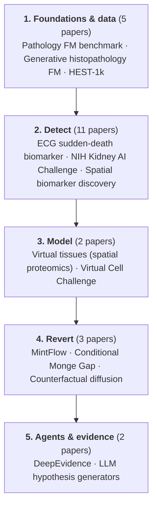

# Sikander's picks

Everything Sikander recommended, Jul–Sep 2026, on the detect → model → revert line.

Sikander 2026 年 7–9 月推荐的全部内容，按 detect → model → revert 排列。

## Pipeline / 流程

Flow canvas: [[_maps/Sikander's picks — flow.canvas|Sikander's picks — flow]]

## Foundations & data / 基础模型与数据
- [[_maps/papers/pathbench-natcommun-2026|Pathology FM benchmark]] ★ — A benchmark study of vision and pathology foundation models for computational pathology
- [[_maps/papers/fm-arxiv-2604|Generative histopathology FM]] — A Generative Foundation Model for Multimodal Histopathology
- [[_maps/papers/hest1k-2024|HEST-1k]] — HEST-1k: A Dataset for Spatial Transcriptomics and Histology Image Analysis
- [[_maps/papers/virchow-2024|Virchow]] — A foundation model for clinical-grade computational pathology and rare cancers detection
- [[_maps/papers/uni2-h-model|UNI2-h]] — MahmoodLab/UNI2-h

## Detect / 检测
- [[_maps/papers/imaging-nature-2026|ECG sudden-death biomarker]] ★ — An ECG biomarker for sudden cardiac death discovered with deep learning
- [[_maps/papers/nih-kidney-ai-challenge-2026|NIH Kidney AI Challenge]] ★ — Kidney Artificial Intelligence Discovery Challenge: From Nebulae to Nephrons
- [[_maps/papers/histo-sciencedirect-2026|Spatial biomarker discovery]] ★ — Spatial biomarker discovery via interpretable semantic learning in histopathology
- [[_maps/papers/histo-nejmai-2024|Clinical-grade histo AD]] ★ — AI-Based Anomaly Detection for Clinical-Grade Histopathological Diagnostics
- [[_maps/papers/imaging-ehjdh-2026|AI ejection fraction]] — An artificial intelligence model to detect abnormal ejection fraction from non-contrast chest computed tomography: the CT–LVEF study
- [[_maps/papers/pathomics-npjpo-2026|Pathomics signature]] — Deep learning-based pathomics signature predicts prognosis and treatment response in gastric cancer: a multicenter retrospective study
- [[_maps/papers/histo-miccai-2025|Latent-diffusion AD]] — Pathology-Informed Latent Diffusion Model for Anomaly Detection in Lymph Node Metastasis
- [[_maps/papers/spatial-natcommun-2024|STANDS]] — Detecting anomalous anatomic regions in spatial transcriptomics with STANDS
- [[_maps/papers/pathomics-blood-2023|Pathomics (Blood 2023)]] — A Deep Learning-Based Pathomics Methodology for Quantifying and Characterizing Nucleated Cells in the Bone Marrow Microenvironment
- [[_maps/papers/pathomics-repo|PathOmics code]] — Cassie07/PathOmics
- [[_maps/papers/histo-anomaly-bi-repo|BI histo-AD code]] — Boehringer-Ingelheim/anomaly-detection-in-histology

## Model / 建模
- [[_maps/papers/virtual-tissue-2501|Virtual tissues (spatial proteomics)]] ★ — AI-powered virtual tissues from spatial proteomics for clinical diagnostics and biomedical discovery
- [[_maps/papers/virtual-cell-challenge|Virtual Cell Challenge]] — Virtual Cell Challenge

## Revert / 逆转
- [[_maps/papers/spatial-biorxiv-2025|MintFlow]] ★ — Mapping and reprogramming human tissue microenvironments with MintFlow
- [[_maps/papers/scrna-natmachintell-2026|Conditional Monge Gap]] — Conditional Monge Gap enables generalizable single-cell perturbation modelling
- [[_maps/papers/counterfactual-diffusion-cancerres-2026|Counterfactual diffusion]] — Counterfactual Diffusion Models Provide Interpretable Explanations of Artificial Intelligence Models in Pathology

## Agents & evidence / agent 与证据
- [[_maps/papers/deepevidence-natmachintell-2026|DeepEvidence]] ★ — Empowering biomedical evidence exploration and synthesis with deep knowledge graph research
- [[_maps/papers/hypogen-llm-colm-2024|LLM hypothesis generators]] ★ — Large Language Models as Biomedical Hypothesis Generators: A Comprehensive Evaluation

## EHR / 电子病历
- [[_maps/papers/ehr-delphi2m-nature-2025|Delphi-2M]] ★ — Learning the natural history of human disease with generative transformers
- [[_maps/papers/ehr-pancreatic-trajectory-natmed-2023|Pancreatic cancer trajectories]] ★ — A deep learning algorithm to predict risk of pancreatic cancer from disease trajectories
- [[_maps/papers/ehr-apollo-arxiv-2026|APOLLO virtual patient]] — A multimodal and temporal foundation model for virtual patient representations at healthcare system scale
- [[_maps/papers/ehr-comet-natmachintell-2025|COMET (EHR + omics)]] — A machine learning approach to leveraging electronic health records for enhanced omics analysis
- [[_maps/papers/ehr-pancreatic-llm-npjdigitmed-2025|LLM-embedding pancreatic risk]] — Enhancing EHR-based pancreatic cancer prediction with LLM-derived embeddings
