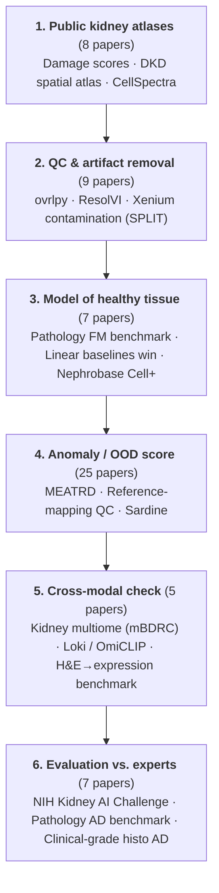

# Topic 1 — Artifact Injection to Boost Anomaly Detection in Kidney Single-Cell Omics

Learn normal kidney from healthy data, then flag what it cannot explain; one modality is evidence on another.

从健康数据学习正常肾脏，再标出它解释不了的细胞和区域；用一个模态作为另一个模态的证据。

## Pipeline / 流程

Flow canvas: [[_maps/Topic 1 — Artifact Injection to Boost Anomaly Detection in Kidney Single-Cell Omics — flow.canvas|Topic 1 — Artifact Injection to Boost Anomaly Detection in Kidney Single-Cell Omics — flow]]

## General AD methods / 通用异常检测方法
- [[_maps/papers/generalized-ood-survey-ijcv-2024|Generalized OOD survey]] ★ — Generalized Out-of-Distribution Detection: A Survey
- [[_maps/papers/conformal-outliers-annstat-2023|Conformal p-values]] ★ — Testing for Outliers with Conformal p-values
- [[_maps/papers/patchcore-cvpr-2022|PatchCore]] ★ — Towards Total Recall in Industrial Anomaly Detection
- [[_maps/papers/ad-unifying-review-procieee-2021|Unifying AD review]] ★ — A Unifying Review of Deep and Shallow Anomaly Detection
- [[_maps/papers/f-anogan-media-2019|f-AnoGAN]] ★ — f-AnoGAN: Fast unsupervised anomaly detection with generative adversarial networks
- [[_maps/papers/deep-svdd-icml-2018|Deep SVDD]] ★ — Deep One-Class Classification
- [[_maps/papers/mahalanobis-ood-neurips-2018|Mahalanobis OOD]] ★ — A Simple Unified Framework for Detecting Out-of-Distribution Samples and Adversarial Attacks
- [[_maps/papers/abnormality-radiology-arxiv-2024|Abnormality radiology (Ligero 2024)]] — Abnormality-Driven Representation Learning for Radiology Imaging
- [[_maps/papers/cflow-ad-wacv-2022|CFLOW-AD]] — CFLOW-AD: Real-Time Unsupervised Anomaly Detection with Localization via Conditional Normalizing Flows
- [[_maps/papers/diffusion-medical-ad-miccai-2022|Diffusion AD (medical)]] — Diffusion Models for Medical Anomaly Detection
- [[_maps/papers/draem-iccv-2021|DRAEM]] — DRÆM – A discriminatively trained reconstruction embedding for surface anomaly detection
- [[_maps/papers/padim-icpr-2020|PaDiM]] — PaDiM: A Patch Distribution Modeling Framework for Anomaly Detection and Localization
- [[_maps/papers/energy-ood-neurips-2020|Energy OOD]] — Energy-based Out-of-distribution Detection
- [[_maps/papers/mvtec-ad-cvpr-2019|MVTec AD]] — MVTec AD — A Comprehensive Real-World Dataset for Unsupervised Anomaly Detection
- [[_maps/papers/anogan-ipmi-2017|AnoGAN]] — Unsupervised Anomaly Detection with Generative Adversarial Networks to Guide Marker Discovery
- [[_maps/papers/msp-ood-iclr-2017|MSP baseline]] — A Baseline for Detecting Misclassified and Out-of-Distribution Examples in Neural Networks

## Atlases & disease states / 图谱与疾病状态
- [[_maps/papers/damage-scores-cellgenomics-2026|Damage scores]] ★ — Cell-type-specific damage scores reveal kidney and liver disease trajectories in single-cell and spatial transcriptomics
- [[_maps/papers/dkd-spatial-atlas-nature-2026|DKD spatial atlas]] ★ — Spatial atlas of diabetic kidney disease reveals a B cell-rich subgroup
- [[_maps/papers/cellspectra-natgenet-2025|CellSpectra]] ★ — Analysis of individual patient pathway coordination in a cross-species single-cell kidney atlas
- [[_maps/papers/spatialagent-biorxiv-2025|SpatialAgent]] ★ — SpatialAgent: An autonomous AI agent for spatial biology
- [[_maps/papers/abedini-kidney-atlas-natgenet-2024|Kidney atlas (Abedini 2024)]] ★ — Single-cell multi-omic and spatial profiling of human kidneys implicates the fibrotic microenvironment in kidney disease progression
- [[_maps/papers/lake-kidney-atlas-nature-2023|Kidney atlas (Lake 2023)]] ★ — An atlas of healthy and injured cell states and niches in the human kidney
- [[_maps/papers/kidney-epigenome-nataging-2026|Kidney epigenome atlas]] — A cross-species single-cell kidney epigenome atlas reveals epithelial-dominant aging-like states in disease
- [[_maps/papers/inflammatory-pt-natcommun-2025|Inflammatory PT cells]] — Multiomic analysis of human kidney disease identifies a tractable inflammatory and pro-fibrotic tubular cell phenotype

## QC & artifacts / 质控与伪影
- [[_maps/papers/ovrlpy-natbiotech-2026|ovrlpy]] ★ — Identifying 3D signal overlaps in spatial transcriptomics data with ovrlpy
- [[_maps/papers/resolvi-natmethods-2026|ResolVI]] ★ — ResolVI: addressing noise and bias in spatial transcriptomics
- [[_maps/papers/xenium-split-natmethods-2026|Xenium contamination (SPLIT)]] ★ — Resolving sensitivity, specificity and signal contamination in Xenium spatial transcriptomics
- [[_maps/papers/hoeft-genotype-multiplexing-natcommun-2024|SNP multiplexing (Hoeft)]] ★ — Label-free single-cell RNA multiplexing leveraging genetic variability
- [[_maps/papers/janssen-ambient-noise-genomebiol-2023|Ambient truth, mouse kidney (Janssen)]] ★ — The effect of background noise and its removal on the analysis of single-cell expression data
- [[_maps/papers/denisenko-dissociation-bias-genomebiol-2020|Dissociation bias, mouse kidney]] ★ — Systematic assessment of tissue dissociation and storage biases in single-cell and single-nucleus RNA-seq workflows
- [[_maps/papers/malone-transplant-chimerism-jasn-2020|Transplant chimerism (Malone)]] ★ — Harnessing Expressed Single Nucleotide Variation and Single Cell RNA Sequencing To Define Immune Cell Chimerism in the Rejecting Kidney Transplant
- [[_maps/papers/lake-snrna-pipeline-natcommun-2019|Kidney snRNA processing (Lake 2019)]] ★ — A single-nucleus RNA-sequencing pipeline to decipher the molecular anatomy and pathophysiology of human kidneys
- [[_maps/papers/ambient-rna-bench-biorxiv-2026|Ambient-RNA benchmark]] — Benchmarking computational decontamination of ambient RNA

## Anomaly / OOD detection / 异常 / OOD 检测
- [[_maps/papers/meatrd-aaai-2025|MEATRD]] ★ — MEATRD: Multimodal Anomalous Tissue Region Detection Enhanced with Spatial Transcriptomics
- [[_maps/papers/refmap-eval-biorxiv-2025|Reference-mapping QC]] ★ — Automated evaluation of single-cell reference atlas mappings enables the identification of disease-associated cell states
- [[_maps/papers/sardine-bioinformatics-2025|Sardine]] ★ — Anomaly detection in spatial transcriptomics via spatially localized density comparison
- [[_maps/papers/healthy-ref-natgenet-2023|Healthy-reference design]] ★ — Precise identification of cell states altered in disease using healthy single-cell references
- [[_maps/papers/scatac-novel-genomeres-2026|Novel types in scATAC]] — Robust annotation and discovery of novel cell types in single-cell ATAC-seq data through cross-modal reference alignment
- [[_maps/papers/bioml-bench-biorxiv-2025|BioML-bench]] — BioML-bench: Evaluation of AI Agents for End-to-End Biomedical ML
- [[_maps/papers/conformal-scrna-bioinformatics-2025|Conformal annotation]] — Conformal inference for reliable single cell RNA-seq annotation
- [[_maps/papers/mrvi-natmethods-2025|MrVI]] — Deep generative modeling of sample-level heterogeneity in single-cell genomics
- [[_maps/papers/spatial-natcommun-2024|STANDS]] — Detecting anomalous anatomic regions in spatial transcriptomics with STANDS

## Cross-modal consistency / 跨模态一致性
- [[_maps/papers/kidney-multimodal-genomebiol-2026|Kidney multiome (mBDRC)]] ★ — Systematic evaluation of single-cell multimodal data integration enhances cell type resolution and discovery of clinically relevant states in complex tissues
- [[_maps/papers/loki-omiclip-natmethods-2025|Loki / OmiCLIP]] ★ — A visual–omics foundation model to bridge histopathology with spatial transcriptomics
- [[_maps/papers/he2expr-bench-natcommun-2025|H&E→expression benchmark]] — Benchmarking the translational potential of spatial gene expression prediction from histology
- [[_maps/papers/multimodal-integration-bench-natmethods-2025|Integration benchmark]] — Benchmarking single-cell multi-modal data integrations
- [[_maps/papers/hest1k-2024|HEST-1k]] — HEST-1k: A Dataset for Spatial Transcriptomics and Histology Image Analysis

## Foundation models & baselines / 基础模型与基线
- [[_maps/papers/pathbench-natcommun-2026|Pathology FM benchmark]] ★ — A benchmark study of vision and pathology foundation models for computational pathology
- [[_maps/papers/linear-baselines-natmethods-2025|Linear baselines win]] ★ — Deep-learning-based gene perturbation effect prediction does not yet outperform simple linear baselines
- [[_maps/papers/nephrobase-biorxiv-2025|Nephrobase Cell+]] ★ — Nephrobase Cell+: Multimodal Single-Cell Foundation Model for Decoding Kidney Biology
- [[_maps/papers/scfm-zeroshot-genomebiol-2025|scFM zero-shot limits]] ★ — Zero-shot evaluation reveals limitations of single-cell foundation models
- [[_maps/papers/nicheformer-natmethods-2025|Nicheformer]] — Nicheformer: a foundation model for single-cell and spatial omics
- [[_maps/papers/uni2-h-model|UNI2-h]] — MahmoodLab/UNI2-h
- [[_maps/papers/virchow-2024|Virchow]] — A foundation model for clinical-grade computational pathology and rare cancers detection

## Evaluation & benchmarks / 评测与基准
- [[_maps/papers/nih-kidney-ai-challenge-2026|NIH Kidney AI Challenge]] ★ — Kidney Artificial Intelligence Discovery Challenge: From Nebulae to Nephrons
- [[_maps/papers/pathology-ad-bench-mlhealth-2025|Pathology AD benchmark]] ★ — Quantitative benchmarking of anomaly detection methods in digital pathology images
- [[_maps/papers/histo-nejmai-2024|Clinical-grade histo AD]] ★ — AI-Based Anomaly Detection for Clinical-Grade Histopathological Diagnostics
- [[_maps/papers/kidney-ssl-histology-scirep-2025|Kidney histology SSL]] — Unbiased self supervised learning of kidney histology reveals phenotypic and prognostic insights
- [[_maps/papers/histo-miccai-2025|Latent-diffusion AD]] — Pathology-Informed Latent Diffusion Model for Anomaly Detection in Lymph Node Metastasis
- [[_maps/papers/medianomaly-media-2025|MedIAnomaly]] — MedIAnomaly: A comparative study of anomaly detection in medical images
- [[_maps/papers/histo-anomaly-bi-repo|BI histo-AD code]] — Boehringer-Ingelheim/anomaly-detection-in-histology
