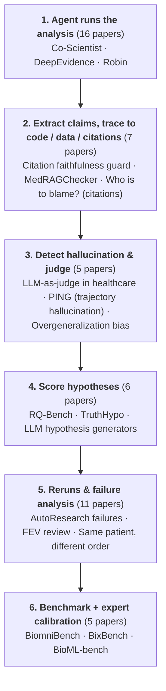

# Trustworthiness of Hypothesis-Testing Agents on Kidney Omics

Give agents CKD hypotheses on raw kidney omics with answers built in advance; measure when their verdicts cannot be trusted.

给 agent 肾脏病假设和原始组学数据，答案事先构造好；测它的结论什么时候不可信。

## Pipeline / 流程

Flow canvas: [[_maps/Trustworthiness of Hypothesis-Testing Agents on Kidney Omics — flow.canvas|Trustworthiness of Hypothesis-Testing Agents on Kidney Omics — flow]]

## Research agents / 科研 agent
- [[_maps/papers/co-scientist-nature-2026|Co-Scientist]] ★ — Accelerating scientific discovery with Co-Scientist
- [[_maps/papers/deepevidence-natmachintell-2026|DeepEvidence]] ★ — Empowering biomedical evidence exploration and synthesis with deep knowledge graph research
- [[_maps/papers/robin-nature-2026|Robin]] ★ — A multi-agent system for automating scientific discovery
- [[_maps/papers/biomni-biorxiv-2025|Biomni]] ★ — Biomni: A General-Purpose Biomedical AI Agent
- [[_maps/papers/kosmos-arxiv-2025|Kosmos]] ★ — Kosmos: An AI Scientist for Autonomous Discovery
- [[_maps/papers/gpnmb-cart-cell-2026|GPNMB CAR T (Cell 2026)]] — AI-driven discovery of GPNMB CAR T cells as a multi-cancer therapy
- [[_maps/papers/virtual-biotech-biorxiv-2026|Virtual Biotech]] — The Virtual Biotech: A Multi-Agent AI Framework for Therapeutic Discovery and Development
- [[_maps/papers/virtual-lab-nature-2025|Virtual Lab]] — The Virtual Lab of AI agents designs new SARS-CoV-2 nanobodies
- [[_maps/papers/paperqa2-arxiv-2024|PaperQA2]] — Language agents achieve superhuman synthesis of scientific knowledge

## Omics-analysis agents / 组学分析 agent
- [[_maps/papers/cellvoyager-natmethods-2026|CellVoyager]] ★ — CellVoyager: AI CompBio agent generates new insights by autonomously analyzing biological data
- [[_maps/papers/scbench-arxiv-2026|scBench]] ★ — scBench: Evaluating AI Agents on Single-Cell RNA-seq Analysis
- [[_maps/papers/scbench-long-arxiv-2026|scBench-Long]] ★ — scBench-Long: Verifiable Benchmarking of Long-Horizon Single-Cell Biology
- [[_maps/papers/spatialagent-biorxiv-2025|SpatialAgent]] ★ — SpatialAgent: An autonomous AI agent for spatial biology
- [[_maps/papers/lake-kidney-atlas-nature-2023|Kidney atlas (Lake 2023)]] ★ — An atlas of healthy and injured cell states and niches in the human kidney
- [[_maps/papers/heurekabench-arxiv-2026|HeurekaBench]] — HeurekaBench: A Benchmarking Framework for AI Co-scientist
- [[_maps/papers/inflammatory-pt-natcommun-2025|Inflammatory PT cells]] — Multiomic analysis of human kidney disease identifies a tractable inflammatory and pro-fibrotic tubular cell phenotype

## Agent benchmarks / agent 基准
- [[_maps/papers/biomnibench-biorxiv-2026|BiomniBench]] ★ — BiomniBench: Process-level Evaluation of LLM Agents for Real-world Biomedical Research
- [[_maps/papers/bixbench-arxiv-2025|BixBench]] ★ — BixBench: a Comprehensive Benchmark for LLM-based Agents in Computational Biology
- [[_maps/papers/bioml-bench-biorxiv-2025|BioML-bench]] — BioML-bench: Evaluation of AI Agents for End-to-End Biomedical ML
- [[_maps/papers/medagentbench-nejmai-2025|MedAgentBench]] — MedAgentBench: A Virtual EHR Environment to Benchmark Medical LLM Agents
- [[_maps/papers/lab-bench-arxiv-2024|LAB-Bench]] — LAB-Bench: Measuring Capabilities of Language Models for Biology Research

## Claim & citation verification / 结论与引用核查
- [[_maps/papers/citation-faithfulness-arxiv-2026|Citation faithfulness guard]] ★ — Evaluating and Guarding Citation Faithfulness in Agentic Scientific Synthesis
- [[_maps/papers/medragchecker-arxiv-2026|MedRAGChecker]] ★ — MedRAGChecker: Claim-Level Verification for Biomedical Retrieval-Augmented Generation
- [[_maps/papers/citation-blame-emnlp-2026|Who is to blame? (citations)]] ★ — Who is the Agent to Blame? Localizing Faithfulness and Citation Mistakes in Agentic Deep Research
- [[_maps/papers/sourcecheckup-natcommun-2025|SourceCheckup]] ★ — An automated framework for assessing how well LLMs cite relevant medical references
- [[_maps/papers/reference-hallucination-arxiv-2026|Reference hallucinations]] — Detecting and Correcting Reference Hallucinations in Commercial LLMs and Deep Research Agents
- [[_maps/papers/conformal-scrna-bioinformatics-2025|Conformal annotation]] — Conformal inference for reliable single cell RNA-seq annotation
- [[_maps/papers/deeptrace-arxiv-2025|DeepTRACE]] — DeepTRACE: Auditing Deep Research AI Systems for Tracking Reliability Across Citations and Evidence

## Hallucination & LLM-as-judge / 幻觉与 LLM 评审
- [[_maps/papers/llm-judge-healthcare-arxiv-2026|LLM-as-judge in healthcare]] ★ — LLM-as-a-Judge in Healthcare: A Scoping Analysis of Applications, Methods, and Human Alignment
- [[_maps/papers/deep-research-hallucination-arxiv-2026|PING (trajectory hallucination)]] ★ — Why Your Deep Research Agent Fails? On Hallucination Evaluation in Full Research Trajectory
- [[_maps/papers/generalization-bias-rsos-2025|Overgeneralization bias]] ★ — Generalization bias in large language model summarization of scientific research
- [[_maps/papers/biomednlp-natcommun-2025|BioNLP LLM benchmark]] — Benchmarking large language models for biomedical natural language processing applications and recommendations
- [[_maps/papers/medical-hallucination-arxiv-2025|Medical hallucinations]] — Medical Hallucinations in Foundation Models and Their Impact on Healthcare

## Hypothesis evaluation / 假设评测
- [[_maps/papers/rq-bench-arxiv-2026|RQ-Bench]] ★ — On the Limits of LLM-as-Judge for Scientific Novelty Assessment
- [[_maps/papers/truthhypo-ijcai-2025|TruthHypo]] ★ — Toward Reliable Scientific Hypothesis Generation: Evaluating Truthfulness and Hallucination in Large Language Models
- [[_maps/papers/hypogen-llm-colm-2024|LLM hypothesis generators]] ★ — Large Language Models as Biomedical Hypothesis Generators: A Comprehensive Evaluation
- [[_maps/papers/falsifiable-ideation-arxiv-2026|Falsifiable ideation]] — What Proves You Wrong: Benchmarking Language Models on Falsifiable Research Ideation
- [[_maps/papers/ideation-execution-gap-arxiv-2025|Ideation–execution gap]] — The Ideation-Execution Gap: Execution Outcomes of LLM-Generated versus Human Research Ideas
- [[_maps/papers/semnovel-jbi-2025|SemNovel]] — SemNovel – A new approach to detecting semantic novelty of biomedical publications using embeddings of large language models

## Reliability & safety / 可靠性与安全
- [[_maps/papers/autoresearch-failures-arxiv-2026|AutoResearch failures]] ★ — How Do Agents Fail on AutoResearch: End-to-End Diagnostic Evaluation on 100 Real-World Frontier Research Tasks
- [[_maps/papers/fev-bioinformatics-agents-arxiv-2026|FEV review]] ★ — Evaluating Agentic Bioinformatics through Function, Evidence, and Validation
- [[_maps/papers/resolvi-natmethods-2026|ResolVI]] ★ — ResolVI: addressing noise and bias in spatial transcriptomics
- [[_maps/papers/clinical-agent-reruns-arxiv-2026|Same patient, different order]] ★ — Same Patient, Different Order: Action-Level Reliability of Clinical LLM Agents Under Repeated Runs
- [[_maps/papers/scirigor-arxiv-2026|SciRIGOR]] ★ — SCIRIGOR:Evaluating Open-Ended Scientific Analysis Beyond Final Scores
- [[_maps/papers/abc-agentic-benchmarks-neurips-2025|ABC checklist]] ★ — Establishing Best Practices for Building Rigorous Agentic Benchmarks
- [[_maps/papers/ailuminate-arxiv-2025|AILuminate]] ★ — AILuminate: Introducing v1.0 of the AI Risk and Reliability Benchmark from MLCommons
- [[_maps/papers/holistic-agent-leaderboard-iclr-2026|Holistic Agent Leaderboard]] — Holistic Agent Leaderboard: The Missing Infrastructure for AI Agent Evaluation
- [[_maps/papers/scitrace-arxiv-2026|SciTrace]] — SciTrace: Trajectory-Aware Safety Reasoning for Scientific Discovery Agents
- [[_maps/papers/mast-neurips-2025|MAST]] — Why Do Multi-Agent LLM Systems Fail?
- [[_maps/papers/trail-arxiv-2025|TRAIL]] — TRAIL: Trace Reasoning and Agentic Issue Localization
