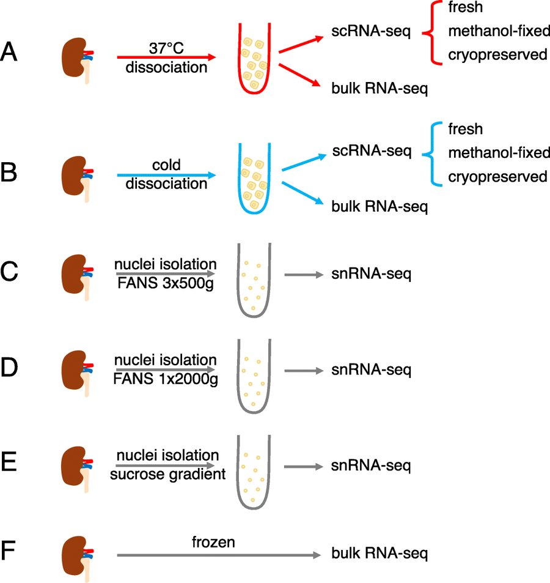

# Denisenko 2020 · Dissociation and storage in mouse kidney

> Mouse kidney dissociated at 37 °C or on ice, used fresh, cryopreserved or methanol-fixed, and profiled with three nucleus protocols: a controlled experiment human kidney data does not have.

**Species** mouse · **Assays** scRNA · snRNA · **Access** open

## At a glance

| | |
|---|---|
| Scale | 77,656 cells + 98,303 nuclei |
| People / samples | 3 mice per arm |
| Labels | dissociation / storage arm per sample |
| Licence | CC BY 4.0 |
| Paper | Denisenko E et al. Genome Biol 2020;21:130. doi:10.1186/s13059-020-02048-6 · [deep-read](../papers/denisenko-dissociation-bias-genomebiol-2020/index.md) |



*Original figure: Denisenko 2020 Fig. 1. A: 37 °C dissociation, B: cold dissociation, each fresh / methanol-fixed / cryopreserved for single-cell, plus bulk; C–E: three nucleus-extraction methods; F: whole-tissue bulk as reference. Genome Biol 2020, CC BY 4.0.*

## What was measured

Single-cell and single-nucleus RNA (10x).

## People and samples

Healthy mice, 3 per arm.

## Labels

A 17-gene stress signature (Fos, Jun, Atf3, Egr1, heat-shock genes …); in 8 of 14 cell types stress rose only with 37 °C dissociation. After 37 °C dissociation podocytes fell to 0.03% (cold: 2.78%); after cryopreservation proximal tubule fell from about 63% to < 1%.

## Known issues

- Mouse genes must be mapped to human orthologues; batch is confounded with strain, sex and reagent version; processing is labelled per sample only.

## Download

| Format | File | Size | Link |
|---|---|---|---|
| `TXT` | GEO GSE141115: 54 per-library gene × cell count tables (after QC) | 250 MB | [↗](https://www.ncbi.nlm.nih.gov/geo/query/acc.cgi?acc=GSE141115) |
| `FASTQ` | SRA SRP233496 (336 runs) | ≈ 400 GB (SRA) | — |

Cell-type labels are in the paper's Additional file 3.

## How to prepare

*Tested on 2026-10-26 in plain Python (anndata, scanpy, h5py, scipy, pandas, rdata); no R needed. Keep the data outside this repository.*

1. Counts are one text file per sample, genes × cells (e.g. BG30: 13,347 genes × 897 cells); cell IDs carry sample and arm (`BG30_BG20C_CRYO_<barcode>`).
2. The arm of each sample (cold / warm dissociation; fresh / cryopreserved / methanol; protocol) is in the series matrix, under `workflow` and `sequencing protocol`.

```python
import pandas as pd
bg30 = pd.read_csv("GSM4195108_BG30.txt.gz", sep="\t", index_col=0)  # genes x cells
```

## Used in our research topics

- **[A Benchmark for Anomaly Detection in Kidney Single-Cell Omics](../research/anomaly-benchmark.md)**: Evidence that dissociation stress can look like injury; the same FOS / JUN genes appear in Lake 2023's degenerative state. Later use, or calibration.
