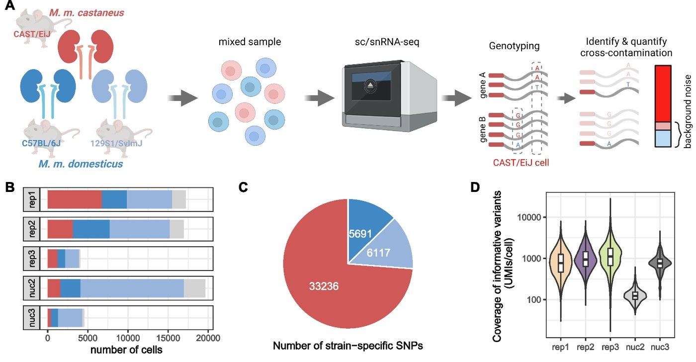

# Janssen 2023 · 小鼠肾真实 ambient

> 3 个品系小鼠的肾混在一个通道，按品系基因型算出每个细胞被污染了多少。

**物种** 小鼠 · **测法** 单细胞 RNA · 单核 RNA · 基因型 · **获取** 公开

## 一眼看完

| | |
|---|---|
| 规模 | 3 次单细胞 + 2 次单核 |
| 人 / 样本 | 3 个品系小鼠（CAST、BL6、SvImJ）混在一个通道 |
| 标签 | 每个细胞的污染比例（含 95% 置信区间） |
| 许可 | CC BY 4.0 |
| 论文 | Janssen P et al. Genome Biol 2023;24:140. doi:10.1186/s13059-023-02978-x · [精读](../papers/janssen-ambient-noise-genomebiol-2023/index.md) |



*原图: Janssen 2023 Fig. 1 A–D（已截取）。A：三个品系小鼠的肾混在一起 → 单细胞 / 单核测序 → 按品系 SNP 分出每条 RNA 来自谁 → 算出每个 CAST 细胞里的外来 RNA（红条 = 背景噪声）；B：每次实验各品系细胞数；C：品系特异 SNP 数；D：每个细胞覆盖的信息位点。Genome Biol 2023，CC BY 4.0。*

## 测了什么

单细胞 RNA 3 次（新鲜）+ 单核 RNA 2 次（RNAlater 冷冻），10x。

## 人和样本

只有健康小鼠。

## 标签

污染中位数：单核 35% / 17%，单细胞 11% / 3%。每个细胞的污染 UMI 数和测序深度只有弱相关。我们的理解：所以注入的量不该随深度按比例放大。

## 已知问题

- 小鼠、只有健康；nuc3 上所有工具都最差，作者没再用。

## 下载

| 格式 | 文件 | 大小 | 链接 |
|---|---|---|---|
| `zip` | Zenodo 7328632：rep1 / rep2 / rep3 / nuc2 / nuc3 五个 zip | 3.4 GB total | [↗](https://doi.org/10.5281/zenodo.7328632) |
| `H5` | 每个 zip 里：raw（含空液滴）+ filtered 10x 矩阵 | 163–226 MB | — |
| `RDS` | 每个 zip 里：每个细胞的污染比例 | 70–310 KB | — |
| `H5` | GEO GSE218853：同样的 raw / filtered h5 | 1.1 GB | [↗](https://www.ncbi.nlm.nih.gov/geo/query/acc.cgi?acc=GSE218853) |

rep3.zip 只有 0.31 GB（和 nuc3.zip 差不多，是最小的之一），可以先下来看格式。

## 怎么准备

*2026-10-26 实测，只用 Python（anndata、scanpy、h5py、scipy、pandas、rdata），不需要 R。数据不要放进这个仓库。*

1. Zenodo 每个 zip（rep3.zip 0.31 GB，是最小的之一）里有 `raw_feature_bc_matrix.h5`、`filtered_feature_bc_matrix.h5`、`perCell_noMito_CAST_binom.RDS`，以及两个 Seurat 对象。
2. rep3：filtered 28,692 基因 × 6,546 细胞（mm10）；raw 有 6,794,880 个条形码，含空液滴（估计 ambient 时用它）。
3. 污染比例表**只有 CAST 品系的细胞**（rep3 有 2,096 个）：`contPerCell_binom`，带 `CI_low` / `CI_high` 和用到的 SNP 数。

```python
import scanpy as sc, rdata
filt = sc.read_10x_h5("rep3/filtered_feature_bc_matrix.h5")
raw  = sc.read_10x_h5("rep3/raw_feature_bc_matrix.h5")
cont = rdata.read_rds("rep3/perCell_noMito_CAST_binom.RDS")      # pandas DataFrame
```

## 在我们的研究课题里

- **[肾脏单细胞组学异常检测基准](../research/anomaly-benchmark.md)**: 定注入的 ambient 有多强、什么样子。不当测试集。
