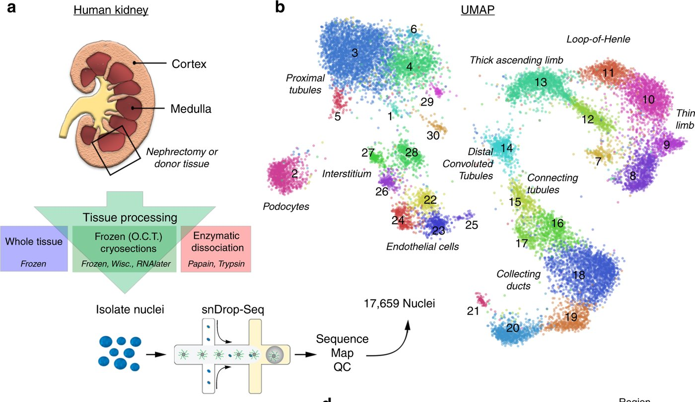

# Lake 2019 · Same patients, different storage and processing

> Kidney tissue from the same people stored and processed in different ways, to see what the processing itself changes.

**Species** human · **Assays** snRNA · **Access** open

## At a glance

| | |
|---|---|
| Scale | 17,659 nuclei (after QC) |
| People / samples | 15 people (nephrectomies and deceased donors) |
| Labels | 30 clusters; processing method per library |
| Licence | CC BY 4.0 (paper) |
| Paper | Lake BB et al. Nat Commun 2019;10:2832. doi:10.1038/s41467-019-10861-2 · [deep-read](../papers/lake-snrna-pipeline-natcommun-2019/index.md) |



*Original figure: Lake 2019 Fig. 1 a–b (cropped). a: nephrectomy or donor tissue → whole-block freezing; cryosections then frozen / Wisconsin / RNAlater; fresh enzymatic dissociation → nuclei → snDrop-seq; b: 30 clusters of 17,659 nuclei (red clusters: marked by the authors as inflammation-, surgery- or stress-related). Nat Commun 2019, CC BY 4.0.*

## What was measured

Single-nucleus RNA with snDrop-seq (not 10x).

## People and samples

15 people, tissue from nephrectomies and deceased donors; no biopsies. Example: patient 3414 medulla — frozen 1,401, Wisconsin 1,533, RNAlater 3,102 nuclei.

## Labels

Cluster annotations; the processing method of every nucleus can be recovered from the GEO sample metadata (checked). The authors found stress genes (FOS, FOSB, DNAJB1) after enzymatic dissociation, one cluster that "likely represented a dissociation artifact", and two clusters with high mitochondrial RNA "consistent with … warm ischemia".

## Known issues

- Mitochondrial genes were removed from the public matrix; processing method is confounded with batch (date); small.

## Download

| Format | File | Size | Link |
|---|---|---|---|
| `TSV` | GEO GSE121862: UMI matrix with cluster labels (17,659 nuclei) | 19 MB | [↗](https://www.ncbi.nlm.nih.gov/geo/query/acc.cgi?acc=GSE121862) |
| `CSV` | annotation of the 30 clusters | 1 KB | [↗](https://www.ncbi.nlm.nih.gov/geo/query/acc.cgi?acc=GSE121862) |
| `FASTQ` | SRA SRP166966 (92 runs) | ≈ 87 GB | — |

Small enough to download right away. Mitochondrial fractions need a re-alignment from FASTQ.

## How to prepare

*Tested on 2026-10-26 in plain Python (anndata, scanpy, h5py, scipy, pandas, rdata); no R needed. Keep the data outside this repository.*

1. One 20 MB file: 31,522 genes × 17,659 nuclei, integer UMIs, mitochondrial genes removed. Reading it with pandas takes about 45 s.
2. Column names carry cluster and library: `C1_NK5_CCCGCTTCCTCC` = cluster 1, library NK5. The annotation CSV maps the 30 clusters to names.
3. The processing method of each library (frozen, Wisconsin, RNAlater, enzymatic) is on the GEO sample pages and still needs to be tabulated.

```python
import pandas as pd
m = pd.read_csv("GSE121862_UCSD-WU_Single_Nuclei_Cluster_Annotated_Raw_UMI_Matrix.tsv.gz",
                sep="\t", index_col=0)                           # genes x nuclei
cluster = m.columns.str.split("_").str[0].str[1:].astype(int)
library = m.columns.str.split("_").str[1]
```

## Used in our research topics

- **[A Benchmark for Anomaly Detection in Kidney Single-Cell Omics](../research/anomaly-benchmark.md)**: Under discussion: a small real answer to "is a storage or processing change flagged as anomalous?"
