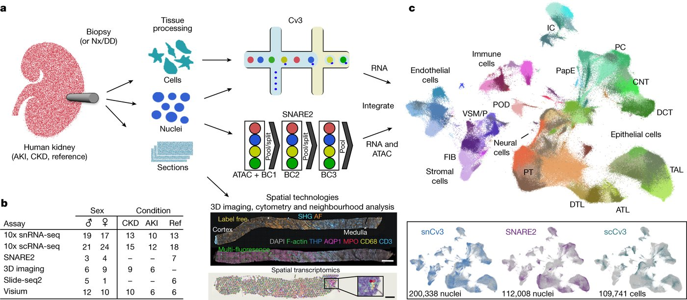

# Lake 2023 · Kidney atlas (KPMP / HuBMAP)

> The standard human kidney atlas, with healthy donors, patients, and a reference / altered label on almost every cell. Our reading (as of 2026-10): we know of no other public kidney dataset with all three.

**Species** human · **Assays** scRNA · snRNA · multiome · spatial · **Access** open

## At a glance

| | |
|---|---|
| Scale | 203,702 nuclei (sn) + 109,741 cells (sc) + 104,809 nuclei (SNARE2) |
| People / samples | 71 people in the three single-cell parts (35 healthy, 19 CKD, 17 AKI) |
| Labels | cell type + reference / altered state for every cell except 3,364 single-nucleus nuclei |
| Licence | CC BY 4.0 (cellxgene); GEO: not stated |
| Paper | Lake BB et al. Nature 2023;619:585–594. doi:10.1038/s41586-023-05769-3 · [deep-read](../papers/lake-kidney-atlas-nature-2023/index.md) |



*Original figure: Lake 2023 Fig. 1. a: kidney tissue (biopsy, nephrectomy or deceased donor) is dissociated into cells, nuclei are extracted, or it is sectioned; 10x Cv3 (single-cell / single-nucleus RNA) and SNARE2 (RNA + ATAC in one nucleus); b: people per assay; c: the integrated atlas. Nature 2023, CC BY 4.0.*

## What was measured

Single-nucleus RNA (snCv3, 203,702 nuclei, 36 people); single-cell RNA (scCv3, 109,741 cells, 45 people, all biopsies); SNARE-seq2 RNA + ATAC in the same nucleus (104,809 nuclei, 7 healthy donors only); spatial (Visium with H&E images, Slide-seq); the Visium sections are a candidate for expert annotation in Topic 1 (under discussion).

## People and samples

The paper reports 45 healthy reference donors and 48 AKI / CKD patients, including people with spatial data only. Healthy tissue comes from partial or total nephrectomies, deceased-donor kidneys not used for transplant, and living-donor biopsies; the paper does not say whether the nephrectomies were for tumours. Patient tissue is mostly KPMP research biopsies, but in the single-nucleus data 3 of the 13 CKD patients are nephrectomies (counted by us). 14 patients have both single-nucleus and single-cell data (counted by us).

## Labels

`subclass.l1/l2/l3` (in the single-nucleus GEO table: 16 classes, 74 `subclass.l2` and 77 `subclass.l3` subclasses, plus NA for 3,364 unlabelled nuclei; the paper's "77 subclasses" are level 3) and `state.l1/l2` (reference, degenerative, adaptive, cycling, transitioning); 28 subclasses are altered. Labels were assigned by experts after clustering, not measured.

## Known issues

- In single-nucleus data, degenerative nuclei have fewer genes (median 791 vs 1,736) and more mitochondrial RNA (3.0% vs 0.6%) than reference nuclei, like low-quality cells; in single-cell data the pattern is reversed (counted by us).
- Healthy donors carry altered cells too: 26% of their nuclei in the single-nucleus data (the authors suggest procurement ischaemia or normal ageing).
- Raw sequencing is controlled (KPMP / dbGaP), so there are no empty droplets for ambient estimation.

## Download

| Format | File | Size | Link |
|---|---|---|---|
| `RDS` | GEO GSE183277 snCv3 count matrix | 868 MB | [↗](https://www.ncbi.nlm.nih.gov/geo/query/acc.cgi?acc=GSE183277) |
| `TXT` | snCv3 per-cell metadata with state.l1 / l2 | 19 MB | [↗](https://www.ncbi.nlm.nih.gov/geo/query/acc.cgi?acc=GSE183277) |
| `RDS` | GEO GSE183276 scCv3 counts + metadata | 1.3 GB | [↗](https://www.ncbi.nlm.nih.gov/geo/query/acc.cgi?acc=GSE183276) |
| `RDS` | GEO GSE183273 SNARE2 RNA counts + ATAC peak counts | 0.5 GB | [↗](https://www.ncbi.nlm.nih.gov/geo/query/acc.cgi?acc=GSE183273) |
| `TSV` | SNARE2 ATAC fragments + index | 15 GB | [↗](https://www.ncbi.nlm.nih.gov/geo/query/acc.cgi?acc=GSE183273) |
| `H5AD` | cellxgene: single-cell, single-nucleus, integrated (RNA only) | 2.19 / 1.57 / 2.96 GB | [↗](https://cellxgene.cziscience.com/collections/bcb61471-2a44-4d00-a0af-ff085512674c) |

Use the GEO RDS + metadata when you need the altered labels. GSE183279_RAW.tar (3.5 GB) is spatial data. Raw FASTQ is at KPMP / dbGaP and needs an application.

## How to prepare

*Tested on 2026-10-26 in plain Python (anndata, scanpy, h5py, scipy, pandas, rdata); no R needed. Keep the data outside this repository.*

1. Download the cellxgene single-nucleus h5ad (1.57 GB): 172,847 nuclei × 28,813 genes. `X` is normalised; the integer counts are in `raw.X`.
2. The cellxgene file has cell types (`subclass.l1/l2`) but **no `state.l1/l2`**. Download the GEO metadata (19 MB) and join on the cell ID: all 172,847 IDs match.
3. The cellxgene file leaves out 30,855 of GEO's 203,702 nuclei, including **all COVID-AKI patients** (19,678 nuclei) and the 3,364 nuclei without a state. If you need them, read GEO's count RDS instead (second code block).
4. GEO's `.RDS` files are R sparse matrices (dgCMatrix). The `rdata` package reads them in Python; no R needed (SNARE2 RNA: 30,574 genes × 104,809 nuclei in about 4 s).

```python
import scanpy as sc, pandas as pd
adata = sc.read_h5ad("lake2023_sn.h5ad")           # cellxgene single-nucleus file
adata.X = adata.raw.X                               # integer counts
meta = pd.read_csv("GSE183277_Kidney_Healthy-Injury_Cell_Atlas_snCv3_Metadata_03282022.txt.gz",
                   sep="\t", index_col=0, low_memory=False,
                   dtype={"patient": str})          # patient IDs mix numbers and text
adata.obs = adata.obs.join(meta[["state.l1", "state.l2", "condition.l2", "patient"]])

# GEO count matrix without R (gunzip the .RDS.gz first)
import rdata, numpy as np, scipy.sparse as sp
m = rdata.read_rds("GSE183277_Kidney_Healthy-Injury_Cell_Atlas_snCv3_Counts_03282022.RDS")
X = sp.csc_matrix((np.asarray(m.x), np.asarray(m.i), np.asarray(m.p)), shape=tuple(m.Dim))
genes, cells = list(m.Dimnames[0]), list(m.Dimnames[1])   # genes x cells
```

## Used in our research topics

- **[Artifact Injection to Boost Anomaly Detection in Kidney Single-Cell Omics](../research/anomaly-benchmark.md)**: Healthy reference; disease ground truth (altered states, tier 3); base for artifact injection.
- **[Verifying the Claims of Biomedical Analysis Agents](../research/agent-claims.md)**: Source of known results (for example aTAL markers) to check agent claims against.
