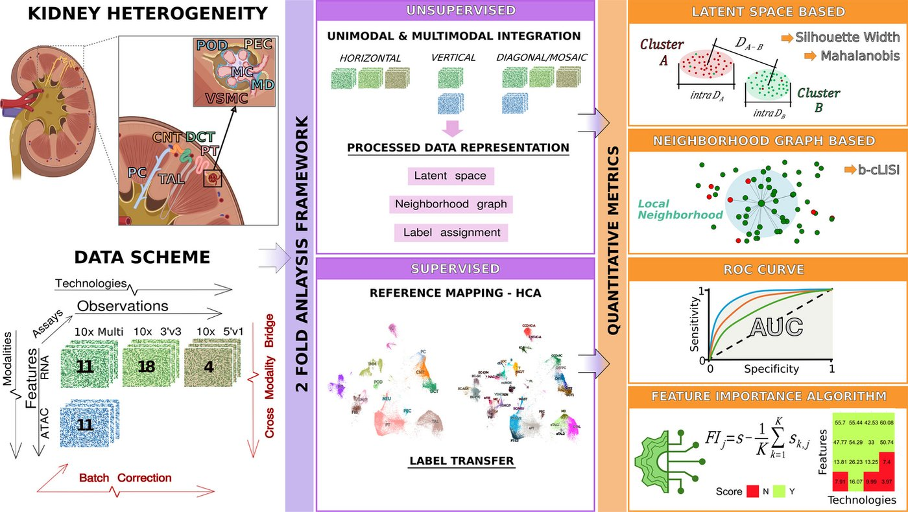

# mBDRC 2026 · 同一个人三种测法

> 19 名供体的健康肾皮质，用最多三种方法测（cellxgene 文件里 18 人中 3 人三种都有、8 人有两种）。换测法造成的差异是实验设计给定的答案，不靠注入。

**物种** 人 · **测法** 单细胞 RNA · 同核 RNA+ATAC · **获取** 公开

## 一眼看完

| | |
|---|---|
| 规模 | 119,744 细胞 / 核 |
| 人 / 样本 | 19 名健康供体，33 份正常皮质 |
| 标签 | 细胞类型；每个细胞的测法和供体 |
| 许可 | CC BY 4.0 (data); paper CC BY-NC-ND 4.0 |
| 论文 | Acera-Mateos M et al. Genome Biol 2026;27:64. doi:10.1186/s13059-026-04002-4 · [精读](../papers/kidney-multimodal-genomebiol-2026/index.md) |



*原图: Acera-Mateos 2026 Fig. 1，未改动。左下“DATA SCHEME”就是数据：10x Multiome 11 份（RNA + ATAC）、10x 3′ v3 18 份、10x 5′ v1 4 份，都是健康皮质；其余部分是论文比较整合方法的框架，我们不用。Genome Biol 2026，CC BY-NC-ND 4.0。*

## 测了什么

3′ 单细胞 RNA、5′ 单细胞 RNA，以及 10x multiome（同一个核里测 snRNA + snATAC）。

## 人和样本

19 名健康供体（论文的说法）；全肾切除时未受累部分的正常组织，切成约 25 个活检大小的组织块，分别用不同介质保存（CryoStor、RNAlater、OCT、液氮）。只有皮质，没有髓质。论文：33 份样本，25 份来自有多份样本的供体，8 份来自只有一份的供体。

## 标签

细胞类型，以及每个细胞的测法和供体。论文的关键数字（3′ 单细胞 vs 单核，5 名供体、14 种细胞）：表达差异里测法解释中位 24%，供体只解释约 3%。

## 已知问题

- 只有健康人，只有皮质。
- 只有 3 人三种测法都有；测法还和组织块、保存介质混在一起。

## 下载

| 格式 | 文件 | 大小 | 链接 |
|---|---|---|---|
| `H5AD` | cellxgene：整合 RNA，97,125 细胞（3′ / 5′ / multiome） | 1.41 GB | — |
| `H5AD` | cellxgene：multiome 37,717 核 | 0.3 GB | — |
| `TSV` | cellxgene：ATAC fragments + 索引 | 4.1 GB | — |
| `tar.gz` | Zenodo：全部处理后数据 + README | 35.2 GB | [↗](https://doi.org/10.5281/zenodo.18157241) |

先下 cellxgene 的三个文件（约 6 GB）就够用。原始测序在 dbGaP phs004459，要申请。

## 怎么准备

*2026-10-26 实测，只用 Python（anndata、scanpy、h5py、scipy、pandas、rdata），不需要 R。数据不要放进这个仓库。*

1. 下载 cellxgene 的全部测法 h5ad（1.41 GB）：97,125 细胞 × 36,030 基因；整数计数在 `raw.X`。
2. `obs` 里已经有基准要用的列：`assay`（10x 3′ v3 / 5′ v1 / multiome）、`donor_id`（18 名供体）、`sample_id`（28 个）、`author_cell_type`（36 种）、`pct_counts_mt`、保存方式。
3. 做“换测法”任务时，按 `donor_id` × `assay` 分组。只有用到 ATAC 时，才需要 multiome 单独的 h5ad（0.3 GB）和它的 ATAC fragments（4.1 GB）。

```python
import scanpy as sc
adata = sc.read_h5ad("mbdrc_all.h5ad")
adata.X = adata.raw.X
adata.obs.groupby(["donor_id", "assay"], observed=True).size()
```

## 在我们的研究课题里

- **[肾脏单细胞组学异常检测基准](../research/anomaly-benchmark.md)**: 任务 T2b：同一个人换了测法就被报成“异常”的，按误报处理（二级答案；这是我们的设定）。也补充健康参考。
