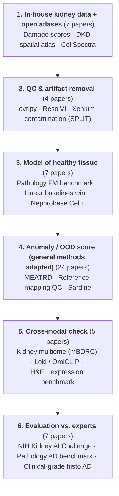
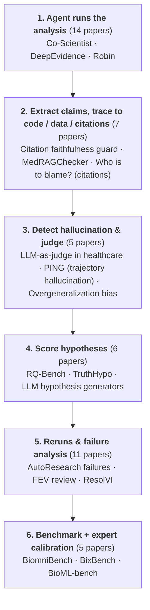
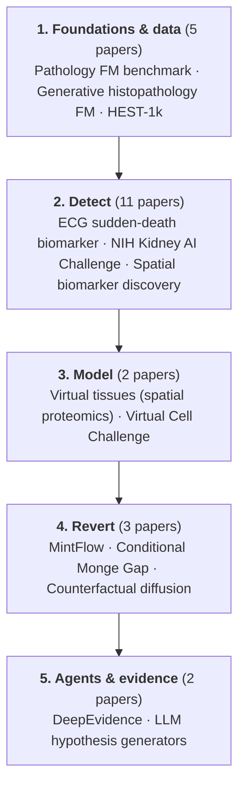

# Knowledge map

Each view is its own graph. Groups start collapsed: click a group to open it, click a node to see its neighbours, double-click a paper to open its deep-read.

## Method map

Rows are anomaly-detection paradigms, columns go from general data to kidney omics. Arrows show where a method was carried over; dashed cells are what Plan A adds. [Open full screen ↗](maps/matrix.html?lang=en){target=_blank}

<iframe src="../maps/matrix.html?lang=en&embed=1" style="width:100%;height:760px;border:1px solid var(--md-default-fg-color--lightest);border-radius:6px" loading="lazy"></iframe>

## Reading-list views

| View | Papers | Concepts |
| --- | --- | --- |
| [Plan A — Kidney omics anomaly detection ↗](maps/viewer.html?view=plan-a&lang=en){target=_blank} — Learn normal kidney from healthy data, then flag what it cannot explain; one modality is evidence on another. | 54 | 20 |
| [Plan B — Trustworthy biomedical agents ↗](maps/viewer.html?view=plan-b&lang=en){target=_blank} — Trace every agent claim back through code and data; calibrate the verifier against experts. | 48 | 18 |
| [Bridge — papers in both plans ↗](maps/viewer.html?view=bridge&lang=en){target=_blank} — Papers that Plan A and Plan B both depend on. | 6 | 17 |
| [Sikander's picks ↗](maps/viewer.html?view=sikander&lang=en){target=_blank} — Everything Sikander recommended, Jul–Sep 2026, on the detect → model → revert line. | 28 | 8 |
| [EHR & patient trajectories ↗](maps/viewer.html?view=ehr&lang=en){target=_blank} — Papers for the Mount Sinai EHR project. | 5 | 0 |
| [Overview — all papers ↗](maps/viewer.html?view=overview&lang=en){target=_blank} — Every paper, clustered by category. For orientation only; use the views above to read. | 114 | 0 |

## Pipelines

Each plan as a pipeline; every step lists its must-read papers. The links below each chart open that step in the map.

### Plan A — Kidney omics anomaly detection

Open in map: [1. In-house kidney data + open atlases](maps/viewer.html?view=plan-a&lang=en&focus=group:A1){target=_blank} · [2. QC & artifact removal](maps/viewer.html?view=plan-a&lang=en&focus=group:A2){target=_blank} · [3. Model of healthy tissue](maps/viewer.html?view=plan-a&lang=en&focus=group:A5){target=_blank} · [4. Anomaly / OOD score (general methods adapted)](maps/viewer.html?view=plan-a&lang=en&focus=group:A3){target=_blank} · [5. Cross-modal check](maps/viewer.html?view=plan-a&lang=en&focus=group:A4){target=_blank} · [6. Evaluation vs. experts](maps/viewer.html?view=plan-a&lang=en&focus=group:A6){target=_blank}

### Plan B — Trustworthy biomedical agents

Open in map: [1. Agent runs the analysis](maps/viewer.html?view=plan-b&lang=en&focus=group:B1){target=_blank} · [2. Extract claims, trace to code / data / citations](maps/viewer.html?view=plan-b&lang=en&focus=group:B4){target=_blank} · [3. Detect hallucination & judge](maps/viewer.html?view=plan-b&lang=en&focus=group:B5){target=_blank} · [4. Score hypotheses](maps/viewer.html?view=plan-b&lang=en&focus=group:B6){target=_blank} · [5. Reruns & failure analysis](maps/viewer.html?view=plan-b&lang=en&focus=group:B7){target=_blank} · [6. Benchmark + expert calibration](maps/viewer.html?view=plan-b&lang=en&focus=group:B3){target=_blank}

### Sikander's picks

Open in map: [1. Foundations & data](maps/viewer.html?view=sikander&lang=en&focus=group:foundations){target=_blank} · [2. Detect](maps/viewer.html?view=sikander&lang=en&focus=group:detect){target=_blank} · [3. Model](maps/viewer.html?view=sikander&lang=en&focus=group:model){target=_blank} · [4. Revert](maps/viewer.html?view=sikander&lang=en&focus=group:revert){target=_blank} · [5. Agents & evidence](maps/viewer.html?view=sikander&lang=en&focus=group:agents){target=_blank}

## Plan A — Kidney omics anomaly detection

<iframe src="../maps/viewer.html?view=plan-a&lang=en&embed=1" style="width:100%;height:640px;border:1px solid var(--md-default-fg-color--lightest);border-radius:6px" loading="lazy"></iframe>

