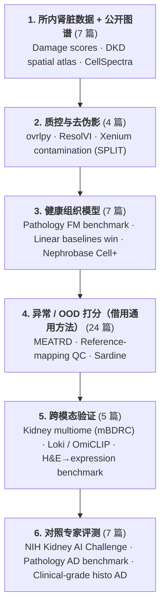
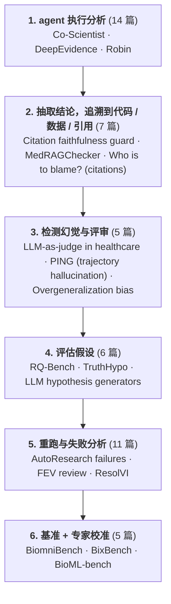
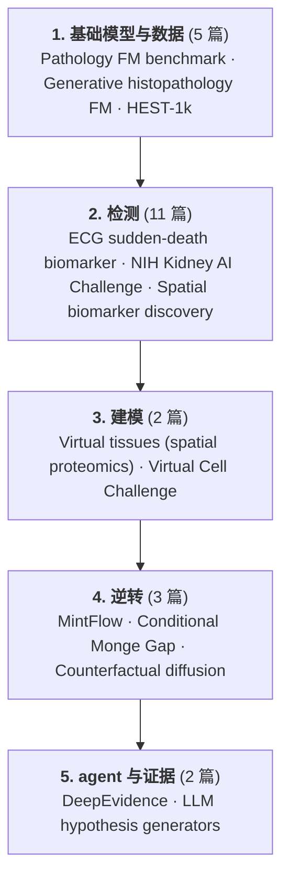

# 知识图谱

每个视图是一张独立的图。组默认折叠：点击组展开，点击节点只看它的邻居，双击论文打开精读。

## 方法图

行是异常检测的方法范式，列从通用数据一直到肾脏组学。箭头表示方法被迁移到哪里；虚线格是 Plan A 要补的空白。 [全屏打开 ↗](maps/matrix.html?lang=zh){target=_blank}

<iframe src="../../maps/matrix.html?lang=zh&embed=1" style="width:100%;height:760px;border:1px solid var(--md-default-fg-color--lightest);border-radius:6px" loading="lazy"></iframe>

## 按阅读清单的视图

| 视图 | 论文 | 概念 |
| --- | --- | --- |
| [Plan A:肾脏组学异常检测 ↗](maps/viewer.html?view=plan-a&lang=zh){target=_blank} — 从健康数据学习正常肾脏，再标出它解释不了的细胞和区域；用一个模态作为另一个模态的证据。 | 54 | 20 |
| [Plan B:可信的生物医学 agent ↗](maps/viewer.html?view=plan-b&lang=zh){target=_blank} — 把 agent 的每条结论追溯到代码和数据；用专家标注校准核查器。 | 48 | 18 |
| [桥：两个 plan 共用的论文 ↗](maps/viewer.html?view=bridge&lang=zh){target=_blank} — Plan A 和 Plan B 都要用到的论文。 | 6 | 17 |
| [Sikander 推荐 ↗](maps/viewer.html?view=sikander&lang=zh){target=_blank} — Sikander 2026 年 7–9 月推荐的全部内容，按 detect → model → revert 排列。 | 28 | 8 |
| [电子病历与患者轨迹 ↗](maps/viewer.html?view=ehr&lang=zh){target=_blank} — Mount Sinai 电子病历项目的论文。 | 5 | 0 |
| [总览：全部论文 ↗](maps/viewer.html?view=overview&lang=zh){target=_blank} — 全部论文按分类聚在一起，只用来看轮廓；细读请用上面的视图。 | 114 | 0 |

## 流程图

每个 plan 画成一条流程，每一步列出它的必读论文。图下面的链接会在图谱里打开对应的那一步。

### Plan A:肾脏组学异常检测

在图谱中打开：[1. 所内肾脏数据 + 公开图谱](maps/viewer.html?view=plan-a&lang=zh&focus=group:A1){target=_blank} · [2. 质控与去伪影](maps/viewer.html?view=plan-a&lang=zh&focus=group:A2){target=_blank} · [3. 健康组织模型](maps/viewer.html?view=plan-a&lang=zh&focus=group:A5){target=_blank} · [4. 异常 / OOD 打分（借用通用方法）](maps/viewer.html?view=plan-a&lang=zh&focus=group:A3){target=_blank} · [5. 跨模态验证](maps/viewer.html?view=plan-a&lang=zh&focus=group:A4){target=_blank} · [6. 对照专家评测](maps/viewer.html?view=plan-a&lang=zh&focus=group:A6){target=_blank}

### Plan B:可信的生物医学 agent

在图谱中打开：[1. agent 执行分析](maps/viewer.html?view=plan-b&lang=zh&focus=group:B1){target=_blank} · [2. 抽取结论，追溯到代码 / 数据 / 引用](maps/viewer.html?view=plan-b&lang=zh&focus=group:B4){target=_blank} · [3. 检测幻觉与评审](maps/viewer.html?view=plan-b&lang=zh&focus=group:B5){target=_blank} · [4. 评估假设](maps/viewer.html?view=plan-b&lang=zh&focus=group:B6){target=_blank} · [5. 重跑与失败分析](maps/viewer.html?view=plan-b&lang=zh&focus=group:B7){target=_blank} · [6. 基准 + 专家校准](maps/viewer.html?view=plan-b&lang=zh&focus=group:B3){target=_blank}

### Sikander 推荐

在图谱中打开：[1. 基础模型与数据](maps/viewer.html?view=sikander&lang=zh&focus=group:foundations){target=_blank} · [2. 检测](maps/viewer.html?view=sikander&lang=zh&focus=group:detect){target=_blank} · [3. 建模](maps/viewer.html?view=sikander&lang=zh&focus=group:model){target=_blank} · [4. 逆转](maps/viewer.html?view=sikander&lang=zh&focus=group:revert){target=_blank} · [5. agent 与证据](maps/viewer.html?view=sikander&lang=zh&focus=group:agents){target=_blank}

## Plan A:肾脏组学异常检测

<iframe src="../../maps/viewer.html?view=plan-a&lang=zh&embed=1" style="width:100%;height:640px;border:1px solid var(--md-default-fg-color--lightest);border-radius:6px" loading="lazy"></iframe>

