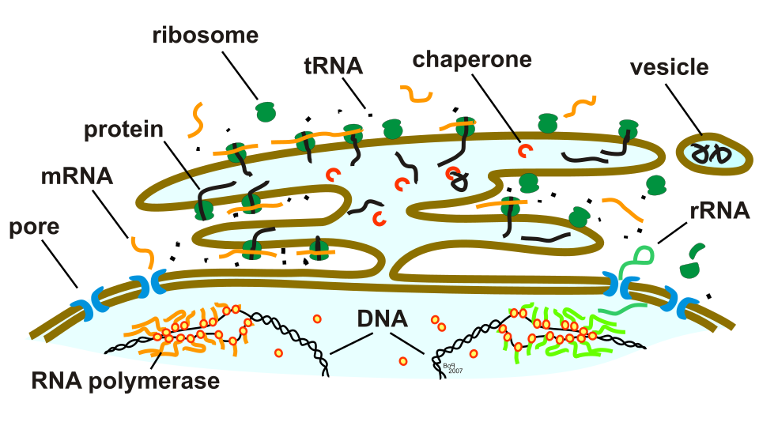

# 2 · 细胞和 RNA

> ⏱ 约 30 分钟 · 第 1 天 · 读懂

!!! abstract "读完能回答"
    - 细胞核、胞质、RNA 分别在哪里？
    - 为什么数 RNA 就能知道细胞在干什么？
    - 细胞类型和细胞状态有什么区别？它们在 obs 里是哪两列？

这一模块只讲后面用得到的最少生物知识。

## 第 1 步 · 一个细胞长什么样

- **细胞膜**（cell membrane）：外面一层膜，把细胞和外界隔开。
- **细胞核**（nucleus）像机房，存着 **DNA**，也就是全部源代码。同一个人身上每个细胞的 DNA 几乎完全一样。
- **胞质**（cytoplasm）像车间，是真正干活的地方。
- **线粒体**（mitochondrion）在胞质里，是细胞的"电源"。它有自己的一小段 DNA，编码 2 种 rRNA、22 种 tRNA 和 13 种蛋白 [3]；这些基因名以 `MT-` 开头，比如模块 1 里的 `MT-CO1`（"mitochondrially encoded cytochrome c oxidase I"）[4]。

图：Wikimedia「[Simple diagram of animal cell (en).svg](https://commons.wikimedia.org/wiki/File:Simple_diagram_of_animal_cell_(en).svg)」，domdomegg，CC BY 4.0。

## 第 2 步 · RNA 是什么、在哪里

细胞要用某个基因时，先在核里把这段 DNA **抄写成 RNA**（这一步叫转录，transcription），相当于打印一张"工单"。工单刚打印出来时还在核里，之后被送到胞质，车间照着它生产蛋白质 [1]。

所以一个细胞里的 RNA 分两部分：**核里是刚打印、大多还没剪接完的，胞质里是已经送出去的。**核里那部分有多大因细胞而异：一项小鼠神经元的研究估计占全部 mRNA 的 20% 到 50% 以上 [2]。模块 5.1 会用到这一点：只测细胞核，就只拿到前一部分。

线粒体基因是例外：它们在线粒体里面转录，不在核里 [3]。所以一个干净的细胞核里几乎没有 `MT-` 开头的 RNA（模块 6）。

图的下半部分是细胞核：黑色的双螺旋是 **DNA**，橙色的线是刚抄出来的 **mRNA**（工单）。中间那层带蓝色小孔的是核膜，**核孔**（pore）就是工单出门的通道。上半部分是胞质：绿色的**核糖体**（ribosome）照着 mRNA 生产蛋白质（黑色的链）；棕色的折叠膜是和核膜相连的内质网。其余标注（tRNA、chaperone、vesicle 等）这里用不到。

图：Wikimedia「[ProteinTranscription+Synthesis.svg](https://commons.wikimedia.org/wiki/File:ProteinTranscription%2BSynthesis.svg)」，Adjustit，CC BY-SA 4.0。

## 第 3 步 · 为什么数 RNA 就知道细胞在干什么

细胞经常用的基因，工单就多。所以数一个细胞里每种 RNA 各有几条，就知道它在干什么。这就是模块 1 里 X 的一行。

不同细胞会大量使用各自的"招牌"基因，叫**标记基因**（marker gene）。肾脏里几个常用的：

| 标记基因 | 细胞类型 | 为什么 |
|---|---|---|
| `NPHS1`, `NPHS2` | 足细胞 | nephrin 和 podocin，过滤屏障的组成部分 [5] |
| `LRP2` | 近端小管 | megalin，从滤液里回收蛋白 [6] |
| `UMOD` | 髓袢升支粗段 | uromodulin，主要在这里产生 [7] |
| `AQP2` | 集合管主细胞 | 水通道 [8] |

!!! tip "计算机类比"
    同一个程序（DNA）装在每台机器上，但每台机器运行的进程不同。数 RNA 就像对每台机器跑一次 `ps`，看各个进程有多少个实例。标记基因就是某类机器专有的那个进程名。

## 第 4 步 · 细胞类型和细胞状态

- **细胞类型**（cell type）是**长期身份**：这个细胞是干哪份工作的，比如近端小管细胞。它通常不变，但受伤的细胞可能暂时关掉自己的特征基因：Lake 2023 的修复态细胞就明显下调了维持正常功能的转运蛋白 [9]。在 obs 里是 `subclass.l1`（16 个大类）和更细的 `subclass.l2`（74 个亚类）[10]。
- **细胞状态**（cell state）是**当前状况**：同一类细胞，健康时、受伤时、修复时、分裂时，表达谱都不一样。在 obs 里是 `state.l1`（reference / altered）和 `state.l2`（具体哪种改变）[9][10]。

Lake 2023 单核数据里 `state.l2` 的分布（我们从 GEO 标签表数的）[10]，含义按 Lake 2023 的定义 [9]：

| state.l2 | 意思 | 核数 |
|---|---|---|
| reference | 正常的参考态 | 128,090 |
| degenerative | 受损或应激 | 42,316 |
| adaptive – epi | 上皮在修复 | 25,150 |
| adaptive – str | fibrosis states (myofibroblasts, adaptive fibroblasts) / 间质的伤口愈合、纤维化状态（肌成纤维细胞、适应性成纤维细胞） | 3,513 |
| cycling | 正在分裂（细胞周期基因打开） | 839 |
| transitioning | 介于两种细胞类型之间（这里是主细胞和闰细胞） | 430 |
| NA | 没有标 | 3,364 |

`subclass.l2` 的名字把两者拼在了一起：**dPT** = degenerative（退化的）PT，**aTAL1 / aTAL2** = adaptive（修复中的）TAL。74 个亚类里有 28 个是 altered [10]，对应 Lake 2023 定义的 28 种改变态 [9]。

!!! tip "计算机类比"
    细胞类型像服务器的**角色**（数据库、网关、缓存），细胞状态像它此刻的**运行状态**（正常、过载、重启中、扩容中）。异常检测要找的是"状态不对"，而不是"这台是数据库"。

## 第 5 步 · 这些标签是怎么来的

没有人在显微镜下逐个给 20 万个细胞贴标签。实际流程是：

1. 用表达谱把细胞**聚类**；
2. 看每个簇里哪些**标记基因**高，人工判断它是哪种细胞、处于什么状态；
3. 把这个判断赋给簇里的所有细胞 [9][10]。

所以 `subclass` 和 `state` 是**专家对聚类结果的解读**，不是直接测出来的。而且判断 altered 的依据里本身就有质量指标：Lake 2023 先把"测到的基因少、线粒体转录本多、内质网相关转录本多、损伤标记基因升高、或者主要来自 AKI / CKD 样本"的簇标为可能的改变态 [9]。大部分时候这些标签很可靠，但边界上的细胞、以及"看起来受损但其实是测量问题"的细胞，可能被标错。我们的工作恰恰关心这些边界（模块 6 和 8）。

## 自测

??? question "1. 只测细胞核，会丢掉哪部分 RNA？"
    丢掉已经送到胞质里的那部分，只剩核里刚转录出来、大多还没剪接的那部分（占多少因细胞而异）。线粒体 RNA 本来就不在核里，也基本测不到。

??? question "2. 一个细胞的 `subclass.l1` 是 PT、`state.l2` 是 degenerative，它的 `subclass.l2` 最可能是什么？"
    dPT（degenerative PT，退化的近端小管细胞）。

??? question "3. 为什么说 `state` 标签不是真值？"
    它是专家看聚类和标记基因后判读出来的，不是实验直接测的；判断依据里还包括基因少、线粒体多这类质量指标。边界上的细胞和测量问题造成的"假受损"细胞可能被标错。

## 参考文献

1. OpenStax. *Biology 2e*, section 15.3 "Eukaryotic Transcription" (CC BY 4.0). [link](https://openstax.org/books/biology-2e/pages/15-3-eukaryotic-transcription) — "RNA polymerase II is located in the nucleus and synthesizes all protein-coding nuclear pre-mRNAs"; "the eukaryotic cell must be able to transport its mRNA to the cytoplasm".
2. Bakken TE, Hodge RD, Miller JA, et al. Single-nucleus and single-cell transcriptomes compared in matched cortical cell types. *PLoS One* 2018;13:e0209648. [doi:10.1371/journal.pone.0209648](https://doi.org/10.1371/journal.pone.0209648) — mouse neurons; abstract ("nuclear proportion of total cellular mRNA varies from 20% to over 50%"); Results (more than 50% intronic reads in nuclei).
3. D'Souza AR, Minczuk M. Mitochondrial transcription and translation: overview. *Essays Biochem* 2018;62:309–320. [doi:10.1042/EBC20170102](https://doi.org/10.1042/EBC20170102) — Introduction ("encodes 2 rRNAs, 22 tRNAs and mRNAs for 13 polypeptides"); "Transcription initiation" ("Transcription in human mitochondria is driven by… POLRMT").
4. HGNC. MT-CO1 (HGNC:7419). [link](https://www.genenames.org/data/gene-symbol-report/#!/hgnc_id/HGNC:7419) — name "mitochondrially encoded cytochrome c oxidase I", location "mitochondria".
5. NCBI Gene 4868 (NPHS1) and 7827 (NPHS2). [NPHS1](https://www.ncbi.nlm.nih.gov/gene/4868), [NPHS2](https://www.ncbi.nlm.nih.gov/gene/7827) — RefSeq summaries (nephrin "found at the slit diaphragm of glomerular podocytes… functions in the glomerular filtration barrier"; podocin "regulation of glomerular permeability").
6. De S, Kuwahara S, Saito A. The endocytic receptor megalin and its associated proteins in proximal tubule epithelial cells. *Membranes* 2014;4:333–355. [doi:10.3390/membranes4030333](https://doi.org/10.3390/membranes4030333) — abstract.
7. Mount DB. Thick ascending limb of the loop of Henle. *Clin J Am Soc Nephrol* 2014;9:1974–1986. [doi:10.2215/CJN.04480413](https://doi.org/10.2215/CJN.04480413) — section "Uromodulin". A second review puts 10–15% of uromodulin in the early distal convoluted tubule: Karagiannidis AG, et al. *Nephrol Dial Transplant* 2024;39:1073–1087, [doi:10.1093/ndt/gfae008](https://doi.org/10.1093/ndt/gfae008), Introduction.
8. Pearce D, Soundararajan R, Trimpert C, et al. Collecting duct principal cell transport processes and their regulation. *Clin J Am Soc Nephrol* 2015;10:135–146. [doi:10.2215/CJN.05760513](https://doi.org/10.2215/CJN.05760513) — Introduction ("the aquaporin 2 (AQP2) water channel").
9. Lake BB, Menon R, Winfree S, et al. An atlas of healthy and injured cell states and niches in the human kidney. *Nature* 2023;619:585–594. [doi:10.1038/s41586-023-05769-3](https://doi.org/10.1038/s41586-023-05769-3) — abstract (28 altered states); Results ("cycling, transitioning, adaptive… and degenerative (damaged or stressed)"; aStr = "myofibroblasts (MyoF), cycling MyoF… and… adaptive fibroblasts"; aEpi "downregulation of transporters"); Methods "Clustering snCv3" (altered-state criteria). Deep-read: [Lake 2023](../papers/lake-kidney-atlas-nature-2023/index.md).
10. GEO GSE183277: `GSE183277_Kidney_Healthy-Injury_Cell_Atlas_snCv3_Metadata_03282022.txt.gz` and the field-description file ([GEO files](https://ftp.ncbi.nlm.nih.gov/geo/series/GSE183nnn/GSE183277/suppl/)) — `subclass.l1` (16 values + 3,364 NA), `subclass.l2` (74 + NA), `state.l2` counts; labels described as "for clusters". Counted by us.

## 本模块名词

| 中文 | English | 一句话 |
|---|---|---|
| [细胞核](glossary.md#cell-nucleus) | Nucleus (cell nucleus) | 细胞里装 DNA 的部分；核基因的 RNA 在这里被转录出来，之后再运到胞质（线粒体基因在线粒体里转录）。 |
| [转录（基因表达）](glossary.md#transcription) | Transcription (gene expression) | 把一个基因的 DNA 抄写成 RNA；数一个细胞里某个基因有几条 RNA，就是在量这个基因的活跃程度（表达量）。 |
| [基因表达签名](glossary.md#gene-expression-signature) | Gene-expression signature | 一组特定基因,其协同表达水平可标志某种细胞状态、疾病或治疗响应。 |
| [细胞类型](glossary.md#cell-type) | Cell type | 工作相同、表达谱特征一致的一类细胞（例如近端小管细胞）；通过聚类加看标记基因来确定。 |
| [细胞状态](glossary.md#cell-state) | Cell state | 细胞在其稳定的细胞类型身份之上所处的、可变的功能状态,如激活、耗竭或增殖。 |
