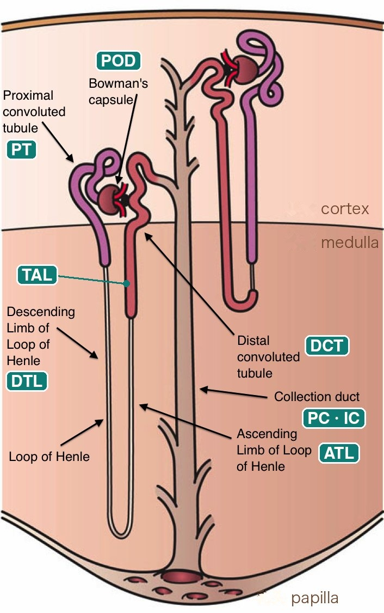
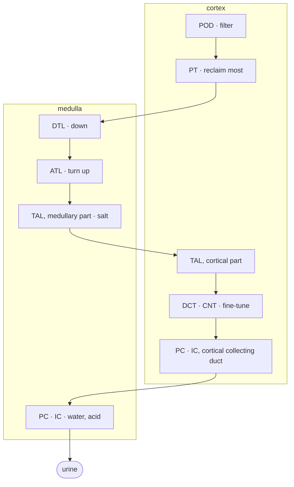

# 3 · The kidney

> ⏱ About 45 min · Day 1 · Understand · 📖 Background: get the gist, no need to memorise details

!!! abstract "After this module you can answer"
    - What is a nephron, and how does fluid flow through it?
    - Which segment is PT, TAL, POD, PC?
    - Why are most altered cells PT or TAL?

Think of the kidney as a **filter-and-reclaim pipeline**: blood is filtered, the filtered fluid flows past a series of stations that take back what is useful, and what is left becomes urine. We zoom in three times: the whole kidney → one nephron → the cells at each station.

## Zoom 1 · The whole kidney, cut open

1. **Renal cortex**: the outer layer. Filters (glomeruli), the proximal and distal tubules, and the first part of the collecting ducts sit here [1].
2. **Medulla**: the inner layer, the red "pyramids". The loops and collecting ducts reach into it [1].
3. **Renal artery**: blood comes in.
4. **Renal vein**: filtered blood leaves.
5. **Ureter**: urine flows to the bladder. The tip of each pyramid is a **papilla**, where urine leaves.
6. **Nephrons**: thin tubes spanning cortex and medulla. The number differs up to 10-fold between people [2]; one study of Japanese living kidney donors estimated about 650,000 per kidney on average [3].

Figure: left half of Wikimedia "[KidneyAndNephron-v4 Antares42.svg](https://commons.wikimedia.org/wiki/File:KidneyAndNephron-v4_Antares42.svg)" (by Madhero88, Piotr Michał Jaworski, Daniel Sachse), CC BY-SA 3.0; cropped by us and shared under the same licence.

## Zoom 2 · One nephron

Zoom in on one nephron. The teal labels were added by us and match the abbreviations in Lake's `subclass.l1`. In the order fluid flows:

- **POD, podocyte**: wrapped around the ball of capillaries inside Bowman's capsule. Fluid is filtered out of the blood here; the filtration barrier has three layers: capillary endothelium, basement membrane and podocytes [4].
- **PT, proximal tubule**: the purple proximal convoluted tubule. Takes back about 60–70% of the water and salt, and nearly all of the sugar and other nutrients [5].
- **DTL, descending thin limb**: runs deep into the medulla.
- **ATL, ascending thin limb**: the thin part that turns back up.
- **TAL, thick ascending limb**: the thicker red part higher up, running from the medulla into the cortex. Takes back about 30% of the salt while staying water-tight, which builds the medulla's concentration gradient [6].
- **DCT, distal convoluted tubule**: back in the cortex next to the glomerulus, right after the macula densa; takes back 5–10% of the sodium and also handles potassium, calcium and magnesium [7]; then joins the **CNT, connecting tubule**.
- **PC · IC, collecting duct**: many nephrons drain into one, running from the cortex down to the papilla. Principal cells (PC) set water with the AQP2 water channel [8], intercalated cells (IC) set acid–base [9].

Figure: Wikimedia "[Kidney Nephron.png](https://commons.wikimedia.org/wiki/File:Kidney_Nephron.png)" by Holly Fischer, CC BY 3.0; teal labels and region names added by us.

## Zoom 3 · As a pipeline

Support cells surround the tubes: **EC** endothelial cells, **FIB** fibroblasts, **VSM/P** vascular smooth muscle and pericytes, **IMM** immune cells. They are not on the fluid's path, but they are all in `subclass.l1`.

!!! tip "Computer analogy"
    A nephron is a **pipeline**: each station is a service that processes the "data" (filtered fluid) and hands it on. Each cell type is the pool of instances of one service. When a service is overloaded or down (a cell type is injured), its instances leave characteristic logs (expression changes); that is an altered state.

## In the data

The 16 classes of `subclass.l1` are these stations and support cells. Nuclei per class in Lake 2023's single-nucleus data (counted by us from the GEO label table) [10]:

| subclass.l1 | Name | Nuclei |
|---|---|---|
| PT | proximal tubule | 51,672 |
| TAL | thick ascending limb | 43,539 |
| EC | endothelial cell | 17,495 |
| FIB | fibroblast | 16,181 |
| PC | principal cell | 15,988 |
| IMM | immune cell | 11,273 |
| IC | intercalated cell | 9,912 |
| DCT | distal convoluted tubule | 8,160 |
| DTL | descending thin limb | 7,968 |
| CNT | connecting tubule | 6,964 |
| VSM/P | vascular smooth muscle, pericyte | 3,848 |
| ATL | ascending thin limb | 2,957 |
| POD | podocyte | 2,555 |
| PEC | parietal epithelial cell | 1,425 |
| PapE | papillary epithelium | 329 |
| NEU | neural cell | 72 |
| NA | not assigned | 3,364 |

The region is in `region.l1`: cortex 125,521 nuclei, medulla 57,790, papilla 20,391 [10]. Different regions hold different stations, so where a piece of tissue comes from changes its cell mix: PT makes up about 35% of cortex nuclei, while TAL makes up about 40% of medulla nuclei [10].

## Why PT and TAL get into trouble first

PT and TAL do most of the reclaiming [5][6] and are highly metabolically active. In most animal models the proximal tubule is the cell most sensitive to ischaemic or hypoxic damage; the TAL is also highly metabolically active and is badly affected in some models [11]. The data agree: the four largest altered subclasses in Lake's single-nucleus data all belong to these two [10]:

| subclass.l2 | Meaning | Nuclei |
|---|---|---|
| aPT | adaptive (repairing) PT | 15,712 |
| dPT | degenerative PT | 14,431 |
| dM-TAL | degenerative medullary TAL | 10,781 |
| aTAL1 | adaptive TAL | 6,989 |

This is also why the artifacts in module 6 matter so much: ischaemia during tissue collection affects these same two cell types. In single-nucleus kidney data (from nephrectomies and deceased-donor kidneys), Lake 2019 found more mitochondrial transcripts in a TAL subpopulation (TAL-1) and in S3 proximal tubule, which the authors read as "consistent with the nephrectomy procedure-related warm ischemia" [13]. Dissociation stress in the lab is a different story: in a mouse-kidney comparison of cold and warm digestion, the populations depleted after 37 °C digestion included podocytes, mesangial and endothelial cells, and these depleted populations also showed high stress-gene expression [12].

## Self-check

??? question "1. Put in flow order: TAL, POD, PC, PT, DTL."
    POD → PT → DTL → (ATL →) TAL → (DCT → CNT →) PC.

??? question "2. A biopsy that sampled only cortex is most likely missing which cell types?"
    The medullary and papillary segments: the thin limbs (DTL, ATL), the medullary part of TAL, the medullary and papillary collecting duct (e.g. IMCD), and papillary epithelium (PapE). The collecting duct is not missing altogether: the cortex has collecting ducts too (Lake's cortex samples hold 4,400 PC and 7,257 IC nuclei [10]).

??? question "3. Why are most altered cells PT or TAL?"
    They do the most reclaiming and are highly metabolically active: in most animal models the PT is the cell most sensitive to ischaemia, and the TAL is badly affected in some models [11]; they are also the two most numerous types, and more than half of each type's nuclei are altered (PT 66%, TAL 53%) [10].

## References

1. Lake BB, Menon R, Winfree S, et al. An atlas of healthy and injured cell states and niches in the human kidney. *Nature* 2023;619:585–594. [doi:10.1038/s41586-023-05769-3](https://doi.org/10.1038/s41586-023-05769-3) — Methods, "Tissue cytometry and in situ cell classification" ("Cortical distal nephron cells (distal tubules (CD), connecting tubules (CNT) and collecting ducts (C-CD)…"); Results ("the transition from… M-TAL in the medulla to the cortical thick ascending limb (C-TAL) in the cortex"). Deep-read: [Lake 2023](../papers/lake-kidney-atlas-nature-2023/index.md).
2. Luyckx V, Shukha K, Brenner BM. Inborn nephron diversity and its clinical consequences. *Rambam Maimonides Med J* 2011;2:e0061. [doi:10.5041/RMMJ.10061](https://doi.org/10.5041/RMMJ.10061) — Introduction ("variability of up to 10-fold within select populations").
3. Sasaki T, Tsuboi N, Okabayashi Y, et al. Estimation of nephron number in living humans by combining unenhanced computed tomography with biopsy-based stereology. *Sci Rep* 2019;9:14400. [doi:10.1038/s41598-019-50529-x](https://doi.org/10.1038/s41598-019-50529-x) — Table 5 (mean 636–655 × 10³ nephrons per kidney, 44 Japanese living donors).
4. Scott RP, Quaggin SE. The cell biology of renal filtration. *J Cell Biol* 2015;209:199–210. [doi:10.1083/jcb.201410017](https://doi.org/10.1083/jcb.201410017) — "The GECs, the podocytes, and the GBM in between constitute the three distinctive layers of the glomerular filtration barrier".
5. Curthoys NP, Moe OW. Proximal tubule function and response to acidosis. *Clin J Am Soc Nephrol* 2014;9:1627–1638. [doi:10.2215/CJN.10391012](https://doi.org/10.2215/CJN.10391012) — Summary ("reabsorbing approximately 60%–70% of the water and NaCl… and nearly all of the nutrients").
6. Mount DB. Thick ascending limb of the loop of Henle. *Clin J Am Soc Nephrol* 2014;9:1974–1986. [doi:10.2215/CJN.04480413](https://doi.org/10.2215/CJN.04480413) — "Apical Transport of Na+, K+, and Cl−" ("reabsorbs approximately 30% of filtered Na+-Cl−"; "water-impermeable TAL… drives the countercurrent multiplication").
7. Subramanya AR, Ellison DH. Distal convoluted tubule. *Clin J Am Soc Nephrol* 2014;9:2147–2163. [doi:10.2215/CJN.05920613](https://doi.org/10.2215/CJN.05920613) — abstract ("immediately downstream of the macula densa"); Introduction; "reabsorbs roughly 5%–10% of the filtered sodium load".
8. Pearce D, Soundararajan R, Trimpert C, et al. Collecting duct principal cell transport processes and their regulation. *Clin J Am Soc Nephrol* 2015;10:135–146. [doi:10.2215/CJN.05760513](https://doi.org/10.2215/CJN.05760513) — Introduction (ENaC, ROMK and AQP2 in principal cells; AQP2 regulated by vasopressin).
9. Roy A, Al-bataineh MM, Pastor-Soler NM. Collecting duct intercalated cell function and regulation. *Clin J Am Soc Nephrol* 2015;10:305–324. [doi:10.2215/CJN.08880914](https://doi.org/10.2215/CJN.08880914) — abstract ("important roles in the regulation of acid-base homeostasis").
10. GEO GSE183277: `GSE183277_Kidney_Healthy-Injury_Cell_Atlas_snCv3_Metadata_03282022.txt.gz` ([GEO files](https://ftp.ncbi.nlm.nih.gov/geo/series/GSE183nnn/GSE183277/suppl/)) — counted by us by `subclass.l1`, `subclass.l2`, `region.l1` and `state.l1`.
11. Basile DP, Anderson MD, Sutton TA. Pathophysiology of acute kidney injury. *Compr Physiol* 2012, pp. 1303–1353. [doi:10.1002/cphy.c110041](https://doi.org/10.1002/cphy.c110041) — III.1.1 "Energetics and sensitivity to injury" ("the proximal tubule is considered the most sensitive cellular entity to ischemic, hypoxic or nephrotoxic damage… the thick ascending limb of Henle is also highly metabolically active").
12. Denisenko E, Guo BB, Jones M, et al. Systematic assessment of tissue dissociation and storage biases in single-cell and single-nucleus RNA-seq workflows. *Genome Biol* 2020;21:130. [doi:10.1186/s13059-020-02048-6](https://doi.org/10.1186/s13059-020-02048-6) — mouse kidney; Results ("less abundant in warm-dissociated samples… including podocytes, mesangial cells, and endothelial cells… also showed significantly high expression of the stress-response-related gene set"). Deep-read: [Denisenko 2020](../papers/denisenko-dissociation-bias-genomebiol-2020/index.md).
13. Lake BB, Chen S, Hoshi M, et al. A single-nucleus RNA-sequencing pipeline to decipher the molecular anatomy and pathophysiology of human kidneys. *Nat Commun* 2019;10:2832. [doi:10.1038/s41467-019-10861-2](https://doi.org/10.1038/s41467-019-10861-2) — Results (MT enrichment in TAL-1 and S3 PT "consistent with the nephrectomy procedure-related warm ischemia"). Deep-read: [Lake 2019](../papers/lake-snrna-pipeline-natcommun-2019/index.md).

## Terms in this module

| Term | In one sentence |
|---|---|
| [Nephron](glossary.md#nephron) | The functional unit of the kidney: a filter (glomerulus) followed by a tubule that reclaims useful substances and leaves urine. The number per kidney differs up to 10-fold between people (one study of Japanese living donors: about 650,000 on average). |
| [Renal cortex / medulla / papilla](glossary.md#renal-cortex-medulla) | The kidney's outer layer (cortex, with glomeruli, proximal and distal tubules and the first part of the collecting ducts), inner layer (medulla, with the loops and collecting ducts) and the tips of the medulla (papillae) where urine leaves. |
| [Glomerulus](glossary.md#glomerulus) | The ball of capillaries at the start of each nephron, inside Bowman's capsule, where blood is filtered. |
| [Podocyte (POD)](glossary.md#podocyte) | Cells wrapped around the glomerular capillaries that form the final filtration barrier; when they are injured, protein leaks into the urine. |
| [Proximal tubule (PT)](glossary.md#proximal-tubule) | The first tubule segment after the glomerulus; reclaims about 60–70% of the water and salt and nearly all of the glucose; highly metabolically active and, in most animal models, the cell type most sensitive to ischaemia. The most abundant cell type in kidney atlases. |
| [Loop of Henle (DTL / ATL)](glossary.md#loop-of-henle) | The U-shaped tubule segment that dips into the medulla: descending thin limb (DTL), ascending thin limb (ATL), then the thick ascending limb. |
| [Thick ascending limb (TAL)](glossary.md#thick-ascending-limb) | The thick part of the loop of Henle that reclaims salt and builds the concentration gradient; like the proximal tubule it is often injured, and its adaptive state (aTAL) was defined in Lake 2023. |
| [Distal convoluted / connecting tubule (DCT / CNT)](glossary.md#distal-tubule) | Segments back in the cortex after the loop that fine-tune salt and calcium and connect the nephron to a collecting duct. |
| [Collecting duct (PC / IC)](glossary.md#collecting-duct) | The duct that collects fluid from many nephrons and carries it to the papilla; principal cells (PC) set the final water balance, intercalated cells (IC) the acid–base balance. |
| [Interstitial fibrosis](glossary.md#interstitial-fibrosis) | Scar-tissue accumulation between the functional units of an organ, scored routinely on kidney biopsies (read on several stains such as H&E, PAS and trichrome) as a coarse prognostic marker and the canonical target of 'detect the diseased region' tasks. |
