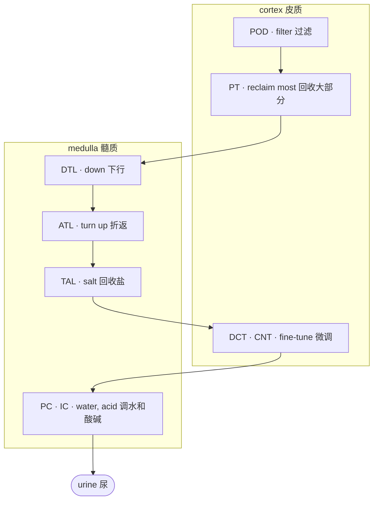

# 3 · The kidney

> ⏱ About 45 min · Day 1 · Understand · 📖 Background: get the gist, no need to memorise details

!!! abstract "After this module you can answer"
    - What is a nephron, and how does fluid flow through it?
    - Which segment is PT, TAL, POD, PC?
    - Why are most altered cells PT or TAL?

Think of the kidney as a **filter-and-reclaim pipeline**: blood is filtered, the filtered fluid flows past a series of stations that take back what is useful, and what is left becomes urine. We zoom in three times: the whole kidney → one nephron → the cells at each station.

## Zoom 1 · The whole kidney, cut open

1. **Renal cortex**: the outer layer. Filters (glomeruli) and the proximal and distal tubules sit here.
2. **Medulla**: the inner layer, the red "pyramids". The loops and collecting ducts reach into it.
3. **Renal artery**: blood comes in.
4. **Renal vein**: filtered blood leaves.
5. **Ureter**: urine flows to the bladder. The tip of each pyramid is a **papilla**, where urine leaves.
6. **Nephrons**: thin tubes spanning cortex and medulla, about a million per kidney.

Figure: left half of Wikimedia "KidneyAndNephron-v4" (by Madhero88, Piotr Michał Jaworski, Daniel Sachse), CC BY-SA 3.0; cropped by us and shared under the same licence.

## Zoom 2 · One nephron

Zoom in on one nephron. The teal labels were added by us and match the abbreviations in Lake's `subclass.l1`. In the order fluid flows:

- **POD, podocyte**: on the ball of capillaries inside Bowman's capsule. The filter: fluid is squeezed out of the blood here.
- **PT, proximal tubule**: the purple proximal convoluted tubule. Takes back most water, sugar and salt.
- **DTL, descending thin limb**: runs deep into the medulla.
- **ATL, ascending thin limb**: the thin part that turns back up.
- **TAL, thick ascending limb**: the thicker red part higher up; takes back salt and builds the concentration gradient.
- **DCT, distal convoluted tubule**: back in the cortex next to the glomerulus; fine-tunes salt and calcium, then joins the **CNT, connecting tubule**.
- **PC · IC, collecting duct**: many nephrons drain into one. Principal cells (PC) set water, intercalated cells (IC) set acid–base.

Figure: Wikimedia "Kidney Nephron" by Holly Fischer, CC BY 3.0; teal labels and Chinese region names added by us.

## Zoom 3 · As a pipeline

Support cells surround the tubes: **EC** endothelial cells, **FIB** fibroblasts, **VSM/P** vascular smooth muscle and pericytes, **IMM** immune cells. They are not on the fluid's path, but they are all in `subclass.l1`.

!!! tip "Computer analogy"
    A nephron is a **pipeline**: each station is a service that processes the "data" (filtered fluid) and hands it on. Each cell type is the pool of instances of one service. When a service is overloaded or down (a cell type is injured), its instances leave characteristic logs (expression changes); that is an altered state.

## In the data

The 17 classes of `subclass.l1` are these stations and support cells. Nuclei per class in Lake 2023's single-nucleus data (counted by us from the GEO label table):

| subclass.l1 | Name | Nuclei |
|---|---|---|
| PT | proximal tubule | 51,672 |
| TAL | thick ascending limb | 43,539 |
| EC | endothelial cell | 17,495 |
| FIB | fibroblast | 16,181 |
| PC | principal cell | 15,988 |
| IMM | immune cell | 11,273 |
| IC | intercalated cell | 9,912 |
| DCT | distal convoluted tubule | 8,160 |
| DTL | descending thin limb | 7,968 |
| CNT | connecting tubule | 6,964 |
| VSM/P | vascular smooth muscle, pericyte | 3,848 |
| ATL | ascending thin limb | 2,957 |
| POD | podocyte | 2,555 |
| PEC | parietal epithelial cell | 1,425 |
| PapE | papillary epithelium | 329 |
| NEU | neural cell | 72 |
| NA | not assigned | 3,364 |

The region is in `region.l1`: cortex 125,521 nuclei, medulla 57,790, papilla 20,391. Different regions hold different stations, so where a piece of tissue comes from changes its cell mix.

## Why PT and TAL get into trouble first

PT and TAL do most of the reclaiming and need a lot of energy and oxygen. When blood flow drops (ischaemia), they fail first. The data agree: the largest altered subclasses in Lake's single-nucleus data all belong to these two:

| subclass.l2 | Meaning | Nuclei |
|---|---|---|
| aPT | adaptive (repairing) PT | 15,712 |
| dPT | degenerative PT | 14,431 |
| dM-TAL | degenerative medullary TAL | 10,781 |
| aTAL1 | adaptive TAL | 6,989 |

This is also why the artifacts in module 6 matter so much: ischaemia and procurement stress hit the same two cell types first.

## Self-check

??? question "1. Put in flow order: TAL, POD, PC, PT, DTL."
    POD → PT → DTL → (ATL →) TAL → (DCT → CNT →) PC.

??? question "2. A biopsy that sampled only cortex is most likely missing which cell types?"
    The medullary and papillary segments: the thin limbs (DTL, ATL), the medullary part of TAL and the collecting duct, and papillary epithelium (PapE).

??? question "3. Why are most altered cells PT or TAL?"
    They do the most reclaiming and use the most energy and oxygen, so they are injured first by ischaemia; they are also the two most numerous types.

## Terms in this module

| English | 中文 | In one sentence |
|---|---|---|
| [Nephron](glossary.md#nephron) | 肾单位 | The functional unit of the kidney, about a million per kidney: a filter (glomerulus) followed by a tubule that reclaims useful substances and leaves urine. |
| [Renal cortex / medulla / papilla](glossary.md#renal-cortex-medulla) | 皮质 / 髓质 / 乳头 | The kidney's outer layer (cortex, with glomeruli and proximal and distal tubules), inner layer (medulla, with the loops and collecting ducts) and the tips of the medulla (papillae) where urine leaves. |
| [Glomerulus](glossary.md#glomerulus) | 肾小球 | The ball of capillaries at the start of each nephron, inside Bowman's capsule, where blood is filtered. |
| [Podocyte (POD)](glossary.md#podocyte) | 足细胞 | Cells wrapped around the glomerular capillaries that form the final filtration barrier; when they are injured, protein leaks into the urine. |
| [Proximal tubule (PT)](glossary.md#proximal-tubule) | 近端小管 | The first tubule segment after the glomerulus; reclaims most water, glucose and salt, uses the most energy, and is the first to be injured by ischaemia. The most abundant cell type in kidney atlases. |
| [Loop of Henle (DTL / ATL)](glossary.md#loop-of-henle) | 髓袢（降支细段 / 升支细段） | The U-shaped tubule segment that dips into the medulla: descending thin limb (DTL), ascending thin limb (ATL), then the thick ascending limb. |
| [Thick ascending limb (TAL)](glossary.md#thick-ascending-limb) | 髓袢升支粗段 | The thick part of the loop of Henle that reclaims salt and builds the concentration gradient; like the proximal tubule it is often injured, and its adaptive state (aTAL) was defined in Lake 2023. |
| [Distal convoluted / connecting tubule (DCT / CNT)](glossary.md#distal-tubule) | 远曲小管 / 连接小管 | Segments back in the cortex after the loop that fine-tune salt and calcium and connect the nephron to a collecting duct. |
| [Collecting duct (PC / IC)](glossary.md#collecting-duct) | 集合管（主细胞 / 闰细胞） | The duct that collects fluid from many nephrons and carries it to the papilla; principal cells (PC) set the final water balance, intercalated cells (IC) the acid–base balance. |
| [Interstitial fibrosis](glossary.md#interstitial-fibrosis) | 间质纤维化 | Scar-tissue accumulation between the functional units of an organ, scored routinely on H&E as a coarse prognostic marker and the canonical target of 'detect the diseased region' tasks. |
