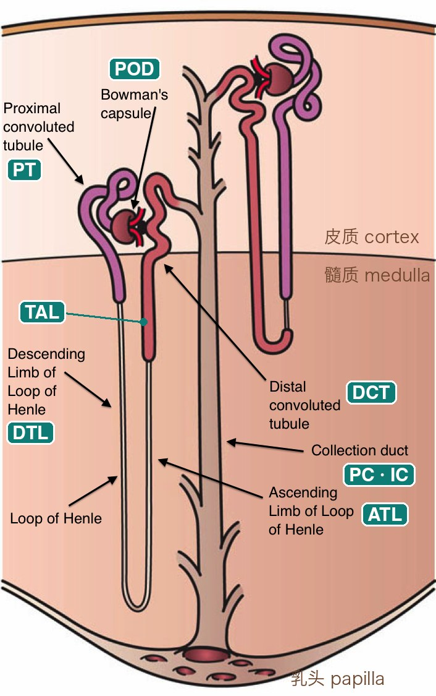
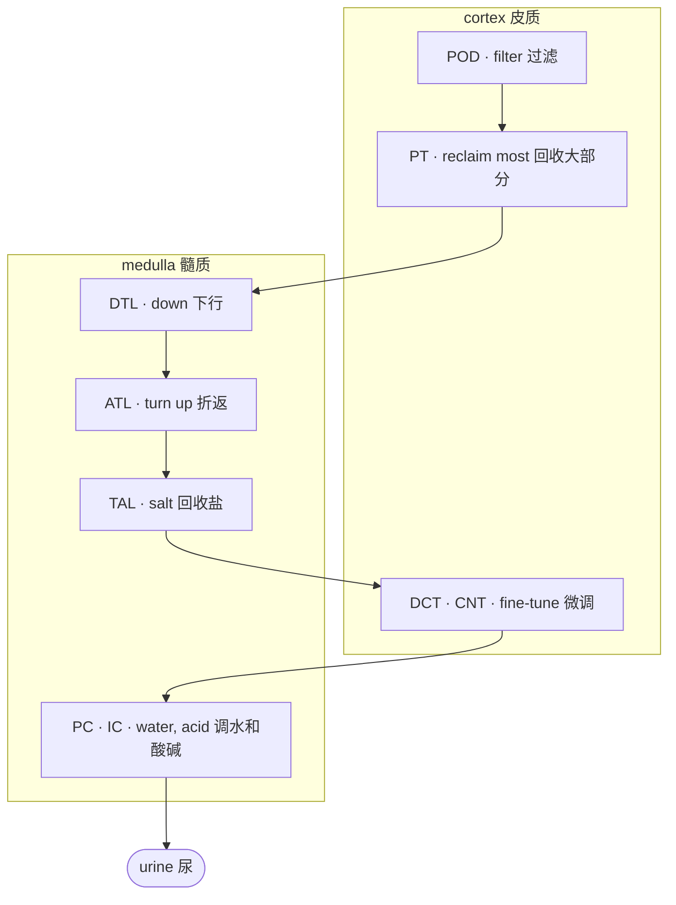

# 3 · 肾脏

> ⏱ 约 45 分钟 · 第 1 天 · 读懂 · 📖 背景知识，大致了解即可，不用记细节

!!! abstract "读完能回答"
    - 肾单位是什么，液体在里面怎么流？
    - PT、TAL、POD、PC 这些简称分别是哪一段？
    - 为什么 altered 细胞大多出在 PT 和 TAL？

肾脏可以看成一条**过滤加回收的流水线**：血液先被过滤，滤出来的液体流过一串"工位"，有用的东西被收回去，剩下的变成尿。我们分三层放大来看：整个肾 → 一个肾单位 → 每个工位上的细胞。

## 第 1 层 · 整个肾剖开

1. **皮质**（renal cortex）：外层。过滤器（肾小球）和近端、远端小管在这里。
2. **髓质**（medulla）：内层，一块块红色的"锥体"。髓袢和集合管伸到这里。
3. **肾动脉**（renal artery）：血从这里进来。
4. **肾静脉**（renal vein）：过滤后的血从这里出去。
5. **输尿管**（ureter）：尿从这里流到膀胱。锥体的尖端叫**乳头**（papilla），尿从乳头流出。
6. **肾单位**（nephrons）：横跨皮质和髓质的细管，一个肾约 100 万条。

图：Wikimedia「KidneyAndNephron-v4」左半部分（作者 Madhero88、Piotr Michał Jaworski、Daniel Sachse），CC BY-SA 3.0，我们做了截取，截取后的图按同样许可共享。

## 第 2 层 · 一个肾单位

放大一条肾单位。青色标签是我们加的，和 Lake 数据 `subclass.l1` 里的简称一一对应。按液体流动的顺序：

- **POD 足细胞**（podocyte）：在图里 Bowman's capsule 里那团血管球上。过滤器，血在这里被滤出液体。
- **PT 近端小管**（proximal tubule）：图里紫色的 Proximal convoluted tubule。回收大部分水、糖、盐。
- **DTL 降支细段**（descending thin limb）：往髓质深处走。
- **ATL 升支细段**（ascending thin limb）：折返向上的细的那段。
- **TAL 升支粗段**（thick ascending limb）：升支上面变粗的红色段，回收盐、建立浓度梯度。
- **DCT 远曲小管**（distal convoluted tubule）：回到皮质、贴着肾小球，微调盐和钙；后面接 **CNT 连接小管**（connecting tubule）。
- **PC · IC 集合管**（collecting duct）：多条肾单位汇进同一根。主细胞（PC）调水，闰细胞（IC）调酸碱。

图：Wikimedia「Kidney Nephron」，Holly Fischer，CC BY 3.0；青色标签和中文部位名是我们加的。

## 第 3 层 · 简化成流水线

管道周围还有支撑细胞：**EC** 血管内皮、**FIB** 成纤维细胞、**VSM/P** 血管平滑肌和周细胞、**IMM** 免疫细胞。它们不在液体流经的路线上，但都在 `subclass.l1` 里。

!!! tip "计算机类比"
    一条肾单位就是一条**流水线**：每个工位是一个服务，处理完把"数据"（滤液）交给下一个。每种细胞类型是一个服务的实例群。一个服务过载或宕机（某类细胞受损），会在它的实例上留下特征性的日志（表达谱变化），这就是 altered state。

## 在数据里

`subclass.l1` 的 17 个大类就是上面这些工位和支撑细胞。Lake 2023 单核数据里每类的核数（我们从 GEO 标签表数的）：

| subclass.l1 | 名称 | 核数 |
|---|---|---|
| PT | 近端小管 | 51,672 |
| TAL | 髓袢升支粗段 | 43,539 |
| EC | 内皮 | 17,495 |
| FIB | 成纤维细胞 | 16,181 |
| PC | 集合管主细胞 | 15,988 |
| IMM | 免疫细胞 | 11,273 |
| IC | 闰细胞 | 9,912 |
| DCT | 远曲小管 | 8,160 |
| DTL | 降支细段 | 7,968 |
| CNT | 连接小管 | 6,964 |
| VSM/P | 血管平滑肌、周细胞 | 3,848 |
| ATL | 升支细段 | 2,957 |
| POD | 足细胞 | 2,555 |
| PEC | 壁层上皮 | 1,425 |
| PapE | 乳头上皮 | 329 |
| NEU | 神经细胞 | 72 |
| NA | 没有标 | 3,364 |

部位记在 `region.l1`：皮质 125,521 个核，髓质 57,790，乳头 20,391。不同部位的工位不同，所以一块组织取在哪里，细胞组成就不同。

## 为什么 PT 和 TAL 最容易出问题

PT 和 TAL 承担了最多的回收工作，需要大量能量和氧气。血流一减少（缺血），它们最先撑不住。数据也是这样：Lake 单核数据里最大的几个 altered 亚类都属于这两类：

| subclass.l2 | 意思 | 核数 |
|---|---|---|
| aPT | 修复中的近端小管 | 15,712 |
| dPT | 退化的近端小管 | 14,431 |
| dM-TAL | 退化的髓质升支粗段 | 10,781 |
| aTAL1 | 修复中的升支粗段 | 6,989 |

这也是为什么模块 6 里讲的伪影特别值得担心：缺血和取样应激最先打到的，也是这两类细胞。

## 自测

??? question "1. 按液体流动顺序排列：TAL、POD、PC、PT、DTL。"
    POD → PT → DTL →（ATL →）TAL →（DCT → CNT →）PC。

??? question "2. 一份只取了皮质的活检，最可能缺哪些细胞类型？"
    髓质和乳头里的段：降支和升支细段（DTL、ATL）、髓质部分的 TAL 和集合管，以及乳头上皮（PapE）。

??? question "3. 为什么 altered 细胞大多是 PT 和 TAL？"
    这两类做最多的回收工作，耗能耗氧最多，缺血时最先受伤；它们也是数量最多的两类。

## 本模块名词

| 中文 | English | 一句话 |
|---|---|---|
| [肾单位](glossary.md#nephron) | Nephron | 肾脏的功能单位，一个肾约 100 万个：先是一个过滤器（肾小球），后面接一条小管，把有用的东西收回，剩下的成为尿。 |
| [皮质 / 髓质 / 乳头](glossary.md#renal-cortex-medulla) | Renal cortex / medulla / papilla | 肾的外层（皮质，有肾小球、近端和远端小管）、内层（髓质，有髓袢和集合管），以及髓质的尖端（乳头，尿从这里流出）。 |
| [肾小球](glossary.md#glomerulus) | Glomerulus | 每个肾单位起点的一团毛细血管，包在肾小球囊（Bowman's capsule）里，血液在这里被过滤。 |
| [足细胞](glossary.md#podocyte) | Podocyte (POD) | 包在肾小球毛细血管外面的细胞，构成过滤的最后一道屏障；受损时蛋白会漏进尿里。 |
| [近端小管](glossary.md#proximal-tubule) | Proximal tubule (PT) | 肾小球后面的第一段小管；回收大部分水、葡萄糖和盐，最耗能，缺血时最先受伤。是肾脏图谱里数量最多的细胞类型。 |
| [髓袢（降支细段 / 升支细段）](glossary.md#loop-of-henle) | Loop of Henle (DTL / ATL) | 伸进髓质的 U 形小管段：降支细段（DTL）、升支细段（ATL），再接升支粗段。 |
| [髓袢升支粗段](glossary.md#thick-ascending-limb) | Thick ascending limb (TAL) | 髓袢变粗的那一段，回收盐、建立浓度梯度；和近端小管一样容易受伤，它的修复态 aTAL 是 Lake 2023 定义的。 |
| [远曲小管 / 连接小管](glossary.md#distal-tubule) | Distal convoluted / connecting tubule (DCT / CNT) | 髓袢之后回到皮质的小管段，微调盐和钙，并把肾单位接到集合管上。 |
| [集合管（主细胞 / 闰细胞）](glossary.md#collecting-duct) | Collecting duct (PC / IC) | 汇集多条肾单位液体、通往乳头的管道；主细胞（PC）决定最后的水平衡，闰细胞（IC）调酸碱。 |
| [间质纤维化](glossary.md#interstitial-fibrosis) | Interstitial fibrosis | 器官功能单位之间瘢痕组织的堆积,常规在 H&E 上评分作为粗略的预后标志,也是「检出病变区域」类任务的经典目标。 |
