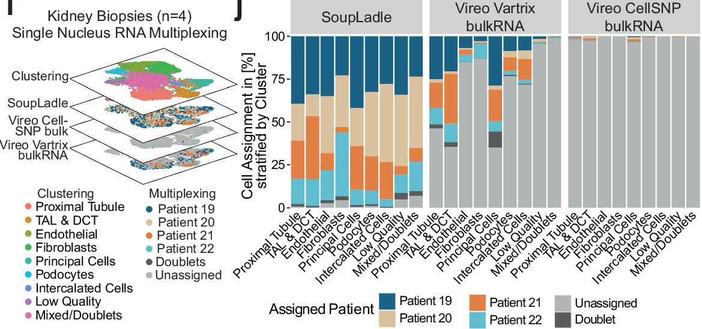

# 6 · Artifacts, and biology that looks like one

> ⏱ About 1 h · Day 1 · Understand

!!! abstract "After this module you can answer"
    - How do doublets, ambient RNA, low-quality cells and dissociation stress arise?
    - What do they look like in the data, and why can they pass for disease?
    - Which real biological states can pass for artifacts?

This module answers one question: **when a row of X looks abnormal, is it disease, or something else?**

"Something else" comes in three kinds, covered one by one below:

- **Measurement artifacts**: the cell was fine, but the measurement left a row that does not represent it.
- **Handling-induced changes**: the cell really changed, but lab handling caused it, not disease.
- **Batch effects**: not a problem of one row, but a whole batch of data shifted together.

The difficulty is that they often look just like real disease in the data. So we go in three steps:

1. **Where non-disease changes come from**: what the data-making process assumes, and which assumption each change breaks;
2. **Check by what you see**: for each pattern, the non-disease reading and the biology reading side by side, and what tells them apart;
3. **What this means for QC**: what the usual filtering steps remove.

## Step 1 · Where non-disease changes come from

The data is made like this (module 5 has the details): tissue is digested into single cells (or nuclei are extracted), an instrument wraps them one by one into tiny oil droplets, each droplet gets a **barcode**, and in the end **one barcode = one row of X**.

This assumes several things: **each droplet holds exactly one cell, the cell is intact, the RNA read comes only from that cell, handling does not change the cell, and every batch is measured the same way**. The table lists, by kind, which assumption each change breaks:

| Kind | Change | Assumption broken | What happened |
|---|---|---|---|
| measurement artifact | empty droplet | exactly one cell | no cell, only RNA floating in the liquid |
| measurement artifact | doublet | exactly one cell | two cells in one droplet, sharing a barcode |
| measurement artifact | low-quality cell | the cell is intact | the cell broke and lost part of its RNA |
| measurement artifact | ambient RNA | RNA only from this cell | RNA released by broken cells, the "soup", gets into every droplet |
| handling-induced | dissociation stress | handling does not change the cell | digestion at 37 °C makes the cell switch on stress genes |
| batch | batch effect | every batch measured the same way | a different date, reagent lot or assay shifts a whole batch |

How the three kinds differ:

- **Measurement artifacts** affect individual rows; the row does not represent the cell's real state. This is what "artifact" means in the strict sense.
- In **dissociation stress**, the RNA change really happened, only after the tissue left the body. The literature often calls it a "dissociation artifact" too, because it is not the state we want to measure.
- A **batch effect** affects every row of a batch. It contains purely technical shifts and possibly real differences (single-nucleus and single-cell assays capture different parts of the RNA, module 5). It acts more like a **confounder**: the danger is when it lines up with disease.

One more kind of noise fits none of the three but is everywhere: **technical dropout**. As module 1 said, most of X is 0, and many of those zeros mean "not caught", not "not expressed". A single gene at 0 is not evidence.

!!! tip "Computer analogy"
    Think of each droplet as a log file meant for one server.

    - **Measurement artifacts**: an **empty droplet** is an empty file; a **doublet** is two servers writing to the same file; a **low-quality cell** is a server that crashed halfway; **ambient RNA** is leftover logs on a shared disk leaking into every file.
    - **Handling-induced**: **dissociation stress** is the monitoring probe itself driving the server's CPU up. The CPU really is high, but the probe caused it, not the workload.
    - **Batch effect**: a new log format or collection script changes a whole batch of files.

## Step 2 · Check by what you see

In practice you first see a **pattern** in a row, not its cause. Below, the patterns are listed one by one, each with two readings: non-disease and biological (disease).

### Pattern A · Few genes, high mitochondrial fraction

- **Non-disease reading**: a low-quality cell or an empty droplet. A whole cell whose membrane broke loses its cytoplasmic RNA, so `nCount_RNA` and `nFeature_RNA` are low; what stays is mostly the RNA inside mitochondria, so `percent.mt` is high [1]. Nuclei differ: mitochondrial transcripts are not expressed in the nucleus (module 2); Lake 2019 reads those found in single-nucleus data as "indicative of mitochondrial association with the nuclear membranes", with levels that also reflect tissue quality during processing [10]. Single-nucleus `percent.mt` is therefore much lower to begin with (median 0.81% in Lake 2023's single-nucleus data vs 23% in its single-cell data [3]). Lake 2019 also found more mitochondrial transcripts in TAL and S3 proximal tubule, regions with high metabolic demand and prone to ischaemia, "consistent with the nephrectomy procedure-related warm ischemia" [10].
- **Biology reading**: injured, degenerating cells can look the same. In Lake 2023's single-nucleus data, degenerative nuclei do have fewer genes and more mitochondrial RNA (see the known issues on the [Lake 2023 dataset page](../datasets/lake-2023.md)). But this is not independent evidence: Lake 2023 first flagged as possible altered states the clusters with "low genes detected, a high number of mitochondrial transcripts, a high number of endoplasmic-reticulum-associated transcripts, upregulation of injury markers… or enrichment in AKI or CKD samples" [2]. Part of "few genes, high mito" was built into the labels.
- **What tells them apart**: totals alone cannot. Check whether injury-related genes go up, rather than everything going down.

### Pattern B · Markers of two cell types in one row

For example, one nucleus with both PT's `LRP2` and TAL's `UMOD`.

- **Non-disease reading**: a doublet (a PT and a TAL nucleus in one droplet), or ambient RNA (a TAL nucleus picked up PT RNA from the soup). The soup's make-up varies from experiment to experiment and can be estimated from empty droplets [4]. In one mouse-kidney study, single-nucleus data from frozen tissue was far more contaminated than single-cell data from fresh tissue; see [Janssen 2023](../datasets/janssen-2023.md). There, nucleus and frozen tissue go together, so it does not show that single-nucleus data is always dirtier.
- **Biology reading**: real transitioning or repairing cells express genes of both states.
- **What tells them apart**: expression alone hardly can. **Genotype** gives part of the answer: when several people's samples are pooled, a droplet carrying two people's DNA differences (SNPs) is certainly a doublet [5]. Two cells from the same person in one droplet are invisible to genotype: with N people pooled, the detectable share of doublets is about 1 − 1/N [5], so with 4 people in equal shares about a quarter are missed. Genotype gives a lower bound on doublets, not the full list.

Hoeft 2024 did exactly this: nuclei from 4 patients were pooled, then assigned to people by SNPs [6]. The right half of the figure shows the result: in the cluster that expression called "Mixed/Doublets", most nuclei are assigned to a single person by SNPs, and genotype-called doublets (dark grey) are few. Same-person doublets are invisible to genotype, so this does not prove the cluster is free of doublets; but it shows that many nuclei called "mixed" by expression are not a mix of two people. Our reading: judging artifacts from expression alone is easy to get wrong. The numbers are on the [Hoeft 2024 dataset page](../datasets/hoeft-2024.md).

Figure: Hoeft 2024 Fig. 2 i–j (kidney part, cropped) [6]. Left: a schematic of the pooled kidney UMAP coloured by expression cluster and by three SNP-based donor assignments; right: share of each patient, doublets (dark grey) and unassigned nuclei (light grey) per cluster; the left-hand SoupLadle group is enough. Hoeft K et al., Nat Commun 2024, CC BY 4.0.

### Pattern C · Very many RNA molecules

- **Non-disease reading**: a doublet, two cells' RNA added together.
- **Biology reading**: polyploid or multinucleated cells. After acute injury, some tubular cells copy their DNA without dividing and become polyploid (mouse experiments, also seen in biopsies of patients with CKD after AKI) [7]; podocytes in diseased glomeruli can become binucleated [8]. More DNA can mean more RNA. Our reading: binucleation matters mainly for single-cell data; in single-nucleus data the two nuclei would normally be measured separately.
- **What tells them apart**: genotype again (it only sees two-person doublets); also the cell type, since such cells occur mainly in tubules and podocytes after injury.

### Pattern D · Stress genes up

- **Non-disease reading**: dissociation stress. Digestion at 37 °C switches on `Fos`, `Jun` and heat-shock genes; fragile cells (podocytes, for example) are also largely lost during digestion (mouse kidney) [9].
- **Biology reading**: tissue injury, or ischaemia during collection (module 4), can switch on the same family of genes. Lake 2023's degenerative states share a FOS/JUN signalling signature; healthy donors carry many altered cells too, which the authors suggest might arise from ischaemic stress during sample acquisition or normal ageing [2].
- **What tells them apart**: a control experiment that changes only the handling. Kidneys from littermate mice digested cold on ice show far lower stress genes [9]; see [Denisenko 2020](../datasets/denisenko-2020.md). A similar stress signal has been seen in human kidney [10]; see [Lake 2019](../datasets/lake-2019.md).

### Pattern E · One cell type splits by batch

- **Non-disease reading**: a batch effect; each `library` or assay is shifted on its own.
- **Biology reading**: if patients and healthy donors happened to be run in separate batches, "batch" and "disease" are mixed up and cannot be told apart.
- **What tells them apart**: the experimental design, measuring the same person's tissue with several assays or in several batches. [mBDRC 2026](../datasets/mbdrc-2026.md) measured tissue from the same healthy donors with different assays (not every donor with every assay): comparing single-cell with single-nucleus RNA, the assay explained much more of the expression variance than the donor did [11].

## Step 3 · Summary

| Pattern | Non-disease reading | Biology reading | What tells them apart |
|---|---|---|---|
| A · few genes, high `percent.mt` | low-quality cell, empty droplet | injured, degenerating cell | injury genes up, not just counts down |
| B · markers of two cell types | doublet, ambient RNA / doublet、ambient | transitioning, repairing cell | genotype when donors are pooled (two-person doublets only) |
| C · very many RNA molecules | doublet | polyploid, binucleated cell | genotype; cell type |
| D · stress genes up | dissociation stress | injury, ischaemia | same tissue, cold vs warm digestion |
| E · one cell type splits by batch | batch effect | disease, if confounded with batch | same tissue, several assays or batches |

Look at the last column: **what really tells them apart is almost always information from the experimental design** (genotypes, several assays, cold vs warm digestion), not the expression profile itself. That is why the [Datasets](../datasets/index.md) tab has a group of "measurement control" datasets.

## Step 4 · What this means for QC

Most analysis pipelines start with **quality control** (QC), using the three columns from module 1 to remove suspicious rows. Matched to the patterns above:

- `nFeature_RNA` too low or `percent.mt` too high → removed (pattern A), **and injured cells go with them**;
- `nCount_RNA` too high, or a high doublet-tool score → removed (patterns B and C), **and polyploid or transitioning cells may go too**;
- a tool estimates and subtracts the ambient counts (pattern B) [4].

There are no universal thresholds; they differ by dataset and assay, and a common recommendation is to keep them as permissive as possible so as not to remove real cell populations [1]. Lake 2023 itself used different thresholds for its single-nucleus and single-cell data [2].

!!! warning "For our problem, QC is part of the question"
    Standard pipelines treat QC as cleaning: remove and move on. But every filtering rule above may also remove the diseased cells we most want to find. So we cannot assume that data after QC is clean: telling non-disease changes from real disease is exactly the problem we work on (module 8).

## Self-check

??? question "1. A nucleus has both PT's `LRP2` and TAL's `UMOD`. What could it be, and how would you tell?"
    Artifacts: a doublet or ambient RNA. Biology: a real transitioning cell. Expression alone can hardly tell; if donors were pooled, genotypes reveal two-person doublets, but not doublets of two cells from the same person.

??? question "2. Why can't we simply apply standard QC thresholds and then run anomaly detection?"
    Injured, degenerating cells look like low-quality cells (fewer genes, more mitochondrial RNA; in Lake 2023 this was even one of the criteria for calling a state altered), and polyploid cells after injury look like doublets. A hard threshold removes the diseased cells we want to find.

??? question "3. Both dissociation stress and tissue injury raise `FOS`. What data helps you tell them apart?"
    A controlled experiment that changes only the handling, for example kidneys from littermate mice digested at 37 °C and on ice (Denisenko 2020).

## References

1. Luecken MD, Theis FJ. Current best practices in single-cell RNA-seq analysis: a tutorial. *Mol Syst Biol* 2019;15:e8746. [doi:10.15252/msb.20188746](https://doi.org/10.15252/msb.20188746) — section "Quality control" ("cytoplasmic mRNA has leaked out through a broken membrane, and thus, only mRNA located in the mitochondria is still conserved"; thresholds "as permissive as possible"). See also Ilicic T, et al. Classification of low quality cells from single-cell RNA-seq data. *Genome Biol* 2016;17:29, [doi:10.1186/s13059-016-0888-1](https://doi.org/10.1186/s13059-016-0888-1).
2. Lake BB, Menon R, Winfree S, et al. An atlas of healthy and injured cell states and niches in the human kidney. *Nature* 2023;619:585–594. [doi:10.1038/s41586-023-05769-3](https://doi.org/10.1038/s41586-023-05769-3) — Methods "Clustering snCv3" (altered-state criteria, quoted above); Methods "Quality control of sequencing data" (per-assay thresholds); Results ("common expression and regulatory signature across cell types associated with FOS/JUN signalling"; "in reference tissues in which they might arise from ischaemic stress during sample acquisition or normal ageing"). Deep-read: [Lake 2023](../papers/lake-kidney-atlas-nature-2023/index.md).
3. GEO GSE183277 (single-nucleus) and GSE183276 (single-cell) metadata tables of Lake 2023 ([GEO](https://ftp.ncbi.nlm.nih.gov/geo/series/GSE183nnn/)) — median `percent.mt`, counted by us.
4. Young MD, Behjati S. SoupX removes ambient RNA contamination from droplet-based single-cell RNA sequencing data. *GigaScience* 2020;9:giaa151. [doi:10.1093/gigascience/giaa151](https://doi.org/10.1093/gigascience/giaa151) — abstract ("ubiquitous, with experiment-specific variations in composition and magnitude"); Results ("Estimate the ambient mRNA expression profile from empty droplets").
5. Kang HM, Subramaniam M, Targ S, et al. Multiplexed droplet single-cell RNA-sequencing using natural genetic variation. *Nat Biotechnol* 2018;36:89–94. [doi:10.1038/nbt.4042](https://doi.org/10.1038/nbt.4042) — Results ("the probability that a doublet contains cells from different individuals is very high (1 – 1/N…)").
6. Hoeft K, Bleckwehl T, Schumacher D, et al. Label-free single-cell RNA multiplexing leveraging genetic variability. *Nat Commun* 2024;15:10612. [doi:10.1038/s41467-024-54270-6](https://doi.org/10.1038/s41467-024-54270-6) (CC BY 4.0) — Fig. 2 i–j and legend ("i Conceptual cartoon showing UMAP representations of kidney nuclei…"). Deep-read: [Hoeft 2024](../papers/hoeft-genotype-multiplexing-natcommun-2024/index.md); data facts: [Hoeft 2024 dataset page](../datasets/hoeft-2024.md).
7. Lazzeri E, Angelotti ML, Peired A, et al. Endocycle-related tubular cell hypertrophy and progenitor proliferation recover renal function after acute kidney injury. *Nat Commun* 2018;9:1344. [doi:10.1038/s41467-018-03753-4](https://doi.org/10.1038/s41467-018-03753-4) — Results (polyploid ≥4C tubular cells after IRI in mice; "Endocycle is detected in kidneys of patients with CKD after AKI").
8. Liapis H, Romagnani P, Anders HJ. New insights into the pathology of podocyte loss: mitotic catastrophe. *Am J Pathol* 2013;183:1364–1374. [doi:10.1016/j.ajpath.2013.06.033](https://doi.org/10.1016/j.ajpath.2013.06.033) — Table 1 (mitotic catastrophe: "Binucleation, micronuclei" in human glomerular disease).
9. Denisenko E, Guo BB, Jones M, et al. Systematic assessment of tissue dissociation and storage biases in single-cell and single-nucleus RNA-seq workflows. *Genome Biol* 2020;21:130. [doi:10.1186/s13059-020-02048-6](https://doi.org/10.1186/s13059-020-02048-6) — mouse kidney, littermates; Results ("immediate-early genes Fosb, Fos, Jun, Junb, Atf3, and Egr1 and heat shock proteins Hspa1a and Hspa1b"; "only three podocytes were detected in warm-dissociated samples… compared to 330… in the cold-dissociated samples"). Deep-read: [Denisenko 2020](../papers/denisenko-dissociation-bias-genomebiol-2020/index.md).
10. Lake BB, Chen S, Hoshi M, et al. A single-nucleus RNA-sequencing pipeline to decipher the molecular anatomy and pathophysiology of human kidneys. *Nat Commun* 2019;10:2832. [doi:10.1038/s41467-019-10861-2](https://doi.org/10.1038/s41467-019-10861-2) — Results (mitochondrial transcripts "not expressed in nuclei"; "fewest MTs and stress-induced artifacts in cryoR samples compared to… fresh dissociated samples"; MT enrichment in TAL and S3 PT "consistent with the nephrectomy procedure-related warm ischemia"). Deep-read: [Lake 2019](../papers/lake-snrna-pipeline-natcommun-2019/index.md).
11. Acera-Mateos M, et al. *Genome Biol* 2026;27:64. [doi:10.1186/s13059-026-04002-4](https://doi.org/10.1186/s13059-026-04002-4) — Results (variance explained by cell type, donor and assay; 3′ scRNA-seq vs snRNA-seq, 5 donors). Deep-read: [mBDRC 2026](../papers/kidney-multimodal-genomebiol-2026/index.md); design and numbers: [mBDRC 2026 dataset page](../datasets/mbdrc-2026.md).

## Terms in this module

| English | 中文 | In one sentence |
|---|---|---|
| [Artifact (technical artifact)](glossary.md#technical-artifact) | 伪影（技术伪影） | A change in the data that does not come from the cell's real state in the body, such as empty droplets, doublets, low-quality cells or ambient RNA; in a broader sense also handling-induced changes such as dissociation stress. |
| [Empty droplet](glossary.md#empty-droplet) | 空液滴 | A droplet without a cell; it captures only free-floating RNA, so it samples the ambient profile. Present in the raw matrix, removed from the filtered one. |
| [Doublet](glossary.md#doublet) | 双细胞假象(doublet) | A technical artifact where two cells or nuclei are captured under one barcode and analysed as a single cell, producing a chimeric expression profile that can masquerade as a novel cell state. |
| [Low-quality cell](glossary.md#low-quality-cell) | 低质量细胞 | A dying or broken cell with few RNA molecules and genes and a high mitochondrial fraction; usually filtered by QC thresholds, but injured cells can look similar. |
| [Ambient RNA](glossary.md#ambient-rna) | 游离 RNA 污染(ambient RNA) | Free-floating transcripts released by lysed cells that get counted into other droplets, adding a background signal that makes unrelated cells look alike. |
| [Dissociation stress](glossary.md#dissociation-stress) | 解离应激 | Stress genes (FOS, JUN, heat-shock genes) switched on while tissue is digested at 37 °C; makes cells look injured although the injury happened in the lab. |
| [Batch effect](glossary.md#batch-effect) | 批次效应 | Systematic non-biological variation between datasets acquired at different sites, times, or platforms that can confound analysis if not corrected. |
| [Confounder (confounding)](glossary.md#confounder) | 混杂因素 | A factor that varies together with the label, so a model cannot tell which one it learned; for example, patients and healthy donors measured in separate batches confound batch with disease. |
| [Technical dropout (false zero)](glossary.md#technical-dropout) | 技术性丢失(假零) | A zero in a count matrix caused by failed capture rather than absent expression; because true and false zeros are indistinguishable, sparsity is both biology and noise at once. |
| [Mitochondrial fraction (percent.mt)](glossary.md#mitochondrial-fraction) | 线粒体比例 | The share of a cell's RNA from mitochondrial genes; a standard QC metric. In whole cells a high value suggests a broken or dying cell; nuclei contain no mitochondrial transcripts of their own, so values are naturally much lower, and a high value reflects mitochondria stuck to the nucleus or tissue handling. |
| [Quality control (QC)](glossary.md#quality-control) | 质控（QC） | The first step of most single-cell analyses: rows with too few genes, too high a mitochondrial fraction or too many RNA molecules are removed and ambient counts subtracted; thresholds differ by dataset and can also remove injured cells. |
| [Polyploidy / multinucleation](glossary.md#polyploidy) | 多倍体 / 多核 | Cells with extra DNA copies or more than one nucleus; after injury some tubular cells become polyploid and some podocytes binucleated. In single-cell data such cells can look like doublets. |
