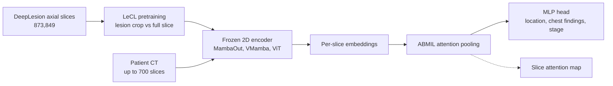

# Abnormality-Driven Representation Learning for Radiology Imaging

> **Bibkey** `Ligero2024_241116803` · **Venue** arXiv preprint (2024) · **Category** imaging · **Relevance** medium · **Access** open
> **Link** <https://arxiv.org/abs/2411.16803> · `status: complete`

---

## One-liner
CLEAR treats a CT scan as a stack of 2D axial slices: a frozen encoder trained by self-supervised contrastive learning embeds each slice, and attention-based multiple-instance learning (ABMIL) aggregates them into a patient-level prediction; the proposed LeCL feeds lesion-centred crops to one encoder branch so that representations focus on abnormalities. With 22–36M-parameter models it matches or slightly beats BiomedCLIP on three tasks.

## Takeaways
- This is a **representation-learning** paper, not an anomaly-detection method: "abnormality-driven" means lesion boxes steer pretraining toward abnormal regions; downstream tasks are still supervised classification (§3.2–3.3).
- It ports the pathology recipe "frozen foundation-model features + ABMIL aggregation" to CT, with no task-specific encoder fine-tuning and no per-slice labels (Fig. 1, §1).
- Best combo MambaOut + LeCL-0 averages AUC 78.4% (lesion location), 66.9% (chest abnormalities), 68.3% (lung-cancer staging) vs BiomedCLIP 77.6%, 65.0%, 65.2% (Tables 1–3). Our reading: most gaps are within one standard deviation.
- Backbone choice matters: the gated CNN (MambaOut) and state-space model (VMamba) beat ViT (§4.6).
- Up-weighting lesion slices hurts: λ = 0 (lesion-crop vs full-slice pairs, without the extra key-slice term ξ) is best (§4.7, Supp. Table 6). For MambaOut λ = 5 is worst; for VMamba the lowest values in Supp. Table 6 are at λ = 3 (Task 1 75.7, Task 2 56.6, below λ = 5's 76.9 and 61.1), which disagrees with the §4.7 text saying the maximum drop for both architectures is at λ = 5.

## Problem
Radiology deep learning mostly uses end-to-end 3D networks fine-tuned per task, with scan selection and lesion annotation (Abstract, §1). Pathology has adopted task-agnostic self-supervised foundation models plus weakly supervised aggregation, but radiology lacks task-agnostic representation models because 3D imaging is compute- and data-hungry and anatomically complex (Abstract). Existing CT foundation models are either region-specific (CT-CLIP for chest, Merlin for abdomen) or over-general across modalities (§1–2). The authors want a CT-only, whole-body, compute-friendly representation model that is more sensitive to lesions.

## Method
1. **Input**: each CT is a set of up to 700 axial slices, typically 512×512; Hounsfield units (CT density) are clipped to DeepLesion windows, e.g. abdominal −175 to 275 HU and lung −1500 to 500 HU; Task 1 uses both windows, Tasks 2–3 the lung window only (§4.2).
2. **Contrastive pretraining (MoCo-v3 baseline)**: InfoNCE loss with a query encoder and a momentum (EMA) key encoder, built on the official MoCo-v3 code (§3.1).
3. **LeCL (lesion-enhanced contrastive learning)**: for DeepLesion slices with lesion boxes, one encoder branch receives a lesion-centred crop and the other the full image of the same slice, pulling "lesion ↔ whole slice" together; optionally a term λ·ξ is added to the InfoNCE denominator, where ξ sums the query's similarity to all key slices (annotated lesion slices), λ ∈ {0, 1, 3, 5}; LeCL-0 means λ = 0 (§3.2 Eq. 4, §4.3). The authors call it semi-supervised because it uses lesion boxes.
4. **Backbones**: ViT-B with a convolutional stem, VMamba (vision state-space model), MambaOut (gated CNN); trained 100 epochs on 873,849 DeepLesion axial slices on 4 A100s in under 2 days (ViT-B and VMamba 33 h, MambaOut 25 h) (§4.3, Supp. Table 5).
5. **Downstream (CLEAR)**: frozen encoder per slice → linear projection to 256-d + ReLU → ABMIL attention pooling (one weight per slice, weighted sum) → LayerNorm + one-hidden-layer MLP head. Tasks 1–2 multi-label (BCE), Task 3 binary (cross-entropy); lr 1e-4, batch 128, 32 epochs, early stop after 8 (§3.3, §4.3, Supp. A).
6. **Compared foundation models**: 2D BiomedCLIP and SAM2 (with ABMIL), 3D CT-CLIP and Merlin (MLP head only) (§4.3, Fig. 2B).
7. **Interpretability**: ABMIL attention over slices is plotted to check whether peaks fall near DeepLesion's annotated key slices (§4.5, Fig. 4, Supp. B).

## Method diagram


## Data
**DeepLesion** (pretraining + Task 1): 14,601 contrast-enhanced CT scans from 4,427 patients with solid tumours in bone, lung, mediastinum, liver, kidney, abdomen, soft tissue and pelvis; all scans have lesion boxes, 4,177 scans (1,368 patients) have lesion-location labels. 839 patients (20%) are held out for testing; pretraining uses 10,224 unlabeled + 3,538 labeled scans (80%), 873,849 axial slices in total (§4.1, §4.3). Our reading: 10,224 + 3,538 = 13,762 and 14,601 − 13,762 = 839, so the 839 is more likely a count of scans than of patients; the paper says "839 patients". Task 1 = multi-label lesion location. **RadChest** (Task 2, external): 3,630 non-contrast chest CTs with lung abnormalities (emphysema, bronchiectasis, pleural effusion, atelectasis, fibrosis, opacity, calcification, nodules, etc.) (§4.1). **NSCLC-Radiomics** (Task 3, external): 447 non-contrast CTs of 422 non-small-cell lung cancer patients; predict low (I–II) vs high (III–IV) stage (§4.1). Tasks 1–2: held-out test set plus 5-fold CV; Task 3: nested 5-fold CV (§4.3).

## Key results
- **Task 1 lesion location (DeepLesion, mean AUC)**: MambaOut-LeCL-0 78.4 ± 2.1, VMamba-LeCL-0 78.2, MambaOut-MoCo 77.7, BiomedCLIP 77.6, SAM2 74.7, CT-CLIP 58.7, Merlin 52.8 (Table 1).
- **Per region**: bone lesions are 50–55.4 for every model (near chance); soft tissue VMamba-LeCL-0 71.9 vs BiomedCLIP 66.0 (+5.9); on kidney, BiomedCLIP's 65.9 beats every in-house model (best 64.0) (Table 1, §4.4).
- **Task 2 chest abnormalities (RadChest, mean AUC)**: MambaOut-LeCL-0 66.9 ± 1.6, MambaOut-MoCo 66.6, BiomedCLIP 65.0, Merlin 59.8, SAM2 56.4, CT-CLIP 51.1; emphysema +5.8 over BiomedCLIP (75.6 vs 69.8) (Table 2, §4.4).
- **Task 3 staging (NSCLC-Radiomics)**: MambaOut-LeCL-0 AUC 68.3 ± 5.0, ViT-ConvB 67.5, MambaOut-MoCo 66.7, BiomedCLIP 65.2 ± 4.2, SAM2 61.4, Merlin 60.9, CT-CLIP 51.6 (Table 3).
- **Backbone ablation**: MambaOut beats ViT by 2.4, 2.6 and 6.8 AUC on Tasks 1–3; VMamba by 2.2, 1.1 and 3.8 (§4.6).
- **λ ablation**: LeCL-0's gain over MoCo is small. From Tables 1–3, MambaOut gains +0.7 / +0.3 / +1.6 (78.4 vs 77.7, 66.9 vs 66.6, 68.3 vs 66.7); the §4.7 text says +0.5 / +0.35 / +0.35, while §4.4 says +1.6 on Task 3, so the paper contradicts itself. Larger λ hurts, with λ = 5 dropping MambaOut by up to 1.19 and 4 AUC points on Tasks 1–2 (§4.7, Fig. 5, Supp. Table 6). Note: Task 2 values in Supp. Table 6 are about 4 points lower than Table 2 for the same models (e.g. MambaOut-LeCL-0 62.8 vs 66.9, MambaOut-MoCo 62.5 vs 66.6); the paper does not explain this.
- **Efficiency**: in-house models have 22M (MambaOut), 36M (VMamba), 82M (ViT-B) parameters vs BiomedCLIP 86M, Merlin 122M, SAM2 213M, CT-CLIP 1110M (Supp. Table 5).

## Contributions
- CLEAR: frozen 2D slice features + ABMIL for CT, which the authors call the first radiology DL framework supporting diverse clinical tasks without task-specific fine-tuning (§1).
- LeCL: lesion boxes generate lesion-centred positive pairs so the contrastive representation attends to abnormalities (§3.2).
- A systematic comparison of ViT, VMamba and MambaOut backbones for CT self-supervision (§4.6).
- Post-hoc interpretability via slice-attention plots (Fig. 4).

## Limitations
- (Authors) representation learning for radiology is still limited, with existing methods such as Merlin and CT-CLIP performing relatively poorly on all downstream tasks; current image-representation models have substantial limitations and more domain-specific representation learning is needed (§4.4, Conclusion). Our reading: the paper's own models also have modest absolute AUCs (about 67–78 across the three tasks).
- Our reading: LeCL's gains over MoCo and BiomedCLIP are mostly 0.3–3 AUC points with standard deviations of 1.6–5.0, so "outperforms" is a strong claim; no significance tests are given.
- Our reading: pretraining and Task 1 both use DeepLesion (test patients excluded from pretraining), and the external tasks are chest-only; 2D slices ignore inter-slice 3D context.
- Our reading: the paper calls it one of the first open-source CT SSL foundation models (§2.2), but the v1 preprint gives no code or weight link.

## Relation to our direction
Not an anomaly detector; a pretraining trick that makes representations more sensitive to abnormalities, sitting at the representation layer before "detect". Our reading: (1) for the artifact-injection topic the useful part is CLEAR's structure — frozen unit-level embeddings (slice / tile / cell) + ABMIL aggregation + attention maps — the same weakly supervised pattern as "cell / spot embeddings → sample label → attention highlights abnormal regions" in kidney biopsies, usable as a supervised comparator for the detect stage; (2) LeCL's "lesion crop vs whole" positive pairs could map to pairing a lesion neighbourhood with the whole section in spatial omics, but it needs lesion labels, unlike normal-only anomaly detection; (3) it shows a small single-domain model can approach a large general multimodal one, encouraging for data-limited kidney omics. Virtual tissue and revert are not addressed.

## Reusable assets
- **Code:** no link in the v1 preprint; the MoCo-v3 part is adapted from the official repository (§3.1).
- **Data:** all public — DeepLesion, RadChest, NSCLC-Radiomics (§4.1).
- **Checkpoints:** no weight download is given.
- **Recipe:** the ABMIL head (256-d projection + attention pooling + LayerNorm + MLP, Supp. A); multi-window input and attention plots (§4.2, Fig. 4).

## Follow-ups
- Ilse et al. 2018, Attention-based deep multiple instance learning (ref [15]) — the ABMIL paper.
- El Nahhas et al. 2024, Nature Protocols (ref [11]) — the same group's pathology weak-supervision pipeline that CLEAR mirrors.
- Chen, Xie, He 2021, MoCo-v3 (ref [8]).
- Check for later versions or a code release.

## Cite
```bibtex
@misc{Ligero2024_241116803,
  title = {Abnormality-Driven Representation Learning for Radiology Imaging},
  author = {Marta Ligero and Tim Lenz and Georg Wölflein and Omar S. M. El Nahhas and Daniel Truhn and Jakob Nikolas Kather},
  year = {2024},
  eprint = {2411.16803},
  archivePrefix = {arXiv},
  url = {https://arxiv.org/abs/2411.16803}
}
```


---

📄 **[AI-ready full-text extract →](ai-ready.md)**
