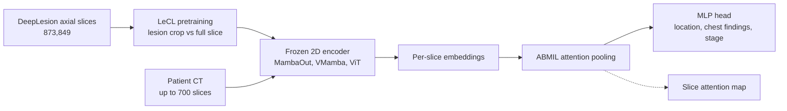

# Abnormality-Driven Representation Learning for Radiology Imaging

> **文献键** `Ligero2024_241116803` · **来源** arXiv preprint(2024) · **类别** imaging · **相关度** medium · **获取** open
> **链接** <https://arxiv.org/abs/2411.16803> · `status: complete`

---

## 一句话
CLEAR 框架把 CT 当作一叠 2D 轴位切片:用自监督对比学习训练的编码器(冻结)给每张切片提特征,再用注意力多示例学习(ABMIL)聚合成病人级预测;其中提出的 LeCL 在对比学习中让一路编码器看到以病灶为中心的裁剪,使表征更关注异常。用约 2–4 千万参数的模型,在三项任务上与 BiomedCLIP 相当或略好。

## 要点
- 这是**表征学习**论文,不是异常检测方法:"abnormality-driven" 指预训练时用病灶框把注意力引向异常区域,下游仍是有监督分类(§3.2–3.3)。
- 把病理学里成熟的"冻结基础模型特征 + ABMIL 聚合"流程搬到 CT 上,不需要针对任务微调编码器,也不需要逐切片标注(Fig. 1, §1)。
- 最佳组合 MambaOut + LeCL-0 的平均 AUC:病灶部位 78.4%、胸部异常 66.9%、肺癌分期 68.3%,对应 BiomedCLIP 为 77.6%、65.0%、65.2%(Tables 1–3)。我们的理解:多数差距小于标准差。
- 对比学习的骨干选择影响大:门控 CNN(MambaOut)和状态空间模型(VMamba)都好于 ViT(§4.6)。
- 加大病灶切片权重 λ 反而变差:λ = 0(保留病灶裁剪 vs 整片的正样本对,但不加额外的关键切片项 ξ)最好(§4.7, Supp. Table 6)。MambaOut 上 λ = 5 最差;VMamba 上 Supp. Table 6 中最低的是 λ = 3(任务 1 75.7、任务 2 56.6,低于 λ = 5 的 76.9、61.1),与 §4.7 正文「λ = 5 时两种架构下降最大」不一致。

## 研究问题
放射学的深度学习大多是"端到端 3D 网络 + 针对每个任务微调",并依赖扫描序列挑选和病灶标注(Abstract, §1)。病理学已经普遍用"任务无关的自监督基础模型 + 弱监督聚合",而放射学缺少这样的任务无关表征模型,原因是 3D 影像的算力和数据需求高、解剖结构复杂(Abstract)。现有 CT 基础模型要么只针对特定部位(如胸部的 CT-CLIP、腹部的 Merlin),要么横跨所有模态过于泛化(§1–2)。作者想要一个只用 CT、覆盖全身、算力友好的表征模型,并让它对病灶更敏感。

## 方法
1. **输入表示**:每个 CT 视为最多 700 张、通常 512×512 的轴位切片集合;按 DeepLesion 规范把 Hounsfield 值(CT 的密度单位)裁到对应窗口,如腹部窗 -175 到 275 HU、肺窗 -1500 到 500 HU;任务 1 两种窗都用,任务 2、3 只用肺窗(§4.2)。
2. **对比预训练(MoCo-v3 基线)**:InfoNCE 损失,查询编码器 + 动量(指数滑动平均)键编码器;基于官方 MoCo-v3 代码(§3.1)。
3. **LeCL(病灶增强对比学习)**:对 DeepLesion 中有病灶框标注的切片,让一路编码器接收以病灶为中心的裁剪,另一路接收同一切片的整图,从而把"病灶 ↔ 整片"拉近;可选地在 InfoNCE 分母中加入 λ·ξ,ξ 为查询与所有关键切片(key slices,即含病灶的标注切片)的相似度之和,λ ∈ {0, 1, 3, 5};LeCL-0 即 λ = 0(§3.2 式 4, §4.3)。作者称之为 semi-supervised,因为用到了病灶框。
4. **骨干**:ViT-B(带卷积 stem)、VMamba(视觉状态空间模型)、MambaOut(门控 CNN),参数量分别约 82M、36M、22M;在 DeepLesion 的 873,849 张轴位切片上训练 100 epoch,4 张 A100,不到 2 天(ViT-B 与 VMamba 33 小时,MambaOut 25 小时)(§4.3, Supp. Table 5)。
5. **下游(CLEAR)**:冻结编码器给每张切片提特征 → 线性层投影到 256 维 + ReLU → ABMIL 注意力池化(每张切片一个注意力权重,加权求和)→ LayerNorm + 一层隐藏层 MLP 分类头。任务 1、2 为多标签分类(BCE 损失),任务 3 为二分类(交叉熵);lr 1e-4,batch 128,32 epoch,8 epoch 无改善早停(§3.3, §4.3, Supp. A)。
6. **对比的基础模型**:2D 的 BiomedCLIP、SAM2(同样接 ABMIL),3D 的 CT-CLIP、Merlin(只接 MLP 头)(§4.3, Fig. 2B)。
7. **可解释性**:画出 ABMIL 在各切片上的注意力分布,检查峰值是否落在 DeepLesion 标注的关键切片附近(§4.5, Fig. 4, Supp. B)。

## 方法图


## 数据
**DeepLesion**(预训练 + 任务 1):14,601 个增强 CT,来自 4,427 名实体瘤患者,病灶分布于骨、肺、纵隔、肝、肾、腹部、软组织、盆腔;所有 CT 有病灶框,4,177 个 CT(1,368 名患者)有病灶部位标签。839 名患者(20%)留作测试;预训练用 10,224 个无标签 CT + 3,538 个有标签 CT(80%),共 873,849 张轴位切片(§4.1, §4.3)。我们的理解:10,224 + 3,538 = 13,762,而 14,601 − 13,762 = 839,所以这个 839 更可能是 CT 数而不是患者数;论文写的是「839 patients」。任务 1 = 按部位的多标签病灶分类。**RadChest**(任务 2,外部):3,630 个平扫胸部 CT,多种肺部异常(肺气肿、支气管扩张、胸腔积液、肺不张、纤维化、磨玻璃影、钙化、肺结节等)(§4.1)。**NSCLC-Radiomics**(任务 3,外部):422 名非小细胞肺癌患者的 447 个平扫 CT,预测低分期(I–II)vs 高分期(III–IV)(§4.1)。任务 1、2 先留出测试集再 5 折交叉验证;任务 3 用嵌套 5 折交叉验证(§4.3)。

## 主要结果
- **任务 1 病灶部位(DeepLesion,平均 AUC)**:MambaOut-LeCL-0 78.4 ± 2.1,VMamba-LeCL-0 78.2,MambaOut-MoCo 77.7,BiomedCLIP 77.6,SAM2 74.7,CT-CLIP 58.7,Merlin 52.8(Table 1)。
- **分部位**:骨病灶所有模型都在 50–55.4(接近随机);软组织上 VMamba-LeCL-0 71.9 vs BiomedCLIP 66.0(+5.9);肾脏上 BiomedCLIP 65.9 高于所有自训模型(最高 64.0)(Table 1, §4.4)。
- **任务 2 胸部异常(RadChest,平均 AUC)**:MambaOut-LeCL-0 66.9 ± 1.6,MambaOut-MoCo 66.6,BiomedCLIP 65.0,Merlin 59.8,SAM2 56.4,CT-CLIP 51.1;肺气肿上 LeCL 比 BiomedCLIP 高 5.8(75.6 vs 69.8)(Table 2, §4.4)。
- **任务 3 分期(NSCLC-Radiomics)**:MambaOut-LeCL-0 AUC 68.3 ± 5.0,ViT-ConvB 67.5,MambaOut-MoCo 66.7,BiomedCLIP 65.2 ± 4.2,SAM2 61.4,Merlin 60.9,CT-CLIP 51.6(Table 3)。
- **骨干消融**:MambaOut 比 ViT 在任务 1–3 上分别高 2.4、2.6、6.8 AUC;VMamba 比 ViT 高 2.2、1.1、3.8(§4.6)。
- **λ 消融**:LeCL-0 相对 MoCo 的提升很小。按 Tables 1–3,MambaOut 上为 +0.7 / +0.3 / +1.6(78.4 vs 77.7、66.9 vs 66.6、68.3 vs 66.7);§4.7 正文写 +0.5 / +0.35 / +0.35,§4.4 却写任务 3 为 +1.6,论文自相矛盾。λ 越大越差,λ = 5 时 MambaOut 在任务 1、2 上最多下降 1.19 和 4 个 AUC 点(§4.7, Fig. 5, Supp. Table 6)。注意:Supp. Table 6 的任务 2 数值比 Table 2 中同一模型低约 4 个点(如 MambaOut-LeCL-0 62.8 vs 66.9,MambaOut-MoCo 62.5 vs 66.6),论文未解释。
- **效率**:自训模型 MambaOut 22M、VMamba 36M、ViT-B 82M 参数,对比 BiomedCLIP 86M、Merlin 122M、SAM2 213M、CT-CLIP 1110M(Supp. Table 5)。

## 创新点
- 提出 CLEAR:2D 切片冻结特征 + ABMIL 的 CT 分析框架,作者称是首个无需任务特定微调即可支持多种临床任务的放射学 DL 框架(§1)。
- 提出 LeCL:用病灶框生成以病灶为中心的正样本对,使对比表征更关注异常(§3.2)。
- 系统比较 ViT、VMamba、MambaOut 三类骨干在 CT 自监督上的表现(§4.6)。
- 用切片注意力分布做事后可解释性检查(Fig. 4)。

## 局限
- (作者)放射学表征学习的现状仍然有限,Merlin、CT-CLIP 等现有方法在所有下游任务上表现较差;现有图像表征模型有明显局限,需要更多领域专用的表征学习研究(§4.4, Conclusion)。我们的理解:本文自己的模型绝对 AUC 也不高(三项任务约 67–78)。
- 我们的理解:LeCL 相对 MoCo 和 BiomedCLIP 的提升多在 0.3–3 个 AUC 点,而标准差为 1.6–5.0,结论"全面优于"偏强;没有显著性检验。
- 我们的理解:预训练和任务 1 都用 DeepLesion(测试患者已从预训练中排除),外部任务只有胸部;2D 切片忽略了层间 3D 上下文。
- 我们的理解:文中称是"开源"基础模型之一(§2.2),但 v1 预印本中没有给出代码或权重链接。

## 与本研究方向的关系
这篇不做异常检测,而是"让表征对异常更敏感"的预训练技巧,位于 detect 之前的表征层。我们的理解:(1) 对课题 1 有用的是 CLEAR 的结构——"冻结的单元级(切片 / 图块 / 细胞)嵌入 + ABMIL 聚合 + 注意力图",这与肾脏活检中"细胞 / spot 嵌入 → 样本级标签 → 注意力定位异常区域"的弱监督思路一致,可作为 detect 环节的有监督对照;(2) LeCL 的"病灶裁剪 vs 整体"正样本对,可以类比为在空间组学中把"病变邻域"和"整张切片"配对,但它需要病灶标注,和只用正常数据的异常检测设定不同;(3) 它显示数据量小得多的单域模型可以接近通用多模态模型,这对数据有限的肾脏组学是个积极信号。不涉及 virtual tissue 与 revert。

## 可复用资产
- **代码:** v1 预印本中未给出链接;作者说明 MoCo-v3 部分改自官方仓库(§3.1)。
- **数据:** 均为公开数据集——DeepLesion、RadChest、NSCLC-Radiomics(§4.1)。
- **模型:** 文中未给出权重下载。
- **方法配方:** ABMIL 下游头(256 维投影 + 注意力池化 + LayerNorm + MLP,Supp. A);多窗口输入与注意力可视化(§4.2, Fig. 4)。

## 待读
- Ilse et al. 2018, Attention-based deep multiple instance learning(ref [15])——ABMIL 原文。
- El Nahhas et al. 2024, Nature Protocols(ref [11])——同组的病理弱监督流程,CLEAR 的模板。
- Chen, Xie, He 2021, MoCo-v3(ref [8])。
- 查看是否有后续版本或代码发布。

## 引用
```bibtex
@misc{Ligero2024_241116803,
  title = {Abnormality-Driven Representation Learning for Radiology Imaging},
  author = {Marta Ligero and Tim Lenz and Georg Wölflein and Omar S. M. El Nahhas and Daniel Truhn and Jakob Nikolas Kather},
  year = {2024},
  eprint = {2411.16803},
  archivePrefix = {arXiv},
  url = {https://arxiv.org/abs/2411.16803}
}
```


---

📄 **[AI-ready 全文提取 →](ai-ready.md)**
