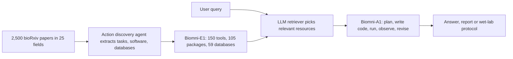

# Biomni: A General-Purpose Biomedical AI Agent

> **Bibkey** `Huang2025_Biomni` · **Venue** bioRxiv (2025) · **Category** agents · **Relevance** high · **Access** open
> **Link** <https://doi.org/10.1101/2025.05.30.656746> · `status: complete`

---

## One-liner
Biomni is the Leskovec-lab general-purpose biomedical agent: an action discovery agent reads the 100 most recent papers in each of bioRxiv's 25 subject categories (2,500 papers) and extracts tasks, software and databases, which are implemented and tested by humans into the unified environment **Biomni-E1** (150 specialised tools + 105 software packages + 59 databases); a CodeAct-based agent **Biomni-A1** (retrieve relevant tools → write a plan → write and run code → revise the plan from results) then solves cross-domain tasks zero-shot, plus one CRISPR-cloning wet-lab run that followed its protocol verbatim (Results §"Overview of Biomni"; Fig. 1; Fig. 4).

## Takeaways
- **Code-as-action is the main selling point**: on 8 new tasks Biomni's average relative gain is 20.4% over its own ablation Biomni-ReAct (code planning replaced by ReAct chaining), 43.0% over a generic coding agent (ReAct+Code) and 402.3% over tool-less Claude Sonnet 3.7 (Results §"Biomni generalizes…").
- **Near human experts on LAB-Bench**: DbQA 74.4% (humans 74.7%), SeqQA 81.9% (humans 78.8%) — but on a 12.5% subset (315 test questions) (Results §"Biomni excels…").
- **"Discoveries" are checked only by the authors reading traces and code**: e.g. the multiome case proposes AUTS2, ZFHX3 and PBX1 as novel regulators, yet the text itself says PBX1 is a well-established skeletal regulator while the Fig. 3h caption says "no previous association with skeletal development" (Results; Fig. 3h; Methods §"Manual verification").
- **Reported conclusions carry no confidence and no rerun-consistency analysis**; several numbers are inconsistent (cloning benchmark 10 vs 20 tasks; wearable files 458 vs 485). Our reading: exactly the kind of agent output Topic 2 wants to verify.
- **Limited in later independent evaluations**: HeurekaBench open-ended correctness 2.31/5 for Biomni (Lite, Claude-4-Sonnet); in SpatialAgent's heart MERFISH cell annotation Biomni reaches 0.394 overall accuracy, skewed toward endothelial labels (from those papers' text; `heurekabench-arxiv-2026`, `spatialagent-biorxiv-2025` in this repo).

## Problem
Existing biomedical agents are mostly specialist workflows for narrow tasks and generalise poorly across subfields (Introduction). A generalist needs an environment that **explicitly defines the biomedical action space** (tools, databases, software, wet-lab protocols) and an architecture that selects and composes actions in it without predefined workflows (Introduction). The question: can one build a "virtual AI biomedical scientist" that handles genetics, genomics, microbiology, pharmacology and clinical tasks zero-shot?

## Method
**Step 1 Mine the action space from literature**: for each of bioRxiv's 25 subject categories, the 100 most recent papers; an LLM reads each PDF in chunks and extracts tasks, software and databases, highlighting recurrent tasks that need specialised implementation (Results; Methods §"Action Discovery from Literature").
**Step 2 Filter tasks**: keep fields relevant to drug discovery and clinical biomedicine, narrow to ~1,900 recurring tasks, then manually de-duplicate and drop trivial "few lines of code" tasks, favouring expertise-heavy ones (wet-lab protocols, AI predictors) (Methods §"Implementing the Biomni Environment").
**Step 3 Build Biomni-E1**: human scientists plus web-search-enabled software-engineering agents implement each tool, each meeting a five-point checklist: clear name, detailed docs, output as an LLM-readable research log, a passing test case, and genuine specialisation. 150 tools, plus literature tools such as PubMed and Google Scholar. Large relational databases with web APIs (PDB, OpenTargets, ClinVar, …) each get **one** natural-language query function, with an LLM parsing the schema and writing the query; API-less databases are downloaded into a local data lake as pandas DataFrames; 59 databases in total. 105 software packages live in one container supporting Python, R and Bash (Results; Methods).
**Step 4 Biomni-A1 retrieval**: the action space is large and one query needs only a small part; a separate LLM does prompt-based retrieval of relevant functions, datasets and software to keep the context short (Methods §"Biomni-A1").
**Step 5 Plan and execute**: built on CodeAct — the LLM first writes a numbered plan, then generates code step by step, runs it in Python/R/Bash, feeds observations back and revises the plan until it converges (Methods; Fig. 1c). Code as the universal action interface can express loops, parallelism, conditionals and calls without predefined signatures, which the authors contrast with classic function calling (Results).
**Step 6 Evaluation**: LAB-Bench and HLE QA; 8 new real-world tasks (vs tool-less base LLM, ReAct+Code, Biomni-ReAct); 3 case studies (wearables, single-cell multiome, cloning protocol + wet lab) (Results).

## Method diagram


## Data
**QA benchmarks**: LAB-Bench DbQA (database QA) and SeqQA (DNA/protein sequence reasoning): a 45-question dev set used to refine tool and database interfaces, 315 held-out test questions, averaged over three runs; a 12.5% subset because of API cost, sampled proportionally across subtasks, with an "insufficient information" abstain option (Results; Methods §"Q&A Benchmarks"). HLE: up to 5 questions per bio/med subdiscipline, 52 questions, no dev set (the text says 14 subdisciplines; Methods names 13) (Methods). QA results compare against 6 general-purpose baselines described in Supplementary Notes A (Results).
**8 new tasks** (Methods §"Curating real-world benchmarks"): variant prioritisation (Open Targets Genetics truth set, accuracy); GWAS causal gene (Shringarpure et al., accuracy); CRISPR screen design (Schmidt et al., choose genes out of 18,939 to maximise perturbation effect; only the IL-2 screen; metric = mean post-perturbation effect); scRNA-seq annotation (CellxGene etc., typically ~10 author cell types, 20k–50k cells subsampled proportionally; LLM semantic-match scoring later checked by humans); microbiome differential abundance (5 datasets, compared with human experts); drug repurposing (Huang et al., scored by alignment with clinicians' off-label prescribing in an EHR); rare-disease diagnosis (MyGene2 curated by Alsentzer et al., expert diagnosis as truth); patient causal-gene prioritisation (Alsentzer et al.).
**Case data**: wearables — 30 participants' CGM (continuous glucose monitor; its sensor also logs skin temperature) data; Results says 458 Excel files, Methods says 485 temperature files (each centred on a presumed meal, 2 h before to 4 h after); 227 nights of sleep from 10 people; blood omics: 652 lipid features / 147 samples, 731 metabolite features / 147 samples, 1,470 protein features / 20 samples (Results; Methods). Multiome — To et al. 2024 human embryonic skeleton, ~336,000 nuclei of snRNA-seq + snATAC-seq (single-nucleus transcriptome + chromatin accessibility), 5–11 weeks post-conception, 5 anatomical regions, used unmodified (Results; Methods).

## Key results
- **LAB-Bench**: DbQA 74.4% (human experts 74.7%; coding agent ReAct+Code 40.8%); SeqQA 81.9% (humans 78.8%) (Results §"Biomni excels…"; Fig. 2a).
- **HLE subset (52 questions)**: 17.3% vs base LLM 6.0%, coding agent 12.8%, literature agent 12.2% (Results).
- **8 new tasks**: average relative gain 402.3% over the base LLM (Claude Sonnet 3.7, no tools), 43.0% over ReAct+Code, 20.4% over Biomni-ReAct; per-task gains are marked in Fig. 2b and full numbers are in Supplementary Notes B (Results; Fig. 2b). Tasks take 6–24 steps on average, using 0–4 specialised tools, 1–8 packages and 0–3 data-lake items; synthesis tasks (CRISPR screen, GWAS) lean on database queries (KEGG, Reactome) and literature, analysis tasks (microbiome, scRNA annotation) on code with libraries such as scanpy (Results).
- **Wearables**: an autonomous 10-step pipeline (infer meals from glucose spikes, extract pre/post-meal temperature windows, normalise across people, summarise) reports a mean post-meal temperature rise of 2.19 °C, median 1.10 °C, range −0.11 to 15.56 °C (Results; Fig. 3b–d); for sleep it reports efficiency peaking on Wednesdays and dropping on Sundays, and timing regularity correlating more with sleep quality than total duration (Results).
- **Multiome**: a 10-step GRN pipeline (pySCENIC setup, GRNBoost2 network inference, cisTarget pruning, AUCell regulon activity, ATAC-accessibility filtering of targets, …) finished in just over 5 hours with 566–589 regulons; it recovers known regulation of RUNX2 and HHIP by TWIST1, LMX1B and ALX4, and flags AUTS2, ZFHX3 and PBX1 as highly active across skeletal lineages; limb mesenchyme has the highest mean regulon activity (Results; Fig. 3f–h).
- **Cloning benchmark**: a blinded reviewer rated Biomni's protocols on par with a senior human expert in accuracy and completeness and clearly above a trainee, in much less time (Results; Fig. 4a); the main text gives no scores. Results says 10 tasks and 4 entrants (Claude 3.7, Biomni, trainee, senior expert); Methods says 20 open-ended questions, 3 human experts, 1 blinded evaluator, accuracy and completeness each on 1–5 (Methods §"Wetlab Benchmark…").
- **Wet lab**: cloning an sgRNA against human B2M into lentiCRISPR v2 Blast; Biomni designed three sgRNAs, BsmBI-overhang oligos, Golden Gate assembly and transformation protocols and a U6 sequencing primer; a scientist followed it exactly, colonies grew next day, and two sequenced colonies both aligned perfectly (Results; Fig. 4b–e).

## Contributions
- **Mines the action space from literature**, then human-implements and tests it into an executable environment — environment building as a scalable process (Fig. 1a).
- "One natural-language query function per large database", keeping the tool count manageable (Results).
- Retrieval-based tool selection + code-as-action (CodeAct) + adaptive planning, with an ablation against its own ReAct variant isolating the gain from code planning (Results).
- A wet-lab run executed verbatim from the agent's protocol and sequence-confirmed (Fig. 4e).
- Open code, Harvard Dataverse data and a web UI (Data / Code availability).

## Limitations
- Authors: evaluated tasks cover only part of the field; action discovery uses only recent literature and may miss still-useful classic methods; it struggles with nuanced clinical judgement, novel experimental reasoning, analytical invention and deep biological synthesis, and is not expert-level on all tasks (Discussion).
- Our reading: **coarse evaluation** — only a 12.5% LAB-Bench subset; the 8 tasks are summarised in the main text as average "relative gains", which near-zero baselines (Fig. 2b shows "+inf") inflate; the main text does not state which LLM Biomni uses on the QA benchmarks.
- Our reading: **conclusions are checked only by humans reading traces** (Methods §"Manual verification") — no independent validation, no confidence, no rerun stability; PBX1 is called both "novel" and "well-established". In the wearables case a 15.56 °C individual post-meal rise is implausible as physiology and looks more like a data artefact, which the paper does not discuss; the sensor measures skin temperature (Methods) while Fig. 3d says "core body temperature".
- Inconsistent numbers: number of papers (Abstract "tens of thousands" vs Results 2,500); cloning benchmark (10 vs 20 tasks); wearable files (458 vs 485); HLE subdisciplines (14 vs 13 named).
- Later independent evaluations: in HeurekaBench (open single-cell research questions) Biomni scores 2.31/5 open-ended correctness (Lite, all three agents on Claude-4-Sonnet), at most 2.58 across planners on the full set; in SpatialAgent's heart MERFISH cell annotation, Biomni (Claude Sonnet 4.5, 3 runs) reaches 0.394 overall accuracy with labels skewed toward endothelial cells (label collapse) (sources: `heurekabench-arxiv-2026` Tables 1–2, `spatialagent-biorxiv-2025` cell-annotation section).

## Relation to our direction
Biomni sits at the **analysis-execution layer** of detect → model → revert: it neither detects anomalies nor builds a virtual tissue, but it is the representative "agent writes its own code, runs an omics analysis and reports a biological conclusion" system. Our reading: it is now a common baseline — DeepEvidence, HeurekaBench and SpatialAgent all compare against it.
It matters most for **Topic 2 (verifying the claims of biomedical analysis agents)**. Our reading: (1) it is the archetypal **system to verify**: it autonomously analyses snRNA/snATAC-type data and emits "novel regulator / novel pattern" claims, which the paper checks only by humans reading traces, with no confidence or rerun consistency. (2) Its own text already supplies ready-made "suspicious claim" examples: PBX1 called both novel and known; a 15.56 °C post-meal rise; skin temperature reported as core temperature — exactly what a claim-to-evidence verifier should flag (claims inconsistent with the data, with cited papers, or with other parts of the report). (3) The multiome GRN case is nearly a Topic 2 task template: run Biomni on kidney snRNA/snATAC for GRN or differential analysis, then check each claim against its own code outputs and across reruns; Topic 1's known answers (diseased cells vs doublets / low-quality cells) can show whether it reports artefacts as biology. (4) The label collapse seen in SpatialAgent warns that in anomaly detection such systematic bias would fold rare lesion cell states into common classes.
For the revert step, our reading: its CRISPR screen-design task (choose perturbations from 18,939 genes) and the cloning wet-lab run show that "agent nominates perturbation → bench validates" is feasible as engineering, but the nomination itself still needs evidence and confidence.

## Reusable assets
- **Code:** open-source Biomni (environment + agent) (Code availability).
<https://github.com/snap-stanford/biomni>
- **Data:** all data used by Biomni (Harvard Dataverse, Data availability).
<https://doi.org/10.7910/DVN/CE4ZYG>
- **Web UI:** hosted version (not for protected health information).
<https://biomni.stanford.edu>
- **Eval tasks:** prompts and metrics for the 8 real-world tasks (Methods §"Curating real-world benchmarks"), usable as Topic 2 baseline task templates.

## Follow-ups
- Supplement: tool list (Supp. Tables 1–18), databases (19–22), software (23–30) and trace analyses (Supp. Figs 6–16) — which single-cell/spatial tools are built in; per-task numbers (Supplementary Notes B).
- Independent evaluations of Biomni in BiomniBench (`biomnibench-biorxiv-2026`) and HeurekaBench (`heurekabench-arxiv-2026`).
- The CodeAct paper (Wang et al., ICML 2024; ref. 31 here).

## Cite
```bibtex
@article{Huang2025_Biomni, title={Biomni: A General-Purpose Biomedical AI Agent}, url={http://dx.doi.org/10.1101/2025.05.30.656746}, DOI={10.1101/2025.05.30.656746}, journal={bioRxiv}, publisher={openRxiv}, author={Huang, Kexin and Zhang, Serena and Wang, Hanchen and Qu, Yuanhao and Lu, Yingzhou and Roohani, Yusuf and Li, Ryan and Qiu, Lin and Li, Gavin and Zhang, Junze and Yin, Di and Marwaha, Shruti and Carter, Jennefer N. and Zhou, Xin and Wheeler, Matthew and Bernstein, Jonathan A. and Wang, Mengdi and He, Peng and Zhou, Jingtian and Snyder, Michael and Cong, Le and Regev, Aviv and Leskovec, Jure}, year={2025}, month=June }
```


---

📄 **[AI-ready full-text extract →](ai-ready.md)**
