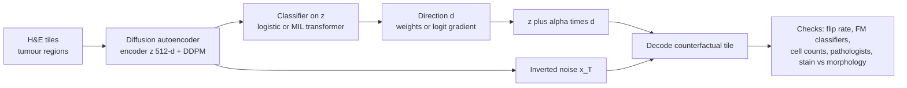

# Counterfactual Diffusion Models Provide Interpretable Explanations of Artificial Intelligence Models in Pathology

> **Bibkey** `Zigutyte_2026` · **Venue** Cancer Research (2026) · **Category** histopath · **Relevance** medium · **Access** open
> **Link** <https://doi.org/10.1158/0008-5472.CAN-25-5645> · `status: complete`

---

## One-liner
MoPaDi (Morphing histoPathology Diffusion) couples a **diffusion autoencoder** with tile-level logistic-regression or slide-level **MIL** classifiers: it pushes a tile's latent feature vector along the classifier's decision direction and decodes it with the conditional diffusion model into a **counterfactual H&E image** ("what would this tile look like if it were class X?"), so pathologists can see the morphologic cues a model relies on. Validated on colorectal (tissue type, MSI), hepatobiliary, lung and breast tasks, with a Shapley-style decomposition showing MSI predictions are driven mostly by morphology rather than stain.

## Takeaways
- The core operation is simple: move the 512-d diffusion-autoencoder vector z along a classifier direction d (linear weights, or the gradient of the MIL logit w.r.t. z) by α, then decode with the original image's inverted noise x_T, giving "the same tissue with only the classifier-relevant features changed" (Methods Eq. B–D).
- It attaches diffusion counterfactuals to weakly supervised MIL (slide-level labels only), which the authors call a first (Discussion).
- Counterfactuals are faithful to the classifier, not to biology: the MSI classifier has AUC 0.73 ± 0.08, so the authors treat MSI counterfactuals as an audit of the classifier (Results §MSI).
- Stain vs morphology (Vahadane transfer + Shapley-style split): of a +8.9 logit change toward MSIH, morphology contributes +7.4 and stain +1.1; morphology dominates in all 108 test patients (Fig. 5B).
- Realism: 4 blinded raters, 300 tiles each; 41.7% of synthetic tiles judged real (Results, Fig. S12).

## Problem
DL models predict biomarkers from WSIs, but standard XAI (attention heatmaps, CAM/Grad-CAM) shows *where* the model looked, not *which features* it used, and invites confirmation bias. Counterfactual explanations ("how would the image need to change to be classified as X?") exist for natural images, radiology and dermatology, but in pathology mostly via less stable GANs; moreover, pathology labels are usually slide/patient-level (weak supervision), so counterfactuals must work with MIL — which, per the authors, had not been combined with diffusion counterfactuals before.

## Method
**(1) Diffusion autoencoder** (on the official DiffAE implementation of Preechakul et al.): a learnable CNN encoder yields a 512-d semantic vector z; a DDPM conditioned on z reconstructs the image; encoder and denoiser are trained jointly with the simplified noise-prediction loss until FID < 20, with DDIM sampling at inference; a latent DDPM over z is also trained to sample synthetic features and test latent quality. **(2) Classifiers**: tile labels (NCT-CRC-HE-100K) → one-vs-rest logistic regression; patient labels (MSI, cancer subtype) → a transformer MIL (cross-attention + self-attention pooling), five-fold CV. **(3) Counterfactuals**: linear case, direction d = weight vector v; MIL case, d = gradient of target-class logit s_c(z) w.r.t. the tile feature; z is shifted with amplitude α (linear α ∈ {0.2…1}, MIL α ∈ {0.02…0.08}), denormalized and decoded together with the original image inverted to noise x_T; top-5 contributing tiles per WSI; generation is deterministic for fixed settings. **(4) Style–morphology decomposition**: Vahadane stain transfer builds two hybrids (original morphology + counterfactual stain; original stain + counterfactual morphology), and the logit change Δf is split Shapley-style into φ_style + φ_morph. **(5) Validation**: independent UNI2 / Virchow2 / CONCH + STAMP MIL classifiers check that counterfactuals move toward the target class for external models too; DeepCMorph nuclei segmentation for cell-type fractions and morphometrics; structured pathologist surveys (features appearing/disappearing) and a blinded real-vs-synthetic test.

## Method diagram


## Data
Training: NCT-CRC-HE-100K (100k 224×224 tiles from 86 FFPE samples, 9 tissue classes; test on 7,180 tiles of CRC-VAL-HE-7K), TCGA-CRC (625 WSIs → 588 WSIs / 582 patients after filtering; 512×512 tiles at 0.5 MPP, tumour regions only), TCGA-BRCA (1,115 WSIs / 1,046 patients), and a TCGA pan-cancer tile set (32 cancer types). External: CPTAC-COAD (105 patients / 221 WSIs, 24 MSIH, frozen), CPTAC breast (100 / 323), CPTAC lung LUAD/LUSC (333 / 1,534), and a Charité liver cohort (496 patients, not public). The MSI cut-off is set with a two-component GMM on TCGA MSI-event counts. Apart from NCT-CRC-HE-100K (pre-normalised with Macenko), no dataset, including the external cohorts, is stain-normalised, so that the influence of staining on classifiers can be studied.

## Key results
- **Reconstruction/generation**: MS-SSIM 0.966–0.992 across four datasets; synthetic FID from 36.95 (NCT-CRC-HE-100K model on CRC-VAL-HE-7K, heterogeneous) to 4.71 (pan-cancer, attributed to a low-diversity reference set); UNI2/Virchow2 Fréchet distances agree (Table 1).
- **Tissue type**: on CRC-VAL-HE-7K, AUC 0.91 ± 0.01 (normal mucosa) and 0.98 ± 0.01 (tumour epithelium); tumour→normal counterfactuals lose nuclear atypia, invasive growth and necrotic debris and gain goblet-like cells (Fig. 2C); real normal tiles (n = 741) vs tumour→normal counterfactuals (n = 1,233) differ negligibly-to-small in cell composition (Cliff's δ < 0.33; median shifts ≤ 3.1 pp); in the reverse direction (real tumour epithelium vs normal→tumour counterfactuals) connective-tissue and epithelial fractions show large and medium effect sizes (epithelium +1.57 pp, connective tissue −1.27 pp in synthetic images), which the authors read as the model capturing epithelial abundance (Fig. 2E, Table S4).
- **MSI (TCGA-CRC)**: MIL five-fold AUC 0.73 ± 0.08, AP 0.40 ± 0.09; external CPTAC-COAD (frozen) AUC 0.67 (Results §MSI). three pathologists rated 52 transitions (13 patients per class, 2 top-contributing tiles each, so 26 patients in total) in a structured survey (Fig. 3C), and the Discussion summarises the features they identified as signet-ring cells, mucinous and medullary patterns, inflammatory infiltration and poor differentiation, consistent with literature; in the three-class MSIL example, edits toward MSIH show loss of glandular architecture, more solid growth and more intratumoral lymphocytes, while the stable direction restores glands and reduces mucin (Fig. 4B); UNI2 / CONCH / Virchow2 classifiers shift MSI probability in the intended direction (Fig. 4A).
- **Stain vs morphology**: 108 test patients; toward MSIH median Δf +8.9 (IQR 7.2–10.1) with φ_morph +7.4 and φ_style +1.1; toward non-MSIH Δf −7.6 (φ_morph −6.6, φ_style −0.7); morphology dominates in every patient (Fig. 5B–C).
- **Realism**: four blinded raters, 300 tiles each — synthetic tiles judged real 41.7% of the time across all datasets (Results; Fig. S12).
- **Other cancers**: liver HCC vs CCA linear AUC 0.90 (0.94 patient-level), MIL five-fold 0.96, Charité external (496 patients) 0.85, 100% flipped at α = 0.08 (Fig. 6B); lung LUAD vs LUSC MIL AUC 0.91, CPTAC external 0.77, 98.8% flipped at α = 0.06 (Fig. 7C); breast ILC vs IDC AUC 0.86, CPTAC external 0.70, ~97% flipped, though top tiles often lacked typical IDC features (Results; Fig. S13D).

## Contributions
- First generative model (per the authors) combining diffusion counterfactuals with MIL to explain biomarkers that exist only as slide-level labels.
- A continuous α trajectory lets one watch features morph along the decision direction *within the same tissue region*, rather than only seeing heatmap locations.
- A Shapley-style style–morphology decomposition that can expose stain / site batch shortcuts per image.
- Layered validation: external foundation-model classifier agreement, cell-composition quantification, pathologist surveys and a blinded real-vs-synthetic test.

## Limitations
- Tile-level only; each dataset needs its own costly diffusion autoencoder; magnification effects not systematically evaluated.
- Counterfactuals are *classifier-faithful*, not biologically causal; the MSI classifier is only moderate (AUC 0.73), and for weak classifiers counterfactuals mainly expose shortcuts.
- Vahadane stain transfer cannot perfectly separate stain from structure; the decomposition is approximate.
- Behaviour under **slide artifacts** (folds, bubbles, scanner noise) not systematically assessed — artifact cues learned by the classifier may be preserved or reinforced.
- No formal user study versus attention heatmaps / Grad-CAM yet; some cell-type generation bias, requiring expert review.

## Relation to our direction
The authors frame MoPaDi as "model-based virtual perturbation" that could prescreen hypotheses before wet-lab work (Discussion). Within detect → model → revert it is the closest **imaging prototype of "revert"**: it pushes a tumour tile toward "normal mucosa" along a decision direction and renders the result (Fig. 2A).
- Our reading: MoPaDi's direction d comes from a **supervised classifier**; replacing d by the gradient of an anomaly score (e.g. distance to a healthy reference distribution) w.r.t. z would yield "revert-to-healthy" counterfactuals — a visual interface for a virtual tissue on H&E. The paper does not do this.
- Our reading (the artifact-injection topic): (1) the stain–morphology decomposition can separate stain/site differences from true morphologic change, directly useful for H&E of the kidney biopsies to be tested; (2) the authors admit no evaluation under folds, bubbles or scanner noise, and artifact cues learned by the classifier may be kept or reinforced — exactly a failure mode an anomaly benchmark should cover; (3) checking counterfactual direction with several independent foundation-model classifiers transfers as an "is the anomaly encoder-agnostic?" test.
- Our reading (the agent-trustworthiness topic): the paper keeps "the classifier thinks X" separate from "the tissue is X" — the kind of claim an agent citing image evidence should have checked.
- Relevance medium: cancer H&E at tile level; no kidney, no omics.

## Reusable assets
- **Code:** MoPaDi (pinned uv environment).
<https://github.com/KatherLab/mopadi>
- **Checkpoints:** trained MoPaDi models.
<https://huggingface.co/KatherLab/MoPaDi>
- **Data:** NCT-CRC-HE-100K / CRC-VAL-HE-7K and the TCGA pan-cancer tile set.
<https://zenodo.org/records/1214456> · <https://zenodo.org/records/5889558>
- **Eval protocol:** flip rate vs α, external-FM ΔP(target), Shapley style–morphology decomposition, DeepCMorph cell composition, blinded real-vs-synthetic test.

## Follow-ups
- Preechakul et al., Diffusion Autoencoders (CVPR 2022).
- The earlier GAN-based pathology counterfactual / MSI-morphology work (ref. 16) for comparison.
- Try replacing MoPaDi's direction d with an anomaly-score gradient for "revert-to-healthy" experiments on kidney H&E.

## Cite
```bibtex
@article{Zigutyte_2026, title={Counterfactual Diffusion Models Provide Interpretable Explanations of Artificial Intelligence Models in Pathology}, volume={86}, ISSN={1538-7445}, url={http://dx.doi.org/10.1158/0008-5472.CAN-25-5645}, DOI={10.1158/0008-5472.CAN-25-5645}, number={17}, journal={Cancer Research}, publisher={American Association for Cancer Research (AACR)}, author={Žigutytė, Laura and Lenz, Tim and Han, Tianyu and Reitsam, Nic G. and Foersch, Sebastian and Hewitt, Katherine J. and Jesinghaus, Moritz and Carrero, Zunamys I. and Unger, Michaela and Meneghetti, Asier Rabasco and Lurje, Georg and Lurje, Isabella and Herda, Sophia and Pein, Justus and Uluk, Deniz and Schneider, Carolin V. and Pearson, Alexander T. and Truhn, Daniel and Kather, Jakob Nikolas}, year={2026}, month=jun, pages={4414–4433} }
```


---

📄 **[AI-ready full-text extract →](ai-ready.md)**
