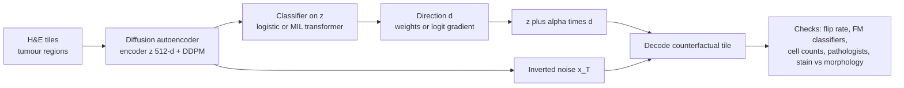

# Counterfactual Diffusion Models Provide Interpretable Explanations of Artificial Intelligence Models in Pathology

> **文献键** `Zigutyte_2026` · **来源** Cancer Research(2026) · **类别** histopath · **相关度** medium · **获取** open
> **链接** <https://doi.org/10.1158/0008-5472.CAN-25-5645> · `status: complete`

---

## 一句话
MoPaDi(Morphing histoPathology Diffusion)把 **diffusion autoencoder** 与 tile 级 logistic regression / slide 级 **MIL** 分类器接起来:沿分类器在潜空间里的决策方向推动 tile 的特征向量,再用条件扩散解码器生成"如果它是另一类会长什么样"的 **counterfactual H&E 图像**,让病理医生直接看到模型依赖的形态学线索;在结直肠(组织类型、MSI)、肝胆、肺、乳腺癌任务上验证,并用 Shapley 式分解说明 MSI 预测主要由形态而非染色驱动。

## 要点
- 核心操作很简单:在 diffusion autoencoder 的 512 维语义向量 z 上,沿分类器的方向 d(线性分类器的权重,或 MIL 分类器 logit 对 z 的梯度)走 α 步,再用原图反演得到的噪声 x_T 解码,得到"同一块组织、只改分类器在意的特征"的图像(Methods Eq. B–D)。
- 把扩散反事实接到弱监督 MIL 上(只有 slide 级标签),作者称这是首次(Discussion)。
- 反事实忠实于分类器,不等于生物因果:MSI 分类器只有 AUC 0.73 ± 0.08,作者因此把 MSI 反事实当作"审计分类器"的案例(Results §MSI)。
- 染色 vs 形态分解(Vahadane 染色迁移 + Shapley 式分解):朝 MSIH 的 logit 变化 +8.9 中,形态贡献 +7.4、染色 +1.1,108 例测试患者全部形态主导(Fig. 5B)。
- 真实感:4 位评估者盲评 300 张,合成图有 41.7% 被判为真(Results, Fig. S12)。

## 研究问题
计算病理里的 DL 模型能从 WSI 预测生物标志物,但常用的 XAI(attention heatmap、CAM/Grad-CAM)只告诉你"看了哪里",不告诉你"看到了什么特征",还容易引发确认偏差、高估模型。counterfactual explanation("要怎么改这张图它才会被分到另一类?")在自然图像、放射、皮肤科已有探索,但在病理里多基于不稳定的 GAN;而且病理标签大多只在 slide/患者层面(弱监督),需要与 MIL 结合 —— 这在扩散 counterfactual 上此前没有做过。

## 方法
**(1) Diffusion autoencoder**(基于 Preechakul 等 DiffAE 官方实现):可学习 CNN 编码器提取 512 维语义特征 z,条件 DDPM 以 z 为条件重建图像;编码器与去噪器用简化的噪声预测损失联合训练,训练至 FID < 20,推理用 DDIM 采样;另训一个 latent DDPM 用于采样合成特征以检验潜空间质量。**(2) 分类器**:tile 级标签(NCT-CRC-HE-100K)用 one-vs-rest logistic regression;患者级标签(MSI、癌种亚型)用 transformer 型 MIL(cross-attention + self-attention pooling),五折交叉验证。**(3) Counterfactual 生成**:线性情形方向 d = 分类器权重向量 v;MIL 情形 d = 目标类 logit s_c(z) 对该 tile 特征的梯度;按幅度 α 逐步移动 z(线性 α∈{0.2…1},MIL α∈{0.02…0.08}),反归一化后与原图反演得到的噪声 x_T 一起送入扩散解码器;每张 WSI 取贡献最大的 top-5 tile;固定参数下生成是确定性的。**(4) Style–morphology 分解**:用 Vahadane 染色迁移构造两种混合图(原形态+反事实染色;原染色+反事实形态),对 logit 变化 Δf 做 Shapley 式加性分解为 φ_style 与 φ_morph。**(5) 验证**:用独立的 UNI2 / Virchow2 / CONCH + STAMP MIL 分类器检查 counterfactual 是否在外部模型上也朝目标类移动;DeepCMorph 做核分割/细胞类型比例与形态统计;病理医生结构化问卷(特征出现/消失)与盲法真假判别。

## 方法图


## 数据
训练:NCT-CRC-HE-100K(10 万张 224×224 tile,86 例 FFPE,9 类组织;测试用 CRC-VAL-HE-7K 的 7,180 tile)、TCGA-CRC(625 WSI,过滤后 588 WSI / 582 例,512×512 tile @0.5 MPP,仅肿瘤区域,不做染色归一化)、TCGA-BRCA(1,115 WSI / 1,046 例)、TCGA pan-cancer tile 集(32 癌种)。外部验证:CPTAC-COAD(105 例 / 221 WSI,24 例 MSIH,冰冻切片)、CPTAC 乳腺(100 例 / 323 WSI)、CPTAC 肺 LUAD/LUSC(333 例 / 1,534 WSI)、Charité 肝癌队列(496 例,非公开)。MSI 阈值用两组分 GMM 拟合 TCGA 的 MSI events 分布得到。

## 主要结果
- **重建与生成**:四个数据集上 MS-SSIM 0.966–0.992;合成图 FID 最高 36.95(NCT-CRC-HE-100K 模型在 CRC-VAL-HE-7K 上,组织类别多、异质性大),最低 4.71(pan-cancer,作者认为参照集多样性低);UNI2/Virchow2 Fréchet 距离趋势一致(Table 1)。
- **组织类型**:CRC-VAL-HE-7K 上正常黏膜 AUC 0.91 ± 0.01、肿瘤上皮 0.98 ± 0.01(Results §Tissue type);肿瘤→正常反事实中核异型、浸润生长、坏死碎屑消失,杯状细胞样结构出现(Fig. 2C);真实正常 tile 与"肿瘤→正常"反事实的细胞组成差异效应量可忽略到小(Cliff's δ < 0.33,中位偏移 ≤ 3.1 个百分点)(Fig. 2E, Table S4)。
- **MSI(TCGA-CRC)**:MIL 五折 AUC 0.73 ± 0.08、AP 0.40 ± 0.09;CPTAC-COAD(冰冻切片)外部 AUC 0.67(Results §MSI)。病理医生识别出腺体结构丧失、实性生长、黏液增多等与文献一致的特征(Fig. 3A–C);UNI2 / CONCH / Virchow2 外部分类器的 MSI 概率都朝目标方向变化(Fig. 4A)。
- **染色 vs 形态**:108 例测试患者,朝 MSIH 的 Δf 中位 +8.9(IQR 7.2–10.1),φ_morph +7.4、φ_style +1.1;朝 non-MSIH Δf −7.6,φ_morph −6.6、φ_style −0.7;所有患者形态主导(Fig. 5B–C)。
- **真实感**:4 位评估者盲评 300 张图,合成图被误判为真的比例 41.7%(Results; Fig. S12)。
- **其他癌种**:肝 HCC vs CCA 线性 AUC 0.90(患者级 0.94),MIL 五折 0.96,Charité 外部(496 例)0.85,α = 0.08 时 100% 翻转(Fig. 6B);肺 LUAD vs LUSC MIL AUC 0.91,CPTAC 外部 0.77,α = 0.06 时 98.8% 翻转(Fig. 7C);乳腺 ILC vs IDC AUC 0.86,CPTAC 外部 0.70,约 97% 翻转,但 top tile 常缺乏典型 IDC 特征(Results §additional tumor types; Fig. S13D)。

## 创新点
- 首个把扩散 counterfactual 与 MIL 结合、可解释**只有 slide 级标签**的生物标志物的生成模型(作者自述)。
- 连续的 α 轨迹让人在**同一块组织**上观察特征随决策方向的渐变,而非只看热图位置。
- Shapley 式 style–morphology 分解,可在单图层面暴露染色/中心批次效应等 shortcut。
- 多层验证:外部基础模型分类器一致性 + 细胞组成定量 + 病理医生问卷 + 盲法真假测试。

## 局限
- 只在 tile 层面;每个数据集都要重新训练一个昂贵的 diffusion autoencoder;未系统评估放大倍数影响。
- Counterfactual 是**分类器忠实**而非生物因果:MSI 分类器本身只有中等性能(AUC 0.73),对弱分类器而言 counterfactual 更多是在暴露 shortcut。
- Vahadane 染色迁移无法完美分离染色与结构,分解只是近似归因。
- 未系统评估折叠、气泡、扫描噪声等**切片伪影**下的行为 —— 若分类器学到了伪影线索,counterfactual 可能保留甚至强化它们。
- 尚未与 attention heatmap / Grad-CAM 做正式的用户对照研究;细胞类型生成存在偏差,需专家把关。

## 与本研究方向的关系
作者自己把 MoPaDi 表述为"基于模型的虚拟扰动",可用于湿实验前预筛假设(Discussion)。它在 detect → model → revert 中最接近"revert"的**图像版原型**:把一块肿瘤 tile 沿决策方向推向"正常黏膜",并画出推回后的样子(Fig. 2A)。
- 我们的理解:MoPaDi 的方向 d 来自**有监督分类器**;如果把 d 换成异常分数(例如到健康参照分布的距离)对 z 的梯度,就能得到"把异常拉回健康"的反事实,这正是虚拟组织在 H&E 上的一个可视化接口。论文本身没有做这一步。
- 我们的理解(肾脏 Topic 1 / Plan A):(1) 染色–形态分解可以用来区分"染色/中心批次差异"和"真实形态改变",对 95 例活检的 H&E 有直接用处;(2) 作者承认未评估折叠、气泡、扫描噪声等伪影,而且分类器学到的伪影线索可能被反事实保留甚至强化——这正是异常检测基准应专门覆盖的失败模式;(3) 用多个独立基础模型分类器检查反事实方向是否一致,可以借来检验"异常是否与编码器无关"。
- 我们的理解(Topic 2 / Plan B):论文反复区分"分类器认为 X"与"组织确实是 X",这正是 agent 在引用图像证据时需要被核查的一类 claim。
- 相关性 medium:癌症 H&E、tile 级,不涉及肾脏和组学。

## 可复用资产
- **代码:** MoPaDi(uv 环境、依赖已锁定)。
<https://github.com/KatherLab/mopadi>
- **模型:** 训练好的 MoPaDi 权重。
<https://huggingface.co/KatherLab/MoPaDi>
- **数据:** NCT-CRC-HE-100K / CRC-VAL-HE-7K、TCGA pan-cancer tile 集。
<https://zenodo.org/records/1214456> · <https://zenodo.org/records/5889558>
- **评测协议:** 翻转率 vs α、外部 FM 分类器 ΔP(target)、Shapley style–morphology 分解、DeepCMorph 细胞组成、盲法真假测试。

## 待读
- Preechakul 等 Diffusion Autoencoders(CVPR 2022)原文。
- 早期病理 GAN counterfactual / MSI 形态工作(文中 ref. 16),对比扩散方案的优势。
- 尝试把 MoPaDi 的方向 d 替换为异常分数梯度,在肾脏 H&E 上做"回退到健康"实验。

## 引用
```bibtex
@article{Zigutyte_2026, title={Counterfactual Diffusion Models Provide Interpretable Explanations of Artificial Intelligence Models in Pathology}, volume={86}, ISSN={1538-7445}, url={http://dx.doi.org/10.1158/0008-5472.CAN-25-5645}, DOI={10.1158/0008-5472.can-25-5645}, number={17}, journal={Cancer Research}, publisher={American Association for Cancer Research (AACR)}, author={Žigutytė, Laura and Lenz, Tim and Han, Tianyu and Reitsam, Nic G. and Foersch, Sebastian and Hewitt, Katherine J. and Jesinghaus, Moritz and Carrero, Zunamys I. and Unger, Michaela and Meneghetti, Asier Rabasco and Lurje, Georg and Lurje, Isabella and Herda, Sophia and Pein, Justus and Uluk, Deniz and Schneider, Carolin V. and Pearson, Alexander T. and Truhn, Daniel and Kather, Jakob Nikolas}, year={2026}, month=June, pages={4414–4433} }
```


---

📄 **[AI-ready 全文提取 →](ai-ready.md)**
