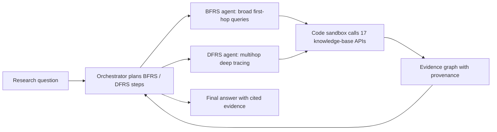

# Empowering biomedical evidence exploration and synthesis with deep knowledge graph research

> **Bibkey** `Wang_2026b` · **Venue** Nature Machine Intelligence (2026) · **Category** agents · **Relevance** high · **Access** paywall
> **Link** <https://doi.org/10.1038/s42256-026-01266-0> · `status: complete`

---

## One-liner
DeepEvidence is a biomedical deep-research agent: an orchestrator dispatches two kinds of subagent — breadth-first BFRS and depth-first DFRS — that write code to query 17 heterogeneous knowledge bases and the literature, while **incrementally building an evidence graph with provenance**. With the same base LLM (GPT-5) for every agent, it beats Biomni and ToolUniverse on four open benchmarks and on new drug-discovery, preclinical, clinical-trial and evidence-based-medicine tasks (Abstract; Figs. 1–5).

## Takeaways
- **Controlled comparison**: every agent (DeepEvidence, Biomni, ToolUniverse) runs on GPT-5, so gaps reflect agent design rather than the base model (Results §"DeepEvidence excels on biomedical research benchmarks").
- **The evidence graph itself is audited**: 10 graphs, 316 nodes/relations; provenance validity 100%, normalization 99.7%, but claim alignment (does the recorded observation match the cited source) is only 93.3% overall and 89.2% at node level — roughly one node observation in ten misstates its source (Fig. 5g).
- **Ablation: how tools are exposed matters more than "multi-agent" per se**: dumping all tool definitions in context (ReAct+MCP) gives 25.0% gap detection on the EBM task, adding code execution gives 80.0%, a naive Orchestrator+ReAct drops to 70.0%, and combining BFRS+DFRS is best (89.5%) (Fig. 5f).
- **Several benchmarks use proxy truths**: correct options for target identification, in vivo flux and surrogate endpoints are generated from KEGG pathway data by rules; for target identification and flux the authors state this is a controlled proxy, not clinical/in vivo truth, chosen to avoid LLM recall (Methods §"Curating target identification tasks", §"Curating in vivo metabolic flux response tasks"); for surrogate endpoints only the construction is described, with no such statement.
- **The gap the authors admit is Topic 2's entry point**: no explicit probabilistic or uncertainty-aware mechanism to reconcile conflicting evidence — it relies on the base LLM's parametric reasoning — and it is text-only (Discussion).
- Sample sizes are small (HLE-Medicine 30 questions; most built tasks n = 14–25), so many gaps sit inside wide confidence intervals. Our reading: read the CIs, not just the point estimates.

## Problem
Biomedical evidence is spread across resources that differ in structure, evolve continuously and rarely align: literature-derived knowledge (PubTator, PKG), pathways and function (KEGG, Gene Ontology), gene–disease associations (OpenTargets), unified chemical/gene annotation (BioThings), so cross-resource reasoning is hard in practice (Introduction). Generic deep-research systems (OpenAI DeepResearch, Gemini Deep Research, Perplexity Deep Research) work mainly over unstructured web text and fit poorly where key evidence lives in literature, structured databases, ontologies and knowledge graphs (Introduction). The authors also observe that general biomedical agents such as Biomni and ToolUniverse, despite many knowledge-base APIs, typically "issue only a few searches before answering", and their large tool suites cause tool confusion (Results).

## Method
**Step 1 Plan**: the orchestrator receives the research question, writes a plan, chooses the order and interplay of BFRS and DFRS, and sets the target of each step (Fig. 1d). It is a LangGraph state machine that tracks search budgets and manages the evidence graph (Methods §"Implementing the orchestrator and research agents").
**Step 2 Dispatch subagents**: the orchestrator calls a subagent through a tool call specifying the search target (entity names plus standard IDs such as PubTator IDs or UMLS CUIs — UMLS is the US National Library of Medicine's unified medical vocabulary, a CUI is a concept ID in it), the knowledge bases to use and an action budget (Methods). **BFRS** issues multigraph queries to sweep first-hop neighbourhoods (e.g. drugs linked to a disease across disease–drug and gene–disease graphs); **DFRS** goes multihop deep from the key entities BFRS surfaced (e.g. recursively tracing references to build a systematic-review evidence graph). They are not called BFS/DFS because the agent chooses traversal steps itself rather than following fixed graph rules; agents can also bridge graphs through shared entities or inferred cross-graph relations ("bridge entities", Fig. 1a).
**Step 3 Code as action**: every agent's main action is generated Python run in a sandbox — e.g. one gene search queries several databases in parallel, merges a dataframe and saves it to a shared workspace; runtime errors and failed API calls go back to the agent for self-correction in a ReAct loop; the sandbox enforces action budgets against infinite loops (Methods).
**Step 4 Tool library**: the paper says the tool library queries 17 knowledge bases/databases but lists only 16 (BioThings, ChEMBL, ClinicalTrials.gov, Gene Ontology, Human Phenotype Ontology, KEGG, NCBI Datasets, OpenFDA, Open Genes, ProteinAtlas, PubChem, PubTator, PubMed, Reactome, UMLS, UniProt); Open Targets is also queried (it has a GraphQL client and appears in the unified search tools). Our reading: Open Targets is probably the 17th, which the paper does not state. Each has a low-level client (auth, rate limits, errors, parsing) and high-level tool functions that return (DataFrame, formatted string). "Unified" tools such as `search_genes_unified` query MyGene.info, KEGG and Open Targets (optionally MyVariant.info) in parallel and merge cross-database IDs; PubTator3 supports relation search (TREAT, CAUSE, INTERACT, INHIBIT, ASSOCIATE). The system does **not** build a unified knowledge graph on the fly; it issues parallel targeted queries to external sources (Methods §"Implementing the knowledge graph tools").
**Step 5 Evidence graph as memory**: only high-value normalized entities (genes, diseases, drugs, pathways, papers, concrete findings) with canonical IDs, globally de-duplicated; edges from a controlled set (mechanistic, membership, association, evidence level); every node and relation carries provenance. The agent attaches short factual observations (setting, quantitative or mechanistic outcome) to entities, queries the graph before adding, merges near-duplicates, updates observations instead of creating nodes, and **records conflicting findings as separate evidence links** (Methods).
**Step 6 Conclude**: the orchestrator aggregates the subagents' findings into the answer (Fig. 1d). The authors stress this is **not GraphRAG** and not BFS/DFS over a pre-unified biomedical knowledge graph (Discussion).

## Method diagram


## Data
**Four open benchmarks (filtered and adapted)**: HLE-Medicine — Humanity's Last Exam questions labelled Medicine that need no image, **30 questions**; LabBench-LitQA2 — **184 questions** requiring literature search; SuperGPQA — Hard difficulty and Clinical Medicine field, **172 questions**; TrialPanorama-EvidenceQA — the most recent **50** EvidenceSummary questions with the **provided abstracts removed**, so agents must find the literature themselves (Methods §"Processing open benchmarks").
**New tasks** (Methods): target identification (from 85 KEGG human disease-pathway KGML files, 10 candidates, a rule engine scoring path polarity, top-10% betweenness centrality and druggability); target validation (30 curated questions with conflicting literature: evidence-hierarchy, context-applicability, and noise/temporal conflicts); mechanism-of-action (MOA) and pathway reasoning (expert-curated MCQs); in vivo metabolic flux response (truth from KEGG reaction-graph topology, 7 options); sample size estimation (25 most recent TrialPanorama trials, distractors = truth × 0.25–4.00); drug regimen design (toxicity/dose corpus from early-phase oncology combination trials, rule-based classes I–IV); surrogate endpoint discovery (KEGG drugs approved in 2025, 6–10 options); EBM evidence-gap discovery (Cochrane reviews whose conclusions changed between consecutive versions; truth = PMIDs included in the newer but not the older version); and two expert-rubric open-ended tasks (target prioritization, translational validation). The n in the figure panels: target identification / MOA / flux / sample size / regimen n = 25, surrogate endpoint n = 14, EBM n = 20 (Figs. 2–5).
Note: the abstract says "seven benchmark tasks", the Results text says "six new benchmark tasks", and Methods lists more — the paper's count is inconsistent. Test sets are public on HuggingFace (Data availability).

## Key results
All agents run on GPT-5; the baselines are GPT-5 and Sonnet-4.5 with literature search, plus Biomni and ToolUniverse (Results).
- **HLE-Medicine 40.0%**, Biomni 20.0%, GPT-5 3.3% (text and Fig. 1e agree). ToolUniverse and Sonnet-4.5 **disagree between text and figure**: text says ToolUniverse 10.0% and Sonnet-4.5 3.3%, Fig. 1e shows ToolUniverse 6.7% and Sonnet-4.5 10.0%. Our reading: on 30 questions, 40% is 12 questions and 3.3% is a single question.
- **LabBench-LitQA2 64.7%**, Biomni 48.9%, ToolUniverse 25.0%; Fig. 1e shows GPT-5 50.0% and Sonnet-4.5 44.0% — search-equipped GPT-5 is slightly above Biomni (Results; Fig. 1e).
- **SuperGPQA-Medicine-Hard 47.1%**, Sonnet-4.5 43.6%, Biomni 40.7% (Fig. 1e: ToolUniverse 37.2%, GPT-5 29.4%); **TrialPanorama-EvidenceQA 96.0%**, Sonnet-4.5 88.0%, Biomni 84.0% (Fig. 1e: ToolUniverse 73.7%, GPT-5 72.0%).
- **Target identification** 68%, Biomni 56%, general LLMs 42%, ToolUniverse 40% (Fig. 2b); **MOA and pathway reasoning** 72%, Biomni and ToolUniverse both 44%, LLMs 52% (Fig. 3b); **in vivo flux** 80%, Biomni 68%, LLMs 60%, ToolUniverse 52% (Fig. 3d).
- **Expert rubrics (vs Biomni only)**: target prioritization better on 5 of 8 dimensions and comparable on 3, overall 1.40 vs 1.15 (P < 0.001) (Fig. 2c); translational validation better on 6 of 8, overall 1.64 (1.47–1.81) vs 1.46 (1.39–1.54) (P < 0.05), with hallucination control 1.2 vs 1.0 and uncertainty calibration 1.8 vs 1.3, but causal reasoning depth 1.8 vs 1.9 (Fig. 3f).
- **Trial design**: sample size 68%, ToolUniverse 32%, PubMed-search LLM 24%, Biomni 20% (Fig. 4c); regimen design 52%, Biomni 36%, ToolUniverse 28%, LLMs 20% (Fig. 4e); surrogate endpoints precision/recall/F1 = 73.2/75.0/73.3%, Biomni 60.8/64.3/60.9%, ToolUniverse 57.7/69.0/61.9%, LLMs 58.4/61.9/58.7% (Fig. 4g).
- **EBM evidence gap**: gap detection rate (at least one true positive in the top 30) 90.0%, Biomni 50.0%, ToolUniverse 15.0%, LLMs 10.0%; recall@30 44.14%, Biomni 30.17%, ToolUniverse 5.06%, LLMs 2.67% (Fig. 5d).
- **Ablation (EBM task, precision / recall / gap detection)**: ReAct+MCP 1.1/3.7/25.0%; +CodeExec 17.8/36.8/80.0%; Orchestrator+ReAct 15.3/33.9/70.0%; BFRS-only 24.5/26.5/65.0%; DFRS-only 19.9/37.1/80.0%; full DeepEvidence 38.6/44.1/89.5% (Fig. 5f; note 89.5% here vs 90.0% in Fig. 5d). The text's wording is loose rather than contradictory: it says "all naive multi-agent variants underperform the single-agent ReAct+MCP+CodeExec baseline", then adds that "in particular" the vanilla Orchestrator+ReAct is worse on all dimensions, "whereas introducing structured BFRS or DFRS strategies improves performance". In the table DFRS-only (19.9/37.1/80.0%) is not below ReAct+MCP+CodeExec (17.8/36.8/80.0%) on any metric, and BFRS-only (24.5/26.5/65.0%) is higher only on precision. Our reading: "naive" here should mean Orchestrator+ReAct.
- **Evidence-graph quality (manual audit of 10 graphs, 316 items)**: provenance validity 100%, normalization 99.7%, duplication 0.6%, relation-level correctness ≥ 99%; claim alignment 93.3% overall (nodes 89.2%, relations 100%), with errors mostly from nuanced misreading of literature statements rather than wrong entity linking (Results; Fig. 5g).
The authors' explanation: baselines do not lack tools; they explore shallowly and large tool suites make them pick wrong tools, whereas DeepEvidence runs structured BFRS–DFRS exploration guided by the evidence graph (Results).

## Contributions
- Moves deep research from web text to heterogeneous biomedical sources, with unified search interfaces and a code sandbox that queries many databases in parallel.
- Two research strategies, BFRS and DFRS, orchestrated together; the ablation shows they are complementary and neither alone matches the combination (Fig. 5f).
- **An explicit evidence graph as a first-class memory**: canonical IDs, controlled relations, per-item provenance, conflicting evidence kept as separate links — and a manual quality audit of the graph itself (Fig. 5g).
- A task suite spanning drug discovery → preclinical → clinical trials → EBM; the "target validation under conflicting evidence" and "Cochrane version-diff evidence gap" constructions are reusable designs.

## Limitations
- Authors: knowledge-source coverage is incomplete and the benchmarks reflect only a subset of research tasks (Discussion).
- Authors: it currently relies on well-curated sources like KEGG and Gene Ontology with stable schemas and good APIs; proprietary or in-house sources (missing values, inconsistent structure, incomplete interfaces) would require the agent to build new tools (Discussion).
- Authors: **no explicit probabilistic modelling or uncertainty-aware mechanism to reconcile conflicting findings**; it relies on the base LLM's parametric reasoning, and calibrated confidence or probabilistic reasoning is future work (Discussion).
- Authors: only two strategies, unlikely optimal; not expert-level on many tasks; text-only — imaging, structural biology and proteomics are out of scope (Discussion). Full reproducibility is limited by LLM non-determinism and evolving APIs (Methods).
- Our reading: truths for target identification, flux and surrogate-endpoint MCQs are generated from KEGG topology rules while DeepEvidence can itself query KEGG; the authors say KEGG gives only partial structure and does not yield answers directly, but the "question source = available tool" overlap deserves caution.
- Our reading: small n (14–30), text–figure mismatch on HLE, inconsistent task counts; expert rubrics compare only with Biomni, and the number of raters and their agreement are not reported in the main text.

## Relation to our direction
This maps most directly onto **Topic 2 (verifying the claims of biomedical analysis agents)** — it is the closest reference for the claim-to-evidence step.
Our reading: (1) **the evidence graph is a working prototype of claim → evidence tracing**: canonical IDs, provenance per item, conflicting evidence stored separately. Topic 2 wants to trace each agent claim to code, data or literature; DeepEvidence supplies the literature/knowledge-base side of that data structure, and what is missing is the side for "data and statistics the agent itself computed". (2) **Its audit of its own graph (Fig. 5g) is nearly a template for Topic 2's metrics**: is the provenance real, are entities normalized, does the recorded observation faithfully reflect the source (claim alignment). Even in a system built for evidence, node-level claim alignment is only 89.2% — evidence that "cited ≠ supported" and that an independent verifier is needed. (3) **The uncertainty mechanism it admits lacking** is what Topic 2 aims to add: grade evidence (number the code produced / reproducible result / statement the cited paper really makes) and give each claim a calibrated confidence. (4) It is text-only; Topic 1's kidney single-cell/spatial "known answers" (which cells are diseased, which are doublets or low-quality) can supply ground truth for data-side evidence. (5) The same-base-LLM control and the "Cochrane version diff" trick for building ground truth automatically both transfer to our benchmark design.
On the detect → model → revert chain, our reading: it sits after the last step — when the virtual tissue nominates genes/perturbations to revert an anomaly, a BFRS/DFRS + evidence-graph search could collect literature and trial evidence to rank wet-lab candidates; but evidence credibility must be combined with data-level confidence, which the paper does not do.

## Reusable assets
- **Code:** the DeepEvidence implementation inside the BioDSA repo (Code availability).
<https://github.com/RyanWangZf/BioDSA/tree/main/biodsa/agents/deepevidence>
- **Data:** the test datasets used in the experiments (Data availability).
<https://huggingface.co/datasets/zifeng-ai/DeepEvidence>
- **Eval designs:** the four evidence-graph audit metrics (provenance validity, normalization, claim alignment, duplication rate; Fig. 5g); the three-way evidence-conflict taxonomy (Methods §"Curating target validation tasks"); Cochrane version diffs as ground truth (Methods §"Curating EBM tasks").

## Follow-ups
- Biomni (`biomni-biorxiv-2025` in this repo) and ToolUniverse (arXiv:2509.23426, not yet in this repo) — the two agent baselines here.
- Supplement: the orchestrator / BFRS / DFRS / evidence-graph prompts (Supplementary Notes A.1–A.4) and the expert rubrics (Supplementary Tables 11–12).
- The same group's GeneAgent (Nat. Methods 2025, a self-verifying gene-set analysis agent using domain databases; ref. 10 here) — directly relevant to claim verification.
- How LAB-Bench (`lab-bench-arxiv-2024`) and TrialPanorama build questions and ground truth.

## Cite
```bibtex
@article{Wang_2026b, title={Empowering biomedical evidence exploration and synthesis with deep knowledge graph research}, volume={8}, ISSN={2522-5839}, url={http://dx.doi.org/10.1038/s42256-026-01266-0}, DOI={10.1038/s42256-026-01266-0}, number={7}, journal={Nature Machine Intelligence}, publisher={Springer Science and Business Media LLC}, author={Wang, Zifeng and Chen, Zheng and Yang, Ziwei and Wang, Xuan and Jin, Qiao and Peng, Yifan and Lu, Zhiyong and Sun, Jimeng}, year={2026}, month=jul, pages={1142–1156} }
```


---

📄 **[AI-ready full-text extract →](ai-ready.md)**
