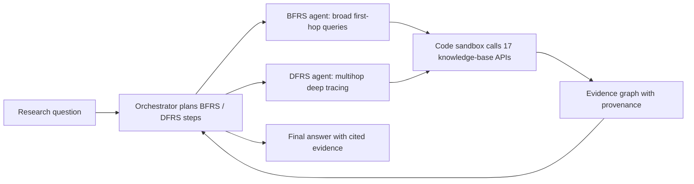

# Empowering biomedical evidence exploration and synthesis with deep knowledge graph research

> **文献键** `Wang_2026b` · **来源** Nature Machine Intelligence(2026) · **类别** agents · **相关度** high · **获取** paywall
> **链接** <https://doi.org/10.1038/s42256-026-01266-0> · `status: complete`

---

## 一句话
DeepEvidence 是一个面向生物医学的 deep research agent:一个 orchestrator 调度两类子 agent —— 广度优先的 BFRS 和深度优先的 DFRS —— 通过写代码去查 17 个异构知识库与文献,同时**增量构建一张带出处(provenance)的 evidence graph**;在同一底座 LLM(GPT-5)下,它在 4 个公开基准和一组新建的药物发现、临床前、临床试验、循证医学任务上都超过 Biomni 与 ToolUniverse(Abstract;Fig. 1–5)。

## 要点
- **公平对照**:所有 agent(含 DeepEvidence、Biomni、ToolUniverse)都跑在 GPT-5 上,所以差距来自 agent 设计而非底座模型(Results §"DeepEvidence excels on biomedical research benchmarks")。
- **Evidence graph 本身被审计过**:10 张图、316 个节点/关系,provenance 有效 100%,实体规范化 99.7%,但 claim alignment(记录的观察是否忠实于被引来源)只有 93.3%,节点级 89.2% —— 即约十分之一的节点观察与原文不符(Fig. 5g)。
- **消融说明"怎么接工具"比"多 agent"更重要**:把所有工具定义塞进上下文(ReAct+MCP)在循证任务上 gap detection 只有 25.0%,加代码执行升到 80.0%;朴素的 Orchestrator+ReAct 反而降到 70.0%;BFRS+DFRS 合起来最好(89.5%)(Fig. 5f)。
- **多个基准的答案是"代理真值"**:靶点识别、体内代谢通量、替代终点等任务的正确选项由 KEGG 通路数据按规则生成;对靶点识别和代谢通量两项,作者明说这是可控的代理真值、不代表临床/体内真相,目的是避免 LLM 凭记忆答题(Methods §"Curating target identification tasks"、§"Curating in vivo metabolic flux response tasks");替代终点一项只描述了构造方法,没有同样的声明。
- **作者自认的空白正是课题 2 的入口**:没有显式的概率/不确定性机制去调和冲突证据,只靠底座 LLM 的参数化推理;且只处理文本(Discussion)。
- 样本量很小(HLE-Medicine 30 题,多数自建任务 n = 14–25),很多差距落在宽置信区间内。我们的理解:读数字时要看 CI,不能只看点估计。

## 研究问题
生物医学证据散落在结构不同、持续变化、彼此难以对齐的资源里:文献衍生知识(PubTator、PKG)、通路与功能注释(KEGG、Gene Ontology)、基因–疾病关联(OpenTargets)、统一化学/基因注释(BioThings)等,跨资源推理在实践中很难(Introduction)。通用 deep research 系统(OpenAI DeepResearch、Gemini Deep Research、Perplexity Deep Research)主要处理非结构化网页文本,不适合关键证据分布在文献、结构化数据库、本体(ontology)和知识图谱里的生物医学场景(Introduction)。作者还观察到,Biomni、ToolUniverse 这类通用生物医学 agent 虽然接了很多知识库 API,但往往"只查几次就回答",庞大的工具集还会造成 tool confusion(Results)。

## 方法
**第 1 步 规划**:orchestrator 接收研究问题,先写研究计划,决定 BFRS 与 DFRS 的先后与组合,并给每一步指定研究目标(Fig. 1d)。实现上用 LangGraph 状态机,跟踪搜索预算并管理 evidence graph(Methods §"Implementing the orchestrator and research agents")。
**第 2 步 派发子 agent**:orchestrator 通过 tool call 调用子 agent,参数包括检索目标(实体名 + 标准化 ID,如 PubTator ID 或 UMLS CUI —— UMLS 是美国国立医学图书馆的医学术语统一词表,CUI 是其中的概念编号)、要查的知识库和本次的 action 预算(Methods)。**BFRS** 做多图查询,快速扫一跳邻域(如跨 disease–drug、gene–disease 图找与某疾病相关的药物);**DFRS** 在 BFRS 找到的关键实体上做多跳深挖(如沿参考文献递归追溯,构建系统综述用的证据图)。作者不叫 BFS/DFS,因为遍历步骤由 agent 自主选择,不遵循固定图论规则;agent 还能通过共享实体或推断的跨图关系在不同知识图之间"架桥"(bridge entities,Fig. 1a)。
**第 3 步 以代码为动作**:所有 agent 的主要动作是生成 Python 代码并在沙箱中运行 —— 例如一次基因检索会并行查多个库、合并成 dataframe、存到共享工作区;运行错误和失败的 API 调用会回传给 agent,在 ReAct 循环里自我修正;沙箱强制 action 预算,防止死循环(Methods)。
**第 4 步 工具库**:论文称工具库可查询 17 个知识库/数据库,但列出的只有 16 个(BioThings、ChEMBL、ClinicalTrials.gov、Gene Ontology、Human Phenotype Ontology、KEGG、NCBI Datasets、OpenFDA、Open Genes、ProteinAtlas、PubChem、PubTator、PubMed、Reactome、UMLS、UniProt);Open Targets 也被查询(有 GraphQL client,并出现在统一检索工具中)。我们的理解:Open Targets 应是第 17 个,但论文没有明说。每个库两层封装:底层 client(认证、限流、错误处理、解析)+ 高层工具函数,统一返回 (DataFrame, 格式化字符串)。另有"统一检索"工具,如 `search_genes_unified` 并行查 MyGene.info、KEGG、Open Targets(可选 MyVariant.info)并合并跨库 ID;PubTator3 支持按语义关系检索(TREAT、CAUSE、INTERACT、INHIBIT、ASSOCIATE)。作者强调**不会**即时构建统一知识图,而是对外部源做并行定向查询(Methods §"Implementing the knowledge graph tools")。
**第 5 步 evidence graph 作为记忆**:图中只存高价值、规范化的实体(基因、疾病、药物、通路、论文、具体发现),用规范 ID 并全局去重;边来自受控的关系集合(机制、成员、关联、证据等级),每个节点和关系都带出处。agent 把简短的事实性观察(实验设置、定量或机制结果)挂在实体上;添加前先查图、合并近似重复、更新观察而非新建节点,**冲突的发现用不同的证据链接分别记录**(Methods)。
**第 6 步 汇总**:orchestrator 汇总各子 agent 的发现给出最终答案(Fig. 1d)。作者明确说这**不是 GraphRAG**,也不是在预先统一的生物医学知识图上做 BFS/DFS(Discussion)。

## 方法图


## 数据
**四个公开基准(经筛选改造)**:HLE-Medicine —— Humanity's Last Exam 中学科为 Medicine、且不需要图像的题,共 **30 题**;LabBench-LitQA2 —— **184 题**,需检索文献;SuperGPQA —— 难度 Hard 且领域为 Clinical Medicine,**172 题**;TrialPanorama-EvidenceQA —— 取 EvidenceSummary 任务最新 **50 题**,并**删去原题给出的摘要**,迫使 agent 自己去找文献(Methods §"Processing open benchmarks")。
**新建任务**(Methods):靶点识别(从 85 个 KEGG 人类疾病通路 KGML 文件构建,10 个候选,规则引擎按路径极性、介数中心性前 10%、可成药性过滤打分);靶点验证(30 道人工整理、文献证据相互冲突的题,分证据等级冲突、情境适用冲突、证据噪声/时间不一致三类);作用机制(MOA)与通路推理(领域专家整理的多选题);体内代谢通量响应(由 KEGG 反应图拓扑生成真值,7 个选项);样本量估计(TrialPanorama 最新 25 个试验,干扰项为真值乘以 0.25–4.00 的扰动);给药方案设计(来自早期肿瘤联合用药试验的毒性/剂量语料,规则分为 I–IV 类);替代终点发现(2025 年 KEGG 新批准药物,6–10 个选项);循证医学(EBM)证据缺口发现(结论在相邻两版之间改变过的 Cochrane 系统综述,真值 = 新版纳入、旧版未纳入的研究 PMID);以及两个由专家按量表打分的开放题(靶点优先级排序、转化验证)。各图注中的 n:靶点识别/MOA/通量/样本量/给药方案 n = 25,替代终点 n = 14,EBM n = 20(Figs. 2–5)。
注意:摘要说"seven benchmark tasks",Results 正文说"six new benchmark tasks",Methods 实际列出的更多 —— 原文计数前后不一。测试集公开在 HuggingFace(Data availability)。

## 主要结果
所有 agent 都用 GPT-5;基线为带文献检索的 GPT-5 与 Sonnet-4.5、以及 Biomni 与 ToolUniverse(Results)。
- **HLE-Medicine 40.0%**,Biomni 20.0%,GPT-5 3.3%(正文与 Fig. 1e 一致)。ToolUniverse 与 Sonnet-4.5 的数字**正文和图不一致**:正文写 ToolUniverse 10.0%、Sonnet-4.5 3.3%,Fig. 1e 画的是 ToolUniverse 6.7%、Sonnet-4.5 10.0%。我们的理解:30 题里 40% 就是 12 题,3.3% 只是 1 题。
- **LabBench-LitQA2 64.7%**,Biomni 48.9%,ToolUniverse 25.0%;Fig. 1e 中 GPT-5 50.0%、Sonnet-4.5 44.0% —— 带检索的 GPT-5 其实略高于 Biomni(Results;Fig. 1e)。
- **SuperGPQA-Medicine-Hard 47.1%**,Sonnet-4.5 43.6%,Biomni 40.7%(Fig. 1e:ToolUniverse 37.2%、GPT-5 29.4%);**TrialPanorama-EvidenceQA 96.0%**,Sonnet-4.5 88.0%,Biomni 84.0%(Fig. 1e:ToolUniverse 73.7%、GPT-5 72.0%)。
- **靶点识别** 68%,Biomni 56%,通用 LLM 42%,ToolUniverse 40%(Fig. 2b);**MOA 与通路推理** 72%,Biomni 与 ToolUniverse 均 44%,LLM 52%(Fig. 3b);**体内代谢通量** 80%,Biomni 68%,LLM 60%,ToolUniverse 52%(Fig. 3d)。
- **专家量表(只和 Biomni 比)**:靶点优先级排序 8 个维度中 5 个更好、其余 3 个相当,总分 1.40 vs 1.15(P < 0.001)(Fig. 2c);转化验证 8 个维度中 6 个更好,总分 1.64(1.47–1.81)vs 1.46(1.39–1.54)(P < 0.05),其中 hallucination control 1.2 vs 1.0、uncertainty calibration 1.8 vs 1.3,causal reasoning depth 反而 1.8 vs 1.9(Fig. 3f)。
- **临床试验设计**:样本量估计 68%,ToolUniverse 32%,PubMed 检索 LLM 24%,Biomni 20%(Fig. 4c);给药方案 52%,Biomni 36%,ToolUniverse 28%,LLM 20%(Fig. 4e);替代终点 precision/recall/F1 = 73.2/75.0/73.3%,Biomni 60.8/64.3/60.9%,ToolUniverse 57.7/69.0/61.9%,LLM 58.4/61.9/58.7%(Fig. 4g)。
- **EBM 证据缺口**:gap detection rate(前 30 个候选中至少有 1 个真阳性)90.0%,Biomni 50.0%,ToolUniverse 15.0%,LLM 10.0%;recall@30 44.14%,Biomni 30.17%,ToolUniverse 5.06%,LLM 2.67%(Fig. 5d)。
- **消融(EBM 任务,precision / recall / gap detection)**:ReAct+MCP 1.1/3.7/25.0%;+CodeExec 17.8/36.8/80.0%;Orchestrator+ReAct 15.3/33.9/70.0%;BFRS-only 24.5/26.5/65.0%;DFRS-only 19.9/37.1/80.0%;完整 DeepEvidence 38.6/44.1/89.5%(Fig. 5f;注意此处 89.5% 与 Fig. 5d 的 90.0% 略有出入)。正文的措辞偏松,但不算自相矛盾:它说"所有朴素多 agent 变体都不如单 agent 的 ReAct+MCP+CodeExec",紧接着又说"特别是"vanilla Orchestrator+ReAct 在所有维度上都更差,而"引入 BFRS 或 DFRS 结构后表现提升"。表中 DFRS-only(19.9/37.1/80.0%)在三项上都不低于 ReAct+MCP+CodeExec(17.8/36.8/80.0%),BFRS-only(24.5/26.5/65.0%)则只在 precision 上更高。我们的理解:这里的"朴素"应指 Orchestrator+ReAct。
- **Evidence graph 质量(人工审计 10 张图、316 项)**:provenance 有效 100%,规范化 99.7%,重复率 0.6%,关系级正确率 ≥ 99%;claim alignment 总体 93.3%(节点 89.2%,关系 100%),错误多来自对文献表述的细微误读而非实体链接错误(Results;Fig. 5g)。
作者的解释:基线不缺工具,而是探索太浅、工具太多导致选错工具;DeepEvidence 在 evidence graph 引导下做结构化的 BFRS–DFRS 探索(Results)。

## 创新点
- 把 deep research 从网页文本搬到异构生物医学知识源上,用统一检索接口 + 代码沙箱一次并行查多个库。
- BFRS / DFRS 两种研究策略由 orchestrator 编排;消融显示二者互补,单独任何一个都不如组合(Fig. 5f)。
- **显式 evidence graph 作为一等记忆结构**:规范 ID、受控关系、逐项出处、冲突证据分开记录,并对图本身做了人工质量审计(Fig. 5g)。
- 一组覆盖药物发现 → 临床前 → 临床试验 → 循证医学的新任务,其中"证据冲突下的靶点验证"和"Cochrane 版本差分找证据缺口"两种构造方式可复用。

## 局限
- 作者自述:知识源覆盖不完整,基准只代表一部分研究任务(Discussion)。
- 作者自述:目前依赖 KEGG、Gene Ontology 这类 schema 稳定、API 质量高的库;私有或内部数据源(缺失值、结构不一致、接口不全)需要 agent 自己造工具(Discussion)。
- 作者自述:**没有显式概率建模或不确定性机制来调和冲突证据**,靠底座 LLM 的参数化推理来权衡;未来可加入概率推理或校准置信度(Discussion)。
- 作者自述:只有 BFRS/DFRS 两种策略,不太可能最优;很多任务未达专家水平;只处理文本,影像、结构生物学、蛋白组未纳入(Discussion)。完全复现受 LLM 不确定性和外部 API 变化限制(Methods)。
- 我们的理解:靶点识别、通量、替代终点等选择题的真值由 KEGG 拓扑规则生成,而 DeepEvidence 本身就能查 KEGG;作者说 KEGG 只给局部结构、不能直接给出答案,但这种"出题源 = 可查工具"的关系仍值得警惕。
- 我们的理解:样本量小(n = 14–30),HLE 正文与图数字不一致,任务数量表述前后不一;专家量表只与 Biomni 对比,且未报告评审人数和一致性。

## 与本研究方向的关系
这篇最直接对应 **课题 2(生物医学分析 agent 的结论核查)**—— 它是"结论 ↔ 证据"这一环最贴切的参照。
我们的理解:(1) **evidence graph 是"结论 → 证据"追溯的一个可执行原型**:每个节点有规范 ID 和出处,冲突证据分开存。课题 2 要做的是把 agent 的每条结论追溯到代码、数据或文献,DeepEvidence 已经给出了"文献 / 知识库"这一侧的数据结构,我们缺的是"agent 自己跑出的数据与统计"这一侧。(2) **它对自己的 evidence graph 做的审计(Fig. 5g)几乎就是课题 2 的评测指标原型**:provenance 是否真实、实体是否规范、记录的观察是否忠实于来源(claim alignment)。即使是这个专门为证据设计的系统,节点级 claim alignment 也只有 89.2% —— 这正说明"有引用 ≠ 被支撑",需要独立的核查器。(3) **它自认缺失的不确定性机制**正是课题 2 想补的:把证据分级(代码跑出的数字 / 可复现的结果 / 文献确实写了的话),再给结论一个校准过的置信度。(4) 它只处理文本;课题 1 的肾脏单细胞/空间组学"已知答案"(哪些是疾病细胞、哪些是 doublet 或低质量细胞)可以给"数据侧证据"提供真值。(5) 同底座 LLM 的对照设计和"Cochrane 版本差分"这种自动构造真值的思路,都可以直接搬到我们的基准设计里。
在 detect → model → revert 链条上,我们的理解:它位于链尾之后 —— 当 virtual tissue 提名"哪些基因/扰动能把异常拉回正常"时,用类似的 BFRS/DFRS + evidence graph 去查文献与试验证据,给湿实验排序;但证据可信度必须加上数据层的置信度,这一步论文没有做。

## 可复用资产
- **代码:** DeepEvidence 实现(BioDSA 仓库内,Code availability)。
<https://github.com/RyanWangZf/BioDSA/tree/main/biodsa/agents/deepevidence>
- **数据:** 实验所用测试集(Data availability)。
<https://huggingface.co/datasets/zifeng-ai/DeepEvidence>
- **评测设计:** evidence graph 四项审计指标(provenance validity、normalization、claim alignment、duplication rate,Fig. 5g);证据冲突三分类(Methods §"Curating target validation tasks");Cochrane 版本差分构造真值(Methods §"Curating EBM tasks")。

## 待读
- Biomni(本仓库 `biomni-biorxiv-2025`)与 ToolUniverse(arXiv:2509.23426,本仓库尚无条目)—— 本文的两个 agent 基线。
- 补充材料:orchestrator / BFRS / DFRS / evidence-graph 的 prompt(Supplementary Notes A.1–A.4)和专家量表(Supplementary Tables 11–12)。
- 同组的 GeneAgent(Nat. Methods 2025,用领域数据库做自我核查的基因集分析 agent,本文 ref. 10)—— 与"结论核查"直接相关。
- LAB-Bench(本仓库 `lab-bench-arxiv-2024`)与 TrialPanorama 的出题与真值方式。

## 引用
```bibtex
@article{Wang_2026b, title={Empowering biomedical evidence exploration and synthesis with deep knowledge graph research}, volume={8}, ISSN={2522-5839}, url={http://dx.doi.org/10.1038/s42256-026-01266-0}, DOI={10.1038/s42256-026-01266-0}, number={7}, journal={Nature Machine Intelligence}, publisher={Springer Science and Business Media LLC}, author={Wang, Zifeng and Chen, Zheng and Yang, Ziwei and Wang, Xuan and Jin, Qiao and Peng, Yifan and Lu, Zhiyong and Sun, Jimeng}, year={2026}, month=jul, pages={1142–1156} }
```


---

📄 **[AI-ready 全文提取 →](ai-ready.md)**
