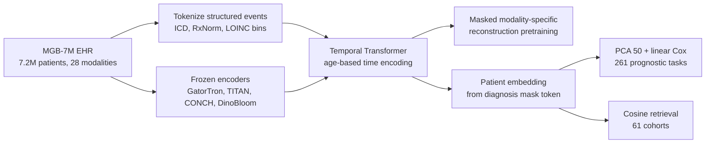

# A multimodal and temporal foundation model for virtual patient representations at healthcare system scale

> **Bibkey** `Zhang2026_260418570` · **Venue** arXiv preprint (2026) · **Category** ehr · **Relevance** medium · **Access** open
> **Link** <https://arxiv.org/abs/2604.18570> · `status: complete`

---

## One-liner
APOLLO (Mahmood lab, Mass General Brigham): a temporal Transformer pretrained by modality-specific masked reconstruction on **7,155,044 patients, ~25.3B medical events and 28 modalities** (codes, medications, labs, vitals, flowsheets, clinical text, pathology/blood-smear images) from 17 hospitals, 1992–2025, compressing a whole care history into one "virtual patient" vector. Frozen vector → PCA → linear Cox beats an age–sex baseline on most of 261 prognostic tasks in a 1.43M-patient held-out test set, and supports patient retrieval on 61 cohorts (Abstract; Results).

## Takeaways
- **For the Sinai EHR project**: the scale (7.2M patients, one academic health system on Epic, uncurated data) matches Sinai's millions, so this is the most direct reference for "what if we use every modality"; the engineering details (binned lab tokens, LLM normalization of local flowsheet names and categorical answers, frozen text/pathology encoders) map almost one-to-one (Online Methods).
- **The evaluation protocol is worth copying**: one snapshot–endpoint pair per patient per task, a τ-dependent blackout period, 4:1 case-cohort sampling for training, natural censoring kept in test, time-dependent AUC plus calibration (ICI/MCE) (Online Methods, "Evaluation framework", "Metrics").
- **Many strong kidney/cardiometabolic endpoints**: 3-year new-onset CKD AUC 0.749→0.863; CKD stage 3→4+ 0.587→0.777; hypertension→CKD 0.686→0.820; AKI after NSAIDs 0.796→0.906 (Extended Data Tables 7, 9, 13) — a ready task list with target numbers for Sinai.
- **Mind the weak baseline**: the main text compares mostly with age–sex; the Extended Data tables also report a "latest progress-note embedding" baseline, which is already strong on some tasks (e.g. in-hospital dialysis dependence balanced accuracy 0.882 vs APOLLO 0.974 and age–sex 0.655; Extended Data Table 15). No head-to-head with clinical scores or other EHR foundation models (Discussion).
- **Ablation**: on the neoplasm-progression set, multimodality adds only +0.025 mean AUROC over structured-only (0.735 vs 0.71), while dropping pretraining (same architecture, supervised per task) costs 0.109 (Results, "Ablation studies").
- Our reading: for detect → model → revert, APOLLO is a patient-scale "model" (the authors themselves invoke the virtual cell), but they state that treatment-response tasks are prognostic stratification within a treated cohort and cannot say which drug is best for a patient — the counterfactual interface that "revert" needs is still missing (Discussion).

## Problem
The EHR is medicine's system of record, but its data sit in modality silos and are high-dimensional, sparse and irregularly sampled (Introduction). Existing longitudinal EHR foundation models (refs 25–35) mostly use structured data only (codes, labs), thanks to ontologies (ICD-10, SNOMED, LOINC) and discrete-token modelling, whereas progression detail, clinical reasoning and novel biomarkers often live only in free text and images. Much prior work also relies on curated public data (e.g. ICU-only MIMIC-IV). The question: on **real, uncurated, all-department** health-system data, can the full longitudinal record — structured + text + images — be unified into one time-aware patient representation that generalizes across onset, progression, treatment response, adverse events, hospital operations and retrieval? The authors liken this to multimodal "virtual cell" models (Introduction).

## Method
1. **Extraction and cleaning**: SQL extraction of Epic data from a Snowflake warehouse, de-identification, removal of duplicates and implausible timestamps (Online Methods, "Data acquisition").
2. **Structured tokenization**: diagnoses → ICD-10, medications → RxNorm ingredients, labs/vitals → LOINC. Numeric values are unit-reconciled, transformed by sign(x)·log(|x|+1) and cut into 10 equal-width bins (the middle 8 span the 2.5th–97.5th percentiles, plus one extreme bin at each end); categorical answers are canonicalized by a two-LLM "agentic workflow" (e.g. "pos"/"+" → positive). Tokens are (code, bin) or (code, category): **235,768** learnable embeddings (Online Methods, "Preprocessing").
3. **Frozen encoders for unstructured data**: all clinical text with GatorTron-base (long notes chunked and averaged); whole-slide images (WSI) with TITAN; blood smears with DinoBloom; electron-microscopy and gross images with CONCHv1.5; radiology and other imaging via report text only. Demographics: sex as a category token, ethnicity via bert-base-uncased embeddings (averaged if several), age via an MLP (Online Methods).
4. **Model**: each event = content embedding (lookup for structured, modality projector for unstructured) + a time MLP on the patient's age at the event (replacing positional encodings); 3 demographic tokens and a CLS token are prepended; the core is a base-size Transformer encoder (12 layers, 768-d, 12 heads), drawn in Fig. 1g together with modality heads as an encoder–decoder (Online Methods, "Architecture").
5. **Pretraining objective**: events are masked with probability 0.3 using modality-specific mask vectors (telling the model which modality to reconstruct). Structured tokens: classification within the modality vocabulary (labs/flowsheets further restricted by LOINC CLASS; classes for vitals/flowsheets assigned by Qwen-32B), cross-entropy. Unstructured: regression to the original encoder embedding, MSE + cosine distance. 1,536-event contiguous windows, AdamW, up to 30,000 iterations, 8×A100-80GB (Online Methods, "Masking", "Implementation details").
6. **Patient embedding**: at inference a "diagnosis mask" token with the last visit's time encoding is appended and its hidden state is the patient vector (history capped at the latest 100,000 events); for retrieval a text or image mask can be used instead (Online Methods, "Patient representation"; Results).
7. **Downstream evaluation**: frozen embedding → PCA to the top 50 components (fit on training only) → lifelines Cox proportional hazards (time-to-event, right-censored); training uses case-cohort sampling (censored:events ≤ 4:1) and the baseline hazard is re-estimated on validation with Breslow; the main metric is time-dependent cumulative/dynamic AUC at a fixed τ, balanced accuracy for operations tasks; 95% CIs from 100 bootstraps. Comparators: age+sex Cox, latest progress-note embedding, structured-only APOLLO, and a same-architecture supervised model without pretraining (Online Methods, "Evaluation framework", "Baselines").
8. **Interpretability**: patient-level leave-one-token-out (LOTO: remove one event at a time and recompute risk); population-level Integrated Gradients on pre-Transformer inputs, restricted to the top hazard quartile (Results; Online Methods, "Interpretability").

## Method diagram


## Data
**MGB-7M**: 17 Mass General Brigham hospitals and affiliated clinics, 1992–2025; 7,155,044 patients (3,915,625 male / 3,236,747 female), 25,296,943,893 events (Results; Extended Data Table 1). Extended Data Table 2: flowsheets 22,936,351,260; labs 1,442,631,333; vitals 505,193,723; medications 112,189,178; diagnoses 39,144,980; clinical notes 182,296,303 (158,683,290 progress notes); diagnostic reports 77,978,881 (radiology 46,643,405, pathology 12,935,526, …); images 1,158,235 (blood smears 522,190, WSIs 311,769, gross 165,837, EM 158,439). Split 75:5:20 train/val/test; every downstream task comes from the 1,431,009-patient test set (Results). Tasks: 95 new-onset (≥60k patients each, 157–27,503 events), 78 progression, 59 treatment response, 17 adverse events, 12 hospital operations, 61 retrieval cohorts (Results; Extended Data Tables 6–17). Data shared only case by case with an MTA (Data availability).

## Key results
- **New onset (95 tasks)**: significantly better than age–sex on 74/95 (p<0.05); 1-year all-cause mortality AUROC **0.92** (age–sex 0.72, Fig. 3d); 3-year heart failure 0.77→0.88; 1-year acute MI 0.68→0.82 (Fig. 3d shows 0.67; Extended Data Table 7 0.675→0.817); 1-year schizophrenia 0.65→0.92; 3-year type 2 diabetes 0.61→0.85; 1-year gout 0.74→0.83 (Results, "new disease onset"; Fig. 3d).
- **Progression (78 tasks)**: 53/78 significant; cardiovascular average 0.65→0.75; hypertension→heart failure at 5 years 0.75→0.86; 3-year survival after stroke 0.72→0.84, after aortic stenosis 0.72→0.83; asthma exacerbation 0.57→0.83; melanoma 3-year survival 0.71→0.87; CML 0.75→0.83 but not significant (Results; Fig. 3e).
- **Treatment response (59) and adverse events (17)**: 30/59 significant; stroke-free survival on apixaban for AF 0.69→0.81; trastuzumab 0.66→0.93. Adverse events 12/17 significant; AKI after NSAIDs 0.80→0.91, GI bleeding 0.80→0.91; T2D after corticosteroids 0.70→0.87 (Results; Fig. 3f–g).
- **Hospital operations (12 tasks, balanced accuracy, input up to 24 h after ED admission, τ = 6 days)**: 9/12 significant; in-hospital dialysis dependence 0.65→0.97 (incidence only 0.02%; the latest-progress-note baseline already reaches 0.882); acute kidney failure 0.64→0.80; sepsis 0.66→0.79; 30-day readmission 0.54→0.62 (Results; Fig. 3h; Extended Data Tables 14–15).
- **Kidney tasks (Extended Data tables, AUC; age–sex → APOLLO)**: 3-year new-onset CKD 0.749→0.863 (Table 7); hypertension→CKD at 5 years 0.686→0.820; CKD stage 2→3 at 5 years 0.622→0.705; CKD stage 3→4+ at 3 years 0.587→0.777; heart failure→acute kidney failure at 1 year 0.525→0.724 (Table 9); ESRD-free survival on lisinopril for CKD at 3 years 0.618→0.742 (Table 11).
- **Ablation (28 neoplasm-progression tasks; the abstract says 30)**: APOLLO mean AUROC 0.735; structured-only 0.71; supervised without pretraining 0.626; latest progress note 0.615; age–sex 0.619; on CML mortality +0.31 over the progress-note baseline and +0.23 over supervised (Results, "Ablation studies"; Fig. 3i; Extended Data Fig. 17).
- **Retrieval**: index of 1.4M test patients (all embedded as of 2025-01-01), 61 SQL cohorts of the form "diagnosis THEN first-line drug"; Acc@5 beats the latest-progress-note baseline on every cohort; retrieves a patient lacking the Z94.0 kidney-transplant code but with transplant complications (T86.19), dialysis (Z99.2) and tacrolimus; supports natural-language inclusion criteria and an external TCGA slide as queries (Results; Fig. 4; Extended Data Fig. 18).
- **Calibration and explanations**: tasks with larger samples are better calibrated (Extended Data Figs. 9–16). LOTO example: one patient's 3-year CKD risk rises after hypertension, dyslipidaemia and T2D are recorded and jumps when eGFR falls to the low 50s (Fig. 5a); IG for heart failure→acute kidney failure highlights obesity, post-procedural states and ageing proxies (Fig. 5e). The authors treat attributions as associative, not causal (Results).

## Contributions
- Claimed by the authors as the first multimodal foundation model unifying the full longitudinal record (structured + text + images, 28 modalities) into a time-aware patient representation (Discussion).
- Frozen off-the-shelf unimodal encoders + a trained temporal Transformer only: raw data never enter the final model, which the authors argue lowers PHI-leakage risk and keeps compute feasible (Results).
- Modality-specific masks serve both as the pretraining target and as an inference-time "prompt", so one model yields diagnosis-, text- or image-tuned patient embeddings and cross-modal retrieval (Results; Fig. 1h).
- A 322-task evaluation framework (261 prognostic + 61 retrieval), all time-to-event, with Kaplan–Meier stratification and calibration curves (Extended Data Figs. 1–16).

## Limitations
- **Stated by the authors**: observational data, associational predictions; treatment-response tasks stratify within a treated cohort and cannot say which drug is best for a patient (Discussion).
- **Stated by the authors**: one health system only (MGB, shared Epic instance, mostly northeastern US) — within-system generalization, no external validation (Discussion).
- **Stated by the authors**: the common comparator is age–sex; no head-to-head with ASCVD, CHA₂DS₂-VASc, HEART or Framingham; frozen encoders and simple averaging of long notes; no wearables, lifestyle or patient–provider conversations (Discussion).
- Our reading: headline jumps such as dialysis dependence 0.65→0.97 are relative to age–sex; the latest-progress-note baseline already gets 0.882, and with 0.02% incidence balanced accuracy rests on very few positives. There is also no comparison with other EHR foundation models and no second health system such as Sinai.
- Preprint; code only "upon publication", data not public (Code / Data availability).

## Relation to our direction
**First, the Sinai EHR project.** APOLLO is the most direct reference for an "all-modality" approach on data of the same order (millions of patients, one US academic health system on Epic, uncurated). Engineering choices that map one-to-one: log + binned tokens for lab values, LLM normalization of local flowsheet names and categorical answers, frozen text/pathology encoders, modality masks as prompts, Cox time-to-event evaluation with calibration throughout, case-cohort sampling (Online Methods). Our reading: its ablation shows multimodality adds only +0.025 over structured-only while pretraining vs no pretraining differs by 0.109 — for Sinai, getting self-supervised pretraining on structured data right may pay off more than wiring in every modality at once; the kidney rows of the Extended Data tables (new-onset CKD, CKD stage progression, hypertension→CKD, heart failure→acute kidney failure, AKI after NSAIDs, dialysis dependence) can serve directly as a cardiometabolic-kidney task list with reference numbers; and evaluations should also report strong baselines like the latest progress note, not only age–sex.
**Then detect → model → revert (our reading).** APOLLO is a patient-scale "model": the authors invoke the virtual cell and call it a virtual patient; it embeds slides with TITAN/CONCH, the same Mahmood-lab encoder family available for the H&E side of Topic 1 (kidney omics anomaly detection). It does not do "revert": the authors state the counterfactual task (differential outcomes across therapies for the same patient) remains open. For Topic 2 (verifying agent claims): the authors separate IG attributions into "established risk factors / care-process proxies / multimorbidity and shared-risk markers / a few testable hypothesis-generating signals" and warn against reading attributions as intervention targets — directly reusable as an evidence-grading scheme for agents drawing conclusions from EHR.

## Reusable assets
- **Code:** pretraining and evaluation pipeline (risk prediction, retrieval) to be released for academic use "upon publication"; not yet public (Code availability).
- **Data:** MGB-7M not public; case by case with an MTA (Data availability).
- **Public encoders used:** GatorTron-base (clinical text), TITAN (WSI), CONCHv1.5 (EM/gross images), DinoBloom (blood smears), bert-base-uncased (ethnicity strings).
- **Task definitions:** Extended Data Tables 6, 8, 10, 12, 14, 16 list endpoint ICD/drug codes, τ, sample size and incidence for every task; Tables 7, 9, 11, 13, 15, 17 give full metrics for each baseline — a template task list for Sinai.
<https://arxiv.org/abs/2604.18570>

## Follow-ups
- The remaining kidney/cardiometabolic rows of Extended Data Tables 7–15 (nephrotic syndrome, pyelonephritis, kidney cancer, dialysis-related) with CIs.
- The other longitudinal EHR foundation models cited (refs 25–35) — look for external validation or head-to-head clinical-score comparisons.
- The TITAN paper (ref. 43), compared with this repo's pathology foundation-model entries.
- Track whether the published version adds external validation and code.

## Cite
```bibtex
@misc{Zhang2026_260418570,
  title = {A multimodal and temporal foundation model for virtual patient representations at healthcare system scale},
  author = {Andrew Zhang and Tong Ding and Sophia J. Wagner and Caiwei Tian and Ming Y. Lu and Rowland Pettit and Joshua E. Lewis and Alexandre Misrahi and Dandan Mo and Long Phi Le and Faisal Mahmood},
  year = {2026},
  eprint = {2604.18570},
  archivePrefix = {arXiv},
  url = {https://arxiv.org/abs/2604.18570}
}
```


---

📄 **[AI-ready full-text extract →](ai-ready.md)**
