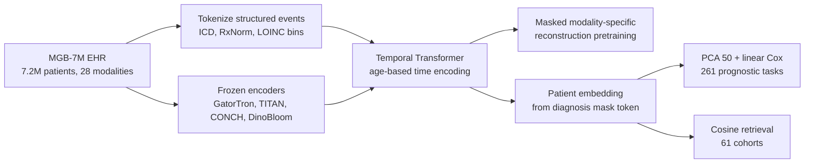

# A multimodal and temporal foundation model for virtual patient representations at healthcare system scale

> **文献键** `Zhang2026_260418570` · **来源** arXiv preprint(2026) · **类别** ehr · **相关度** medium · **获取** open
> **链接** <https://arxiv.org/abs/2604.18570> · `status: complete`

---

## 一句话
APOLLO(Mahmood 组,Mass General Brigham):在 17 家医院 1992–2025 年 **7,155,044 名病人、约 253 亿条医疗事件、28 种模态**(诊断码、用药、化验、生命体征、flowsheet、临床文本、病理/血涂片图像)上用「模态特定 mask 的掩码重建」预训练一个时间 Transformer,把整个就医史压成一个「虚拟病人」向量;冻结向量 → PCA → 线性 Cox,在 143 万人留出测试集的 261 个预后任务上多数显著超过年龄-性别基线,并支持 61 个队列的病人检索(Abstract;Results)。

## 要点
- **对 Sinai EHR 项目**:单一学术医疗系统(720 万人、Epic、未精修数据)上「用上全部模态」的最直接参照;工程细节(化验分 bin token、LLM 规范化本地 flowsheet 命名与分类答案、冻结文本/病理编码器)几乎可以逐条对照(Online Methods)。
- **评测口径值得照搬**:每个任务一个 snapshot–endpoint 对、按 τ 设 blackout 期、case-cohort 采样 4:1、测试集保留自然删失率、报 time-dependent AUC + 校准(ICI/MCE)(Online Methods「Evaluation framework」「Metrics」)。
- **肾/心代谢终点多且强**:3 年新发 CKD AUC 0.749→0.863;CKD 3 期→4 期以上 0.587→0.777;高血压→CKD 3 期以上 0.686→0.820;NSAID 后 AKI 0.796→0.906(Extended Data Tables 7、9、13)—— 可直接作为 Sinai 上的任务清单和目标数值。
- **基线偏弱要注意**:正文主要对比年龄-性别;Extended Data 表里还有「最近一份病程记录嵌入」基线,它在部分任务上已很强(如住院透析依赖 balanced accuracy 0.882 vs APOLLO 0.974,年龄-性别 0.655;Extended Data Table 15)。作者在 Discussion 中说明未与临床评分(ASCVD、CHA₂DS₂-VASc 等)正面比较;我们的理解:文中也没有与其他 EHR 基础模型比较。
- **消融**:在肿瘤进展任务集上,多模态比纯结构化只多 +0.025 平均 AUROC(0.735 vs 0.71),而去掉预训练(同架构逐任务监督)差 0.109(Results「Ablation studies」)。
- 我们的理解:对 detect → model → revert,APOLLO 是病人尺度的「model」(作者自己类比 virtual cell),但作者明确说疗效任务只是同一用药队列内的预后分层,不能回答「哪种药对该病人最好」—— revert 所需的反事实接口仍缺(Discussion)。

## 研究问题
EHR 是医疗的记录系统,但数据分散在各模态孤岛中,且维度高、稀疏、采样不规则(Introduction)。已有纵向 EHR 基础模型(refs 25–35)大多只用结构化数据(诊断码、化验),因为有现成本体(ICD-10、SNOMED、LOINC)和离散 token 建模;而病程细节、医学推理和新型生物标志物常常只在自由文本和图像里。许多已有工作还依赖精修过的公开数据(作者举例:局限于特定科室的 MIMIC-IV)。问题:能否在一个**真实、未精修、覆盖全部科室**的医疗系统数据上,把结构化 + 文本 + 图像的完整纵向病历统一成一个时间感知的病人表示,并证明它在发病、进展、疗效、不良事件、医院运营、检索等大量任务上通用?作者把这一设想类比为整合多模态数据的「virtual cell」(Introduction)。

## 方法
1. **数据抽取与清洗**:从 Snowflake 分析库用 SQL 抽取 Epic 数据,去标识化,去重、清理异常时间戳(Online Methods「Data acquisition」)。
2. **结构化 token 化**:诊断 → ICD-10,用药 → RxNorm 成分,化验/生命体征 → LOINC。数值先统一单位,做 sign(x)·log(|x|+1),再分成 10 个等宽 bin(中间 8 个覆盖 2.5–97.5 百分位,两端各一个极值 bin);分类型结果用「两个 LLM 的 agentic 流程」规范到每个检验的标准答案集(如 "pos"/"+" → positive)。最终 token = (代码, bin) 或 (代码, 类别),共 **235,768** 个可学习嵌入(Online Methods「Preprocessing」)。
3. **非结构化用冻结编码器**:所有临床文本用 GatorTron-base(超长分块后取平均);全切片病理图(WSI)用 TITAN;血涂片用 DinoBloom;电镜与大体图像用 CONCHv1.5;放射等其他影像只用其报告文本。人口学:性别为类别 token,种族用 bert-base-uncased 嵌入后取均值,年龄用 MLP(Online Methods)。
4. **模型**:每个事件 = 内容嵌入(结构化查表,或非结构化经模态投影层)+ 时间 MLP(事件时刻年龄,替代位置编码);前置 3 个人口学 token 和 CLS;主体是 base 尺寸 Transformer encoder(12 层、768 维、12 头),Fig. 1g 将其与各模态重建头合称 encoder–decoder(Online Methods「Architecture」)。
5. **预训练目标**:以概率 0.3 随机 mask 事件,mask 向量按模态区分(告诉模型要重建哪种模态)。结构化 token:在同模态词表内做分类(化验/flowsheet 再按 LOINC CLASS 限定子词表;生命体征/flowsheet 的类别由 Qwen-32B 指派),交叉熵;非结构化:回归原编码器嵌入,MSE + 余弦距离。窗口 1,536 个连续事件,AdamW,最多 30,000 步,8×A100-80GB(Online Methods「Masking」「Implementation details」)。
6. **病人嵌入**:推理时在序列末尾追加一个带最后时刻时间编码的「诊断 mask」token,取其隐状态作为病人向量(最多取最近 10 万个事件);检索时可换成文本或图像 mask(Online Methods「Patient representation」;Results)。
7. **下游评估**:冻结嵌入 → PCA 取前 50 维(只在训练集拟合)→ lifelines Cox 比例风险模型(time-to-event,右删失);训练集 case-cohort 采样(删失:事件 ≤ 4:1),基线风险在验证集用 Breslow 重估;主指标是固定 τ 的 time-dependent cumulative/dynamic AUC,运营任务用 balanced accuracy;100 次 bootstrap 给 95% CI。对照:年龄+性别 Cox、最近病程记录嵌入、仅结构化 APOLLO、同架构无预训练的逐任务监督模型(Online Methods「Evaluation framework」「Baselines」)。
8. **可解释性**:个体层面 leave-one-token-out(LOTO,逐个删事件看风险变化);人群层面在 Transformer 之前的输入上算 Integrated Gradients,只看风险前 25% 的病人(Results;Online Methods「Interpretability」)。

## 方法图


## 数据
**MGB-7M**:Mass General Brigham 17 家医院及附属诊所,1992–2025 年;7,155,044 名病人(男 3,915,625 / 女 3,236,747),25,296,943,893 条事件(Results;Extended Data Table 1)。Extended Data Table 2:flowsheet 22,936,351,260;化验 1,442,631,333;生命体征 505,193,723;用药 112,189,178;诊断 39,144,980;临床文本 182,296,303 份(其中病程记录 158,683,290);诊断报告 77,978,881 份(放射 46,643,405、病理 12,935,526 等);图像 1,158,235 张(血涂片 522,190、WSI 311,769、大体 165,837、电镜 158,439)。诊断报告来自 12 个主要医学领域,用药覆盖 ATC 全部 14 个大类,诊断码覆盖 ICD 全部章节(Results;Extended Data Tables 2–4)。按 75:5:20 划分训练/验证/测试;下游任务全部来自 1,431,009 人的测试集(Results)。任务:新发疾病 95(每个 ≥6 万人,事件数 157–27,503)、进展 78、疗效 59、不良事件 17、医院运营 12、检索队列 61(Results;Extended Data Tables 6–17)。数据仅按个案审批 + MTA 共享(Data availability)。

## 主要结果
- **新发疾病(95 任务)**:74/95 显著优于年龄-性别(p<0.05);1 年全因死亡 AUROC **0.92**(年龄-性别 0.72,Fig. 3d);3 年心衰 0.77→0.88;1 年急性心梗 0.68→0.82(Fig. 3d 标为 0.67,Extended Data Table 7 为 0.675→0.817);1 年精神分裂症 0.65→0.92;3 年 2 型糖尿病 0.61→0.85;1 年痛风 0.74→0.83(Results「new disease onset」;Fig. 3d)。
- **疾病进展(78 任务)**:53/78 显著;心血管类平均 0.65→0.75;高血压→心衰 5 年 0.75→0.86;卒中后 3 年生存 0.72→0.84;主动脉瓣狭窄后 3 年生存 0.72→0.83;哮喘急性加重 0.57→0.83;黑色素瘤 3 年生存 0.71→0.87;CML 0.75→0.83 但不显著(Results;Fig. 3e)。
- **疗效(59 任务)与不良事件(17 任务)**:疗效 30/59 显著;作用于内分泌系统的药物平均 0.57→0.80;房颤用阿哌沙班无卒中生存 0.69→0.81;高血压用氯沙坦 / 氨氯地平的无 MACE 生存 AUROC 0.80 / 0.79;曲妥珠单抗 0.66→0.93。不良事件 12/17 显著;NSAID 后 AKI 0.80→0.91、消化道出血 0.80→0.91;糖皮质激素后 2 型糖尿病 0.70→0.87(Results;Fig. 3f–g)。
- **医院运营(12 任务,balanced accuracy;10 个急性任务输入为急诊入院后 24 小时内数据、τ=6 天,住院时长为住院后 24 小时、τ=6 天,30 天再入院从出院起、τ=30 天;Extended Data Table 14)**:9/12 显著;住院透析依赖 0.65→0.97(该任务发生率仅 0.02%;最近病程记录基线已达 0.882);急性肾衰 0.64→0.80;脓毒症 0.66→0.79;30 天再入院 0.54→0.62(Results;Fig. 3h;Extended Data Tables 14–15)。
- **肾相关任务(Extended Data 表,AUC;年龄-性别 → APOLLO)**:3 年新发 CKD 0.749→0.863(Table 7);高血压→CKD 3 期以上 5 年 0.686→0.820;CKD 2→3 期 5 年 0.622→0.705;CKD 3→4 期以上 3 年 0.587→0.777;心衰→急性肾衰 1 年 0.525→0.724(Table 9);CKD 用赖诺普利的无 ESRD 生存 3 年 0.618→0.742(Table 11)。
- **消融(肿瘤进展 28 任务;摘要写作 30 任务)**:APOLLO 平均 AUROC 0.735;仅结构化 0.71;无预训练的监督模型 0.626;最近病程记录 0.615;年龄-性别 0.619;CML 死亡上比病程记录基线 +0.31、比监督模型 +0.23(Results「Ablation studies」;Fig. 3i;Extended Data Fig. 17)。
- **检索**:索引为 140 万测试病人(统一截至 2025-01-01),61 个「诊断 THEN 一线用药」SQL 队列,Acc@5 在全部队列上高于最近病程记录基线;能找回缺少 Z94.0(肾移植状态)码但有移植并发症 T86.19、透析 Z99.2 和他克莫司的病人;支持自然语言入组标准和外部 TCGA 切片查询(Results;Fig. 4;Extended Data Fig. 18)。
- **校准与解释**:较大样本的任务校准更好(Extended Data Figs. 9–16)。LOTO 示例:一名病人 3 年 CKD 风险在高血压、血脂异常、2 型糖尿病记录后上升,eGFR 降到 50 出头时再跳升(Fig. 5a);IG 对心衰→急性肾衰突出肥胖、术后状态和衰老代理特征(Fig. 5e)。作者把归因视为关联,而非因果(Results)。

## 创新点
- 作者称其为首个把完整纵向病历(结构化 + 文本 + 图像,28 种模态)统一成时间感知病人表示的多模态基础模型(Discussion)。
- 冻结现成单模态编码器 + 只训练时间 Transformer:原始数据不进入最终模型,作者认为降低 PHI 泄漏风险,同时计算上可行(Results)。
- 模态特定 mask 同时用作预训练目标和推理时的「提示」,同一模型可给出偏向诊断、文本或图像的病人嵌入,支持跨模态检索(Results;Fig. 1h)。
- 322 个任务的评测框架:261 个 time-to-event 预后任务 + 61 个检索任务(检索用 Acc@k / mAP 评估),附 Kaplan–Meier 分层与校准曲线(Extended Data Figs. 1–16)。

## 局限
- **作者自述**:观察性数据,预测是关联而非因果;疗效任务只是同一用药队列内的预后分层,不能回答哪种药对该病人最好(Discussion)。
- **作者自述**:只有一个医疗系统(MGB,共享 Epic,主要代表美国东北部),只是系统内泛化,没有外部验证(Discussion)。
- **作者自述**:共同对照是年龄-性别(正文主要对比;另有最近病程记录、仅结构化、无预训练监督等基线),未与 ASCVD、CHA₂DS₂-VASc、HEART、Framingham 等临床评分正面比较;冻结编码器、长文本简单平均;无可穿戴、生活方式、医患对话数据(Discussion)。
- 我们的理解:正文的 0.65→0.97 透析依赖等「大跳升」是相对年龄-性别而言;最近病程记录基线已到 0.882,而该任务发生率仅 0.02%,极少数正例下 balanced accuracy 的方差会很大。另外未与其他 EHR 基础模型对比,也没有 Sinai 这样的第二家系统验证。
- 预印本;代码「发表后」才开放,数据不公开(Code / Data availability)。

## 与本研究方向的关系
**先说 Sinai EHR 项目。** APOLLO 是在单一美国学术医疗系统(720 万人、Epic、未精修)数据上「全模态」做法的最直接参照,可逐条对照的工程选择有:化验数值的 log + 分 bin token、用 LLM 规范本地 flowsheet 命名与分类答案、冻结的文本/病理编码器、模态 mask 作为提示、全部用 Cox time-to-event + 校准评估、case-cohort 采样(Online Methods)。我们的理解:它的消融显示多模态比纯结构化只多 +0.025,而预训练 vs 无预训练差 0.109 —— 对 Sinai 而言,先把结构化数据的自监督预训练做好,可能比一开始就接入所有模态更划算;Extended Data 中的肾任务行(CKD 新发、CKD 分期进展、高血压→CKD 3 期以上、心衰→急性肾衰、NSAID 后 AKI、透析依赖)可以直接作为 Sinai 上的心-代谢-肾任务清单与参考数值;另外,评估时应同时报告「最近病程记录」这类强基线,而不只是年龄-性别。
**再说 detect → model → revert(我们的理解)。** APOLLO 是病人尺度的「model」:作者自己用 virtual cell 作类比并称其为 virtual patient;它也用 TITAN/CONCH 嵌入病理切片,与伪影注入课题H&E 侧可用的编码器同属 Mahmood 组。它没有做 revert:作者明确说反事实任务(同一病人换不同疗法的结局差异)尚待解决。对 Agent 可信度课题:作者把 IG 归因区分为「已知危险因素 / 护理过程代理 / 多病共存与共享风险环境 / 少量可检验的假设信号」,并强调不能把归因当作干预靶点,这可以直接借作 agent 基于 EHR 下结论时的证据分级。

## 可复用资产
- **代码:** 预训练与评估流水线(风险预测、检索)将在「发表后」面向学术开放;目前未公开(Code availability)。
- **数据:** MGB-7M 不公开,按个案审批 + MTA(Data availability)。
- **文中使用的公开编码器:** GatorTron-base(临床文本)、TITAN(WSI)、CONCHv1.5(电镜/大体图)、DinoBloom(血涂片)、bert-base-uncased(种族文本)。
- **任务定义:** Extended Data Tables 6、8、10、12、14、16 给出各任务的终点 ICD/用药码、样本量和发生率(预后任务另有 τ;Table 16 为检索队列,无 τ);7、9、11、13、15 给出年龄-性别、最近病程记录与 APOLLO 三个模型的完整指标,17(检索)只有最近病程记录与 APOLLO 两行(Acc@k、mAP)(仅结构化与监督基线只见 Fig. 3i 与 Extended Data Fig. 17) —— 可作为 Sinai 任务清单模板。
<https://arxiv.org/abs/2604.18570>

## 待读
- Extended Data Tables 7–15 中其余肾/心代谢行(肾病综合征、肾盂肾炎、肾癌、透析相关)的完整数值与 CI。
- 引用的其他纵向 EHR 基础模型(refs 25–35),找有外部验证或与临床评分正面比较的工作。
- TITAN 原文(ref 43),与本仓库病理基础模型条目对照。
- 跟踪正式发表版本是否补充外部验证与代码。

## 引用
```bibtex
@misc{Zhang2026_260418570,
  title = {A multimodal and temporal foundation model for virtual patient representations at healthcare system scale},
  author = {Andrew Zhang and Tong Ding and Sophia J. Wagner and Caiwei Tian and Ming Y. Lu and Rowland Pettit and Joshua E. Lewis and Alexandre Misrahi and Dandan Mo and Long Phi Le and Faisal Mahmood},
  year = {2026},
  eprint = {2604.18570},
  archivePrefix = {arXiv},
  url = {https://arxiv.org/abs/2604.18570}
}
```


---

📄 **[AI-ready 全文提取 →](ai-ready.md)**
