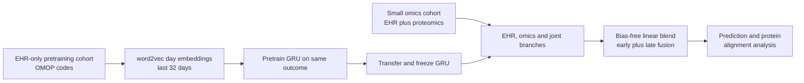

# A machine learning approach to leveraging electronic health records for enhanced omics analysis

> **Bibkey** `Mataraso_2025` · **Venue** Nature Machine Intelligence (2025) · **Category** ehr · **Relevance** medium · **Access** open
> **Link** <https://doi.org/10.1038/s42256-024-00974-9> · `status: complete`

---

## One-liner
COMET (Aghaeepour lab, Stanford): omics studies usually have tens to hundreds of samples while the matching EHR covers tens of thousands — pretrain a GRU on the large EHR-only cohort, transfer its frozen weights into a multimodal EHR + omics network that adaptively blends early and late fusion; on a 61-person pregnancy proteomics cohort (days to labour) and a 559-person UK Biobank cancer proteomics cohort (3-year mortality) it beats a same-architecture baseline without pretraining, and the proteins it relies on agree better with known biology (Abstract; Results).

## Takeaways
- **For the Sinai EHR project**: COMET's "pretrain on big EHR → transfer to a small omics cohort" is designed for the asymmetry of many EHR patients and few omics samples (Introduction). Our reading: any health system with many EHR patients but few with omics or biopsies fits this asymmetry; among this batch of EHR papers it is also the only one linking EHR to molecular data.
- **Numbers**: days to labour Pearson r 0.868 (joint baseline 0.815, proteomics-only 0.796, EHR-only 0.768); 3-year cancer mortality AUROC 0.842 / AUPRC 0.504 (joint baseline 0.786 / 0.365) (Results).
- **A clean ablation**: the joint baseline is architecturally identical to COMET, differing only in pretraining; pretraining also helps ridge, logistic and Transformer variants (Results).
- **Beyond prediction**: the authors also count significant correlations between EHR latent dimensions and proteins (pregnancy 3,201→5,364; cancer 0→7,591) and validate important proteins in external datasets (Results).
- **An open question the authors state**: whether it helps omics modalities needing complex architectures (their example: spatial transcriptomics) is unknown; pretraining needs a labelled EHR task (Discussion).
- Our reading: for detect → model → revert, COMET is a prototype interface between patient clinical trajectories and molecular features, but it is correlational — an important protein is not an actionable target.

## Problem
Omics is high-dimensional, but clinical and budget limits cap cohort size and hurt replication; in ML, false positives appear as overfitting (Introduction). Existing remedies (feature priors, transfer learning, deep Cox) mostly learn from omics or metadata alone. EHRs are increasingly accessible (MIMIC, UK Biobank, OMOP-standardized hospital databases), but EHR–omics integration has a structural tension: early/intermediate fusion needs both modalities complete (dropping the many EHR-only patients), while late fusion cannot learn cross-modal interactions (Introduction). The question: how can **many EHR-only patients** improve modelling and biological discovery in a **small omics cohort**?

## Method
1. **EHR extraction**: concept codes from the OMOP measurement, observation, drug_exposure, condition_occurrence and procedure_occurrence tables (concept_id 0 removed). Pregnancy: from pregnancy start (280 days before birth) up to sampling; cancer: up to sampling for the omics cohort and up to the first C-prefixed ICD-10 code (cancer diagnosis) for the pretraining cohort; deaths from the OMOP death table (Methods).
2. **EHR embedding**: all codes of one patient-day form a "sentence" (shuffled, since many timestamps — especially for conditions — are unreliable); word2vec learns 400-d code embeddings (a separate word2vec model for the pretraining and omics cohorts); codes are averaged per day into one summary embedding, using up to the 32 most recent days (Methods, "Embedding process").
3. **Pretraining**: a GRU-RNN + linear head trained on the EHR-only pretraining cohort for the same outcome as the target. Pregnancy: cut the EHR at a random point in the last 100 days of pregnancy and predict days to labour (MSE); cancer: 3-year all-cause mortality (BCE) (Results; Methods).
4. **Multimodal network**: three branches — EHR (transferred, frozen GRU + linear), omics (a single linear layer for pregnancy; a one-hidden-layer ReLU MLP for cancer) and joint (linear layer on concatenated EHR latent + omics); a final **bias-free linear layer** weights the three predictions — an adaptive blend of early and late fusion (Methods, "COMET deep learning architecture"; Fig. 1c).
5. **Training protocol**: 3-fold CV + grid search for hyperparameters; then 25 repeats with different 70/15/15 splits (patient-level, so one person's samples stay together); early stopping after 5 epochs without improvement; final metrics from predictions averaged over the 25 validation sets (Methods).
6. **Comparators**: EHR-only, omics-only, and a joint baseline (same architecture, no pretraining); ridge/logistic regression and variants using pretrained coefficients as priors β₀ (objective ‖y−Xβ‖² + λ‖β−γβ₀‖²); COMET Transformer (2 layers, 4 heads, 128-d, up to 1,024 tokens) (Methods).
7. **Biology analyses**: correlations between each of the 400 EHR latent dimensions and each protein (counted after multiple-testing correction); Integrated-Gradients protein importance; the 50 most important proteins among those weighted more by COMET than by the baseline (and vice versa for the baseline set) tested for outcome association in external datasets (14 / 12 of them found externally for pregnancy, 18 / 18 for cancer); intermediate-node performance; "parameter-space" t-SNE trajectories (built from each network's outputs at every epoch) (Results; Methods, "External validation", "Parameter-space visualization").

## Method diagram


## Data
**Pregnancy cohort (Stanford)**: 30,904 people delivering at Stanford 2013–2021, EHR from STARR OMOP; **61** of them (all spontaneous labour; C-sections and inductions excluded) gave 2–3 blood draws in the last 100 days, 171 plasma samples, measured on an aptamer platform for 1,317 proteins (1,305 after removing 12 controls); the other 30,843 form the pretraining cohort; metabolomics from the same cohort as a second omics type (Results; Methods, "Datasets"). **Cancer cohort (UK Biobank)**: 36,901 people diagnosed with any cancer from 12 months before to 5 years after enrolment; **559** have enrolment-blood proteomics within 12 months after diagnosis (UKB proteomics covers 53,058 participants, median 2,894 proteins), the other 36,342 form the pretraining cohort; 3-year mortality in the omics cohort 5.5% (Results; Methods). External validation uses a public pregnancy plasma-proteomics dataset and a breast-cancer proteomics dataset (Methods, "External validation").

## Key results
- **Days to labour**: COMET Pearson r = **0.868** (95% CI 0.825–0.900, RMSE 16.0 days); joint baseline 0.815 (18.4 days); proteomics-only 0.796 (20.2 days); EHR-only 0.768 (20.4 days). Metabolomics: COMET 0.839 vs metabolites alone 0.758 (Results; Fig. 2c).
- **3-year cancer mortality**: COMET AUROC **0.842** (0.744–0.922), AUPRC **0.504** (0.341–0.670); joint baseline 0.786 / 0.365; EHR-only 0.749 / 0.205; proteomics-only 0.737 / 0.325 (Results; Fig. 4c).
- **Pretraining helps other models too**: pretrained priors raise ridge joint r from 0.572 to 0.799; logistic AUPRC 0.263→0.279 with priors; COMET Transformer r = 0.848, slightly below the GRU version (Results; Supplementary Tables 3–4, 6).
- **EHR–protein alignment**: significant EHR-latent–protein correlations rise from 3,201 (joint baseline) to **5,364** (COMET) in pregnancy and from 0 to **7,591** in cancer. In COMET, IL1RL1 (ST2), cystatin C and plexin-B2 correlate with 76%, 68% and 68% of latent dimensions, proteins the authors note are known pregnancy-progression players (Results; Figs. 3a–b, 5a–b).
- **External validation**: in pregnancy, proteins COMET weights more (14 found externally) have mean |r| = 0.22 with time to labour vs 0.12 for baseline-favoured proteins (12) (difference 0.109, p = 0.0276); in cancer, 9 of 18 vs 8 of 18 are significantly associated with mortality (Results; Figs. 3d, 5d).
- **Mechanism**: lower test loss at matched training loss, and COMET models occupy separate parts of the parameter space (built from network outputs) than baselines (Fig. 6e,f) — the authors call it "regularization by initialization" (Results; Fig. 6).

## Contributions
- To the authors' knowledge, the first approach using EHR transfer learning to improve omics analysis (Discussion).
- Handles the "many EHR, few omics" asymmetry: pretraining uses all EHR patients while the multimodal stage still learns cross-modal interactions (Introduction; Fig. 1).
- Adds biological consistency as an evaluation axis: EHR-latent–protein alignment counts and external validation of important proteins (Results).
- The pretraining gain holds for GRU, Transformer, ridge and logistic models (Results).

## Limitations
- **Stated by the authors**: generalization to other architectures needs study; whether similar gains hold when the omics branch must be more complex (e.g. spatial transcriptomics) is unknown; EHR data are manually mapped OMOP extracts that may contain errors; labels are needed in the EHR pretraining data, with self-supervised pretraining left for future work (Discussion).
- Our reading: very small omics cohorts (61 / 559) and wide CIs (cancer AUROC 0.744–0.922, overlapping heavily with the joint baseline's 0.664–0.882); external validation is indirect (univariate association of important proteins), and the cancer gap of 9/18 vs 8/18 is small.
- Our reading: the EHR representation is coarse (word2vec with daily means, shuffled within-day codes, last 32 days only), and pretraining uses the same outcome as the target, so each new outcome needs new pretraining; only tabular omics (proteomics, metabolomics) were tested.

## Relation to our direction
**First, the Sinai EHR project.** Our reading: among this batch of EHR papers it is the only one linking EHR to molecular data, so it is the most direct bridge between the Sinai EHR project and the lab's omics/tissue work. Where EHR patients far outnumber those with omics or biopsies, COMET's "pretrain on big EHR → transfer to a small omics cohort" matches that asymmetry. Swap pregnancy/cancer for CKD progression and the pretraining task for eGFR decline or dialysis initiation, and you get a design reproducible at Sinai; the evaluation can reuse three pieces from this paper: a same-architecture joint baseline without pretraining as the ablation, EHR-latent–molecule correlation counts, and external validation of important features. The authors note EHR foundation models can already predict protein expression (ref. 36), so replacing the labelled GRU pretraining with a Delphi/APOLLO-style self-supervised patient representation is a natural next step.
**Then detect → model → revert (our reading).** The authors list spatial transcriptomics as unknown, and a multi-modal kidney-omics design of this kind is what the artifact-injection topic faces. One extension: use EHR-pretrained patient representations as sample-level covariates or priors that help separate "clinically abnormal" from "technical artefact" — one more independent line of evidence beside cross-modal agreement. COMET links patient-scale clinical trajectories to molecular-scale features, an interface prototype from EHR-level detect towards molecular-level model/revert; but it is correlational — an important protein is not an actionable target.

## Reusable assets
- **Code:** full COMET code, including UK Biobank cohort-extraction queries and a tutorial; Zenodo 10.5281/zenodo.13977341 (Code availability).
<https://github.com/samson920/COMET>
- **Data:** pregnancy proteomics on Dryad (10.5061/dryad.280gb5mpd); Stanford EHR not shareable; UK Biobank part via application; pregnancy external-validation data at nalab.stanford.edu/multiomicsmulticohortpreterm/ (Data availability).
- **Evaluation design:** a same-architecture joint baseline without pretraining as the ablation; EHR-latent–molecule correlation counts; external validation of important features; ridge/logistic with prior β₀ as a lightweight alternative.

## Follow-ups
- Ref. 36 (Seong et al., Brief. Bioinform. 2024): generating pregnant patients' biological profiles from clinical records with EHR foundation models — directly relevant to replacing labelled pretraining with self-supervision.
- Replace COMET's GRU pretraining with a Delphi/APOLLO-style self-supervised patient representation and test whether small-omics-cohort gains grow.
- Search for existing EHR + kidney biopsy/omics integration work (whether KPMP has linkable clinical trajectories).

## Cite
```bibtex
@article{Mataraso_2025, title={A machine learning approach to leveraging electronic health records for enhanced omics analysis}, volume={7}, ISSN={2522-5839}, url={http://dx.doi.org/10.1038/s42256-024-00974-9}, DOI={10.1038/s42256-024-00974-9}, number={2}, journal={Nature Machine Intelligence}, publisher={Springer Science and Business Media LLC}, author={Mataraso, Samson J. and Espinosa, Camilo A. and Seong, David and Reincke, S. Momsen and Berson, Eloise and Reiss, Jonathan D. and Kim, Yeasul and Ghanem, Marc and Shu, Chi-Hung and James, Tomin and Tan, Yuqi and Shome, Sayane and Stelzer, Ina A. and Feyaerts, Dorien and Wong, Ronald J. and Shaw, Gary M. and Angst, Martin S. and Gaudilliere, Brice and Stevenson, David K. and Aghaeepour, Nima}, year={2025}, month=Jan, pages={293–306} }
```


---

📄 **[AI-ready full-text extract →](ai-ready.md)**
