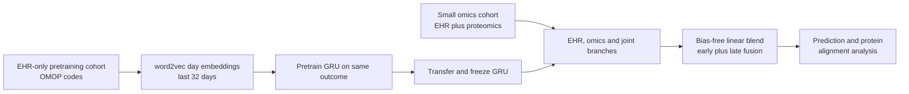

# A machine learning approach to leveraging electronic health records for enhanced omics analysis

> **文献键** `Mataraso_2025` · **来源** Nature Machine Intelligence(2025) · **类别** ehr · **相关度** medium · **获取** open
> **链接** <https://doi.org/10.1038/s42256-024-00974-9> · `status: complete`

---

## 一句话
COMET(Aghaeepour 组,Stanford):组学研究通常只有几十到几百个样本,而同一来源的 EHR 有数万人 —— 先在「只有 EHR」的大队列上预训练一个 GRU,再把冻结的权重迁移进 EHR + 组学的多模态网络(早融合与晚融合的自适应混合);在 61 人妊娠蛋白组(预测距分娩天数)和 559 人 UK Biobank 癌症蛋白组(预测 3 年死亡)上,预测都优于同结构无预训练的基线,模型看重的蛋白也更符合已知生物学(Abstract;Results)。

## 要点
- **对 Sinai EHR 项目**:COMET 的「大 EHR 预训练 → 小组学队列迁移」是为「EHR 病人多、组学样本少」的不对称设计的(Introduction)。我们的理解:任何「EHR 病人多、有组学或活检的病人少」的医疗系统都符合这种不对称;在这批 EHR 论文中,它也是唯一把 EHR 与分子数据连起来的一篇。
- **数字**:距分娩天数 Pearson r 0.868(joint baseline 0.815,仅蛋白 0.796,仅 EHR 0.768);3 年癌症死亡 AUROC 0.842 / AUPRC 0.504(joint baseline 0.786 / 0.365)(Results)。
- **干净的消融**:joint baseline 与 COMET 结构完全相同,唯一差别是有没有预训练;预训练对 ridge、logistic 和 Transformer 变体也都有帮助(Results)。
- **不止看预测**:作者还评估 EHR 潜表示与蛋白的显著相关数(妊娠 3,201→5,364;癌症 0→7,591)和重要蛋白在外部数据集中的验证(Results)。
- **作者明确的未知**:对需要复杂结构的组学模态(作者举例空间转录组)是否有效尚不知道;预训练需要带标签的 EHR 任务(Discussion)。
- 我们的理解:对 detect → model → revert,COMET 是「病人临床轨迹 ↔ 分子特征」的接口原型,但仍是相关性的,重要蛋白不等于可干预靶点。

## 研究问题
组学测量维度高,但队列规模受临床与预算限制,结论难以复现;在机器学习里,假阳性表现为过拟合(Introduction)。已有改进(特征先验、迁移学习、深度 Cox)主要只用组学或元数据。EHR 越来越容易获得(MIMIC、UK Biobank、OMOP 标准化的院内数据库),但 EHR–组学整合有结构性矛盾:早融合 / 中融合要求两种模态都完整(会丢掉大多数只有 EHR 的病人),晚融合又学不到跨模态交互(Introduction)。问题:如何利用**大量只有 EHR 的病人**来改善**小规模组学队列**的建模与生物学发现?

## 方法
1. **EHR 抽取**:从 OMOP 的 measurement、observation、drug_exposure、condition_occurrence、procedure_occurrence 表取概念码(去掉 concept_id=0)。妊娠任务从孕期开始(分娩前 280 天)取到采样时刻;癌症任务对组学队列取到采样时刻,对预训练队列取到首次出现 C 开头 ICD-10 码(癌症诊断)为止;死亡来自 OMOP death 表(Methods)。
2. **EHR 嵌入**:同一病人同一天的所有码视为一个「句子」(随机打乱,因很多时间戳——尤其诊断——不可靠),用 word2vec 学 400 维码嵌入(预训练队列和组学队列各学一个 word2vec),同日取均值得到每天一个 summary embedding,最多取最近 32 天(Methods「Embedding process」)。
3. **预训练**:在只有 EHR 的预训练队列上训练 GRU-RNN + 线性头,预测与目标相同的结局。妊娠:在妊娠最后 100 天内随机取一个时间点截断 EHR,预测距分娩天数(MSE);癌症:3 年全因死亡(BCE)(Results;Methods)。
4. **多模态网络**:三支 —— EHR 支(迁移并冻结的 GRU + 线性层)、组学支(妊娠为单个线性层;癌症为单隐层 ReLU MLP)、joint 支(EHR 潜表示与组学拼接后接线性层);最后一个**无偏置线性层**把三个预测加权合成,即早融合与晚融合的自适应混合(Methods「COMET deep learning architecture」;Fig. 1c)。
5. **训练协议**:三折交叉验证 + 网格搜索选超参;然后用 25 次不同的 70/15/15 划分重复每个实验(按病人划分,同一人的多个样本在同一折);早停 5 个 epoch;最终指标来自 25 次验证集预测的平均(Methods)。
6. **对照**:EHR-only、组学-only、joint baseline(结构同 COMET、无预训练);ridge / logistic 回归,以及把预训练系数作为先验 β₀ 的变体(目标函数 ‖y−Xβ‖² + λ‖β−γβ₀‖²);COMET Transformer(2 层、4 头、128 维、最长 1,024 token)(Methods)。
7. **生物学分析**:EHR 400 维潜表示与每个蛋白的相关(多重检验校正后计数);Integrated Gradients 蛋白重要性;在「COMET 比基线更重视」的蛋白中取最重要的 50 个(反之亦然,得到基线一组),在外部数据集中检验与结局的关联(外部数据中分别找到 14 / 12 个(妊娠)和 18 / 18 个(癌症));中间节点性能;「parameter space」t-SNE 轨迹(作者用每个网络在各 epoch 的输出拼成向量再做 t-SNE)(Results;Methods「External validation」「Parameter-space visualization」)。

## 方法图


## 数据
**妊娠队列(Stanford)**:2013–2021 年在 Stanford 分娩的 30,904 人,EHR 来自 STARR OMOP;其中 **61 人**(均为自然发动分娩,剖宫产和引产除外)在妊娠最后 100 天采血 2–3 次,共 171 份血浆样本,用适配体(aptamer)平台测 1,317 个蛋白(去掉 12 个对照后 1,305 个);其余 30,843 人为预训练队列;同队列代谢组用作第二种组学(Results;Methods「Datasets」)。**癌症队列(UK Biobank)**:入组前 12 个月至入组后 5 年内确诊任意癌症的 36,901 人;其中 **559 人**在确诊后 12 个月内有入组时采血的蛋白组(UKB 蛋白组覆盖 53,058 人、中位 2,894 个蛋白),其余 36,342 人为预训练队列;组学队列 3 年死亡率 5.5%(Results;Methods)。外部验证分别用一个公开妊娠血浆蛋白组和一个乳腺癌蛋白组数据集(Methods「External validation」)。

## 主要结果
- **距分娩天数**:COMET Pearson r = **0.868**(95% CI 0.825–0.900,RMSE 16.0 天);joint baseline 0.815(18.4 天);仅蛋白 0.796(20.2 天);仅 EHR 0.768(20.4 天)。代谢组:COMET 0.839 vs 仅代谢物 0.758(Results;Fig. 2c)。
- **3 年癌症死亡**:COMET AUROC **0.842**(0.744–0.922)、AUPRC **0.504**(0.341–0.670);joint baseline 0.786 / 0.365;仅 EHR 0.749 / 0.205;仅蛋白 0.737 / 0.325(Results;Fig. 4c)。
- **预训练对其他模型也有效**:ridge joint 模型加入预训练先验后 r 从 0.572 升到 0.799;logistic 加先验后 AUPRC 0.263→0.279;COMET Transformer r = 0.848,略低于 GRU 版(Results;Supplementary Tables 3–4、6)。
- **EHR–蛋白对齐**:妊娠中 EHR 潜维度与蛋白的显著相关数 3,201(joint baseline)→ **5,364**(COMET);癌症中 0 → **7,591**。COMET 中 IL1RL1(ST2)、cystatin C、plexin-B2 分别与 76%、68%、68% 的潜维度显著相关,作者指出它们已知与妊娠进程相关(Results;Figs. 3a–b、5a–b)。
- **外部验证**:妊娠中,COMET 更重视的蛋白(外部数据中找到 14 个)与分娩时间的平均 |r| = 0.22,基线更重视的(12 个)为 0.12(差 0.109,p = 0.0276);癌症中,18 个里 9 个与死亡显著相关,基线为 8 个(Results;Figs. 3d、5d)。
- **机制**:相同训练损失下 COMET 的测试损失更低;在 parameter space(由网络输出构建)的 t-SNE 中,COMET 与基线模型落在不同区域 —— 作者称之为「通过初始化实现的正则化」(Results;Fig. 6)。

## 创新点
- 据作者所知,首个用 EHR 迁移学习改善组学分析的方法(Discussion)。
- 处理「EHR 多、组学少」的不对称:预训练用上所有 EHR 病人,多模态阶段仍能学跨模态交互(Introduction;Fig. 1)。
- 把生物学一致性也作为评估维度:EHR 潜表示–蛋白对齐计数、重要蛋白的外部验证(Results)。
- 预训练的收益在 GRU、Transformer、ridge、logistic 上都成立(Results)。

## 局限
- **作者自述**:是否能推广到其他结构尚需研究;对需要更复杂组学结构的模态(如空间转录组)是否有类似提升未知;EHR 来自人工映射的 OMOP 抽取,可能有错误;需要 EHR 预训练数据中有标签,自监督预训练留待以后(Discussion)。
- 我们的理解:组学队列极小(61 / 559 人),置信区间宽(癌症 AUROC 0.744–0.922,与 joint baseline 的 0.664–0.882 大幅重叠);外部验证是间接的(重要蛋白的单变量关联),癌症中 9/18 vs 8/18 差别很小。
- 我们的理解:EHR 表示较粗(word2vec + 日均值、同日码打乱、只用最近 32 天);预训练任务与目标任务相同,换一个结局就要重新预训练;组学只测了表格型的蛋白组和代谢组。

## 与本研究方向的关系
**先说 Sinai EHR 项目。** 我们的理解:在这批 EHR 论文中,这是唯一把 EHR 与分子数据连起来的一篇,因此是 Sinai EHR 项目与本实验室组学/组织工作之间最直接的桥。在 EHR 病人远多于有组学或活检病人的场景下,COMET 的「大 EHR 预训练 → 小组学队列迁移」正对应这种不对称。把妊娠/癌症换成 CKD 进展,把预训练任务换成 eGFR 下降或进入透析,就得到一个可在 Sinai 上复现的设计;评估时可以照用本文的三件事:同结构无预训练的 joint baseline 作消融、EHR 潜表示–分子特征相关计数、重要特征的外部验证。作者在讨论中提到 EHR 基础模型已能直接预测蛋白表达(ref 36),所以用 Delphi/APOLLO 式自监督病人表示替换带标签的 GRU 预训练,是自然的下一步。
**再说 detect → model → revert(我们的理解)。** 作者把空间转录组列为未知,而课题 1(肾脏组学异常检测)要面对的正是这类多模态组学设计。一个延伸是:把 EHR 预训练得到的病人表示作为样本级协变量或先验,帮助区分「临床上异常」和「技术伪迹」,成为跨模态证据之外又一个独立证据源。COMET 把病人尺度的临床轨迹和分子尺度的特征连起来,是从 EHR 层的 detect 走向分子层 model/revert 的接口原型;但它是相关性的,重要蛋白不等于可干预靶点。

## 可复用资产
- **代码:** COMET 全部代码,含 UK Biobank 队列提取查询与教程;Zenodo 10.5281/zenodo.13977341(Code availability)。
<https://github.com/samson920/COMET>
- **数据:** 妊娠蛋白组在 Dryad(10.5061/dryad.280gb5mpd);Stanford EHR 不可共享;UK Biobank 部分需申请;妊娠外部验证数据在 nalab.stanford.edu/multiomicsmulticohortpreterm/(Data availability)。
- **评估设计:** 同结构无预训练的 joint baseline 作消融;EHR 潜维度–分子相关计数;重要特征的外部数据验证;带先验 β₀ 的 ridge/logistic 作为轻量替代。

## 待读
- ref 36(Seong et al., Brief. Bioinform. 2024):用 EHR 基础模型从临床记录生成妊娠病人的生物学谱 —— 与用自监督替代标签化预训练直接相关。
- 用 Delphi/APOLLO 式自监督病人表示替换 COMET 的 GRU 预训练,看小组学队列上的增益是否更大。
- 检索已有的 EHR + 肾活检/组学整合工作(KPMP 是否有可链接的临床轨迹)。

## 引用
```bibtex
@article{Mataraso_2025, title={A machine learning approach to leveraging electronic health records for enhanced omics analysis}, volume={7}, ISSN={2522-5839}, url={http://dx.doi.org/10.1038/s42256-024-00974-9}, DOI={10.1038/s42256-024-00974-9}, number={2}, journal={Nature Machine Intelligence}, publisher={Springer Science and Business Media LLC}, author={Mataraso, Samson J. and Espinosa, Camilo A. and Seong, David and Reincke, S. Momsen and Berson, Eloise and Reiss, Jonathan D. and Kim, Yeasul and Ghanem, Marc and Shu, Chi-Hung and James, Tomin and Tan, Yuqi and Shome, Sayane and Stelzer, Ina A. and Feyaerts, Dorien and Wong, Ronald J. and Shaw, Gary M. and Angst, Martin S. and Gaudilliere, Brice and Stevenson, David K. and Aghaeepour, Nima}, year={2025}, month=Jan, pages={293–306} }
```


---

📄 **[AI-ready 全文提取 →](ai-ready.md)**
