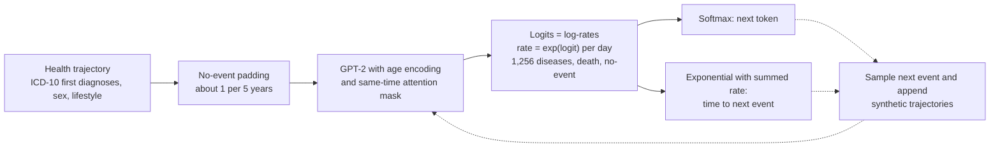

# Learning the natural history of human disease with generative transformers

> **Bibkey** `Shmatko_2025` · **Venue** Nature (2025) · **Category** ehr · **Relevance** high · **Access** open
> **Link** <https://doi.org/10.1038/s41586-025-09529-3> · `status: complete`

---

## One-liner
Delphi-2M turns GPT-2 into a **continuous-time, competing-risk generative model of disease**: given a person's ICD-10 diagnoses ordered by age at first diagnosis (1,256 diseases) plus sex, BMI, smoking and alcohol, it predicts which disease (or death) comes next **and how long until it happens**. Trained on 0.4M UK Biobank participants with only 2.2M parameters, it reaches an average age–sex-stratified AUC of ~0.76 across >1,000 diseases in internal validation, 0.67 on 1.93M Danish individuals with no parameter changes, and can sample synthetic future health trajectories up to 20 years ahead (Abstract; Fig. 2b; Fig. 5a).

## Takeaways
- **One softmax doubles as an incidence model**: each logit is a log-rate λ = exp(logit); P(next = j) is the softmax and time-to-next-event is exponential with rate Σλ, so the model outputs calibratable **absolute incidence rates (per day)** (Methods §"Exponential waiting time model").
- **One model for the whole disease spectrum**: internal-validation average AUC ≈0.76, AUC > 0.5 for 97% of diagnoses, 0.97 for death; comparable to clinical scores for CVD and dementia, but **worse than HbA1c alone for diabetes** (Fig. 2b,f; Results).
- **External validation with zero tuning**: applied directly to Danish registries, average AUC 0.67 (vs 0.69 for UKB longitudinal testing), per-disease AUC correlation r = 0.76 (Fig. 5a).
- **Generative**: sampling futures from history up to age 60 reproduces population incidence at ages 70–75; a model trained only on synthetic data reaches AUC 0.74 on real data, 3 points lower (Fig. 3b,f).
- **The model learns the data-collection process**: hospital-only diseases are predicted at ~10× higher rates in people with other hospital records — an artefact of data-source missingness, not biology (Fig. 5e,f). The authors explicitly caution against reading these temporal dependencies as causal (Discussion).
- Our reading: for the Sinai project this is a clear, small and reproducible template for a patient-trajectory foundation model (code is public); losing to HbA1c on diabetes suggests that metabolic/kidney endpoints need lab values and similar data as inputs.

## Problem
Human disease progression is multimorbid and evolves with age, yet most prediction algorithms target single diseases (cardiovascular disease, specific cancers), and few predict the full spectrum of >1,000 top-level ICD-10 diagnoses (Introduction). Methodological difficulties include the number of diagnoses, temporal dependencies among events, integrating diverse prognostic data, and statistical calibration. LLMs model language as token sequences generated one at a time; disease histories are likewise "predict the future sequence from past events". BERT-style models and Transformers for specific tasks (pancreatic cancer, self-harm, stroke) exist, but comprehensive **generative** multimorbidity modelling had not been fully assessed (Introduction).

## Method
Step by step for a CS reader (from Results §"A transformer model for health records", Methods and Fig. 1):

- **Step 1: sequence representation**. Each datapoint is (token, age in days). Tokens: ICD-10 three-character diseases (at age of first diagnosis) and death; sex (given at birth); BMI (<22 / 22–28 / >28 kg/m²), smoking and alcohol at 3 levels each (recorded at enrolment); "no event" padding tokens. The text counts 1,258 states (diseases + death + no event); Methods lists 1,257 disease tokens + 9 lifestyle + 2 sex + 1 no-event + 1 non-informative padding token.
- **Step 2: no-event padding**. Inserted at an average rate of 1 per 5 years to remove long empty gaps at young ages; at inference they can be inserted anywhere to query risk at that time. Lifestyle token times are randomised by −20 to +40 years around enrolment, because enrolment coincides with the end of immortal-time bias (participants had to be alive), which would otherwise create a spurious jump in mortality tied to those tokens (Methods).
- **Step 3: three architectural changes** (GPT-2 via nanoGPT): (a) **continuous age encoding** replaces discrete positional encoding — sin/cos functions of age (lowest frequency 1/365) followed by a trainable linear map, so input length is unrestricted; (b) modelling of **time to the next event**; (c) causal attention additionally **masks tokens recorded at the same time** (simultaneous events have no order). Weight tying: input embedding and output projection are shared, aiding interpretation (Fig. 1c; Methods).
- **Step 4: competing-exponential waiting-time loss**. Assume waiting times T<sub>i</sub> to each token are exponential with rate λ<sub>i</sub> = exp(logit<sub>i</sub>); the next event is the first to occur: P(j) = λ<sub>j</sub>/Σλ<sub>i</sub> (exactly softmax cross-entropy); the waiting time T* is exponential with rate Σλ<sub>i</sub>, loss<sub>T</sub> = −(logsumexp(logits) − Σexp(logits)·T*). Total loss = loss<sub>j</sub> + loss<sub>T</sub>; sex, lifestyle and non-informative padding tokens are input-only (logits set to −Inf). The constant-rate assumption only holds over short periods, which is why no-event tokens are inserted (expected gaps ≤5 years) (Methods).
- **Step 5: scale and training**. A systematic screen over embedding size, layers and heads (Extended Data Fig. 2: 486 models) reproduces scaling laws: ~2M parameters is optimal at UKB scale; the chosen model has 120-d embeddings, 12 layers, 12 heads, **2.2M parameters**. Adam, 200k iterations, batch 128, 1,000 warm-up iterations then cosine LR 6×10<sup>−4</sup> → 6×10<sup>−5</sup> (Fig. 1e; Methods).
- **Step 6: sampling**. The next disease is drawn from the softmax; times are drawn from all exponentials and the minimum kept; non-disease logits are discarded; iterate to a full trajectory (Methods §"Sampling procedure").
- **Step 7: evaluation**. AUC is computed within 5-year age brackets (50–80) separately by sex and averaged (age–sex-stratified AUC), with DeLong CIs; longitudinal testing leaves a 1-year gap after the cut-off and evaluates incidence in the following year; baselines are age–sex Nelson–Aalen incidence plus QRisk3, SCORE2, PREVENT, Framingham, UKBDRS, Charlson, Elixhauser, AutoPrognosis v2, a plain Transformer encoder and a Llama3.1-8B prompting baseline (Methods).
- **Step 8: interpretation**. UMAP of token embeddings; SHAP (PartitionExplainer, masked tokens replaced by no-event) on 100,639 validation trajectories, compared with hazard ratios from a penalised time-dependent Cox model; Nelson–Aalen nonparametric hazard ratios; attention maps (Methods §"Model interpretation").

## Method diagram


## Data
**UK Biobank**: ~500k participants recruited 2006–2010, aged 37–73 at recruitment (Methods). Diseases come from UKB "first occurrence" data (category 1712: linked primary care, hospital admissions, death registry, self-report; ICD-10 level 3; neoplasms not included), with cancer-registry data (fields 40005/40006) added by the authors, giving 1,256 diagnoses. Training 402,799 (80%), validation 100,639 (20%), both using data up to 30 June 2020; longitudinal testing on the 471,057 alive on 1 July 2020, evaluated on incidence 1 July 2021 – 1 July 2022 with a 1-year gap (Fig. 1b; Methods). UKB totals 502,485 individuals and 7,426,036 tokens (Fig. 1b). **Danish external test**: National Patient Registry (LPR, hospital data since 1977) + cause-of-death registry; **1.93M** residents aged 50–80 on 1 January 2016 (51% female), 11.51M disease tokens from 1978–2016; evaluated on 2017 incidence over **0.96M disease tokens across 796 ICD-10 codes (each ≥25 cases)**. Only first occurrences kept, ICD-8 mapped to ICD-10 via a published mapping, no lifestyle data in Denmark (treated as absent) (Methods).

## Key results
- **Full-spectrum next-event prediction** (internal validation): average age–sex-stratified AUC **≈0.76**; AUC > 0.5 for 97% of diagnoses; death AUC **0.97** (both sexes); predicted rates match observed counts in 5-year age brackets (Fig. 2b; Extended Data Fig. 3).
- **Long horizon**: with a 10-year gap between prediction and diagnosis, average AUC falls from 0.76 to **0.70** (Fig. 2e).
- **Versus dedicated models** (internal longitudinal test set, Fig. 2f): death — Delphi 0.81, Transformer 0.78, Charlson 0.73, Elixhauser 0.71, Llama3.1 0.69; dementia — Delphi 0.82, UKBDRS 0.81, Transformer 0.79, Llama3.1 0.67; CVD — QRisk3 0.71, Delphi 0.70, PREVENT/SCORE2/Framingham/Transformer 0.69, AutoPrognosis 0.68, Llama3.1 0.63. For diabetes it is worse than HbA1c alone (Results; Extended Data Fig. 4a). Note that death's 0.81 here and 0.97 above come from different settings (longitudinal test vs next-event).
- **Versus MILTON**: for 410 matchable diseases, Delphi-2M's AUCs are generally higher than those of MILTON's prognostic models built on UKB blood biomarkers (text: 67 biomarkers) (Fig. 2g).
- **Generated trajectories**: conditioning on data up to age 60, one trajectory per person (text: 63,662; Fig. 3a caption: 63,622) reproduces population incidence at ages 70–75; ~17% of disease tokens are correct in the first year, falling to <14% after 20 years, vs 12–13% using age and sex alone (Fig. 3b,c). Differences in disease burden between high/low smoking, alcohol and BMI groups are also reproduced (Fig. 3d).
- **Training on synthetic data only**: the same model trained on 400,000 synthetic trajectories sampled from birth reaches average AUC **0.74** on real validation data, 3 points below the original; generated trajectories are no more similar to the training data than the validation cohort is (Fig. 3f; Supplementary Fig. 6; Methods).
- **External validation**: applied to Denmark with no retraining or adjustment, average AUC **0.67** (s.d. 0.09) vs 0.69 (s.d. 0.09) for UKB longitudinal testing; per-disease AUCs correlate across datasets with Pearson r = **0.76** (95% CI 0.72–0.80) (Fig. 5a).
- **Interpretability**: the embedding UMAP clusters by ICD chapter without the model being told chapters; both diabetes types cluster with retinal disorders and neuropathies; MI and septicaemia cluster with death (Fig. 4a). SHAP example: a series of digestive diagnoses raised one person's pancreatic cancer risk 19-fold, and the subsequent pancreatic cancer diagnosis raised mortality almost ten-thousandfold (main text, Results §"Explaining Delphi-2M predictions"; the Fig. 4b panel, however, labels the mortality relative rate 9.3 × 10<sup>4</sup>, about 93,000-fold, with the pancreatic cancer token alone contributing ×168). Cancer's effect on mortality decays with a half-life of several years; septicaemia's drops sharply (Fig. 4d).
- **Biases**: diseases exclusive to hospital records are predicted at on average **10×** higher rates in people with other hospital records; septicaemia, 93% diagnosed in hospital, is predicted **8×** higher in people with any other hospital data (Fig. 5e,f). No deaths before UKB recruitment (immortality bias) distorts mortality estimates; ages above 80 are too sparse to model reliably (Fig. 5b; Results).

## Contributions
- **Competing-exponential waiting-time head**: makes GPT's softmax double as an incidence model with absolute rates, enabling inter-event time estimates (Fig. 1g).
- Continuous age encoding + same-time masking + no-event padding: a small set of changes turning a text GPT into a continuous-time event model, with ablations (Fig. 1f; Supplementary Table 1).
- One model covering >1,000 diseases, **externally validated with zero tuning** on another country's registries.
- **Generative**: sampling futures up to 20 years for disease-burden estimates; training models on synthetic data.
- A systematic bias analysis showing how the model exploits UKB-specific data-source missingness.

## Limitations
- Stated by the authors: UKB has more white British participants than the general population, and participants tend to be more affluent and educated; lower disease rates are reported among white participants and diagnosis rates rise with deprivation — trends Delphi-2M reproduces (Results §"External validation and bias assessment"; shown in Extended Data Fig. 10 "Effects of ethnicity and deprivation", although the text cites it as Extended Data Fig. 9).
- Stated by the authors: UKB healthy-volunteer and pre-recruitment selection biases; data-source missingness exploited by the model; different predicted rates across ancestry and deprivation subgroups (Discussion; Supplementary Figs. 10–11).
- Stated by the authors: temporally directed dependencies **should not be interpreted as causal relationships that could be exploited to modify future health**; individual predictions are strongly influenced by chance and compatible with a range of outcomes (Discussion).
- Stated by the authors: inputs are first diagnoses plus a few lifestyle factors; prescriptions, blood tests, imaging, genomics and wearables are future extensions; biomarkers remain indispensable for diseases such as diabetes (Results; Discussion). Clinical decision support still needs an immature regulatory framework (Discussion).
- Our reading: using only *first* diagnoses discards recurrences, stage progression and care intensity — possibly insufficient for repeatedly measured, stepwise conditions such as CKD stages.
- Our reading: external validation covers ages 50–80 and one year of incidence (2017), without lifestyle inputs in Denmark; there are small internal inconsistencies (63,662 vs 63,622; 67 MILTON biomarkers vs 57 in Extended Data Fig. 5; mortality "almost ten thousandfold" after the pancreatic cancer diagnosis in the text vs 9.3 × 10<sup>4</sup> on the Fig. 4b panel).
- A patent has been filed on using generative transformers to model competing risks and timing of diseases (PCT/EP2025/065771) (Competing interests).

## Relation to our direction
**First, the Mount Sinai EHR project.** Our reading: Delphi-2M is a small, reproducible (public code) template for a patient-trajectory foundation model, complementing the pancreatic-trajectory paper (`ehr-pancreatic-trajectory-natmed-2023`, a single-disease discriminative model): that paper asks "how early can one disease be flagged", Delphi asks "how do the rates of all diseases evolve over time". Borrowable design: (1) the competing-exponential head gives absolute rates, suited to putting **competing** endpoints such as CKD progression, dialysis, heart failure, MI and death in one model; (2) no-event padding allows risk queries at any time; (3) the external-validation discipline: zero-tuning transfer + per-disease AUC correlation + calibration curves. The paper reproduces scaling laws (~2M parameters optimal at UKB scale), so "how large is the optimal model on a larger single-system EHR" is itself a testable question. Delphi losing to HbA1c on diabetes suggests that for metabolic/kidney endpoints, lab values (e.g. HbA1c, eGFR) and medications likely need to be inputs — provided the Sinai data actually contain these fields (to be confirmed). The bias analysis matters especially for Sinai: in a single-centre EHR, patients may receive care elsewhere, and missingness driven by data source / care intensity will be learned by the model, so stratified checks are needed. The authors also suggest in the Discussion that future healthcare LLMs could invoke Delphi-type models to improve numerical accuracy.

Our reading (relation to detect → model → revert, briefly): Delphi is patient-scale "model" — a sampleable virtual patient; but the authors explicitly rule out using its temporal dependencies for causal intervention, so reaching "revert" needs a causal/counterfactual layer or a link to tissue-scale virtual tissue. Its "learns data-source missingness rather than disease" problem is the same class of failure as treating batch/artefacts as disease signal in omics, mirroring our use of cross-modal agreement to separate artefacts in kidney-omics anomaly detection.

## Reusable assets
- **Code:** Delphi code, scripts and Jupyter notebooks (Code availability); the model is built on the nanoGPT implementation (Methods §"GPT model").
<https://github.com/gerstung-lab/delphi>
- **Checkpoint:** via UK Biobank controlled-access procedures (upload ID 7318) (Code availability).
- **Data:** UK Biobank (application); Danish registry data via the Danish Patient Safety Authority and the Danish Health Data Authority, in dedicated secure environments (Data availability).
- **Baseline suite:** QRisk3, SCORE2, PREVENT, Framingham, UKBDRS, Charlson, Elixhauser, AutoPrognosis v2, a Transformer encoder, a Llama3.1-8B prompting baseline (full prompt in Methods), MILTON.

## Follow-ups
- Extended Data Fig. 5: linear models predicting 5-year disease that add, separately, polygenic risk scores (a), the 57 MILTON blood biomarkers (b) or self-rated overall health (c) to Delphi logits (plus age and sex) — whether Delphi and lab data are complementary.
- The MILTON paper (Garg et al., Nat. Genet. 2024, ref. 31), the biomarker-driven full-spectrum comparator.
- Subgroup fairness analyses in the Supplementary Discussion (Supplementary Figs. 10–11, Supplementary Table 4).
- Related generative EHR models: Foresight (ref. 28), MOTOR (ref. 29); compare with `ehr-apollo-arxiv-2026` and `ehr-comet-natmachintell-2025`.

## Cite
```bibtex
@article{Shmatko_2025, title={Learning the natural history of human disease with generative transformers}, volume={647}, ISSN={1476-4687}, url={http://dx.doi.org/10.1038/s41586-025-09529-3}, DOI={10.1038/s41586-025-09529-3}, number={8088}, journal={Nature}, publisher={Springer Science and Business Media LLC}, author={Shmatko, Artem and Jung, Alexander Wolfgang and Gaurav, Kumar and Brunak, Søren and Mortensen, Laust Hvas and Birney, Ewan and Fitzgerald, Tom and Gerstung, Moritz}, year={2025}, month=sep, pages={248–256} }
```


---

📄 **[AI-ready full-text extract →](ai-ready.md)**
