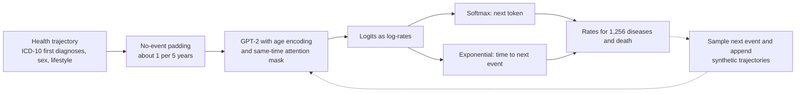

# Learning the natural history of human disease with generative transformers

> **文献键** `Shmatko_2025` · **来源** Nature(2025) · **类别** ehr · **相关度** high · **获取** open
> **链接** <https://doi.org/10.1038/s41586-025-09529-3> · `status: complete`

---

## 一句话
Delphi-2M 把 GPT-2 改成**连续时间、竞争风险的疾病生成模型**:输入一个人按首诊年龄排列的 ICD-10 诊断(1,256 种疾病)以及性别、BMI、吸烟、饮酒,输出下一事件是哪种病(或死亡)**以及多久之后发生**;在 40 万 UK Biobank 参与者上训练、仅 220 万参数,内部验证中 >1,000 种疾病的平均年龄-性别分层 AUC 约 0.76,不改参数用于 193 万丹麦人平均 AUC 0.67,并能采样最长 20 年的合成未来健康轨迹(Abstract;Fig. 2b;Fig. 5a)。

## 要点
- **一个 softmax 同时是疾病发生率模型**:把每个 logit 解释为对数速率 λ = exp(logit),「下一事件是 j」的概率就是 softmax,「到下一事件的时间」服从速率 Σλ 的指数分布;于是模型输出的是可校准的**绝对发病率(每天)**(Methods §"Exponential waiting time model")。
- **单模型覆盖全病谱**:内部验证平均 AUC ≈0.76,97% 的诊断 AUC > 0.5,死亡 0.97;在心血管病、痴呆上与常规临床评分相当,糖尿病上**不如单一 HbA1c**(Fig. 2b,f;Results)。
- **零调参外部验证**:直接用于丹麦登记数据,平均 AUC 0.67(UKB 纵向测试 0.69),两数据集各病种 AUC 相关 r = 0.76(Fig. 5a)。
- **能生成**:从 60 岁前病史采样未来轨迹,可重现 70–75 岁的人群发病率;只用合成数据训练的模型在真实数据上 AUC 0.74,仅低 3 个百分点(Fig. 3b,f)。
- **模型学到了数据采集过程**:只在住院记录中出现的疾病,在已有其他住院记录的人中被预测的速率平均高 10 倍 —— 这是数据来源缺失造成的伪迹,不是生物学(Fig. 5e,f)。作者明确告诫不要把这些时间依赖当作因果(Discussion)。
- 我们的理解:对 Sinai 项目,这是「病人轨迹基础模型」的一个清晰、小而可复现的范式(代码公开);它在糖尿病上输给 HbA1c,说明代谢-肾病类终点需要把化验值等加入输入。

## 研究问题
人的疾病进展是多病共存、随年龄演化的,但现有预测算法大多针对单一疾病(心血管病、某种癌症),很少能预测 ICD-10 顶层 >1,000 种诊断的全病谱(Introduction)。多病共病建模的方法难点包括:诊断种类多、事件之间的时间依赖、整合多种预后数据、预测的统计校准。LLM 把语言建模为 token 序列逐个生成;疾病史同样是「根据过去事件预测未来序列」。此前已有 BERT 类模型和针对单一任务(胰腺癌、自伤、卒中)的 Transformer,但全面的**生成式**多病共病建模尚未被充分评估(Introduction)。

## 方法
面向 CS 读者,按步骤写(出自 Results §"A transformer model for health records"、Methods、Fig. 1):

- **第 1 步:序列表示**。每个数据点是 (token, 年龄[天])。token 包括:ICD-10 三位码疾病(首诊年龄)和死亡;性别(出生时给出);BMI(<22 / 22–28 / >28 kg/m²)、吸烟、饮酒各 3 级(入组时记录);"no event" 填充 token。正文说共 1,258 个状态(疾病 + 死亡 + no event),Methods 列出 1,257 个疾病 token + 9 个生活方式 + 2 个性别 + 1 个 no-event + 1 个非信息填充。
- **第 2 步:no-event 填充**。按平均每 5 年 1 个的速率随机插入,消除年轻时长段无记录的空窗;推理时也可在任意时刻插入以查询该时刻的风险。另外,生活方式 token 的时间在入组点 −20 到 +40 年间随机化,因为入组时刻恰好是 immortal-time bias(入组者必须活着)的结束点,不随机化会造成死亡率在该时刻跳变的虚假关联(Methods)。
- **第 3 步:三处架构改动**(基于 nanoGPT 的 GPT-2):(a) 用**连续年龄编码**替代离散位置编码 —— 年龄的 sin/cos 函数(最低频率 1/365),再经可训练线性变换,所以输入长度不受限;(b) 增加对**到下一事件时间**的建模;(c) 因果注意力额外**屏蔽同一时刻记录的 token**(同时记录的事件没有顺序)。权重绑定:输入 embedding 与输出投影共享,便于解释(Fig. 1c;Methods)。
- **第 4 步:竞争指数等待时间损失**。假设到每个 token 的等待时间 T<sub>i</sub> 独立服从速率 λ<sub>i</sub> = exp(logit<sub>i</sub>) 的指数分布,下一事件是最先发生的那个:P(j) = λ<sub>j</sub>/Σλ<sub>i</sub>(就是 softmax 交叉熵);等待时间 T* 服从速率 Σλ<sub>i</sub> 的指数分布,loss<sub>T</sub> = −(logsumexp(logits) − Σexp(logits)·T*)。总损失 = loss<sub>j</sub> + loss<sub>T</sub>;性别、生活方式和非信息填充 token 只作输入,logit 设为 −Inf,不进损失。速率恒定的假设只在短时间内合理,这也是插入 no-event 的原因(期望间隔不超过 5 年)(Methods)。
- **第 5 步:规模与训练**。对 embedding 维度、层数、头数做系统扫描(Extended Data Fig. 2:486 个模型),复现 scaling law:UKB 规模下最优约 200 万参数;选用 120 维、12 层、12 头,共 **220 万参数**。Adam,20 万次迭代,batch 128,1,000 次 warmup 后 cosine 学习率 6×10<sup>−4</sup> → 6×10<sup>−5</sup>(Fig. 1e;Methods)。
- **第 6 步:采样生成**。下一疾病从 softmax 采样;时间从各指数分布采样后取最小值;非疾病 token 的 logit 被丢弃;迭代得到整条轨迹(Methods §"Sampling procedure")。
- **第 7 步:评估**。AUC 在 50–80 岁的 5 年年龄段内、按性别分别计算后平均(年龄-性别分层 AUC),DeLong 法给 CI;纵向测试在截止日后空 1 年再评估下一年的发病;基线为按年龄性别的 Nelson–Aalen 发病率,以及 QRisk3、SCORE2、PREVENT、Framingham、UKBDRS、Charlson、Elixhauser、AutoPrognosis v2、一个普通 Transformer 编码器和 Llama3.1-8B 提示基线(Methods)。
- **第 8 步:解释**。token embedding 的 UMAP;SHAP(PartitionExplainer,被遮蔽的 token 换成 no-event)在 100,639 条验证轨迹上计算,并与带惩罚的时间依赖 Cox 模型的风险比对照;Nelson–Aalen 非参数风险比;注意力图(Methods §"Model interpretation")。

## 方法图


## 数据
**UK Biobank**:约 50 万人,2006–2010 年入组,入组时 37–73 岁(Methods)。疾病来自 UKB 的 "first occurrence" 数据(category 1712:整合初级保健、住院、死亡登记、自报问卷,ICD-10 三位码,不含肿瘤章节),作者自行补入癌症登记(fields 40005/40006),合计 1,256 种诊断。训练 402,799 人(80%),验证 100,639 人(20%),均用至 2020-06-30 的数据;纵向测试用 2020-07-01 仍在世的 471,057 人,评估 2021-07-01 至 2022-07-01 的发病,留 1 年空窗(Fig. 1b;Methods)。UKB 合计 502,485 人、7,426,036 个 token(Fig. 1b)。**丹麦外部测试**:国家患者登记(LPR,1977 年起住院数据)+ 死因登记;2016-01-01 时居住在丹麦、50–80 岁的 **193 万人**(51% 女性),1978–2016 年间 1,151 万个疾病 token;评估 2017 年的发病,共 **96 万个疾病 token、796 个 ICD-10 码(每个 ≥25 例)**。只保留首诊,ICD-8 按公开映射转为 ICD-10,丹麦无生活方式数据(视为缺失)(Methods)。

## 主要结果
- **全病谱下一事件预测**(内部验证):平均年龄-性别分层 AUC **≈0.76**;97% 的诊断 AUC > 0.5;死亡 AUC **0.97**(两性);5 年年龄段内预测速率与观察病例数吻合(Fig. 2b;Extended Data Fig. 3)。
- **远期**:预测与诊断间隔 10 年时平均 AUC 从 0.76 降到 **0.70**(Fig. 2e)。
- **与专用模型比较**(内部纵向测试集,Fig. 2f):死亡 —— Delphi 0.81,Transformer 0.78,Charlson 0.73,Elixhauser 0.71,Llama3.1 0.69;痴呆 —— Delphi 0.82,UKBDRS 0.81,Transformer 0.79,Llama3.1 0.67;心血管病 —— QRisk3 0.71,Delphi 0.70,PREVENT/SCORE2/Framingham/Transformer 0.69,AutoPrognosis 0.68,Llama3.1 0.63。糖尿病上不如单一 HbA1c(Results;Extended Data Fig. 4a)。注意:这里死亡的 0.81 与上一条的 0.97 是不同设置(纵向测试 vs 下一事件)。
- **与 MILTON 比较**:对可匹配的 410 种疾病,Delphi-2M 的 AUC 总体高于基于 UKB 血液标志物的 MILTON(正文:67 个标志物)预后模型(Fig. 2g)。
- **生成轨迹**:以 60 岁前数据为条件,每人采样一条轨迹(正文 63,662 人;Fig. 3a 图注写 63,622),70–75 岁的人群发病率被很好重现;采样第 1 年平均约 17% 的疾病 token 预测正确,20 年后降到 <14%,只用年龄和性别为 12–13%(Fig. 3b,c)。吸烟、饮酒、BMI 高低组的疾病负担差异也被重现(Fig. 3d)。
- **纯合成数据训练**:用 40 万条从出生采样的合成轨迹训练同样的模型,在真实验证集上平均 AUC **0.74**,比原模型低 3 个百分点;生成轨迹与训练数据的相似度不高于验证集(Fig. 3f;Supplementary Fig. 6;Methods)。
- **外部验证**:不重训、不调整用于丹麦,平均 AUC **0.67**(s.d. 0.09),UKB 纵向测试为 0.69(s.d. 0.09);各病种在两数据集上的 AUC 相关 Pearson r = **0.76**(95% CI 0.72–0.80)(Fig. 5a)。
- **可解释性**:embedding 的 UMAP 按 ICD 章节聚类(模型不知道章节);两型糖尿病与视网膜病、神经病变聚在一起;心梗、败血症与死亡聚在一起(Fig. 4a)。SHAP 示例:一串消化系统诊断使某人胰腺癌风险升高 19 倍,随后的胰腺癌诊断使死亡率升高近万倍(Fig. 4b)。癌症对死亡率的影响以数年半衰期衰减,败血症则迅速回落(Fig. 4d)。
- **偏倚**:只在住院记录中出现的疾病,在有其他住院记录的人中预测速率平均高 **10 倍**;败血症 93% 在医院确诊,在有任何其他住院数据者中被预测高 **8 倍**(Fig. 5e,f)。UKB 入组前无死亡(immortality bias)影响死亡率估计;80 岁以上数据太少,不能可靠建模(Fig. 5b;Results)。

## 创新点
- **竞争指数等待时间头**:让 GPT 的 softmax 同时成为发病率模型,给出绝对速率,从而能估计事件间隔(Fig. 1g)。
- 连续年龄编码 + 同时刻屏蔽 + no-event 填充:把文本 GPT 改成连续时间事件模型的一组小改动,有消融实验(Fig. 1f;Supplementary Table 1)。
- 一个模型同时覆盖 >1,000 种疾病,并在另一国家的登记数据上**零调参外部验证**。
- **生成式**:采样最长 20 年的未来轨迹估计疾病负担;用合成数据训练下游模型。
- 系统的偏倚分析:展示模型如何利用 UKB 特有的数据来源缺失模式。

## 局限
- 作者所述:UKB 的健康志愿者偏倚与入组前选择偏倚;数据来源缺失模式被模型利用;不同祖源和贫困指数亚组的预测速率不同(Discussion;Supplementary Figs. 10–11)。
- 作者所述:时间方向上的依赖**不应被解读为可用来改变未来健康的因果关系**;个体预测很大程度受随机性影响,与多种结局都相容(Discussion)。
- 作者所述:输入只有首诊 + 少量生活方式;处方、血检、影像、基因组、可穿戴等是未来扩展方向;糖尿病等疾病仍离不开生物标志物(Results;Discussion)。临床决策支持还需要尚不成熟的监管框架(Discussion)。
- 我们的理解:只用「首次」诊断,丢掉了复发、分期进展、就诊强度等信息 —— 对 CKD 分期这类反复测量、逐级加重的病,这一表示可能不够。
- 我们的理解:外部验证只覆盖 50–80 岁、只评估一年(2017)的发病,且丹麦缺生活方式输入;论文内有小的数字不一致(63,662 vs 63,622;MILTON 标志物 67 vs Extended Data Fig. 5 的 57)。
- 作者申请了专利(PCT/EP2025/065771,用生成式 Transformer 建模疾病竞争风险与时间)(Competing interests)。

## 与本研究方向的关系
**首先是 Mount Sinai EHR 项目(数百万病人)**。我们的理解:Delphi-2M 是一个小、可复现(代码公开)的「病人轨迹基础模型」模板,和胰腺癌轨迹论文(`ehr-pancreatic-trajectory-natmed-2023`,单病种判别模型)形成对照:后者回答「某个病多早能发现」,Delphi 回答「所有病的发生率随时间如何变化」。可借鉴的设计:(1) 竞争指数头输出绝对速率,适合把 CKD 进展、透析、心衰、心梗、死亡等**相互竞争**的终点放在一个模型里;(2) no-event 填充让风险可在任意时刻查询;(3) 外部验证规范:零调参迁移 + 各病种 AUC 相关性 + 校准曲线。论文复现了 scaling law(UKB 规模最优约 200 万参数),所以「数百万病人的 Sinai 规模下最优模型多大」本身是一个可检验的问题。Delphi 在糖尿病上输给 HbA1c,说明对代谢-肾病终点,化验值(如 HbA1c、eGFR)和用药很可能需要作为输入 —— 前提是 Sinai 数据中确实有这些字段(待确认)。偏倚部分对 Sinai 尤其重要:单中心 EHR 里病人可能在别处就医,「数据来源/就诊强度」造成的缺失模式会被模型学进去,需要分层检验。作者在讨论中也提出,未来面向医疗的 LLM 可以调用 Delphi 类模型来提高数值准确性。

我们的理解(与 detect → model → revert 的关系,简述):Delphi 是病人尺度的「model」—— 可采样的虚拟病人;但作者明确说时间依赖不可作为因果干预依据,所以要走到「revert」还需要因果/反事实层或与组织层 virtual tissue 的连接。它「学到数据来源缺失而非疾病」的问题,与组学中把批次/伪迹当作疾病信号是同一类问题,和我们在肾脏组学异常检测中用多模态一致性区分伪迹的思路对应。

## 可复用资产
- **代码:** Delphi 代码、脚本与 Jupyter notebook(基于 nanoGPT)(Code availability)。
<https://github.com/gerstung-lab/delphi>
- **模型权重:** 按 UK Biobank 受控访问流程获取(upload ID 7318)(Code availability)。
- **数据:** UK Biobank(申请制);丹麦登记数据需向丹麦患者安全局与丹麦卫生数据局申请,在专用安全环境中使用(Data availability)。
- **基线集合:** QRisk3、SCORE2、PREVENT、Framingham、UKBDRS、Charlson、Elixhauser、AutoPrognosis v2、Transformer 编码器、Llama3.1-8B 提示基线(提示词全文在 Methods)、MILTON。

## 待读
- Extended Data Fig. 5:把 Delphi logits 与多基因风险评分、血液标志物、自评健康一起放进线性模型预测 5 年发病 —— 看 Delphi 与化验数据是否互补。
- MILTON 原文(Garg 等,Nat. Genet. 2024,ref. 31),化验驱动的全病谱对照。
- 补充讨论中的亚组公平性分析(Supplementary Figs. 10–11,Supplementary Table 4)。
- 相关生成式 EHR 模型:Foresight(ref. 28)、MOTOR(ref. 29);与 `ehr-apollo-arxiv-2026`、`ehr-comet-natmachintell-2025` 对比。

## 引用
```bibtex
@article{Shmatko_2025, title={Learning the natural history of human disease with generative transformers}, volume={647}, ISSN={1476-4687}, url={http://dx.doi.org/10.1038/s41586-025-09529-3}, DOI={10.1038/s41586-025-09529-3}, number={8088}, journal={Nature}, publisher={Springer Science and Business Media LLC}, author={Shmatko, Artem and Jung, Alexander Wolfgang and Gaurav, Kumar and Brunak, Søren and Mortensen, Laust Hvas and Birney, Ewan and Fitzgerald, Tom and Gerstung, Moritz}, year={2025}, month=Sept, pages={248–256} }
```


---

📄 **[AI-ready 全文提取 →](ai-ready.md)**
