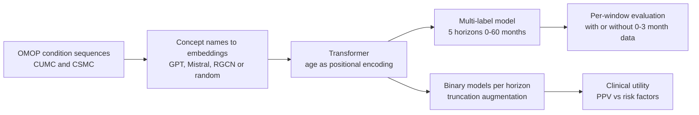

# Enhancing EHR-based pancreatic cancer prediction with LLM-derived embeddings

> **Bibkey** `Park_2025` · **Venue** npj Digital Medicine (2025) · **Category** ehr · **Relevance** medium · **Access** open
> **Link** <https://doi.org/10.1038/s41746-025-01869-8> · `status: complete`

---

## One-liner
In a CancerRiskNet-style pancreatic cancer (PC) trajectory Transformer, randomly initialized code embeddings are replaced with **LLM text embeddings of OMOP concept names** (OpenAI text-embedding-3-small). On EHRs from two US hospitals, Columbia (CUMC) and Cedars-Sinai (CSMC), 6–12-month-ahead AUROC rises from 0.60/0.82 to 0.67/0.86, and reaches 0.82/0.89 after excluding data from the 0–3 months before diagnosis (Abstract; Table 2).

## Takeaways
- **For the Sinai EHR project**: this is the closest to our real situation — a single US academic hospital, OMOP format, hundreds of thousands to ~1M patients, not a Danish national registry; on institutional data the same task scores clearly below CancerRiskNet (within 36 months 0.694/0.744 vs 0.88; Discussion).
- **A near-free improvement**: concept names carry no PHI, so embeddings can be generated straight from Sinai's OMOP vocabulary and used as initialization; 32-d GPT embeddings often match 1536-d, and 4096-d Mistral is not consistently better (Results; Discussion).
- **Leakage is the central issue**: in multi-horizon models, strong near-diagnosis signals (e.g. "disorder of pancreas") bleed into distal windows; per-window case restriction, 0–3-month exclusion and truncation-based augmentation can be copied directly (Results; Discussion).
- **The abstract's PPV is CUMC only**: at max-F1, CUMC PPV 0.141 vs 0.004 for traditional risk factors; at CSMC the GPT model's PPV is only 0.012 (baseline 0.084) (Table 3).
- **Kidney features**: the binary models rank kidney-related conditions among top features in both the 6–12- and 12–36-month windows, which the authors read as a possible multi-organ early signal (Discussion, ref. 13).
- Our reading: for detect → model → revert, this is EHR-level "detect" (early risk flagging); the gain is in representation (injecting medical-language knowledge into code embeddings), with no causal or interventional component.

## Problem
Pancreatic cancer five-year survival is 13%, 44% if caught early; but screening covers only people with familial or genetic risk (5–10% of cases), and MRI/CT, though sensitive (93%) and specific (89%), cannot be used population-wide (Introduction). Longitudinal EHR histories may contain early signals. Inspired by GenePT (GPT embeddings of NCBI gene descriptions), the authors hypothesize that **LLM embeddings of medical concept names** represent diagnosis codes better than embeddings learned from scratch, improving early prediction. A second issue is **leakage from near-diagnosis data**: in a model predicting several horizons at once, strong proximal signals inflate distal-window scores (Results).

## Method
1. **Input**: each patient's OMOP condition (diagnosis) sequence, with age at recording as the positional encoding; a case's "time to diagnosis" is the gap between the last recorded condition and the PC diagnosis (Methods).
2. **Four sources of code embeddings**: (a) baseline: randomly initialized PyTorch nn.Embedding; (b) RGCN: a relational graph convolutional network trained on the OMOP ancestor–descendant knowledge graph (optimizing MRR); (c) GPT: OpenAI text-embedding-3-small on concept names, 32-d and 1536-d; (d) Mistral: Salesforce/SFR-Embedding-Mistral, 4096-d. Each frozen or fine-tuned — 12 models (Methods; Supplementary Table 2).
3. **Multi-label model** (CancerRiskNet-style): one Transformer outputs 5 binary labels for 0–3, 3–6, 6–12, 12–36 and 36–60 months; each window is evaluated only on cases diagnosed in that window (e.g. 12–36 months uses only patients labelled [0,0,0,1,1]) so proximal cases do not inflate scores (Results; Fig. 1B).
4. **Anti-leakage variant**: a second multi-label model **excludes 0–3-month data**, which is instead used to augment the 3–6-month window (Methods).
5. **Binary models + truncation augmentation**: one model per window (3–6, 6–12, 12–36 months); more proximal cases have their latest records removed until the last remaining record falls in the target window, enlarging distal case counts (CUMC after augmentation 1,700 / 1,691 / 1,719 cases, 785,332 controls; CSMC 1,082 / 1,078 / 1,058 cases, 460,417 controls) (Results; Methods; Fig. 1C).
6. **Training and evaluation**: 60/20/20 split; one shared control group across windows (mimicking low real-world prevalence); bootstrap 95% CIs and p-values (AUROC, AUPRC, max-F1); LIME for feature explanations; clinical utility via PPV and "how many must be screened to detect x% of cases", compared with traditional risk factors (CA19-9, type 2 diabetes, pancreatitis) and known germline variants (Methods; Table 3).

## Method diagram


## Data
OMOP-format EHR from two hospitals: **CUMC** (Columbia University Irving Medical Center, New York) 3,300 cases / 785,335 controls; **CSMC** (Cedars-Sinai Medical Center, Los Angeles — note: not Mount Sinai) 1,781 cases / 484,515 controls (Methods, "Patient data"). Cases: a pancreatic malignancy code and no other cancer history; controls: no cancer-related terms, at least 5 condition records, age 18–100, with diagnoses from the 2 years before each control's last record removed (to reduce undiagnosed cancers) (Methods). The 20% held-out test set has few distal cases: in the multi-label model CUMC 23 cases at 6–12 months and 14 at 36–60 months; CSMC 18 and 7; test controls CUMC 157,067, CSMC 92,073 (Table 2). CSMC has genetic data: 1,500 carriers of PC-associated variants, 130 with PC, 50 of them retained in the dataset (Results). HIPAA forbids sharing EHR; both sites ran shared code independently (Data availability).

## Key results
- **6–12 months (multi-label, with 0–3-month data, CUMC)**: baseline AUROC 0.592 [0.466, 0.720] → GPT **0.673** [0.559, 0.776] (p = 0.018); RGCN 0.647; Mistral 0.598, though Mistral has the best max-F1 (0.083, p = 0.035) (Table 1). CSMC 0.819 → **0.858** (Table 2).
- **After excluding 0–3 months (GPT-1536)**: 6–12 months CUMC **0.819** (baseline 0.756), CSMC **0.893** (baseline 0.880); but 3–6 months drops (CUMC 0.856→0.763, CSMC 0.884→0.870) — the authors read this as late symptoms extending back to ~6 months but not further (Table 2; Discussion).
- **Dimension and fine-tuning**: 32-d GPT often matches or beats 1536-d; 4096-d Mistral is not consistently better; fine-tuning helps 32-d much more than 1536-d (Results; Discussion; Supplementary Table 2). GPT embeddings help consistently at CSMC but variably at CUMC (Results).
- **Binary models**: GPT embeddings significantly help at CUMC 3–6 months (p = 0.001) and CSMC 6–12 months (p = 0.032); slightly worse but not significant at 12–36 months; despite more samples, the binary models do not beat the multi-label model without 0–3-month data (Results; Fig. 3).
- **Versus CancerRiskNet (Danish national registry), within 36 months**: baseline 0.694 (CUMC) / 0.744 (CSMC) vs 0.88; with 0–3-month exclusion 0.737/0.771 vs 0.83; with LLM embeddings 0.761/0.811 (Discussion; the 12–36-month columns of Table 2).
- **Clinical utility (6–12-month binary model)**: CUMC (338 cases / 157,067 controls, GPT AUROC 0.755) PPV at max-F1 **0.141** (22 TP / 134 FP) vs 0.004 for "any traditional risk factor" (96 TP / 24,950 FP); detecting 50% of cases requires screening 17% of the population. CSMC (216 cases, GPT AUROC 0.830) PPV at max-F1 only **0.012** (34 TP / 2,852 FP), baseline 0.084; 50% detection requires screening 12% (Table 3; Results).
- **Complementing risk factors**: among cases caught at the 50%-detection point (169 at CUMC, 108 at CSMC), over 50% (CUMC) and over 85% (CSMC) had neither traditional risk factors nor known germline variants (Results).
- **Features (LIME)**: top features are mostly pancreas-related or known risk factors, plus less-established ones such as kidney/ureter disorders, urinary retention, pure hypercholesterolaemia and liver disease; the baseline more often surfaces unrelated features such as closed fractures (Results; Supplementary Figs. 4–5).

## Contributions
- Initializes EHR code embeddings with LLM text embeddings of concept names, pluggable into any EHR sequence model without extra training (Discussion).
- A systematic comparison of embedding source (random / KG-RGCN / GPT / Mistral), dimension and frozen vs fine-tuned (Supplementary Table 2).
- Identifies and handles leakage in multi-label multi-horizon models: per-window case restriction, 0–3-month exclusion, binary models with truncation augmentation (Results; Discussion).
- Two-site validation sharing code, not data; reports clinical quantities such as PPV and number needed to screen (Table 3).

## Limitations
- **Stated by the authors**: key risk factors like family history sit in unstructured notes, so absence in structured fields is not true absence and direct comparison with single risk factors is hard; conditions only, no labs or medications (Discussion).
- **Stated by the authors**: evaluation-cohort prevalence (215 per 100k) is far above the US figure (~32 per 100k, SEER 2022), so real-world PPV would be lower (Discussion).
- Our reading: very few distal cases (18–23 test cases at 6–12 months) and wide CIs (e.g. CUMC 0.673 [0.559, 0.776]); results disagree across sites, and at CSMC the GPT model's PPV is lower than baseline while the abstract reports only CUMC's 0.141.
- Our reading: the text is inconsistent about the binary-model windows (3–6, 6–12, 36–60 months in some places, 12–36 in others), and CSMC test-control counts differ slightly between tables (92,073 / 92,084 / 92,300); reliance on a closed OpenAI embedding API limits version stability and reproducibility.

## Relation to our direction
**First, the Sinai EHR project.** This is the closest to what we will face: a single US academic centre, OMOP format, hundreds of thousands to a million patients — not a complete national registry like Denmark's. Three directly reusable pieces: (1) LLM embeddings of OMOP concept names as initialization, at near-zero cost (concept names carry no PHI); our reading: open embedding models should be tested too, to avoid a closed dependency. (2) Anti-leakage evaluation: per-window cases + 0–3-month exclusion + truncation augmentation, far stricter than a single AUROC. (3) Reporting: PPV and "how many must be screened to catch 50%". Our reading: the "LLM embeddings + multi-horizon + anti-leakage" pipeline transfers unchanged to CKD/DKD progression at Sinai; the binary models rank kidney disease among top features 6–36 months before PC, hinting that kidney codes may be strong cross-disease signals in cardiometabolic-kidney trajectory models (the authors only cite ref. 13 for this; it is not tested).
**Then detect → model → revert (our reading).** This is EHR-level "detect": the improvement is in representation, with no patient-state modelling or intervention. For Topic 2 (verifying agent claims) it is a concrete example: the abstract's PPV of 0.141 comes from CUMC only, while the same model's CSMC PPV is 0.012 — exactly the "claim not fully matching the evidence" type, usable as a test case in an agent failure taxonomy.

## Reusable assets
- **Code:** the pancreatic cancer Transformer shared by both sites (Data availability).
<https://github.com/jp4147/pdac_tf>
- **Data:** not shared (HIPAA) (Data availability).
- **Embedding models:** OpenAI text-embedding-3-small (32/1536-d), Salesforce/SFR-Embedding-Mistral (4096-d); details of the OMOP-hierarchy RGCN in Supplementary Note 2 (Methods).

## Follow-ups
- GenePT (ref. 10, the gene text-embedding work that inspired this paper).
- Ref. 13 (Malyszko et al., Lancet 2020, kidney disease and cancer), to check the basis for "kidney abnormalities as an early signal".
- Supplementary Notes 4–5: individuals consistently high-risk across models (multi-model consensus as a screening definition); Supplementary Table 2 for all 12 models.
- Read side by side with `ehr-pancreatic-trajectory-natmed-2023` (CancerRiskNet).

## Cite
```bibtex
@article{Park_2025, title={Enhancing EHR-based pancreatic cancer prediction with LLM-derived embeddings}, volume={8}, ISSN={2398-6352}, url={http://dx.doi.org/10.1038/s41746-025-01869-8}, DOI={10.1038/s41746-025-01869-8}, number={1}, journal={npj Digital Medicine}, publisher={Springer Science and Business Media LLC}, author={Park, Jiheum and Patterson, Jason and Acitores Cortina, Jose M. and Gu, Tian and Hur, Chin and Tatonetti, Nicholas}, year={2025}, month=July }
```


---

📄 **[AI-ready full-text extract →](ai-ready.md)**
