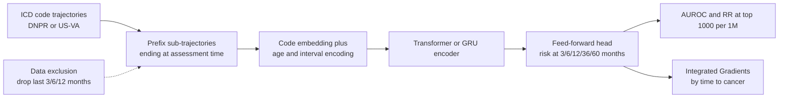

# A deep learning algorithm to predict risk of pancreatic cancer from disease trajectories

> **Bibkey** `Placido_2023` · **Venue** Nature Medicine (2023) · **Category** ehr · **Relevance** high · **Access** open
> **Link** <https://doi.org/10.1038/s41591-023-02332-5> · `status: complete`

---

## One-liner
CancerRiskNet: using **only timestamped ICD diagnosis-code sequences** (disease trajectories), a Transformer trained on the Danish National Patient Registry (DNPR; 6.2M patients and 23,985 pancreatic cancer cases after filtering) predicts whether pancreatic cancer occurs within 3/6/12/36/60 months after the assessment time. The 36-month AUROC is 0.879, and the abstract reports 0.83 when the last 3 months before diagnosis are removed from training. Applied unchanged to the US Veterans Affairs system (US-VA) it drops to 0.710; retrained on VA data it reaches 0.775 (abstract: 0.78) (Abstract; Results).

## Takeaways
- **Time order carries signal**: on the same codes, an order-agnostic bag-of-words gets AUROC 0.807 vs 0.879 for the Transformer; at the "top 1,000 of 1M" operating point, relative risk (RR) rises from 2.1 to 104.7 (Fig. 3a,b).
- **"Data exclusion" is the evaluation design most worth copying**: remove diagnoses from the last 3/6/12 months before diagnosis in training, to test whether the model only reads near-diagnosis codes such as jaundice or abdominal pain; performance drops but does not collapse (text: 0.843/0.829/0.827) (Results §"Performance with data exclusion").
- **Models do not transfer across health systems for free**: the Danish model gives AUROC 0.710 on VA, local VA retraining 0.775; the authors conclude that independent local training is needed when systems differ substantially (Results §"Application in a different healthcare system"; Discussion).
- **Label quality is a major issue in itself**: only 32.4% of VA patients with a pancreatic cancer ICD code in the EHR appear in the VA cancer registry, so cases were defined as registry ∩ EHR code (Methods §"US-VA cancer registry and data quality").
- **Performance reported in terms of clinical capacity**: besides AUROC, RR at the top 0.1%, and an estimate that of the top 1,000 of 1M people about 320 would develop cancer (PPV 0.32, no exclusion), with a conservative estimate (PPV 0.07, 3-month exclusion) of at least ~70 newly identified high-risk patients (Discussion).
- Our reading: for the Sinai project, the reusable part is this **evaluation protocol** (partial trajectories, control truncation, data exclusion, RR@N1000, cross-system test), not only the architecture.

## Problem
Pancreatic cancer is usually found late: ~80% of patients are diagnosed with locally advanced or distant metastatic disease, when 5-year survival is 2–9%, whereas patients with early-stage disease can be cured by surgery, chemotherapy and radiotherapy (Introduction). Incidence is far lower than for lung, breast or colorectal cancer, so age-based population screening would produce many false positives and costly tests; few high-penetrance risk factors are known; only the few people with family history, rare inherited pathogenic variants or cystic pancreatic lesions currently get imaging surveillance, and they account for a small fraction of cases (Introduction). The aim: use **real-world longitudinal clinical records** of many patients to pick out a moderate number of high-risk patients so that surveillance becomes affordable. Previous record-based pancreatic cancer models (survey data, GP records, hospital-system data, TriNetX) used only the occurrence of codes, not the **time sequence** of a patient's trajectory; Danish-registry trajectory studies were descriptive (Introduction).

## Method
Step by step for a CS reader (all from Methods and Fig. 1):

- **Input representation**: each patient is a sequence of (ICD diagnosis code, date, age) events. ICD (International Classification of Diseases) is hierarchical; codes are truncated to the three-character category (level 3, e.g. C25 = malignant neoplasm of pancreas). Methods states n = 2,997 three-character codes while Results says "ICD level-3, 2,000 disease codes" — the paper is internally inconsistent here. In the Danish data, ICD-8 (used until 1994) and ICD-10 codes are used side by side **without semantic mapping**. Codes labelled "temporary" or "referral" (8.3%) are removed. Case definition: ICD-10 C25 or ICD-8 157.
- **Sample construction (augmentation)**: for each patient, all continuous prefix sub-trajectories starting at the first record, of length ≥5 diagnoses, with different endpoints; the endpoint is the time of assessment. For cases, only sub-trajectories ending before diagnosis; for non-cases, only those ending ≥2 years before the end of their records (death or data freeze), to avoid undiagnosed cancer among controls. Batches are balance-sampled to roughly equal positives and negatives.
- **Labels**: for each sub-trajectory, a step-function label y<sub>i,t</sub> at t ∈ {3, 6, 12, 36, 60} months (1 if cancer occurs within that window). This is five binary tasks on a shared representation, not a survival model.
- **Three-part model**: embedding (codes → low-dimensional vectors trained jointly; one-hot for models without embedding) → encoding (GRU, Transformer, or simple pooling for bag-of-words / MLP; age is also input) compresses the trajectory into a "fingerprint" vector → feed-forward network outputs risk for the five windows. The Transformer's positional encoding is adapted from Vaswani et al.: cosine waves at 128 frequencies evaluated at **the age of each diagnosis** and **the time differences between diagnoses**, used as weights on each token, so the same disease at different times, and two diseases near or far apart in time, can be distinguished.
- **Loss**: cross-entropy summed over the five time points plus L2; for cases only time points before diagnosis count (N<sub>T</sub> ≤ 5). A large hyperparameter search (Supplementary Table 2); model selection on the development set by **AUPRC**.
- **Split and evaluation**: random 80/10/10 split by patient (all sub-trajectories of a patient in one split). Performance is **computed over trajectories, not patients**. Metrics: AUROC; precision/recall at the F1 point; and RR = precision / population incidence, read at "the n highest-risk patients per 1M" (N1000 = top 0.1%). 95% CIs from 200 bootstrap resamples.
- **Data-exclusion experiments**: retrain separately with diagnoses from the last 3, 6 or 12 months before diagnosis removed from the input, to test reliance on near-diagnosis codes that almost encode the label (e.g. digestive-tract neoplasms).
- **Cross-system and interpretability**: apply the best Danish model to VA with only code mapping (ICD-9 → ICD-10, then a "D" prefix for Danish format); then train from scratch on VA. Integrated Gradients (Captum) attributions for the 36-month output, computed on the embedding output, summed over dimensions and trajectories, stratified by 0–6/6–12/12–24/24–36 months to cancer; age contribution computed at the age-embedding layer.

## Method diagram


## Data
**Danish DNPR**: ~8.6M patients and 229M hospital diagnoses, 1977–2018, on average 26.7 codes per patient; inpatient contacts since 1977, outpatient and ED since 1995, **no GP records** (Results §"Datasets"; Methods). Cancer-code accuracy is reported at 98% in the literature (950 sampled records). After a demographic-continuity filter (excluding Greenland residents, no stable residence, changed IDs; Extended Data Fig. 1), 8,110,706 patients (Table 1), of whom 23,601 had C25 and 14,720 had ICD-8 157; after removing patients with <5 diagnoses, **6.2M patients and 23,985 cases** (82% ICD-10, 18% ICD-8) were used. 88% of training cases overlap with the Danish Cancer Registry, which the authors treat as a lower bound on label accuracy. **US-VA CDW**: 1999–2020; 2,975,110 patients randomly sampled (compute limits) from 15,933,326 with ≥1 ICD code; cases = present in **both** the VA cancer registry and EHR ICD codes (94.9% of registry cases have an EHR code, but only 32.4% of EHR-coded patients are in the registry); after removing discordant patients and those with <5 events, **1,948,209 patients and 3,418 cases** (Methods; Extended Data Fig. 3). Note the VA counts differ across the paper: abstract "3 million / 3,900 cases", Results "3.0M / 3,864", Table 1 "2,962,383 / 3,869", Methods final set "1,948,209 / 3,418". **System differences** (Table 1): VA is 85.7% male (96.7% among cases) vs ~50% in Denmark; median codes per patient 188 vs 22; median trajectory length 12.0 vs 23.0 years; median age at diagnosis 68 vs 70.

## Key results
- **Model comparison** (DNPR, 36 months, no exclusion): Transformer AUROC **0.879** (0.877–0.880), GRU 0.852 (0.850–0.854), MLP 0.845 (0.843–0.847), bag-of-words 0.807 (0.805–0.809); RR at N1000: Transformer **104.7**, MLP 26.6, bag-of-words 2.1 (Fig. 3a,b; Results).
- **Data exclusion** (36-month window): the text gives AUROC falling from 0.879 to **0.843/0.829/0.827** (3/6/12-month exclusion), while the Fig. 3c legend shows 0.832/0.827/0.814 (all GRU) — text and legend disagree; the abstract uses 0.83. With 3-month exclusion, RR at N1000 is 47.6 (Fig. 3c,d and caption).
- **All codes beat known risk factors**: with only codes for 23 known risk factors, Transformer AUROC is 0.838 vs 0.879 with all codes (Fig. 3e,f).
- **Longer horizons are harder**: AUROC 0.934/0.923/0.908/0.879/0.861 for 3/6/12/36/60-month windows (Fig. 3g); recall at the F1 point falls from 8% for cancer ~1 year after assessment to 4% at ~3 years (DNPR, Fig. 5a).
- **Cross-system**: the Danish Transformer applied to VA gives 36-month AUROC **0.710** (0.708–0.712), RR 57.4 (Fig. 4b); trained from scratch on VA, AUROC **0.775** (0.772–0.778), RR 80.4 (Fig. 4c); the abstract gives AUROC 0.76 for VA retraining with 3-month exclusion.
- **Proposed surveillance setting**: age >50, 3-month exclusion, 12-month window, top 0.1%: RR = **58.7** (DNPR, GRU) / **33.1** (VA, Transformer) (Fig. 4d). Excluding chronic pancreatitis (K86) patients leaves RR nearly unchanged (Extended Data Fig. 5).
- **Head counts**: top 1,000 of 1M (no exclusion, 12-month window, age ≥50), PPV 0.32, so ~320 would develop cancer; a conservative estimate with the 3-month-exclusion model (PPV 0.07) gives at least ~70 newly identified high-risk patients (Discussion). The cost estimate is in the Supplementary Notes, not read here.
- **Features** (IG, Fig. 5b,d): Danish top features 0–6 months before diagnosis include unspecified jaundice, biliary-tract diseases, abdominal and pelvic pain, biliary-tract neoplasms and other pancreatic diseases; type 2 (non-insulin-dependent) diabetes gains weight in earlier trajectories; cholelithiasis and reflux disease are noted as possible mechanistic leads (a hypothesised link via proton-pump inhibitors). Features partly overlap between systems. Age contribution rises strongly from age 50 (Extended Data Fig. 4).

## Contributions
- Uses the **time sequence** of disease trajectories (not just code occurrence) as input, with continuous-time positional encoding from age at diagnosis and inter-diagnosis intervals, directly compared with order-agnostic baselines (Fig. 3a,b).
- **Multi-horizon outputs** (3–60 months), matching the clinical question of how early cancer can be flagged.
- **Data-exclusion protocol**: systematically removing the last 3/6/12 months of input to separate early signal from near-diagnosis signal.
- **RR at the top 0.1%** as the clinical operating point, translating performance into surveillance-programme size.
- A **direct transfer vs local retraining** comparison between two very different national systems.

## Limitations
- Stated by the authors: diagnosis codes only; they expect gains from medications, lab values, clinical notes, abdominal CT/MRI, germline genetics and GP records (Discussion).
- Stated by the authors: no single globally robust model; local training is needed when systems differ; federated learning is only proposed, with social and organisational barriers (Discussion).
- Stated by the authors: no empirical cost–benefit data; clinical impact depends on EHR quality and local practice; the work addresses only the first step (identifying high-risk patients), not surveillance or treatment (Results; Discussion). IG features are not necessarily causal (Results §"Predictive features").
- Populations: no GP data in Denmark; VA is mostly male (85.7%) (Methods; Table 1).
- Our reading: the test set is a **random** patient split, not a temporal split, so drift (e.g. the 2015 US ICD-9 → ICD-10 switch) is not tested; metrics are computed over sub-trajectories, so patients with many trajectories weigh more; RR@N1000 extrapolates test-set results to a hypothetical 1M population.
- Our reading: the paper has internal inconsistencies (2,997 vs 2,000 codes; exclusion results in text vs Fig. 3c legend; four versions of the VA counts), so cite numbers with their location.
- A later paper's view (not this paper): the npj Digital Medicine 2025 LLM-embedding paper notes that over 50% of this paper's top-10 predictors for 0–6 months also appear for 24–36 months (e.g. unspecified jaundice), suggesting multi-label heads may propagate strong proximal features into distal windows (that paper's Discussion; `ehr-pancreatic-llm-npjdigitmed-2025` in this repo).

## Relation to our direction
**First, the Mount Sinai EHR project (millions of patients).** The PI marked this paper "most important for now". Our reading: it gives a complete minimal recipe that runs on ICD codes plus timestamps alone, and an evaluation protocol that can be copied: (1) multiple prefix sub-trajectories per patient at different assessment times; (2) controls truncated 2 years before record end; (3) 3/6/12-month exclusion to test near-diagnosis signal; (4) operating points such as RR at the top 0.1% that map onto clinical capacity; (5) direct transfer of an external model as a baseline vs local retraining. Our reading: Sinai is a US system that, like VA, went through the 2015 ICD-9 → ICD-10 switch and has billing-influenced coding (the authors use such factors to explain the VA transfer drop, Discussion), so Sinai work should centre on local training and ideally add a **temporal** test split. For labels, the VA lesson (only 32.4% of EHR-coded patients confirmed by the cancer registry) suggests Sinai needs a tumour-registry or pathology-confirmed case definition rather than ICD codes alone. For endpoints, the same protocol can be pointed at cardio-kidney-metabolic outcomes (e.g. CKD progression, dialysis, heart failure), closer to the lab's kidney/heart focus; these are our inferences — the paper itself studies only pancreatic cancer.

Our reading (relation to detect → model → revert, briefly): a trajectory model is **patient-scale detect**, answering "who is at high risk, and when", but the authors state IG features are not necessarily causal, so it does not answer "why, and what to change". One possible interface is to take EHR-flagged high-risk patients who have biopsies/omics and run tissue-level anomaly detection on them. The data-exclusion test could also be a leakage check an agent must run before stating an EHR risk claim.

## Reusable assets
- **Code:** CancerRiskNet (Python 3.8.10, PyTorch 1.9.0; Integrated Gradients via Captum 0.3.1) (Code availability).
<https://github.com/BrunakSanderLabs/CancerRiskNet>
- **Data:** DNPR via the Danish Health Data Authority (normally 3–6 months); US-VA via VINCI approval (at least 6 months). Not public (Data availability).
- **Evaluation protocol:** prefix sub-trajectory augmentation, 2-year control truncation, 3/6/12-month exclusion, RR@N1000, MI-CLAIM reporting checklist (Supplementary Table 6).

## Follow-ups
- Supplement: cost estimate (Supplementary Notes), full model-comparison tables (Supplementary Table 3a–i), IG feature tables (Supplementary Table 5).
- Delphi-2M (Nature 2025, Brunak co-author; cites this paper as ref. 26) extends from one cancer to a generative model of >1,000 diseases — see `ehr-delphi2m-nature-2025`.
- Follow-up on US institutional EHRs (Columbia CUMC, Cedars-Sinai CSMC, LLM embeddings) — see `ehr-pancreatic-llm-npjdigitmed-2025`.
- Ref. 23: Tomašev et al. 2019 (Nature), continuous prediction of acute kidney injury — directly relevant to kidney endpoints.
- Ref. 42: Hjaltelin et al., pancreatic cancer symptom trajectories from Danish registry data and free text (medRxiv 2023).

## Cite
```bibtex
@article{Placido_2023, title={A deep learning algorithm to predict risk of pancreatic cancer from disease trajectories}, volume={29}, ISSN={1546-170X}, url={http://dx.doi.org/10.1038/s41591-023-02332-5}, DOI={10.1038/s41591-023-02332-5}, number={5}, journal={Nature Medicine}, publisher={Springer Science and Business Media LLC}, author={Placido, Davide and Yuan, Bo and Hjaltelin, Jessica X. and Zheng, Chunlei and Haue, Amalie D. and Chmura, Piotr J. and Yuan, Chen and Kim, Jihye and Umeton, Renato and Antell, Gregory and Chowdhury, Alexander and Franz, Alexandra and Brais, Lauren and Andrews, Elizabeth and Marks, Debora S. and Regev, Aviv and Ayandeh, Siamack and Brophy, Mary T. and Do, Nhan V. and Kraft, Peter and Wolpin, Brian M. and Rosenthal, Michael H. and Fillmore, Nathanael R. and Brunak, Søren and Sander, Chris}, year={2023}, month=May, pages={1113–1122} }
```


---

📄 **[AI-ready full-text extract →](ai-ready.md)**
