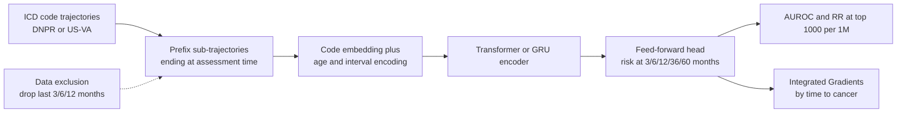

# A deep learning algorithm to predict risk of pancreatic cancer from disease trajectories

> **文献键** `Placido_2023` · **来源** Nature Medicine(2023) · **类别** ehr · **相关度** high · **获取** open
> **链接** <https://doi.org/10.1038/s41591-023-02332-5> · `status: complete`

---

## 一句话
CancerRiskNet:只用**带时间戳的 ICD 诊断码序列**(disease trajectory,疾病轨迹),在丹麦全国患者登记(DNPR;过滤后 620 万人、23,985 例胰腺癌)上训练 Transformer,同时预测评估时刻之后 3/6/12/36/60 个月内是否发生胰腺癌;36 个月窗口 AUROC 0.879,训练时去掉确诊前 3 个月的数据后摘要报告 0.83;不改参数直接用于美国退伍军人系统(US-VA)降到 0.710,在 VA 上重新训练后为 0.775(摘要:0.78)(Abstract;Results)。

## 要点
- **时间顺序有信息量**:同样的诊断码,忽略顺序的 bag-of-words 为 AUROC 0.807,Transformer 为 0.879;在「100 万人中前 1,000 名」操作点,相对风险(RR)从 2.1 升到 104.7(Fig. 3a,b)。
- **"数据排除"是这篇论文最该照搬的评估设计**:训练时删掉确诊前 3/6/12 个月的诊断,看模型是不是只在读黄疸、腹痛这类"已经快确诊"的码;性能下降但没崩(正文:0.843/0.829/0.827)(Results §"Performance with data exclusion")。
- **跨医疗系统不能直接搬**:丹麦模型在 VA 上 AUROC 0.710,VA 本地重训 0.775;作者结论是系统差异大时需要本地独立训练(Results §"Application in a different healthcare system";Discussion)。
- **标签质量本身是一个大问题**:VA 的 EHR 里有胰腺癌 ICD 码的人只有 32.4% 出现在 VA 癌症登记中,所以作者把病例定义为「登记 ∩ EHR 码」(Methods §"US-VA cancer registry and data quality")。
- **用临床容量来报告性能**:除 AUROC 外,作者报告 RR@前 0.1%,并估算 100 万人中筛出前 1,000 人时约 320 人会发病(PPV 0.32,不排除数据),保守估计(PPV 0.07,排除 3 个月)至少约 70 人是新识别的高危(Discussion)。
- 我们的理解:对 Sinai 项目,可直接复用的是这套**评估协议**(子轨迹、对照截断、数据排除、RR@N1000、跨系统检验),而不只是模型结构。

## 研究问题
胰腺癌通常发现得晚:约 80% 的患者确诊时已是局部晚期或远处转移,此时 5 年生存只有 2–9%;而早期发现的患者可以通过手术、化疗与放疗的组合治愈(Introduction)。胰腺癌发病率远低于肺癌、乳腺癌、结直肠癌,按年龄做全人群筛查会带来大量假阳性和昂贵检查;已知的高外显率危险因素很少;目前只有家族史、罕见遗传致病变异或胰腺囊性病变的少数人接受影像监测,而他们只占胰腺癌患者的一小部分(Introduction)。作者的目标:从大量病人的**真实世界纵向临床记录**中挑出数量适中的高危人群,使监测项目可负担。此前用病历做胰腺癌风险预测的工作(问卷、全科记录、医院系统数据、TriNetX)只使用「是否出现过某诊断码」,不使用病人轨迹中的**时间顺序**;用丹麦登记数据做的疾病轨迹研究则是描述性的(Introduction)。

## 方法
面向 CS 读者,按步骤写(均出自 Methods 与 Fig. 1):

- **输入表示**:每个病人是一串 (ICD 诊断码, 日期, 年龄) 事件。ICD(International Classification of Diseases,国际疾病分类)是分层编码;本文截到三位字符的类别(level 3,如 C25 = 胰腺恶性肿瘤)。Methods 写的是 n = 2,997 个三位码,Results 写的是「ICD level-3, 2,000 disease codes」—— 论文内部两个数字不一致。丹麦数据中 ICD-8(使用至 1994 年)与 ICD-10 **不做语义映射**、作为不同 token 共用。去掉标记为 temporary / referral 的码(8.3%)。病例定义:ICD-10 C25 或 ICD-8 157。
- **样本构造(数据增强)**:对每个病人取所有「从病史起点开始、长度 ≥5 个诊断、终点不同」的连续前缀子轨迹,终点称为评估时刻(time of assessment)。病例只用在确诊之前结束的子轨迹;非病例只用在其记录结束(死亡或数据冻结)前 ≥2 年结束的子轨迹,以避免对照里混进尚未确诊的癌症。每个 batch 正负样本约各半(balanced sampling)。
- **标签**:对每个子轨迹,在 t ∈ {3, 6, 12, 36, 60} 个月处给阶跃函数标签 y<sub>i,t</sub>(这段时间内发生胰腺癌 = 1)。这是 5 个二分类任务共享一个表示,而不是生存模型。
- **模型三段式**:embedding(诊断码 → 低维向量,与其余部分联合训练;无 embedding 的模型用 one-hot)→ encoding(GRU、Transformer,或 bag-of-words / MLP 的简单 pooling;编码层也输入年龄)把整段轨迹压成一个 "fingerprint" 向量 → 前馈网络输出 5 个时间窗的风险。Transformer 的位置编码改编自 Vaswani 等:用 128 个频率的余弦波,在**每个诊断的年龄**和**诊断之间的时间差**处取值,作为各 token 的权重;这样同一种病在不同时间、两种病相隔远近都能区分。
- **损失**:5 个时间点上的交叉熵之和 + L2 正则;病例只计入确诊之前的时间点(N<sub>T</sub> ≤ 5)。大规模超参搜索(Supplementary Table 2),在开发集上用 **AUPRC** 选模型。
- **划分与评估**:按病人随机 80/10/10 划分(同一病人的所有子轨迹只进一个集合)。性能**按子轨迹而非按病人计算**。指标:AUROC;F1 操作点的 precision/recall;以及 RR = precision / 人群发病率,在「100 万人中风险最高的 n 人」处读数(N1000 = 前 0.1%)。95% CI 来自 200 次 bootstrap。
- **数据排除实验**:分别重新训练,输入中删掉确诊前最后 3、6、12 个月的诊断,检验模型是否只依赖临近确诊、几乎等于标签的码(如消化道肿瘤)。
- **跨系统与可解释性**:把丹麦最佳模型用于 VA,只做编码映射(ICD-9 → ICD-10,再加前缀 "D" 变成丹麦格式);再在 VA 上从头训练。用 Integrated Gradients(Captum)对 36 个月输出求归因,在 embedding 输出上计算、对维度和轨迹求和,并按距确诊 0–6/6–12/12–24/24–36 个月分层;年龄贡献在年龄 embedding 层上算。

## 方法图


## 数据
**丹麦 DNPR**:1977–2018 年约 860 万人、2.29 亿条医院诊断,平均每人 26.7 个码;1977 年起有住院,1995 年起有门诊与急诊,**不含全科医生记录**(Results §"Datasets";Methods)。癌症诊断码准确性文献报告为 98%(950 份抽样病历)。人口连续性过滤(排除格陵兰居民、无稳定住址、ID 变更等,Extended Data Fig. 1)后 8,110,706 人(Table 1),其中 23,601 人有 C25、14,720 人有 ICD-8 157;再去掉 <5 个诊断的人,训练用 **620 万人,23,985 例**(82% ICD-10,18% ICD-8)。与丹麦癌症登记对照,88% 的训练病例重合,作者视为标签准确度下限。**US-VA CDW**:1999–2020 年;从 15,933,326 名有 ≥1 个 ICD 码的人中因算力限制随机抽 2,975,110 人;病例 = VA 癌症登记与 EHR ICD 码**同时**有记录(登记中 94.9% 的病例在 EHR 有码,但 EHR 有码者只有 32.4% 在登记中);去掉两者不一致者和 <5 个事件者,最终 **1,948,209 人、3,418 例**(Methods;Extended Data Fig. 3)。注意论文中 VA 数字不统一:摘要「300 万人 / 3,900 例」、Results「3.0M / 3,864 例」、Table 1「2,962,383 / 3,869 例」、Methods 最终集「1,948,209 / 3,418 例」。**两系统差异**(Table 1):VA 男性占 85.7%(病例中 96.7%),丹麦约各半;每人诊断码中位数 188 vs 22;轨迹中位长度 12.0 vs 23.0 年;确诊中位年龄 68 vs 70 岁。

## 主要结果
- **模型比较**(DNPR,36 个月,不排除数据):Transformer AUROC **0.879**(0.877–0.880),GRU 0.852(0.850–0.854),MLP 0.845(0.843–0.847),bag-of-words 0.807(0.805–0.809);N1000 处 RR:Transformer **104.7**,MLP 26.6,bag-of-words 2.1(Fig. 3a,b;Results)。
- **数据排除**(36 个月窗口):正文写 AUROC 从 0.879 降至 **0.843/0.829/0.827**(排除 3/6/12 个月);但 Fig. 3c 图例写的是 0.832/0.827/0.814(均为 GRU)—— 正文与图例不一致,摘要取 0.83。排除 3 个月时 N1000 处 RR 为 47.6(Fig. 3c,d 及图注)。
- **全部诊断码优于已知危险因素**:只用 23 个已知危险因素对应的码,Transformer AUROC 0.838,全部码为 0.879(Fig. 3e,f)。
- **时间窗越远越难**:3/6/12/36/60 个月窗口 AUROC 分别为 0.934/0.923/0.908/0.879/0.861(Fig. 3g);F1 操作点的召回率从距确诊约 1 年的 8% 降到约 3 年的 4%(DNPR,Fig. 5a)。
- **跨系统**:丹麦 Transformer 直接用于 VA,36 个月 AUROC **0.710**(0.708–0.712),RR 57.4(Fig. 4b);在 VA 上从头训练,AUROC **0.775**(0.772–0.778),RR 80.4(Fig. 4c);摘要给出 VA 重训 + 排除 3 个月为 AUROC 0.76。
- **建议的监测方案**:>50 岁、排除 3 个月、12 个月窗口、前 0.1%:RR = **58.7**(DNPR,GRU)/ **33.1**(VA,Transformer)(Fig. 4d)。剔除慢性胰腺炎(K86)患者后 RR 几乎不变(Extended Data Fig. 5)。
- **人数换算**:100 万人取前 1,000 人(不排除数据,12 个月窗口,≥50 岁),PPV 0.32,约 320 人会发病;用排除 3 个月的模型保守估计(PPV 0.07),至少约 70 人是此前未被识别的高危者(Discussion)。成本估算在补充材料中,本次未读。
- **特征**(IG,Fig. 5b,d):确诊前 0–6 个月的丹麦 top 特征包括不明原因黄疸、胆道疾病、腹部与盆腔痛、胆道恶性肿瘤、胰腺其他疾病;更远的轨迹中 2 型(非胰岛素依赖)糖尿病贡献上升;作者把胆石症与反流病列为可能的机制线索(反流病与质子泵抑制剂的假设联系)。两系统特征部分重叠。年龄贡献从 50 岁起明显上升(Extended Data Fig. 4)。

## 创新点
- 把疾病轨迹的**时间序列**(而非码是否出现)作为输入,并用诊断年龄 + 诊断间隔做连续时间位置编码;与忽略顺序的对照直接比较(Fig. 3a,b)。
- **多时间窗输出**(3–60 个月),对应「能提前多久发现」的临床问题。
- **数据排除协议**:系统地去掉确诊前 3/6/12 个月的输入,区分早期信号与近确诊信号。
- **RR@前 0.1%** 作为临床操作点,把模型性能换算成监测项目规模。
- 在两个差异很大的国家级系统之间做**直接迁移 vs 本地重训**的对比。

## 局限
- 作者所述:只用诊断码;作者预计加入用药、化验、临床文本、腹部 CT/MRI、胚系遗传、全科记录后会更好(Discussion)。
- 作者所述:不存在一个全球通用模型,系统差异大时需本地训练;联邦学习只是被提议,作者指出其障碍也有社会与组织层面(Discussion)。
- 作者所述:没有成本-收益的实证数据;临床影响取决于 EHR 数据质量与当地实践;本文只解决「识别高危」这一步,不涉及后续监测与治疗(Results;Discussion)。IG 特征不一定有因果关系(Results §"Predictive features")。
- 人群:丹麦无全科医生数据;VA 以男性为主(85.7%)(Methods;Table 1)。
- 我们的理解:测试集是按病人**随机**划分,不是按时间划分,所以没有检验时间漂移(如 2015 年美国 ICD-9 → ICD-10 切换);指标按子轨迹计算,轨迹多的病人权重更大;RR@N1000 是把测试集结果外推到假想的 100 万人。
- 我们的理解:论文内部有数字不一致(码数 2,997 vs 2,000;排除实验正文 vs Fig. 3c 图例;VA 人数四个版本),引用时要注明出处。
- 后续文献的观点(非本文):npj Digital Medicine 2025 的 LLM-embedding 论文指出,本文 0–6 个月与 24–36 个月 top-10 特征有一半以上重叠(如不明原因黄疸),认为多标签结构可能把近端强特征「传」到远端窗口(见该论文 Discussion;本仓库 `ehr-pancreatic-llm-npjdigitmed-2025`)。

## 与本研究方向的关系
**首先是 Mount Sinai EHR 项目(数百万病人)**。PI 标注这篇为「目前最重要」。我们的理解:它给出了一个只需 ICD 码 + 时间戳就能跑的完整最小方案,以及一套可以照搬的评估协议:(1) 每个病人截取多个评估时刻的前缀子轨迹;(2) 对照组在记录结束前 2 年截断;(3) 排除确诊前 3/6/12 个月的数据检验「近确诊信号」;(4) 报告 RR@前 0.1% 这类能对上临床容量的操作点;(5) 外部模型直接迁移作为基线,对比本地重训。我们的理解:Sinai 是美国医疗系统,和 VA 一样经历 2015 年 ICD-9 → ICD-10 切换、编码受计费影响(作者用这些解释 VA 迁移性能下降,Discussion),所以 Sinai 上应以本地训练为主,并最好加一个**按时间划分**的测试集。标签上,VA 的教训(EHR 码只有 32.4% 被癌症登记确认)提示 Sinai 需要肿瘤登记或病理确认的病例定义,而不是只看 ICD 码。终点上,同一协议可以换成心-肾-代谢类终点(如 CKD 进展、透析、心衰),这与实验室的肾脏/心脏方向更贴近;这些都是我们的推断,论文本身只研究胰腺癌。

我们的理解(与 detect → model → revert 的关系,简述):轨迹模型相当于**病人尺度的 detect**,回答「谁、何时风险高」,但作者明确说 IG 特征不一定是因果,所以它不回答「为什么、改什么」;一个可能的接口是从 EHR 高危人群中挑出有活检/组学数据的病人,再做组织层的异常检测。数据排除实验也可以作为 agent 给出 EHR 风险结论前必须跑的一项「泄漏检查」。

## 可复用资产
- **代码:** CancerRiskNet(Python 3.8.10、PyTorch 1.9.0;IG 用 Captum 0.3.1)(Code availability)。
<https://github.com/BrunakSanderLabs/CancerRiskNet>
- **数据:** DNPR 需向丹麦卫生数据局申请(通常 3–6 个月);US-VA 需经 VINCI 审批(至少 6 个月)。不公开(Data availability)。
- **评估协议:** 前缀子轨迹增强、对照 2 年截断、3/6/12 个月数据排除、RR@N1000、MI-CLAIM 报告清单(Supplementary Table 6)。

## 待读
- 补充材料:成本估算(Supplementary Notes)、全部模型比较表(Supplementary Table 3a–i)、IG 特征表(Supplementary Table 5)。
- Delphi-2M(Nature 2025,Brunak 为共同作者,并引用本文为 ref. 26)把单病种扩展到 >1,000 种疾病的生成式模型 —— 见 `ehr-delphi2m-nature-2025`。
- 美国机构 EHR 上的后续工作(哥伦比亚 CUMC、Cedars-Sinai CSMC,LLM embedding)—— 见 `ehr-pancreatic-llm-npjdigitmed-2025`。
- Ref. 23:Tomašev 等 2019(Nature),急性肾损伤的连续预测 —— 与肾病终点直接相关。
- Ref. 42:Hjaltelin 等,丹麦登记 + 病历自由文本中的胰腺癌症状轨迹(medRxiv 2023)。

## 引用
```bibtex
@article{Placido_2023, title={A deep learning algorithm to predict risk of pancreatic cancer from disease trajectories}, volume={29}, ISSN={1546-170X}, url={http://dx.doi.org/10.1038/s41591-023-02332-5}, DOI={10.1038/s41591-023-02332-5}, number={5}, journal={Nature Medicine}, publisher={Springer Science and Business Media LLC}, author={Placido, Davide and Yuan, Bo and Hjaltelin, Jessica X. and Zheng, Chunlei and Haue, Amalie D. and Chmura, Piotr J. and Yuan, Chen and Kim, Jihye and Umeton, Renato and Antell, Gregory and Chowdhury, Alexander and Franz, Alexandra and Brais, Lauren and Andrews, Elizabeth and Marks, Debora S. and Regev, Aviv and Ayandeh, Siamack and Brophy, Mary T. and Do, Nhan V. and Kraft, Peter and Wolpin, Brian M. and Rosenthal, Michael H. and Fillmore, Nathanael R. and Brunak, Søren and Sander, Chris}, year={2023}, month=May, pages={1113–1122} }
```


---

📄 **[AI-ready 全文提取 →](ai-ready.md)**
