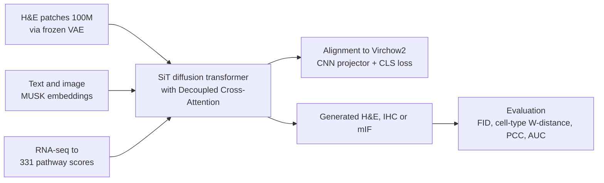
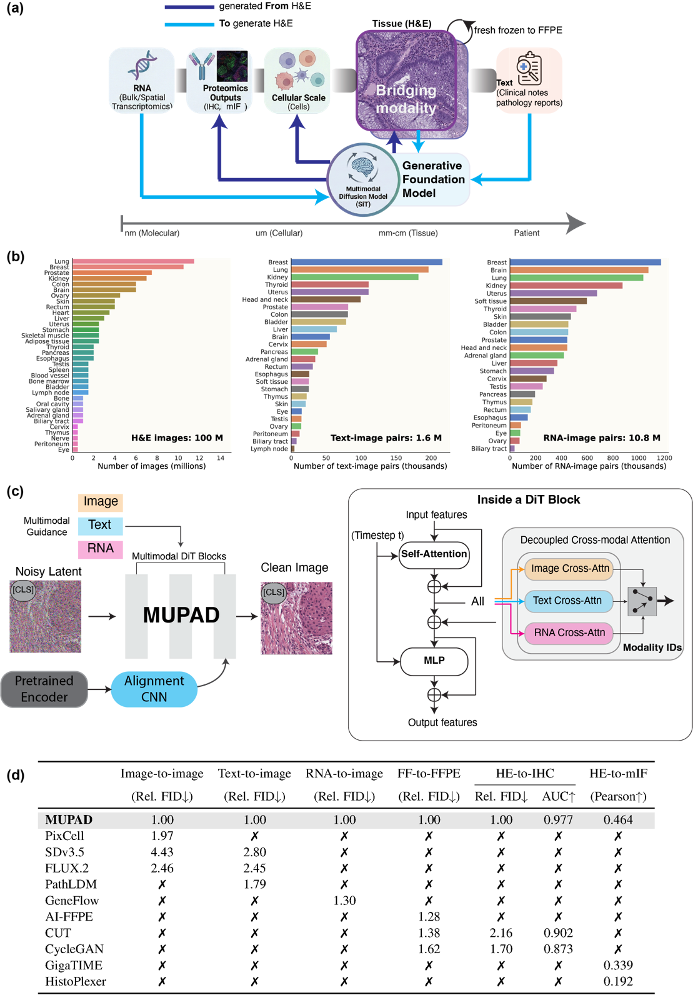
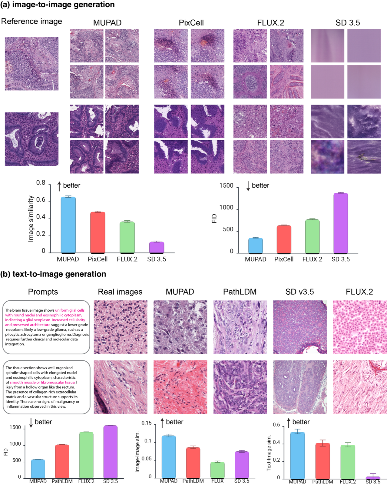
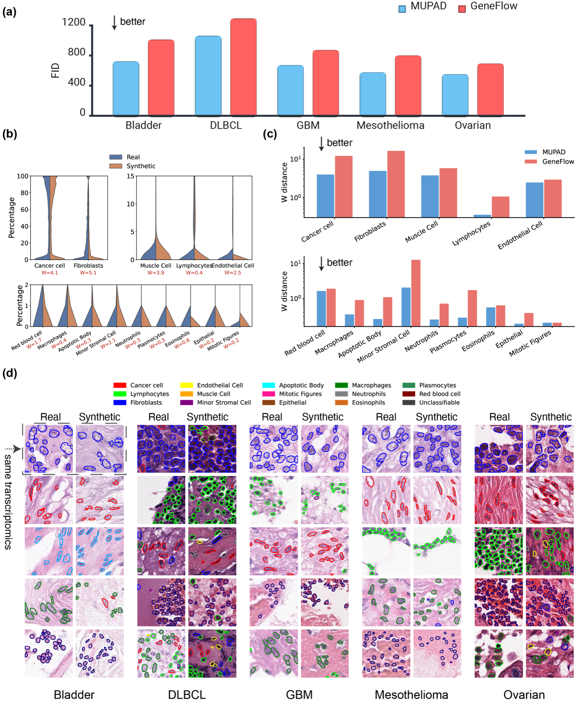
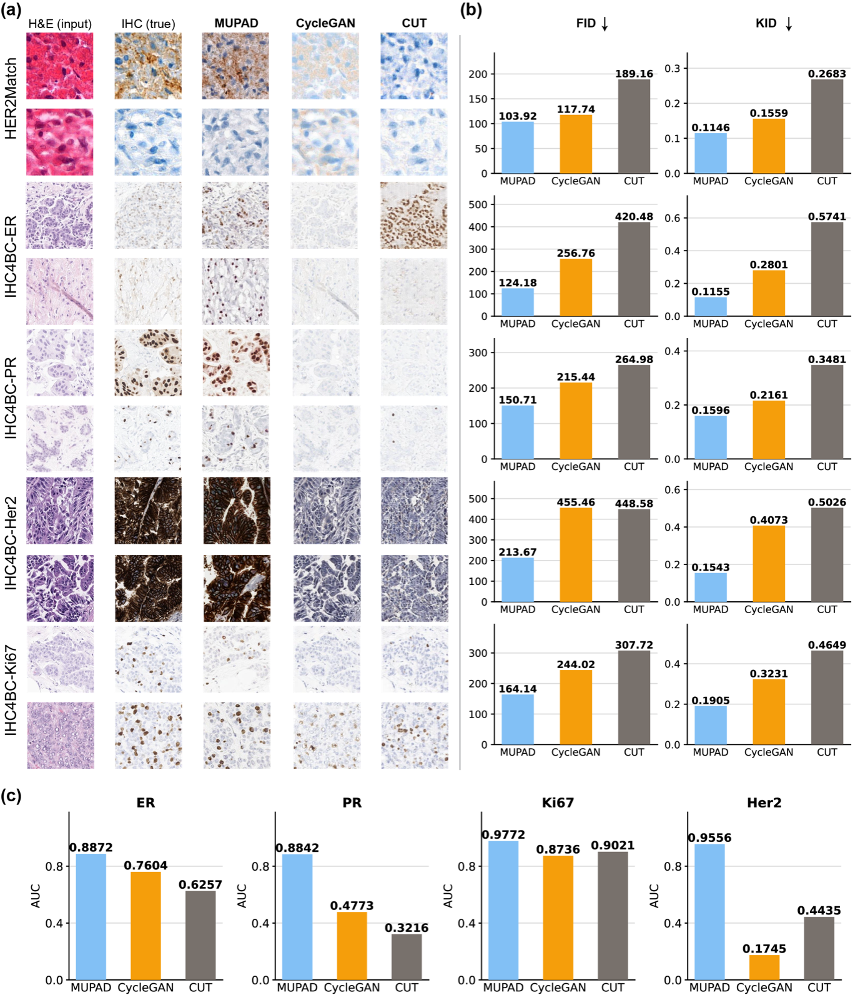

# A Generative Foundation Model for Multimodal Histopathology

> **Bibkey** `Xiang2026_260403635` · **Venue** arXiv preprint (2026) · **Category** foundation · **Relevance** medium · **Access** open
> **Link** <https://arxiv.org/abs/2604.03635> · `status: complete`

---

## One-liner
MuPAD (Multimodal Pathology Diffusion; spelled MUPAD in the PDF and MuPD on the arXiv abstract page) is a generative pathology foundation model: one diffusion transformer with Decoupled Cross-Attention (DCA) conditions H&E generation on images, RNA pathway scores and clinical text, and a single model covers text/image/RNA→H&E generation, frozen→FFPE translation and H&E→IHC/mIF virtual staining (Abstract).

## Takeaways
- Scale: pretrained on 100M H&E patches, 1.6M text–image pairs and 10.8M RNA–image pairs across 34 organs (Abstract; Methods §"Pretraining Datasets").
- RNA conditioning is not gene-level: TPM profiles are compressed to 331 pathway enrichment scores; bulk RNA and spatial transcriptomics share the same signatures, which allows transfer to Visium spots (Methods).
- Spatial transcriptomics→H&E: 5 cancers, 54,033 Visium spots; bladder FID 724.6 vs GeneFlow 1012.5 (−28.4%), with cell-type composition closer to real tissue (Fig. 4).
- Virtual staining: H&E→mIF mean patch PCC 0.238 vs GigaTIME 0.198, slide-level 0.464 vs 0.339 (Fig. 6); H&E→IHC clinical AUC Ki67 0.9772, HER2 0.9556 (Fig. 5c).
- Ablations: replacing DCA with shared cross-attention worsens FID by 7.9–13.6%; CNN alignment + CLS denoising reaches similarity 0.424 at 100K steps vs 0.243 for REPA (Fig. 7).
- Our reading: this is a forward generator (condition → tissue image) with no anomaly score and no inverse "which genes to change"; its value for us is cross-modal consistency checks and a "pathway condition → morphology" simulator.

## Problem
Diagnosis of complex disease needs histological, molecular and clinical data together, but modalities are often missing because of tissue scarcity, assay cost and workflow limits (Introduction). Existing models predict IHC, mIF or spatial transcriptomics from H&E, but each is trained on one paired source→target dataset, cannot share representations, and must be retrained for every new stain, marker panel or tissue (Introduction). The question: can one generative model, pretrained at scale across heterogeneous pathology modalities, beat the specialist models across tasks?

## Method
1) **Backbone**: a Scalable Interpolant Transformer (SiT, a flow-matching / diffusion transformer) denoising in the latent space of a frozen VAE (8× downsampling); it generates a clean H&E image given C = {RNA, text, reference image} (Methods §"Model Architecture").
2) **Condition encoders**: images and text are embedded with the pathology vision–language model MUSK; RNA-seq is TPM-normalised (transcripts per million), housekeeping and mitochondrial genes are removed, and profiles are compressed to 331 pathway-level enrichment scores using published pan-cancer gene signatures (Methods).
3) **Decoupled Cross-Attention (DCA)**: each modality gets its own K/V projections and attention stream, all queried by the intermediate image features h, summed with an indicator I(m) of whether that modality is present (Eq. 1). Any subset of modalities works at inference, and modalities do not compete in one shared KV space.
4) **Alignment losses**: a light CNN projector aligns SiT's internal features to a frozen pathology encoder, Virchow2, used as teacher (Eq. 2); an auxiliary CLS-token denoising loss keeps global semantics of noisy intermediate states (Eq. 3).
5) **Training**: AdamW, lr 1e-4, bf16, 8× H100, up to 500K steps; classifier-free guidance with 10% condition dropout; EMA 0.9999; inference with 250 SDE steps and guidance annealed from 2.5 to 0 (Methods §"Implementation").
6) **Task adaptation**: spatial transcriptomics is fine-tuned on MOSAIC for 50K steps (55 µm spots = 256×256 px); frozen→FFPE uses text domain prompts + DDIM inversion + attention injection to keep structure; H&E→IHC first learns a 6-layer-MLP flow from H&E to IHC embeddings in MUSK space, then generates; H&E→mIF is fine-tuned on ORION with the H&E VAE latent concatenated to the noisy mIF latent (Methods §"Application").

## Method diagram


## Data
**Pretraining**: ~100M H&E patches (512×512, 20×; TCGA, GTEx, PAIP, PLCO); 1.6M text–image pairs (PathGen-1.6M); 10.8M RNA–image pairs (the abstract, introduction and Results all say "10.8 million RNA–histology / RNA–image pairs"; only the Methods say "10.8 million bulk RNA-seq profiles from TCGA linked to their matched WSIs". Our reading: TCGA has bulk RNA-seq profiles only in the tens of thousands, so the figure counts patch–profile pairs and the Methods sentence is the loose one); 34 organs (Methods §"Pretraining Datasets"; Fig. 1b). **Evaluation**: 100K HISTAI references for image→image; 100K held-out PathGen-1.6M captions for text→image; SkinCancer, PanNuke, UniToPatho, LC25000, SICAPv2 for few-shot classification; retrieval reported on Book / Twitter / WebPathology (Methods says PathMMU); MOSAIC spatial transcriptomics, 5 cancers (bladder, GBM, DLBCL, mesothelioma, ovarian), 54,033 Visium spots; TCGA lung and brain for FF→FFPE; IHC4BC and HER2Match for IHC; ORION-CRC for mIF (Methods: 41 WSIs, 16 protein markers; the Results compare 15 markers, and the paper does not explain the difference).

## Key results
- **Image→image**: FID 305.12 vs PixCell 602.45 (−49.4%), FLUX.2 750.30, SD v3.5 1350.80; image similarity 0.63 vs PixCell 0.46 (Results §"Image-to-image"; Fig. 2a).
- **Text→image**: FID 576.30 vs PathLDM 1029.62 (−44.0%); text–image alignment 0.53 vs 0.41 (Fig. 2b).
- **Augmentation**: 10-shot PanNuke 0.492→0.724 (+47.2%), SkinCancer 0.790→0.850, UniToPatho 0.423→0.500, SICAPv2 0.635→0.720, LC25000 0.892→0.900; CLIP fine-tuned on 100K synthetic pairs: Book T2I R@10 4.77%→16.76% (Fig. 3).
- **Spatial transcriptomics→H&E**: FID bladder 724.6 vs GeneFlow 1012.5, mesothelioma 577.2 vs 801.4, ovarian 553.1 vs 695.4, GBM 674.2 vs 874.2, DLBCL 1063.0 vs 1293.5; with 14 cell classes from Histoplus, Wasserstein distances between synthetic and real cell-type distributions are lower for nearly all types (Fig. 4a–c; Extended Data Fig. 2). The abstract summarises this as 23% lower FID (relative FID 1.30 in Extended Data Table 1).
- **Frozen→FFPE**: lung FID 323.7 vs AI-FFPE 435.3 (−25.6%); brain 589.3 vs 731.0 (Results §"Fresh frozen to FFPE").
- **H&E→IHC**: IHC4BC-ER FID 124.18 vs CycleGAN 256.76 and CUT 420.48; clinical AUC PR 0.8842, HER2 0.9556, Ki67 0.9772, while CUT reaches 0.3216 on PR and CycleGAN 0.1745 on HER2 (below 0.5, which the authors attribute to semantic misalignment of the stain) (Fig. 5b–c).
- **H&E→mIF**: mean patch PCC 0.238 (GigaTIME 0.198, HistoPlexer 0.071), significantly better on 12 of 15 markers; mean slide-level PCC 0.464 vs 0.339 / 0.192, first on 11/15; PD-L1 patch PCC 0.218 vs 0.150 (Fig. 6).
- **Ablations** (small SiT-B/2): shared cross-attention FID 641.72 / 480.12 / 439.01 vs DCA 554.43 / 442.31 / 384.54 (image/text/RNA→image; −13.6% / −7.9% / −12.4%); alignment loss reaches FID 156.39 at 100K steps vs REPA 187.39 and SiT 183.22 (Fig. 7).

## Contributions
- One pretrained model covers image/text/RNA-conditioned generation, FF→FFPE, H&E→IHC, H&E→mIF and synthetic augmentation; the authors frame these as projections of one shared cross-modal distribution (Discussion).
- Decoupled Cross-Attention: one attention stream per modality, any subset of conditions at inference (Eq. 1; ablation Fig. 7a).
- A pathology-specific alignment objective (CNN spatial alignment to Virchow2 + CLS denoising) that beats MLP-based REPA (Fig. 7b).
- Pathway scores as a shared conditioning format for bulk and spatial transcriptomics, letting bulk pretraining transfer to Visium (Methods).

## Limitations
- Authors: diffusion is stochastic and may produce anatomically implausible outputs under distribution shift; uncertainty quantification is needed (Discussion).
- Authors: virtual staining needs prospective concordance validation against lab assays; until then outputs are hypothesis-generating, not diagnostic (Discussion).
- Our reading: RNA conditioning is bulk-pretrained and reduced to 331 pathway scores, so gene-level and single-cell detail is lost; Visium spots (55 µm) are multi-cell mixtures.
- Our reading: all evaluations are cancer (or tumour/normal) data, no kidney or non-tumour disease; absolute FIDs are large (hundreds to >1,000) and not comparable across tasks. Results and Methods disagree in places (image→image baseline FLUX.2 in Results vs CytoSyn in Methods; IHC datasets IHC4BC + HER2Match in Results vs HER2Match + MIST in Data Availability).
- Our reading: code is only "available upon publication"; two HF model repos (256 / 512) exist (below), but it is not stated which paper model or which task fine-tunes they correspond to.

## Relation to our direction
Our reading: MuPAD maps mainly to the **model** stage and to the cross-modal-consistency paradigm of **detect**. (1) **Cross-modal consistency**: it predicts mIF marker maps from H&E and H&E from spatial-transcriptomics pathway scores. Comparing a predicted modality against the measured one gives candidate anomalies where they disagree — the "modalities as orthogonal evidence" idea of the artifact-injection topic — but the paper itself computes no anomaly score. (2) **Virtual-tissue simulator**: conditions are pathway scores, so one could in principle edit pathway scores and watch morphology change as a revert "what-if"; the paper does not test such interventions, and pathway scores are correlational summaries, not causal handles. (3) **Kidney**: pretraining spans 34 organs (TCGA/GTEx), but no evaluation is on kidney; the H&E→mIF recipe could transfer to paired kidney Xenium + H&E data, which we would need to validate ourselves.

## Reusable assets
- Project page (given in the paper):
<https://mupad-demo.vercel.app/>
- Model: the HF collection link in the paper is broken by a line wrap; the HF API lists author xiangjx's "MUPAD" collection with model repos `xiangjx/MuPaD-256` and `xiangjx/MuPaD-512` (diffusers SiTPipeline, license "other"; we did not download or test them).
<https://huggingface.co/collections/xiangjx/mupad-696334b4a732662b4d3f9b35>
- Code: provided as supplementary software for review, to be released on publication (Code Availability).
- Data (public or controlled access): TCGA, GTEx, PAIP, PLCO, PathGen-1.6M, HISTAI, MOSAIC (EGA EGAC50000000398), IHC4BC, HER2Match, ORION-CRC (Data Availability).
- Reusable evaluation ideas: cell-type composition Wasserstein distance (Histoplus, 14 classes), marker patch/slide-level PCC, clinical AUC of virtual IHC.

## Follow-ups
- Check whether the HF collection and the published version release weights and code.
- The 331 pathway signatures come from Jaume et al., CVPR 2024 (ref. 61); check whether they cover kidney-relevant pathways.
- Baselines: GeneFlow (NeurIPS 2025), GigaTIME (Cell 2025), HistoPlexer, PixCell, PathLDM.
- Experiment: can H&E→marker prediction residuals serve as a cross-modal anomaly score on kidney tissue?

## Figures & tables


**Fig 1 (paper Fig. 1).** Study overview: (a) the MuPAD framework with H&E as the bridging modality integrating transcriptomics/proteomics, tissue architecture, and clinical text; (b) 34-organ pretraining corpus (100M H&E patches, 1.6M text–image, 10.8M RNA–image pairs); (c) DiT with decoupled cross-modal attention (DCA) processing image/text/RNA conditioning in parallel streams, with MUSK for text/image guidance and Virchow2 for feature distillation; (d) benchmarking against other methods.
_Source: https://arxiv.org/html/2604.03635v1/figs/fig1-overview.png  ·  License: arXiv (author-posted preprint)_


**Fig 2 (paper Fig. 2).** Image- and text-conditioned generation: (a) image-to-image generation where MuPAD preserves biological structures with higher fidelity than baselines; (b) text-to-image generation reconstructing fine-grained histological features from text prompts. Metrics are medians with 95% bootstrap CIs.
_Source: https://arxiv.org/html/2604.03635v1/figs/fig2-text2image-image2image.png  ·  License: arXiv (author-posted preprint)_


**Fig 3 (paper Fig. 4; the arXiv HTML file is named fig5-st2image, one off from the printed figure number).** H&E generation from spatial transcriptomics: (a) FID across five cancer types; (b) cell-type composition in synthetic vs. real images (bladder, 14 cell types, Wasserstein distance); (c) Wasserstein-distance comparison between MuPAD and GeneFlow; (d) representative real/synthetic H&E pairs conditioned on matched spatial transcriptomics.
_Source: https://arxiv.org/html/2604.03635v1/figs/fig5-st2image.png  ·  License: arXiv (author-posted preprint)_


**Fig 4 (paper Fig. 5; the arXiv HTML file is named fig6-he2ihc).** Virtual H&E-to-IHC translation and clinical validation: (a) multi-stain virtual IHC examples; (b) FID and KID for distributional fidelity and perceptual quality; (c) clinical utility on IHC4BC predicting ground-truth biomarkers by AUC.
_Source: https://arxiv.org/html/2604.03635v1/figs/fig6-he2ihc.png  ·  License: arXiv (author-posted preprint)_

### Results

**Table 1.** Headline cross-modal generation results: MuPAD vs. the next-best baseline per task (lower FID is better; higher similarity/alignment/PCC is better). Relative changes computed by us from the reported numbers.

| Task | Metric | MuPAD | Best baseline | Rel. change | Where |
|---|---|---|---|---|---|
| Image → image | FID ↓ | 305.12 | 602.45 (PixCell) | −49.4% | Fig. 2a |
| Image → image | Similarity ↑ | 0.63 | 0.46 (PixCell) | — | Fig. 2a |
| Text → image | FID ↓ | 576.30 | 1029.62 (PathLDM) | −44.0% | Fig. 2b |
| Text → image | Text–image alignment ↑ | 0.53 | 0.41 (PathLDM) | — | Fig. 2b |
| Spatial transcriptomics → H&E (bladder) | FID ↓ | 724.6 | 1012.5 (GeneFlow) | −28.4% | Fig. 4a |
| Frozen → FFPE (lung) | FID ↓ | 323.7 | 435.3 (AI-FFPE) | −25.6% | Results text |
| H&E → IHC (IHC4BC-ER) | FID ↓ | 124.18 | 256.76 (CycleGAN) | ≈ −50% | Fig. 5b |
| H&E → mIF | Patch PCC ↑ | 0.238 | 0.198 (GigaTIME) | +20% | Fig. 6a |
| H&E → mIF | Slide-level PCC ↑ | 0.464 | 0.339 (GigaTIME) | +37% | Fig. 6b |

**Table 2.** Downstream value: synthetic-data augmentation for few-shot classification (10-shot accuracy) and virtual-IHC clinical utility (AUC).

| Evaluation | Metric | Baseline → with MuPAD / value | Where |
|---|---|---|---|
| PanNuke, 10-shot | Accuracy ↑ | 0.492 → 0.724 (+47.2%) | Fig. 3a |
| SkinCancer, 10-shot | Accuracy ↑ | 0.790 → 0.850 | Fig. 3a |
| H&E → IHC, Ki67 | Clinical AUC ↑ | 0.9772 | Fig. 5c |
| H&E → IHC, PR | Clinical AUC ↑ | 0.8842 | Fig. 5c |
| H&E → IHC, HER2 | Clinical AUC ↑ | 0.9556 | Fig. 5c |

_Source: arXiv 2604.03635v1 PDF  ·  License: arXiv (author-posted preprint). Numbers transcribed from the paper text._

## Cite
```bibtex
@misc{Xiang2026_260403635,
  title = {A Generative Foundation Model for Multimodal Histopathology},
  author = {Jinxi Xiang and Mingjie Li and Siyu Hou and Yijiang Chen and Xiangde Luo and Yuanfeng Ji and Xiang Zhou and Ehsan Adeli and Akshay Chaudhari and Curtis P. Langlotz and Kilian M. Pohl and Ruijiang Li},
  year = {2026},
  eprint = {2604.03635},
  archivePrefix = {arXiv},
  url = {https://arxiv.org/abs/2604.03635}
}
```


---

📄 **[AI-ready full-text extract →](ai-ready.md)**
