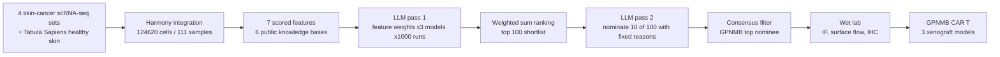

# AI-driven discovery of GPNMB CAR T cells as a multi-cancer therapy

> **Bibkey** `Baker_2026` · **Venue** Cell (2026) · **Category** agents · **Relevance** medium · **Access** paywall
> **Link** <https://doi.org/10.1016/j.cell.2026.06.002> · `status: complete`

---

## One-liner
A reproducible target-discovery pipeline that combines a single-cell skin-cancer atlas, scored features from six public knowledge bases, and three LLMs (for feature weighting and for target nomination); its top-ranked target GPNMB was built into a CAR T cell (T cells engineered to kill whatever carries a chosen surface protein) that cleared tumours in mouse xenograft models of leukaemia, melanoma and colorectal cancer.

## Takeaways
- The LLMs do not invent targets: they do two narrow jobs — assign weights to 7 hand-defined features (1,000 samples per model) and pick 10 genes out of a fixed 100-gene shortlist with reasons drawn from a closed vocabulary (1,000 runs per model).
- The three models (GPT-4o, Claude-3.7-Sonnet, Gemini-2.5-Pro) converge on which features matter (cancer composition, surface localisation, low vital-tissue expression) but diverge on the stated reason for nominating a gene (Supp Fig 2E).
- Removing the expert prior weights barely changes the output (94/100 of the top 100 and 12/15 of the final nominees are shared), so the pipeline is robust to the absence of domain expertise.
- Swapping in bulk RNA-seq changes the output drastically (only 21/100 and 2/15 shared): TIGIT, CTLA4 and CD83 look enriched in bulk but at single-cell resolution sit in T cells and myeloid cells — resolution is correctness here.
- The computational call is validated orthogonally — TCGA bulk, immunofluorescence, non-permeabilised flow cytometry (proving the protein is really on the surface) and multi-organ IHC — before any CAR is built.
- This is work co-authored by Sikander Hayat (one of four corresponding authors; affiliations RWTH Aachen and the Icahn School of Medicine at Mount Sinai), with second author Leon Frommer at the same RWTH Aachen department (Department of Medicine 2); the code lives at `hayatlab/cart_llms`, making it the best sample of the group's "LLM + omics → target" methodology.

## Problem
CAR T therapy is curative in some blood cancers and is moving into solid tumours and autoimmune disease, but the scarcity of safe target antigens is the main bottleneck (Introduction). A good target must be high on tumour cells, near-absent in healthy — especially vital (lung, heart, brain) — tissue, located on the cell surface (a CAR can only see surface protein), and ideally already have a clinical-grade antibody to borrow. The classical workflow is manual database mining: slow, fragmented and bias-prone (Discussion). The question is whether this multi-objective trade-off can be automated, made reproducible, and made usable without deep domain expertise.

## Method
The authors call it a three-pronged strategy — data integration, knowledge augmentation, LLM-based reasoning — followed by wet-lab validation (Fig 1A). Step by step, for a CS reader:

**1. Build the atlas.** Four public skin-cancer scRNA-seq datasets (Biermann 2022, Ji 2020, Li 2019, Yost 2019; basal-cell and squamous carcinoma plus melanoma at several stages, including metastases) are filtered and integrated with Harmony using sample ID as the batch variable (an embedding-alignment step across experiments), giving 285,557 cells from 91 samples. The 106,834 cells labelled malignant are pulled out and re-Harmonised together with 17,786 healthy skin cells from Tabula Sapiens, giving the final 124,620-cell / 111-sample malignant-plus-healthy atlas (STAR Methods, "Single-cell atlas construction").

**2. Compute 7 deterministic features (no LLM involved).** Six resources are scraped per gene: ClinicalTrials.gov API v2 (2.15.0), OpenTargets 25.03, GTEx v8 medians, ProteomicsDB 1.1 (OData), Human Protein Atlas 24.0, UniProt 2025_02. They yield: (i) clinical tractability (phase 6/5/4/3/2 points + status 3/2/1/0 + 10 for a cancer indication + modality 10 antibody / 5 small molecule / 1 PROTAC-other, keeping only the single strongest trial per gene so many weak trials cannot inflate the score); (ii) subcellular localisation (both HPA and UniProt call plasma membrane = 10, UniProt curated + HPA predicted = 8, one source only = 7, HPA prediction only = 5, else 0); (iii) cancer composition: scanpy-normalised to 1e6 counts per cell, the percentage of malignant and of non-malignant cells with expression > 0 per gene, each Z-scored across genes, feature = Z_malignant − Z_non-malignant; (iv–v) GTEx means over vital (lung, heart, brain) and non-vital tissues; (vi–vii) ProteomicsDB iBAQ-normalised protein intensity means over vital and non-vital tissues.

**3. Normalise and aggregate.** Each feature is min–max scaled to [0,1] across genes; features where lower is better (GTEx bulk, ProteomicsDB normal-tissue abundance) are inverted; duplicates collapse by maximum; gene sets are unioned with missing values imputed as 0; the final score is the weighted sum of the normalised features (STAR Methods, "Normalization and aggregation").

**4. LLM pass 1 — pick the weights.** Experts first set base weights from first principles: clinical trials 1.0, HPA 2.0, heatmap (single-cell Z difference) 5.0, vital 2.0, non-vital 1.0, protein vital 2.0, protein non-vital 1.0. A fixed prompt presents the 7 feature definitions plus 7 candidate weighting schemes (base, clinical-trials, HPA, heatmap, expression emphasis, balanced, equal) and the top-100 list each produces, and forces a machine-readable first line ("RECOMMENDED WEIGHTS: Clinical trials (X.X), …"). Each of GPT-4o, Claude-3.7-Sonnet and Gemini-2.5-Pro is queried 1,000 times with temperature cycling over 0.70–0.85; a tiered regex parser extracts the weights (strict header → bold header → per-label flexible match with a negative lookbehind on "Vital" so it cannot collide with "Protein vital"; runs recovering fewer than 4 of 7 fields are excluded from summaries). To avoid anchoring, the models are never told that one scheme came from experts — it is merely called the base weight. Aggregates are compared across models by per-feature ANOVA, and temperature effects checked by OLS with Benjamini–Hochberg FDR.

**5. LLM pass 2 — nominate the targets.** The consensus weights rank genes; the top 100 go forward. Each model is then run 1,000 times to rank-select 10 of those 100, output constrained to a `Rank, Gene, Description, Reason1..Reason5` CSV whose reasons must be verbatim, per the prompt, from five preset phrases ("High tumor-specific expression (>X% of melanoma cells)" / "Potential utility across multiple cancer types" / "Strong existing clinical development profile" / "Minimal expression in healthy vital tissues" / "Expression in significant patient subpopulations"). The parser prefers a fenced CSV block, then a permissive CSV regex, then phrase matching in a ~300-upstream/700-downstream character window around each gene mention; when no exact phrase is found, keyword anchoring maps the text to the closest canonical reason (e.g. "overexpression" → high tumour-specific expression), so some final reason labels come from keyword mapping rather than verbatim output; a gene–reason pair counts once per run and only the first 10 unique genes are kept. Finally a filter keeps only genes nominated at least once by all three models, ranked by total nominations across models (STAR Methods, "Target filtering and ranking").

**6. Robustness and ablations.** (a) Two further iterations, 3,000 independent simulations per model in total (Supp Fig 3N); (b) the expert base weights removed and 1,000 runs repeated; (c) the single-cell cancer-composition feature replaced by bulk: TCGA-SKCM primary tumour STAR counts intersected with GTEx sun-exposed skin (lower leg) counts (Ensembl version suffixes stripped, genes kept at ≥10 reads in ≥10% of samples), DESeq2 1.46.0 for tumour vs normal, and the log2 fold-change Z-scored across genes in place of the original feature.

**7. Wet-lab validation chain.** TCGA bulk differential expression (GEPIA, one-way ANOVA) → immunofluorescence in four melanoma cell lines → non-permeabilised flow cytometry (no membrane holes, so only genuinely surface protein is stained) → multi-organ tissue-microarray IHC scored blind 1–5 for intensity.

**8. Build the CAR and test it in mice.** The VL/VH of CR011 — a fully human anti-GPNMB antibody (patent WO2010135547A1), the binding domain of the clinically tested antibody–drug conjugate glembatumumab vedotin — is joined by a (G4S)3 linker into an scFv and placed in a second-generation CAR: Kozak, CD8α leader, CD8α hinge and transmembrane, 4-1BB costimulation, CD3ζ signalling, cloned into pTRPE, a third-generation self-inactivating lentiviral vector. Healthy-donor CD4+/CD8+ T cells at 1:1 are activated with CD3/CD28 beads and transduced at MOI 3–5. In vitro the triad of activation, effector function and killing is measured (CTV dilution for proliferation, cytometric bead array for cytokines, flow and xCELLigence real-time impedance for lysis). In vivo, NSG immunodeficient mice: monoblastic leukaemia from 1×10^5 U937 cells i.v. on day −2 with 5×10^6 CAR T on day 0; solid tumours from 5×10^5 SK-MEL-3 (melanoma) or SNU-503 (colorectal) cells subcutaneously in matrigel, randomised when tumours reach ~100 mm³ (= day 22) and given 4×10^6 CAR T by tail vein; tumours by caliper as V = length × width² / 2, human CD45+ cells in blood by TruCount flow, survival by Kaplan–Meier with log-rank.

## Method diagram


## Data
**Single cell:** four public skin-cancer scRNA-seq datasets (GEO GSE185386, GSE144240, GSE123139, GSE123814) plus Tabula Sapiens normal skin (GEO GSE201333); 285,557 cells from 91 samples after integration, and a final working atlas of 124,620 cells from 111 samples (106,834 malignant + 17,786 normal) (STAR Methods; Key Resource Table). Treatment histories vary — some patients untreated, others previously given immunotherapy or targeted therapy (Results, "Constructing a single-cell skin cancer…").

**Knowledge bases:** ClinicalTrials.gov API v2 (2.15.0), OpenTargets release 25.03, GTEx v8 medians (GTEx V10 sun-exposed skin for the bulk-vs-single-cell comparison), ProteomicsDB 1.1, HPA v24.0, UniProt release 2025_02. **Bulk:** TCGA-SKCM via GDC, and GEPIA. **Experimental material:** 11 human cell lines (SK-MEL-5/3/28, HT-144, A-375, U-937, NALM-6, THP-1, SW-156, SNU-503, KLM-1), two tissue microarrays (MC5004b multi-organ tumour plus normal, BN1021a 20 normal tissue types from 9 systems), T cells from two healthy donors (ND607, ND657) and NSG mice.

## Key results
- The three LLMs converge on cancer composition, subcellular localisation and vital-tissue expression as the dominant features (Supp Fig 1E–H), fixing the composite scoring system (Fig 1E).
- GPNMB is the most frequently nominated target, consistently chosen for tumour specificity and also showing a strong multi-cancer-utility signal; by contrast PMEL is almost always nominated for tumour specificity and rarely for multi-cancer potential, while IGF1R is the reverse (Results, "Large language models reason-driven nomination"; Fig 1F–G).
- Stability: two further iterations, 3,000 independent simulations per model in total, leave the conclusion unchanged (Supp Fig 3N).
- Expert-weight ablation: 94 of the top 100 genes overlap (Supp Fig 3B–C) and 12 of the top 15 final nominees are shared (Supp Fig 3D–F).
- Bulk instead of single cell: only 21 of the top 100 are shared (Supp Fig 3H–I) and only 2 of the top 15 (Supp Fig 3J–L); only 48.2% of transcripts present in bulk RNA-seq are represented in the integrated single-cell atlas; and among the bulk top 15, TIGIT and CTLA4 (actually T cells) and CD83 (myeloid cells) are exposed as false positives at single-cell resolution (Supp Fig 3M).
- Orthogonal validation: GPNMB, ERBB3 and IGF1R are transcriptionally up in TCGA melanoma versus normal tissue (Fig 1I, one-way ANOVA, *P<0.01); immunofluorescence in four melanoma lines shows membrane and intracellular signal (Fig 1J); non-permeabilised flow confirms all three at the surface (Fig 1K).
- GPNMB across cancers: in TCGA bulk it is significantly enriched not only in melanoma (SKCM) but in cholangiocarcinoma, DLBCL, glioblastoma, head-and-neck squamous carcinoma, kidney chromophobe (KICH), kidney renal papillary carcinoma (KIRP), liver, lung squamous, pancreatic, stomach, testicular germ-cell tumours and thymoma (Fig 2A); patient-biopsy IHC agrees at protein level, with most melanoma samples staining strongly, a range of intensities in other cancers, and low or absent expression across healthy tissues (Fig 2B, Supp Fig 5A).
- CAR specificity: GPNMB CAR T cells proliferate and secrete IFN-γ only against GPNMB+ tumour cells and ignore antigen-negative B-ALL (Fig 2F–H); killing is likewise antigen-dependent (Fig 2I, ****P<0.0001).
- Leukaemia model: human CD45+ cells expand significantly in blood by day 13 (Fig 2K, n=14–15 per cohort, Mann–Whitney, ****P<0.0001); control-T mice reach humane endpoints within weeks while CAR T mice survive for months without signs of disease (Fig 2L, n=15 CAR T vs 14 control, log-rank, ****P<0.0001), with stable body weight (Supp Fig 5E).
- Melanoma model (SK-MEL-3): significant human T-cell expansion at day 21 (Fig 3C, n=10 per cohort, ****P<0.0001) and raised serum cytokines (Fig 3D); tumour volume drops sharply with complete remission in the majority of mice (Fig 3E, n=16 CAR T vs 14 control, two-way ANOVA, ****P<0.0001) and survival improves significantly (Fig 3F, log-rank, ****P<0.0001).
- Colorectal model (SNU-503): all mice achieve complete remission (Fig 3K, n=16 vs 14, ****P<0.0001) with significantly better survival (Fig 3L); in vitro, antigen-dependent lysis is seen against colorectal, pancreatic and renal cancer-derived cells (Fig 3G).
- Between-model difference: a small minority of melanoma mice relapse while no colorectal mice do; at identical dosing the colorectal model shows markedly greater day-21 T-cell expansion with a pronounced CD8+ skew (Fig 3C, I; Supp Fig 6F), which the authors read as tumour-intrinsic factors shaping CAR T expansion (end of Results).

## Contributions
- It puts the LLM in constrained slots — weighting hand-defined features and selecting from a fixed shortlist with a closed reason vocabulary — instead of letting it free-generate targets; the authors state that grounding models in real data and public knowledge may be a way to reduce hallucination risk (Discussion).
- It treats the LLM as a sampling distribution rather than a single answer: 1,000 (cumulatively 3,000) independent runs per model, with nomination frequency and reason distributions as statistics, audited by ANOVA, temperature regressions and FDR correction.
- Cross-model consensus filtering (only genes nominated by all three models) plus analysis of reason divergence turns inter-model agreement into a reportable metric.
- Two valuable ablations: the expert prior barely matters, while input resolution (single-cell vs bulk) matters a lot, with a mechanistic explanation of the false positives.
- It closes the loop from computational nomination through wet-lab validation to in vivo efficacy, de-risking translation by reusing an already clinically tested antibody binding domain.
- The authors describe it as one of the first uses of LLMs in the CAR T field (Discussion), with code and the integrated data released.

## Limitations
- Authors' own: everything is done in immunodeficient xenograft mice, which cannot assess T-cell-extrinsic mechanisms, microenvironmental influences or on-target/off-tumour toxicity (Limitations of the study).
- Authors' own: the CAR recognises human but not murine GPNMB, so safety cannot be tested directly in mouse tissue (only human healthy-organ IHC showing low vital-tissue expression).
- Authors' own: recurrent melanoma tumours were unavailable for mechanistic analysis, and leukaemia monitoring was confined to peripheral blood, where no circulating tumour cells were detected.
- Authors' own: discovery-stage scoring is limited by the number of studies currently available at single-cell resolution and would benefit from more samples.
- Authors' own: a generalised prompt structure was used for cross-model applicability, which may underrepresent gains from model-specific prompt optimisation.
- Our reading: the LLM's degrees of freedom are narrow — the feature set, the 7 candidate weightings, the 100-gene shortlist and the 5 reasons are all human-set, so "the LLM discovered the target" is more precisely "the LLM cast a prior-informed multi-objective weighted vote"; what really decides GPNMB is the feature engineering, especially the cancer-composition Z difference.
- Our reading: there is no comparison with a simple baseline (ranking by the expert base weights alone, or an LLM-free random/uniform weight ensemble), so the gain attributable to the LLM step is unquantified; the ablation hints it is small (94/100 unchanged without expert weights).
- Our reading: consensus across three models is not independent evidence — their training corpora overlap heavily and the GPNMB / glembatumumab vedotin literature was already public, so agreement may partly reflect a shared literature prior rather than independent reasoning.
- Our reading: GPNMB is significantly enriched in both kidney cancers (KICH, KIRP) in Fig 2A, and the "low in healthy tissue" conclusion rests on normal tissue in GTEx, ProteomicsDB and multi-organ IHC — it does not cover diseased (for example fibrotic or injured) kidney, a gap we would have to check ourselves for our kidney direction.

## Relation to our direction
This sits at the revert end of our detect → model → revert pipeline: it answers exactly the question of which molecule to intervene on. It skips the virtual-tissue modelling stage, substituting a lighter route — enrichment scoring plus tractability constraints plus an LLM-weighted vote.

Our reading: three things are directly reusable. (1) The cancer-composition Z difference is formally the same object as our anomaly scores: Z_malignant − Z_non-malignant is a contrast statistic for "unusually high in one population, not high in the reference", so Z_disease − Z_reference gives a candidate-driver ranker for kidney snRNA or Xenium and can serve as a naive reference-based anomaly baseline in Topic 1. (2) The tractability constraint layer (surface localisation, low vital-tissue expression, existing clinical antibody) is exactly the layer our revert end lacks: anomaly detection says which genes or regions changed, this paper says which of them can actually be made into a drug; a kidney version (tubule- or podocyte-specific, low outside kidney, existing agent) would be an immediately usable filter. (3) Auditing an LLM as a distribution (1,000 samples, a closed output vocabulary, a tiered parser, ANOVA/FDR, cross-model consensus filtering) is a ready-made evaluation skeleton for Topic 2's verification of biomedical-agent claims — and the observation that the stated reasons diverge while the conclusion agrees is precisely the phenomenon agent-trustworthiness work needs to characterise.

Our reading: its authors include Sikander Hayat (one of four corresponding authors) and second author Leon Frommer from the same RWTH Aachen department (Department of Medicine 2), and the computational code sits in `hayatlab/cart_llms`, so it is the most direct public sample of the group's "LLM + omics → target" methodology and a concrete methodological starting point for Topic 2.

## Reusable assets
- **Code:** <https://github.com/hayatlab/cart_llms> (listed in STAR Methods "Data and code availability" and the Key Resource Table)
- **Data:** the integrated skin-cancer dataset at Zenodo <https://zenodo.org/records/19071268>; raw data at GEO GSE185386 / GSE144240 / GSE123139 / GSE123814 and normal skin GSE201333; bulk from TCGA (GDC) and GTEx.
- **Checkpoints / prompts:** no model checkpoints (commercial APIs: gpt-4o, claude-3-7-sonnet-20250219, gemini-2.5-pro-preview-03-25); but the STAR Methods print all four prompts verbatim (expert-weight, no-expert-weight, zero-shot and bulk versions) plus the five-phrase reason vocabulary, which can be reused directly.

## Follow-ups
- Read the `hayatlab/cart_llms` source to check feature normalisation, the effect of imputing missing values as 0, and how consensus filtering is actually implemented.
- Reference 43: Zemp et al., "Development and first-in-human CAR T therapy against the pathognomonic MiT-fusion driven protein GPNMB", medRxiv 2025, doi 10.1101/2025.02.26.24319604 — a first-in-human GPNMB CAR T case report in alveolar soft part sarcoma, reported as showing activity without severe toxicity.
- The MiT/TFE transcription-factor family and the CLEAR network (lysosomal biogenesis and autophagy) raised in the Discussion as a possible explanation for GPNMB's broad expression — worth following, as it also touches kidney injury responses.
- Check ourselves: GPNMB expression in diseased kidney single-cell data (fibrosis, AKI, CKD) and its distribution in macrophages, to judge whether the "low in vital tissue" conclusion transfers to the kidney setting.
- Compare with `biomni-biorxiv-2025` and `virtual-biotech-biorxiv-2026`: all three have an LLM choosing targets, but autonomy increases from this paper (most constrained) to the Virtual Biotech (autonomous multi-agent) — a useful spectrum for Topic 2.

## Cite
```bibtex
@article{Baker_2026, title={AI-driven discovery of GPNMB CAR T cells as a multi-cancer therapy}, volume={189}, ISSN={0092-8674}, url={http://dx.doi.org/10.1016/j.cell.2026.06.002}, DOI={10.1016/j.cell.2026.06.002}, number={13}, journal={Cell}, publisher={Elsevier BV}, author={Baker, Daniel J. and Frommer, Leon M. and Uslu, Ugur and Patel, Kisha K. and Zhu, Daniel and Engel, Nils W. and George, James M. and Zhao, Wencao and Kim, Samuel I. and Sun, Lisa and Roselle, Christopher and Rommel, Philipp C. and Young, Regina M. and Epstein, Jonathan A. and Hayat, Sikander and Arany, Zoltan and June, Carl H.}, year={2026}, month=June, pages={3871–3882.e12} }
```


---

📄 **[AI-ready full-text extract →](ai-ready.md)**
