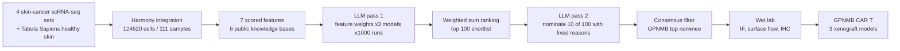

# AI-driven discovery of GPNMB CAR T cells as a multi-cancer therapy

> **文献键** `Baker_2026` · **来源** Cell(2026) · **类别** agents · **相关度** medium · **获取** paywall
> **链接** <https://doi.org/10.1016/j.cell.2026.06.002> · `status: complete`

---

## 一句话
把单细胞转录组图谱 + 六个公共知识库的"打分特征" + 三个 LLM 的加权与提名组合成一条可复现的靶点发现流水线,流水线选出的头号靶点 GPNMB 被做成 CAR T 细胞(一种把 T 细胞改造成"认准某个表面蛋白就杀"的活细胞药),并在白血病、黑色素瘤、结直肠癌三种小鼠移植瘤模型里显示强效抗肿瘤活性。

## 要点
- LLM 在这里**不**直接"想出"靶点:它只做两件窄任务——给 7 个人工定义的特征打权重(每模型 1000 次采样),以及从确定的 100 基因短名单里选 10 个并给出受限词表里的理由(每模型 1000 次)。
- 三个模型(GPT-4o、Claude-3.7-Sonnet、Gemini-2.5-Pro)在"哪些特征重要"上收敛(cancer composition、细胞表面定位、重要器官低表达),在"为什么提名某个基因"上分歧明显(Supp Fig 2E)。
- 去掉专家先验权重后结果几乎不变(top-100 重叠 94/100,top-15 提名重叠 12/15),说明流水线对"有没有领域专家"不敏感。
- 换成 bulk RNA-seq 输入则结果大变(top-100 只重叠 21/100,top-15 只重叠 2/15):TIGIT/CTLA4/CD83 在 bulk 里"富集",单细胞一看其实来自 T 细胞和髓系细胞——**分辨率就是正确性**。
- 计算结论做了正交湿实验验证:TCGA bulk、免疫荧光、非透膜流式(确认蛋白真的在细胞**表面**)、多器官 IHC,然后才做 CAR。
- 这是 Sikander Hayat 参与的工作(他是四位通讯作者之一,单位为 RWTH Aachen 与 Icahn School of Medicine at Mount Sinai;第二作者 Leon Frommer 与他同属 RWTH Aachen Department of Medicine 2),代码在 `hayatlab/cart_llms`,是理解该组"LLM + 组学 → 靶点"方法论的最佳样本。

## 研究问题
CAR T 已经在血液肿瘤里有治愈级疗效,并开始进入实体瘤和自身免疫病,但**靶点太少**是主要瓶颈(Introduction)。一个理想靶点要同时满足:在肿瘤细胞上高表达、在健康(尤其心/肺/脑等要害)组织上几乎不表达、位于细胞**表面**(CAR 只能识别表面蛋白)、并且最好已有临床级抗体可借用。传统做法是人工翻数据库逐条筛,慢、碎片化、带偏见(Discussion)。作者的问题是:能否把这个多目标权衡自动化、可复现、并且在没有资深专家时也能用?

## 方法
作者称之为"三管齐下"(data integration / knowledge augmentation / LLM reasoning),再接湿实验验证(Fig 1A)。对 CS 读者逐步拆解:

**1. 建图谱(特征来源之一)。** 取 4 个公开皮肤癌 scRNA-seq 数据集(Biermann 2022、Ji 2020、Li 2019、Yost 2019;含基底细胞癌、鳞癌、不同阶段黑色素瘤及转移),基本质控后用 Harmony(以 sample ID 为 batch 变量做批次校正,相当于把不同实验的 embedding 对齐)整合,得到 285,557 cells / 91 samples。抽出标注为 malignant 的 106,834 个细胞,与 Tabula Sapiens 的健康皮肤细胞(17,786)再做一次 Harmony,得到最终 124,620 cells / 111 samples 的"恶性 + 健康"图谱(STAR Methods: Single-cell atlas construction)。

**2. 造 7 个确定性特征(没有 LLM 参与)。** 对每个基因程序化抓取 6 个公共资源:ClinicalTrials.gov API v2(2.15.0)、OpenTargets 25.03、GTEx v8 中位数、ProteomicsDB 1.1(OData)、Human Protein Atlas 24.0、UniProt 2025_02。得到:① clinical tractability(临床试验相位 6/5/4/3/2 分 + 状态 3/2/1/0 分 + 癌症相关 +10 + modality:抗体 10/小分子 5/PROTAC 等 1;每基因只留证据最强的一项试验,防止用大量弱试验刷分);② subcellular localization(HPA 与 UniProt 双证据一致=10、UniProt 确认 + HPA 预测=8、单一来源=7、仅 HPA 预测=5、其余=0);③ cancer composition:scanpy 归一化到每细胞 1e6 counts,算每个基因在 malignant / non-malignant 细胞中"表达 >0 的细胞百分比",各自跨基因取 Z-score,特征 = Z_malignant − Z_non-malignant;④⑤ GTEx 要害(lung/heart/brain)与非要害组织均值;⑥⑦ ProteomicsDB 蛋白在要害/非要害组织的 iBAQ 归一化强度均值。

**3. 归一化与聚合。** 每个特征跨基因 min–max 到 [0,1];"越低越好"的特征(GTEx bulk、ProteomicsDB 正常组织丰度)取反;重复基因取最大值;取所有基因集合的并集,缺失值补 0;最终分数 = 归一化特征的**加权和**(STAR Methods: Normalization and aggregation)。

**4. 用 LLM 选权重(第一次用 LLM)。** 专家先从第一性原理给出 base weights:Clinical trials 1.0、HPA 2.0、Heatmap(单细胞 Z 差) 5.0、Vital 2.0、Non-vital 1.0、Protein vital 2.0、Protein non-vital 1.0。把 7 个特征定义 + 7 套候选权重方案(base、clinical-trials emphasis、HPA emphasis、heatmap emphasis、expression emphasis、balanced、equal)和各自产出的 top-100 基因列表一起放进一个固定 prompt,**强制以机器可读表头开头**("RECOMMENDED WEIGHTS: Clinical trials (X.X), …")。对 GPT-4o / Claude-3.7-Sonnet / Gemini-2.5-Pro 各跑 1000 次独立查询,temperature 在 0.70–0.85 之间循环;用分层 regex parser 解析权重(严格表头 → 加粗表头 → 逐标签宽松匹配,对 "Vital" 用负向回顾避免误抓 "Protein vital";恢复不足 4/7 个字段的运行不进统计)。为避免引导,**没有告诉模型哪一套是专家方案**,只叫它 base weight。聚合后做 per-feature ANOVA 比较模型间差异,并用 OLS + Benjamini–Hochberg FDR 检查 temperature 效应。

**5. 用 LLM 提名(第二次用 LLM)。** 用共识权重排序,取 top-100 候选;再让每个模型跑 1000 次,从这 100 个基因里排序选出 10 个,输出必须是 `Rank, Gene, Description, Reason1..Reason5` 的 CSV,理由只能按 prompt 要求逐字取自 5 个预设短语("High tumor-specific expression (>X% of melanoma cells)" / "Potential utility across multiple cancer types" / "Strong existing clinical development profile" / "Minimal expression in healthy vital tissues" / "Expression in significant patient subpopulations")。解析器优先吃代码块 CSV,其次宽松 CSV regex,最后在基因名前后约 300/700 字符窗口内匹配受限理由词;找不到原词时,允许用关键词映射到最接近的标准理由(如 "overexpression" → 高肿瘤特异性表达),所以最终理由标签有一部分来自关键词映射而非逐字输出;每个 run 内同一基因–理由只计一次,只取前 10 个唯一基因。最后**过滤**:只保留三个模型都至少提名过一次的基因,再按三模型总提名次数排序(STAR Methods: Target filtering and ranking)。

**6. 鲁棒性与消融。** ① 再跑两轮,每模型累计 3,000 次独立模拟(Supp Fig 3N);② 去掉专家 base weights 重跑 1,000 次;③ 把单细胞 cancer-composition 特征换成 bulk:TCGA-SKCM 原发瘤 STAR counts 与 GTEx 日晒皮肤(小腿)counts 取交集(去 Ensembl 版本号,保留"≥10 reads 出现在 ≥10% 样本"的基因),DESeq2 1.46.0 做 Tumor vs Normal,把 log2FC 跨基因标准化成 Z-score 顶替原特征。

**7. 湿实验验证链。** TCGA bulk 差异表达(GEPIA,one-way ANOVA)→ 4 个黑色素瘤细胞系免疫荧光 → **非透膜**流式(不打孔,只有真正在表面的蛋白才被抗体染到)→ 多器官组织微阵列 IHC(盲评 1–5 分强度)。

**8. 造 CAR 并做动物实验。** 取 CR011(全人源抗 GPNMB 抗体,专利 WO2010135547A1;即已进入临床的抗体偶联药物 glembatumumab vedotin 的结合域)的 VL/VH,用 (G4S)3 linker 连成 scFv,装进第二代 CAR 框架:Kozak + CD8α leader + CD8α hinge/跨膜 + 4-1BB 共刺激 + CD3ζ 信号域,克隆进 pTRPE 第三代自失活慢病毒载体。健康供者 CD4+/CD8+ T 细胞 1:1,CD3/CD28 磁珠激活,MOI 3–5 转导。体外测"激活—效应—杀伤"三件套(CTV 稀释测增殖、CBA 测细胞因子、流式/xCELLigence 实时阻抗测杀伤)。体内用 NSG 免疫缺陷小鼠:单核细胞白血病 1×10^5 U937 静脉注射,D-2 建模、D0 给 5×10^6 CAR T;实体瘤 5×10^5 SK-MEL-3(黑色素瘤)或 SNU-503(结直肠癌)皮下 + matrigel,长到约 100 mm³(= day 22)随机化,尾静脉给 4×10^6 CAR T;卡尺 V=(长×宽²)/2 测瘤,TruCount 流式数外周血人 CD45+ 细胞,Kaplan–Meier + log-rank 比生存。

## 方法图


## 数据
**单细胞:** 4 个公开皮肤癌 scRNA-seq 数据集(GEO: GSE185386、GSE144240、GSE123139、GSE123814)+ Tabula Sapiens 正常皮肤(GEO: GSE201333);整合后 285,557 cells / 91 samples,最终工作图谱 124,620 cells / 111 samples(106,834 恶性 + 17,786 正常)(STAR Methods;Key Resource Table)。患者治疗史不一,有未治疗者,也有先接受过免疫治疗或靶向治疗者(Results §"Constructing a single-cell skin cancer…")。

**知识库:** ClinicalTrials.gov API v2 (2.15.0)、OpenTargets release 25.03、GTEx v8 中位数(bulk vs sc 对比用 GTEx V10 日晒皮肤)、ProteomicsDB 1.1、HPA v24.0、UniProt release 2025_02。**bulk:** TCGA-SKCM(GDC)、GEPIA。**实验材料:** 11 条人源细胞系(SK-MEL-5/3/28、HT-144、A-375、U-937、NALM-6、THP-1、SW-156、SNU-503、KLM-1)、两张组织微阵列(MC5004b 多器官肿瘤 + 正常、BN1021a 9 系统 20 种正常组织)、2 位健康供者 T 细胞(ND607、ND657)、NSG 小鼠。

## 主要结果
- 三个 LLM 在特征重要性上收敛到 cancer composition、亚细胞定位、要害组织表达三项为主(Supp Fig 1E–H),由此定出复合打分系统(Fig 1E)。
- GPNMB 是**被提名次数最多**的靶点;它一贯因"肿瘤特异性"被选,同时在"多癌种潜力"上也有强信号。对照:PMEL 几乎总以肿瘤特异性为由被提名、极少以多癌种潜力;IGF1R 相反(Results §"Large language models reason-driven nomination";Fig 1F–G)。
- 稳定性:再跑两轮,每模型累计 **3,000** 次独立模拟,结论不变(Supp Fig 3N)。
- 去专家权重消融:top-100 中 **94/100** 重叠(Supp Fig 3B–C),最终 top-15 提名中 **12/15** 相同(Supp Fig 3D–F)。
- bulk 替换 sc:top-100 只有 **21/100** 共享(Supp Fig 3H–I),top-15 只有 **2/15** 共享(Supp Fig 3J–L);bulk RNA-seq 中仅 **48.2%** 的转录本在整合 sc 图谱里有代表;bulk 的 top-15 里 TIGIT、CTLA4(实为 T 细胞)与 CD83(髓系细胞)在单细胞下暴露为假阳性(Supp Fig 3M)。
- 正交验证:GPNMB、ERBB3、IGF1R 在 TCGA 黑色素瘤中相对正常组织转录上调(Fig 1I,one-way ANOVA,*P<0.01);4 个黑色素瘤细胞系免疫荧光见膜与胞内信号(Fig 1J);非透膜流式确认三者在表面(Fig 1K)。
- GPNMB 跨癌种:TCGA bulk 中不只黑色素瘤(SKCM),胆管癌、DLBCL、GBM、头颈鳞癌、**肾嫌色细胞癌 KICH、肾乳状细胞癌 KIRP**、肝癌、肺鳞癌、胰腺癌、胃癌、睾丸生殖细胞瘤、胸腺瘤均显著富集(Fig 2A);患者活检 IHC 蛋白层面一致,多数黑色素瘤样本强染,其他癌种强度不一,健康组织普遍低或无表达(Fig 2B,Supp Fig 5A)。
- CAR 功能特异性:GPNMB CAR T 只在与 GPNMB+ 肿瘤细胞共培养时增殖并显著分泌 IFN-γ,对抗原阴性的 B-ALL 无反应(Fig 2F–H);杀伤同样抗原依赖(Fig 2I,****P<0.0001)。
- 白血病模型:输注后第 13 天外周血人 CD45+ 细胞显著扩增(Fig 2K,n=14–15/组,Mann–Whitney,****P<0.0001);对照 T 细胞组数周内达人道终点,CAR T 组存活数月且无疾病征象(Fig 2L,n=15 CAR vs 14 对照,log-rank,****P<0.0001),体重稳定(Supp Fig 5E)。
- 黑色素瘤模型(SK-MEL-3):day 21 人 T 细胞显著扩增(Fig 3C,n=10/组,****P<0.0001)、血清细胞因子升高(Fig 3D);瘤体显著缩小且**多数**小鼠完全缓解(Fig 3E,n=16 CAR vs 14 对照,two-way ANOVA,****P<0.0001),生存显著改善(Fig 3F,log-rank,****P<0.0001)。
- 结直肠癌模型(SNU-503):**全部**小鼠完全缓解(Fig 3K,n=16 vs 14,****P<0.0001),生存显著改善(Fig 3L);体外对结直肠、胰腺、**肾癌**来源细胞均见抗原依赖杀伤(Fig 3G)。
- 模型间差异:黑色素瘤队列有少数小鼠复发,结直肠队列无复发;剂量相同,但结直肠模型 day 21 的 T 细胞扩增明显更强且外周血 CD8+ 偏移明显(Fig 3C,I;Supp Fig 6F),作者推测是肿瘤内在因素塑造了 CAR T 扩增(Results 末段)。

## 创新点
- 把 LLM 放在**受约束的位置**上(给人工定义特征配权重、从固定短名单里选并给受限理由),而不是让它自由生成靶点——作者明说"把模型接到真实数据和公共知识上可能是降低幻觉风险的途径"(Discussion)。
- 用**采样分布**而不是单次回答:每模型 1000(累计 3000)次独立运行,把提名频次和理由分布当作统计量,配 ANOVA / 温度回归 / FDR 校正做审计。
- 跨模型共识过滤(只留三模型都提名过的基因)+ 理由分歧分析,把"模型间一致性"变成可报告指标。
- 两个有价值的消融:领域专家先验几乎不影响结果;**输入分辨率**(sc vs bulk)严重影响结果,并给出了假阳性的机制性解释。
- 从计算提名一路做到湿实验与体内疗效的**闭环**,并借用已有临床级抗体结合域降低转化风险。
- 作者自述这是 LLM 首次用于 CAR T 领域的工作之一(Discussion),代码与整合数据公开。

## 局限
- 作者自述:实验全在免疫缺陷 xenograft 小鼠中完成,无法评估 T 细胞外在机制、肿瘤微环境影响和 on-target/off-tumor 毒性(Limitations of the study)。
- 作者自述:该 CAR 只认人 GPNMB、不认小鼠 GPNMB,因此无法在小鼠组织里直接做安全性测试(只能靠人健康器官 IHC 显示要害组织低表达)。
- 作者自述:复发的黑色素瘤肿瘤未能取到做机制分析;白血病监测只看外周血,而血中并未检出循环肿瘤细胞。
- 作者自述:发现阶段的打分受限于当前单细胞分辨率研究的数量,样本更多会更好。
- 作者自述:为跨模型可比,prompt 用了通用结构,可能低估了针对单个模型优化 prompt 能带来的提升。
- 我们的理解:LLM 的"自由度"其实很窄——特征集、7 套候选权重、100 基因短名单、5 条理由都是人定的,因此"LLM 发现了靶点"更准确地说是"LLM 做了一次有先验的多目标加权投票";真正决定 GPNMB 胜出的是特征工程(尤其 cancer-composition Z 差)。
- 我们的理解:缺少与简单基线的对比(例如直接用专家 base weights 排序、或不用 LLM 的随机/均匀权重 ensemble),所以无法量化 LLM 这一步本身的增益;消融其实暗示增益有限(去专家权重后 94/100 不变)。
- 我们的理解:三个模型的"共识"不是独立证据——它们的训练语料高度重叠,GPNMB 与 glembatumumab vedotin 的文献早已公开,所以共识可能部分来自共享的文献先验而非独立推理。
- 我们的理解:GPNMB 在 Fig 2A 中于 KICH/KIRP 两种肾癌显著富集,而 GPNMB 也是肾脏/巨噬细胞损伤反应中常被提到的基因;"健康组织低表达"的结论来自 GTEx / ProteomicsDB / 多器官 IHC 的**正常**组织,**未**涵盖病变(如纤维化/损伤)肾脏,这对我们的肾脏方向是需要自己核查的空白。

## 与本研究方向的关系
这篇是 detect → model → **revert** 三段里最靠 revert 的一端:它要回答的正是"选哪个分子去干预"。它跳过了 virtual tissue 的建模环节,用的是"富集打分 + 可干预性约束 + LLM 加权投票"这种更轻量的替代。

我们的理解:三点最可借用。① **cancer composition Z 差**与我们做的异常检测在形式上同构:Z_malignant − Z_non-malignant 本质是"在一个细胞群里异常高表达、在参考群里不高"的对比统计量——换成 Z_disease − Z_reference 就直接变成肾脏 snRNA/Xenium 的候选 driver 排序器,可作为伪影注入课题里 reference-based 异常评分的朴素基线。② **可干预性约束层**(表面定位、要害组织低表达、已有临床抗体)正是我们的 revert 端缺的那一层:异常检测给出"哪里/哪些基因变了",这篇给出"其中哪些能真被做成药";把它换成肾脏版(肾小管/足细胞特异、肾外低表达、已有药物)就是一个可直接落地的筛选器。③ **把 LLM 当分布来审计**的做法(1000 次采样、受限输出词表、分层 parser、ANOVA/FDR、跨模型共识过滤)是 Agent 可信度课题 "验证生物医学 agent 声明"的现成评测骨架,尤其"理由分布分歧大而结论一致"这一观察,正好是 agent 可信度研究要刻画的现象。

我们的理解:这篇的作者包括 Sikander Hayat(四位通讯作者之一)与同属 RWTH Aachen Department of Medicine 2 的第二作者 Leon Frommer,计算部分代码在 `hayatlab/cart_llms`,所以它是理解该组"LLM + 组学 → 靶点"方法论最直接的公开样本,也是 Agent 可信度课题可以直接接续的方法学起点。

## 可复用资产
- **代码:** <https://github.com/hayatlab/cart_llms> (STAR Methods "Data and code availability" 与 Key Resource Table 均列出)
- **数据:** 整合后的皮肤癌数据集见 Zenodo <https://zenodo.org/records/19071268>;原始数据 GEO GSE185386 / GSE144240 / GSE123139 / GSE123814,正常皮肤 GSE201333;bulk 来自 TCGA (GDC) 与 GTEx。
- **模型 / 提示:** 无模型 checkpoint(用的是商用 API:gpt-4o、claude-3-7-sonnet-20250219、gemini-2.5-pro-preview-03-25);但 STAR Methods 逐字给出了四个完整 prompt(含专家权重版、去专家权重版、zero-shot 版、bulk 版)与 5 条受限理由词表,可直接复用。

## 待读
- 读 `hayatlab/cart_llms` 源码,确认特征归一化、缺失值补 0 的影响,以及"共识过滤"的具体实现。
- 参考文献 43:Zemp 等,"Development and first-in-human CAR T therapy against the pathognomonic MiT-fusion driven protein GPNMB", medRxiv 2025, doi 10.1101/2025.02.26.24319604 —— 腺泡状软组织肉瘤患者的首次人体 GPNMB CAR T 病例报告,作者称见到活性且无严重毒性。
- Discussion 提到的 MiT/TFE 转录因子家族与 CLEAR 网络(溶酶体生物合成与自噬)可能解释 GPNMB 的广谱表达 —— 值得顺着查,因为这也牵连肾脏损伤反应。
- 自查:GPNMB 在**病变**肾脏(纤维化、AKI、CKD)单细胞数据中的表达,以及它在巨噬细胞中的分布,以判断"要害组织低表达"结论能否迁移到肾脏场景。
- 与 `biomni-biorxiv-2025`、`virtual-biotech-biorxiv-2026` 对照:三者都在"LLM 选靶点",但自由度从本文(最受约束)到 Virtual Biotech(多 agent 自主)递增,正好是 Agent 可信度课题的一条谱。

## 引用
```bibtex
@article{Baker_2026, title={AI-driven discovery of GPNMB CAR T cells as a multi-cancer therapy}, volume={189}, ISSN={0092-8674}, url={http://dx.doi.org/10.1016/j.cell.2026.06.002}, DOI={10.1016/j.cell.2026.06.002}, number={13}, journal={Cell}, publisher={Elsevier BV}, author={Baker, Daniel J. and Frommer, Leon M. and Uslu, Ugur and Patel, Kisha K. and Zhu, Daniel and Engel, Nils W. and George, James M. and Zhao, Wencao and Kim, Samuel I. and Sun, Lisa and Roselle, Christopher and Rommel, Philipp C. and Young, Regina M. and Epstein, Jonathan A. and Hayat, Sikander and Arany, Zoltan and June, Carl H.}, year={2026}, month=June, pages={3871–3882.e12} }
```


---

📄 **[AI-ready 全文提取 →](ai-ready.md)**
