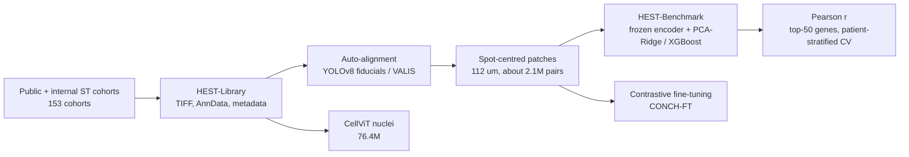

# HEST-1k: A Dataset for Spatial Transcriptomics and Histology Image Analysis

> **Bibkey** `Jaume2024_240616192` · **Venue** NeurIPS 2024 (Datasets and Benchmarks Track, Spotlight) (2024) · **Category** foundation · **Relevance** medium · **Access** open
> **Link** <https://arxiv.org/abs/2406.16192> · `status: complete`

---

## One-liner
HEST-1k unifies 1,229 spatial-transcriptomics (ST) samples from 153 public and internal cohorts into one format — H&E whole-slide image + aligned spot-level expression + metadata — and ships the HEST-Library Python package and HEST-Benchmark, which scores 11 pathology foundation models on predicting gene expression from H&E patches across 9 tasks (Abstract, §1).

## Takeaways
- A **dataset + tooling + benchmark** paper, not a new model; the core contribution is re-aligning heterogeneous legacy ST data, re-estimating pixel size, and turning it into ~2.1M deep-learning-ready (patch, expression) pairs (Abstract, §3.2).
- The best encoder is H-Optimus-0 with mean Pearson 0.4146 over 9 tasks (PCA+Ridge); ImageNet-only ResNet50 is lowest (0.326) — morphology predicts expression only moderately overall (Table 1).
- The gap between tasks is larger than between models: H-Optimus-0 reaches 0.6432 on SKCM but 0.2292 on READ; the only kidney task, ccRCC, sits at ~0.22–0.28 for every model (§5.3, Table 1).
- Average performance scales logarithmically with encoder size (R=0.81, P<0.01) but only weakly with the number of pretraining patches (R=0.48, P=0.13) (Fig. 2).
- The readout changes the ranking: with plain Ridge CONCH has the best average (0.3541), with PCA+Ridge H-Optimus-0 does; the authors therefore report PCA+Ridge and XGBoost as main results (§5.2, Table A13).
- The collection holds 70 kidney samples (Fig. 1a), including 23 Visium samples from the Lake et al. human kidney atlas (Table A5) — directly usable for our kidney work.

## Problem
ST measures gene expression at each location of a tissue section, but cost, fast-moving technology and missing standards have kept methods confined to a few patients and narrow tasks (§1). The paired H&E morphology is often ignored, and existing patch-level pathology benchmarks (Gleason grading, CAMELYON) are close to saturated and no longer separate new foundation models (§2). The question: can public ST data be assembled into one unified, large paired resource, and can "predict expression from morphology" serve as a new, harder benchmark for foundation models?

## Method
1. **Collection**: every ST + H&E whole-slide dataset from 10x Genomics, Mendeley, Spatial-Research, Zenodo, NCBI, GitHub, the Human Cell Atlas, BioStudies, HTAN and internal cohorts (§3, Table A1). Images coarser than 1.15 µm/px are discarded (§3.1).
2. **Metadata**: cancer samples are coded with OncoTree (MSKCC's cancer taxonomy); each sample records species, organ, sample type (healthy, cancer, non-cancer tumour, treated, genetically modified, other pathological), ST technology, spot count, reads, magnification, frozen vs FFPE (§3.1).
3. **Images**: all slides become pyramidal TIFF (OpenSlide/QuPath-readable); a fine-tuned DeepLabV3 (ResNet50 backbone) segments tissue vs background, robust to pen marks, fiducials (corner markers on the capture slide) and artifacts (§3.2, §4).
4. **Alignment**: for Visium, a fine-tuned YOLOv8 detects the corner fiducials (119 hand-annotated regions plus augmentation); spot coordinates are derived when ≥3 of 4 corners are found, and pixel size is inferred from the known inter-spot distance. For Xenium, VALIS registers the DAPI image (aligned with transcripts by design) to the H&E (§3.4, §4, Fig. 5).
5. **Paired patches**: 224×224-pixel patches at 20× (= 112×112 µm) are cut around each spot; Xenium transcripts are pooled into 55×55 µm "pseudo-Visium" spots; ~2.1M patches with expression result (§3.2). Expression is stored as raw counts in AnnData (scanpy's format), un-normalised (§3.4).
6. **Nuclei**: CellViT (trained on PanNuke) segments and classifies every nucleus into 5 classes (neoplastic epithelial, non-neoplastic epithelial, inflammatory, stromal, necrotic): 76.4M nuclei in total (§3.3).
7. **HEST-Benchmark**: per task, the 50 genes with the highest normalised variance (after dropping genes non-zero in <10% of spots), log1p-normalised; a frozen foundation model embeds each patch and a regression head predicts the 50 genes; patient-stratified k-fold CV (k = number of patients; k/2 for ccRCC); metric = Pearson correlation between predicted and measured expression. Main readouts are PCA (256 factors) + Ridge and XGBoost (100 trees, depth 3); plain Ridge is in the appendix (§5.1–5.2, App. C.3).
8. **Two demos**: (a) on Xenium breast-cancer slides, CellViT nuclei are matched to Xenium cells by nearest centroid and 12 interpretable nuclear features are correlated with expression (§6, App. E); (b) the CONCH image encoder (last 3 layers fine-tuned) is aligned to a 3-layer MLP expression encoder with an InfoNCE contrastive loss, giving CONCH-FT, which is then tested on molecular subtyping in an independent breast cancer cohort (§7, App. D).

## Method diagram


## Data
HEST-1k (v2): 1,229 samples, 153 cohorts, 26 organs, two species (human, mouse); 367 cancer samples from 25 cancer types; ~2.1M spot-level (patch, expression) pairs and 76.4M nuclei (Abstract, §3.3). Nucleus classes: neoplastic 17.6M, stromal 21.5M, normal epithelial 4.9M, inflammatory 15.4M, necrotic 76k; 62.1k nuclei per slide on average (§3.3). Note: these class counts sum to only ~59.5M, not 76.4M; they are identical to v1 §3.3 (where the total was 59.6 million, matching the class sum), so v2 appears to have updated the total but not the breakdown (a source inconsistency). Technologies: STv1, Visium, Visium HD, Xenium (Fig. 1a). Sample types (Fig. 1a): healthy 345, cancer 367, other pathological 453, treated 53, among others. The full download exceeds 1 TB (§4). By source: NCBI 696 samples, Spatial-Research 139, Mendeley 118, 10x Genomics 112, internal 28, etc. (Table A1). **Kidney**: Fig. 1a lists 70 kidney samples; the appendix tables include 23 Visium samples from the Lake et al. atlas of healthy and injured human kidney, 7 from a kidney-papilla stone-disease atlas, 4 from a kidney-injury epithelial–immune study, plus several mouse kidney samples (Tables A2–A5; the Lake atlas is in A5, the stone-disease and kidney-injury entries in A4). Benchmark tasks are small: IDC 4 patients, PRAD 2 patients (23 samples), PAAD 3, SKCM 2, COAD 2, READ 2, ccRCC 24, LUAD 2, lymph-node IDC 4 samples (Table A11 says 4 patients, App. C.3 says 2) (Table A11). The GitHub README now states 1,276 samples, so the collection has kept growing after the paper (README, accessed 2026-10).

## Key results

- **Overall benchmark**: under PCA+Ridge the best mean Pearson is H-Optimus-0 0.4146, then UNIv1.5 0.4090, Virchow2 0.3984, Virchow 0.3977; lowest is ResNet50 (ImageNet) 0.326 (Table 1). Under XGBoost H-Optimus-0 is still best (0.3956) (Table A14); it beats second-best UNIv1.5 by 0.56% (PCA+Ridge) / 0.69% (XGBoost) (§5.3).
- **Spread among pathology models**: best vs worst domain-specific model differ by 7.0% (PCA+Ridge) / 4.8% (XGBoost) on average (§5.3).
- **Task difficulty varies a lot**: H-Optimus-0 scores 0.6432 on SKCM vs 0.2292 on READ (§5.3); ccRCC ranges from 0.2179 (CONCH) to 0.2788 (Virchow2) (Table 1). The authors suggest weak morphology–expression links in some cancers or noisier cohorts (batch effects, low sensitivity, dropout, spillover between adjacent spots) (§5.3).
- **Scaling**: log encoder size vs mean performance R=0.81 (P<0.01); number of pretraining patches R=0.48 (P=0.13) (Fig. 2a, b).
- **Readout changes the ranking**: with plain Ridge CONCH has the best mean, 0.3541, while H-Optimus-0 drops to 0.2754 (Table A13); the authors argue plain Ridge penalises high-dimensional embeddings, hence PCA+Ridge as the main readout (§5.2).
- **Biomarker demo**: in one Xenium IDC slide (168,033 nuclei), neoplastic nuclear area vs GATA3 expression gives R=0.47 (P<10⁻⁴) (Fig. 3e); of 12 nuclear features, size features correlate most with expression, while shape, topology and cell-distribution features stay below R=0.2 (§6). In a second slide (342,018 nuclei): FLNB R=0.45, TPD52 R=0.47, FOXA1 R=0.47 (§6, App. Fig. 6).
- **Multimodal fine-tuning**: CONCH-FT is trained on 47,051 patch–expression pairs (238 shared genes) from 5 Xenium breast cancer samples; on BCNB (1,058 WSIs) with mean pooling + logistic regression: ER AUC 0.881→0.884, PR AUC 0.810→0.818, HER2 AUC 0.715→0.724, but HER2 balanced accuracy drops 0.624→0.615; embedding rank 144.66→146.47 (Table 2).

## Contributions
- A public paired ST + H&E WSI collection (1,229 samples, 26 organs, 2 species), all re-aligned and reformatted (Abstract, §3).
- HEST-Library: tooling for legacy data (format conversion, automatic fiducial alignment, pixel-size inference, tissue segmentation, patching, metadata-filtered download, batch-effect visualisation plus ComBat/Harmony/MNN wrappers) (§4).
- HEST-Benchmark: a patient-stratified expression-prediction benchmark with a fixed 50-gene panel per task, with results for 11 encoders under 3 readouts and scaling trends (§5, Fig. 2).

## Limitations
- Authors: ST data are noisy; staining and compression artifacts and varying protocols affect quality (§8).
- Authors: batch effects across samples, datasets and technologies can be large and are neither quantified nor corrected here; only helper functions are provided (§8).
- Authors: HEST-Library cannot cover all formats and should be seen as a blueprint (§8).
- Authors: CONCH-FT used only 5 paired slides (§7); data are research-only, not for diagnosis (App. A).
- Our reading: most tasks have only 2–4 patients and fold SDs of up to ~0.1 (Table 1), so model differences of ~0.5% are unlikely to be significant.
- Our reading: the benchmark covers cancers only; its single kidney task is ccRCC (kidney cancer), not non-tumour kidney disease such as CKD/AKI.
- Our reading: small inconsistencies — COAD is Visium in the text but Xenium in Table A11; Remedis is SimCLR in §5.2 but iBOT in Table A12; LYMPH-IDC has 4 patients in Table A11 but 2 in App. C.3; the nucleus class counts do not add up to the total (see Data). The GitHub README news of 30.08.24 ("New COAD task based on 4 Xenium samples") supports Xenium as in Table A11. Check the code/metadata before relying on these.

## Relation to our direction
Our reading: HEST-1k is not an anomaly-detection paper; in detect → model → revert it is mainly a **data substrate for "model"** and a **cross-modal tool for "detect"**. (1) For Topic 1 (kidney single-cell / spatial anomaly detection): HEST's format (pyramidal TIFF + AnnData + spot-aligned patches) and alignment pipeline can be reused to organise H&E and spatial-omics data from the kidney samples to be tested; its 70 kidney samples, including the Lake atlas, can serve as external reference ("normal") data or an extra test set. (2) Expression-from-H&E is only moderately predictable (Pearson ~0.2–0.6), which matters for our hypothesis that cross-modal agreement separates artifacts from disease: a region where H&E-predicted and measured expression disagree could be a true molecular anomaly or just predictor error, so cross-modal disagreement must be calibrated against the normal-tissue prediction error for that tissue type before being used as an anomaly score. (3) The readout changes the ranking (Table A13), a reminder to fix and publish the feature/readout protocol in any anomaly benchmark. (4) No perturbation or reversion content.

## Reusable assets
- **Code and benchmark**: HEST-Library and HEST-Benchmark (`pip install -e ".[benchmark]"`, tutorial `tutorials/4-Running-HEST-Benchmark.ipynb`) (README).
<https://github.com/mahmoodlab/hest>
- **Data**: HuggingFace `MahmoodLab/hest`, subset download by metadata (organ, cancer type, technology); patient-stratified splits shipped as CSV (App. F.2).
<https://huggingface.co/datasets/MahmoodLab/hest>
- **Licence**: CC BY-NC-SA 4.0 (dataset, benchmark and library) (App. A, README).
- **Protocol to copy**: patient-stratified k-fold, top-50 variable genes, PCA-256 + Ridge readout, Pearson metric (§5).

## Follow-ups
- Lake et al. 2023 human kidney atlas (source of 23 HEST Visium samples), to see which can serve as a healthy reference.
- Original H-Optimus-0, UNI, CONCH and Virchow2 papers, to pick the encoder for our kidney H&E branch.
- VALIS (DAPI–H&E registration) and CellViT (nuclear segmentation), needed for Xenium + H&E preprocessing.
- Check the HuggingFace metadata for how many of the current 1,276 samples are kidney and from where.

## Figures & tables


**Fig 1.** Overview of HEST (this image is from arXiv v1 and all its panel numbers are v1 values, e.g. kidney n=45, 10 tasks, 9 patch encoders, species 573+535=1,108 samples; this note uses the v2 values: kidney 70, 9 tasks, 11 encoders, 1,229 samples): the HEST-1k dataset, HEST-Library functions, and three applications — foundation-model benchmarking, biomarker exploration, multimodal representation learning.
_Source: https://arxiv.org/html/2406.16192v1/x1.png  ·  License: arXiv (open) / paper CC BY-NC-SA 4.0_


**Fig 2.** Biomarker exploration (image from arXiv v1): neoplastic-nuclei overlay on an invasive ductal carcinoma (IDC) Xenium slide, GATA3 expression heatmap, nuclear-area heatmap, CellViT segmentation examples, and nuclear-feature vs expression correlations (e.g. nuclear area ↔ GATA3, R=0.47).
_Source: https://arxiv.org/html/2406.16192v1/x2.png  ·  License: arXiv (open) / paper CC BY-NC-SA 4.0_

### Results

**Table 1.** HEST-Benchmark (arXiv v2): Pearson correlation of 11 pathology encoders on 9 tasks with a PCA (256 factors) + Ridge readout, mean over patient-stratified folds. **Bold** = best per task. Standard deviations omitted; see Table 1 of the paper.

| Model | IDC | PRAD | PAAD | SKCM | COAD | READ | ccRCC | LUAD | LYMPH IDC | **Average** |
|---|---|---|---|---|---|---|---|---|---|---|
| ResNet50 (IN) | 0.4741 | 0.3075 | 0.3889 | 0.4822 | 0.2528 | 0.0812 | 0.2231 | 0.4917 | 0.2322 | 0.326 |
| CTransPath | 0.511 | 0.3427 | 0.4378 | 0.5106 | 0.2285 | 0.11 | 0.2279 | 0.4985 | 0.2353 | 0.3447 |
| Phikon | 0.5327 | 0.342 | 0.4432 | 0.5355 | 0.2585 | 0.1517 | 0.2423 | 0.5468 | 0.2373 | 0.3656 |
| CONCH | 0.5363 | 0.3548 | 0.4475 | 0.5791 | 0.2533 | 0.1674 | 0.2179 | 0.5312 | 0.2507 | 0.3709 |
| REMEDIS | 0.529 | 0.3471 | 0.4644 | 0.5818 | 0.2856 | 0.1145 | 0.2647 | 0.5336 | 0.2473 | 0.3742 |
| GigaPath | 0.5508 | 0.3708 | 0.4768 | 0.5538 | 0.301 | 0.186 | 0.2391 | 0.5399 | 0.2493 | 0.3853 |
| UNI | 0.5702 | 0.314 | 0.4764 | 0.6254 | 0.263 | 0.1762 | 0.2427 | 0.5511 | 0.2565 | 0.3862 |
| Virchow | 0.5702 | 0.3309 | 0.4875 | 0.6088 | **0.311** | 0.2019 | 0.2637 | 0.5459 | 0.2594 | 0.3977 |
| Virchow2 | 0.5922 | 0.3465 | 0.4661 | 0.6174 | 0.2578 | 0.2084 | **0.2788** | **0.5605** | 0.2582 | 0.3984 |
| UNIv1.5 | **0.5989** | 0.3645 | 0.4902 | 0.6401 | 0.2925 | 0.2240 | 0.2522 | 0.5586 | **0.2597** | 0.4090 |
| H-Optimus-0 | 0.5982 | **0.385** | **0.4932** | **0.6432** | 0.2991 | **0.2292** | 0.2654 | 0.5582 | 0.2595 | **0.4146** |

_Source: arXiv:2406.16192v2, Table 1 (bold re-marked by us from the values)._

## Cite
```bibtex
@inproceedings{Jaume2024_240616192,
  title = {HEST-1k: A Dataset for Spatial Transcriptomics and Histology Image Analysis},
  author = {Guillaume Jaume and Paul Doucet and Andrew H. Song and Ming Y. Lu and Cristina Almagro-Pérez and Sophia J. Wagner and Anurag J. Vaidya and Richard J. Chen and Drew F. K. Williamson and Ahrong Kim and Faisal Mahmood},
  booktitle = {Advances in Neural Information Processing Systems 37 (NeurIPS 2024), Datasets and Benchmarks Track},
  pages = {53798--53833},
  year = {2024},
  doi = {10.52202/079017-1704},
  eprint = {2406.16192},
  archivePrefix = {arXiv},
  url = {https://arxiv.org/abs/2406.16192}
}
```


---

📄 **[AI-ready full-text extract →](ai-ready.md)**
