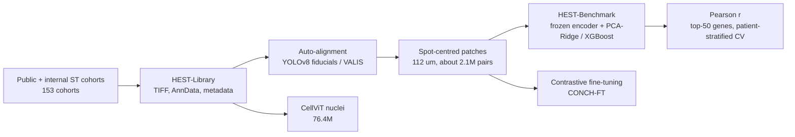
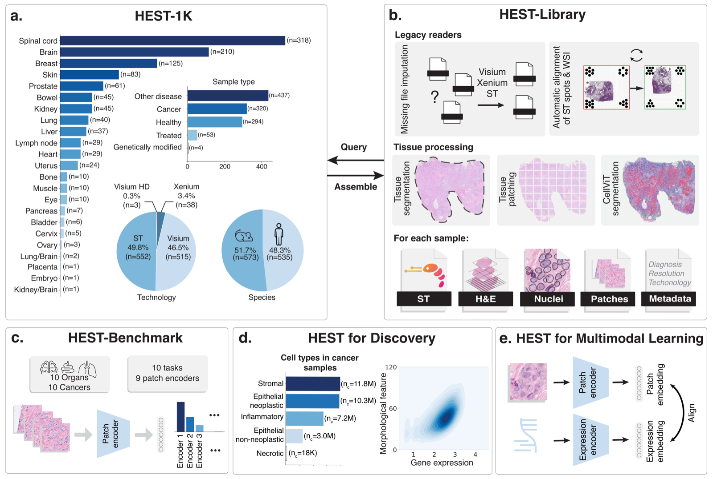
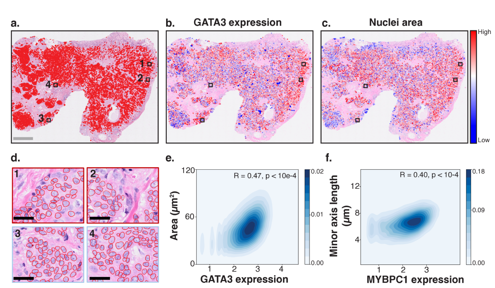

# HEST-1k: A Dataset for Spatial Transcriptomics and Histology Image Analysis

> **文献键** `Jaume2024_240616192` · **来源** NeurIPS 2024 (Datasets and Benchmarks Track, Spotlight)(2024) · **类别** foundation · **相关度** medium · **获取** open
> **链接** <https://arxiv.org/abs/2406.16192> · `status: complete`

---

## 一句话
HEST-1k 把 153 个公开与内部队列中的 1,229 个空间转录组(ST)样本统一成"H&E 全切片 + 对齐的 spot 表达矩阵 + 元数据"的标准格式,配套 Python 工具包 HEST-Library 和"从 H&E patch 预测基因表达"的 HEST-Benchmark(9 个任务、11 个病理基础模型)(Abstract, §1)。

## 要点
- 这是一篇**数据集 + 工具 + 基准**论文,不提出新模型;核心贡献是把格式五花八门的旧 ST 数据重新对齐、重新估计像素分辨率,变成可直接喂给深度学习的 (patch, 表达) 对,共约 210 万对(Abstract, §3.2)。
- 基准上最好的是 H-Optimus-0,9 个任务平均 Pearson 0.4146(PCA+Ridge),只用 ImageNet 预训练的 ResNet50 最低(0.326);也就是说"从形态猜表达"整体只有中等相关(Table 1)。
- 任务间差距比模型间差距大:H-Optimus-0 在 SKCM 达 0.6432,在 READ 只有 0.2292;唯一的肾脏任务 ccRCC 在所有模型上都只有约 0.22–0.28(§5.3, Table 1)。
- 模型规模与平均表现呈对数关系(R=0.81, P<0.01),预训练 patch 数只弱相关(R=0.48, P=0.13)(Fig. 2)。
- 读出头的选择会改变排名:直接 Ridge 时 CONCH 平均最高(0.3541),PCA+Ridge 时是 H-Optimus-0;作者因此主报 PCA+Ridge 与 XGBoost(§5.2, Table A13)。
- 数据集含 70 个肾脏样本(Fig. 1a),其中包括 Lake 等人人类肾脏图谱的 23 个 Visium 样本(Table A5)——对我们的肾脏方向可以直接拿来用。

## 研究问题
空间转录组能在组织切片上测出每个位置的基因表达,但成本高、技术更新快、缺乏统一标准,导致计算方法大多只在几个病人的小队列和窄任务上开发(§1)。同时,与 ST 配套的 H&E 切片里的形态信息常被忽略;而已有的病理 patch 级基准(如 Gleason 分级、CAMELYON)已经接近饱和,难以区分新的病理基础模型(§2)。作者要回答:能否把公开 ST 数据整理成一个统一的大规模配对资源,并用"从形态预测表达"作为评测基础模型的新任务?

## 方法
1. **收集**:从 10x Genomics、Mendeley、Spatial-Research、Zenodo、NCBI、GitHub、Human Cell Atlas、BioStudies、HTAN 及内部队列抓取所有"ST + H&E 全切片"数据(§3, Table A1)。像素尺寸大于 1.15 µm/px 的图像被丢弃(§3.1)。
2. **元数据统一**:癌症样本统一用 OncoTree 编码(MSKCC 的癌种分类);每个样本标注物种、器官、样本类型(健康、癌、非癌肿瘤、药物处理后、基因改造、其他病理)、ST 技术、spot 数、读数、放大倍数、冷冻/FFPE(§3.1)。
3. **图像统一**:所有切片转为金字塔 TIFF(可用 OpenSlide/QuPath 读取);用微调的 DeepLabV3(ResNet50 骨干)做组织/背景分割,能处理笔迹、fiducial(芯片四角的定位标记)、伪影等(§3.2, §4)。
4. **对齐**:Visium 用微调的 YOLOv8 自动检测四角 fiducial(119 个人工标注区域 + 数据增强),至少检到 3 个角即可推算 spot 坐标;再用已知 spot 间距反推像素尺寸;Xenium 用 VALIS 把 DAPI 图(与转录本天然对齐)配准到 H&E(§3.4, §4, Fig. 5)。
5. **配对 patch**:在 20× 下围绕每个 spot 切 224×224 像素(= 112×112 µm)的 patch;Xenium 把转录本按 55×55 µm 方格汇总成"伪 Visium spot",共得到约 210 万个有表达的 patch(§3.2)。表达以原始 count 存为 AnnData(scanpy 的标准格式),不做归一化(§3.4)。
6. **细胞核**:用 CellViT(在 PanNuke 上训练)对所有切片做核分割与 5 类分类(肿瘤上皮、非肿瘤上皮、炎症、间质、坏死),共 7,640 万个核(§3.3)。
7. **HEST-Benchmark**:每个任务取跨样本归一化方差最大的 50 个基因(先排除在 <10% spot 中非零的基因),log1p 归一化;冻结的病理基础模型对每个 patch 提 embedding,再训练回归头预测这 50 个基因;按病人分层做 k 折交叉验证(k = 病人数,ccRCC 用 k/2),指标为预测与实测表达的 Pearson 相关。主报 PCA(256 维)+ Ridge 和 XGBoost(100 棵树、深度 3),另附直接 Ridge(§5.1–5.2, App. C.3)。
8. **两个示范用例**:(a) 在 Xenium 乳腺癌切片上把 CellViT 核与 Xenium 细胞按质心最近匹配,计算 12 个可解释核特征与基因表达的相关(§6, App. E);(b) 用 InfoNCE 对比损失把 CONCH 图像编码器(只微调最后 3 层)与一个 3 层 MLP 表达编码器对齐,得到 CONCH-FT,再在独立乳腺癌队列上做分子分型(§7, App. D)。

## 方法图


## 数据
HEST-1k(v2):1,229 个样本、153 个队列、26 个器官、两个物种(人、小鼠);367 个癌症样本覆盖 25 种癌型;约 210 万个 spot 级 (patch, 表达) 对与 7,640 万个细胞核(Abstract, §3.3)。核分类:肿瘤 1,760 万、间质 2,150 万、正常上皮 490 万、炎症 1,540 万、坏死 7.6 万;平均每张切片 6.21 万个核(§3.3)。注意:这些分类数加起来只有约 5,950 万,不是 7,640 万;它们与 v1 §3.3 的数字完全相同(v1 那里的总数是 5,960 万,与分类之和吻合),看来 v2 只更新了总数、没更新分类(原文自身不一致)。技术包括 STv1、Visium、Visium HD、Xenium(Fig. 1a)。样本类型(Fig. 1a):健康 345、癌 367、其他病理 453、药物处理 53 等。完整下载超过 1 TB(§4)。按来源:NCBI 696 个样本、Spatial-Research 139、Mendeley 118、10x Genomics 112、内部 28 等(Table A1)。**肾脏**:Fig. 1a 列出 70 个肾脏样本;附录表中包括 Lake 等人人类肾脏健康/损伤图谱 23 个 Visium 样本、肾乳头结石病图谱 7 个、肾损伤上皮-免疫互作 4 个,以及若干小鼠肾脏样本(Tables A2–A5;Lake 图谱在 A5,结石病与肾损伤两项在 A4)。基准任务规模很小:IDC 4 病人、PRAD 2 病人(23 样本)、PAAD 3、SKCM 2、COAD 2、READ 2、ccRCC 24、LUAD 2、淋巴结转移 IDC 4 个样本(Table A11 写 4 个病人,App. C.3 写来自 2 个病人)(Table A11)。GitHub README 现在写的是 1,276 个样本,说明数据集在论文之后仍在扩充(README, 2026-10 访问)。

## 主要结果

- **基准总体**:PCA+Ridge 下平均 Pearson 最高为 H-Optimus-0 0.4146,其次 UNIv1.5 0.4090、Virchow2 0.3984、Virchow 0.3977;最低为 ResNet50(ImageNet)0.326(Table 1)。XGBoost 下 H-Optimus-0 仍最高(0.3956)(Table A14);H-Optimus-0 比第二名 UNIv1.5 高 0.56%(PCA+Ridge)/ 0.69%(XGBoost)(§5.3)。
- **病理专用模型之间的差距**:最好与最差的病理领域模型平均差 7.0%(PCA+Ridge)/ 4.8%(XGBoost)(§5.3)。
- **任务难度差异大**:H-Optimus-0 在 SKCM 0.6432、在 READ 0.2292(§5.3);ccRCC 各模型在 0.2179(CONCH)到 0.2788(Virchow2)之间(Table 1)。作者认为原因可能是某些癌种形态与表达关联弱,或某些队列噪声大(批次效应、灵敏度低、dropout、相邻 spot 串扰)(§5.3)。
- **缩放规律**:编码器参数量(对数)与平均表现 R=0.81(P<0.01);预训练 patch 数 R=0.48(P=0.13)(Fig. 2a, b)。
- **读出头影响排名**:直接 Ridge 时 CONCH 平均最高 0.3541,而 H-Optimus-0 只有 0.2754(Table A13);作者认为直接 Ridge 会惩罚 embedding 维度高的模型,所以主报 PCA+Ridge(§5.2)。
- **生物标志物示例**:一张 Xenium IDC 切片(168,033 个核)中,肿瘤细胞核面积与 GATA3 表达 R=0.47(P<10⁻⁴)(Fig. 3e);12 个核特征里与表达相关最强的是大小类特征,形状、拓扑和细胞分布类特征 R<0.2(§6)。另一张切片(342,018 个核)中 FLNB R=0.45、TPD52 R=0.47、FOXA1 R=0.47(§6, App. Fig. 6)。
- **多模态微调**:在 5 个 Xenium 乳腺癌样本的 47,051 对 patch–表达(238 个共同基因)上微调得到 CONCH-FT;在 BCNB(1,058 张 WSI)上用均值池化 + logistic 回归预测 ER/PR/HER2:ER AUC 0.881→0.884、PR AUC 0.810→0.818、HER2 AUC 0.715→0.724,但 HER2 balanced accuracy 0.624→0.615 下降;embedding rank 144.66→146.47(Table 2)。

## 创新点
- 公开的配对 ST + H&E 全切片集合(1,229 样本、26 器官、2 物种),全部重新对齐并统一格式(Abstract, §3)。
- HEST-Library:处理旧数据的工具链(格式转换、fiducial 自动对齐、像素尺寸反推、组织分割、patch 切分、按元数据下载、批次效应可视化与 ComBat/Harmony/MNN 封装)(§4)。
- HEST-Benchmark:病人分层、按任务固定 50 个基因的表达预测基准,并给出 11 个模型在 3 种读出头下的结果与缩放规律(§5, Fig. 2)。

## 局限
- 作者自述:ST 数据本身有噪声,染色、压缩伪影和采集流程差异会影响质量(§8)。
- 作者自述:样本、数据集、技术之间的批次效应可能很大,本文没有量化或校正,只提供了工具(§8)。
- 作者自述:HEST-Library 不能覆盖所有格式,应视为处理 ST 的"蓝图"(§8)。
- 作者自述:CONCH-FT 只用了 5 张配对切片(§7);数据仅限研究用途,禁止用于诊断(App. A)。
- 我们的理解:多数基准任务只有 2–4 个病人,各折标准差最高可达约 0.1(Table 1),模型间 0.5% 量级的差异很难说显著。
- 我们的理解:基准只包含癌症任务;唯一的肾脏任务是 ccRCC(肾癌),不涉及 CKD/AKI 这类非肿瘤肾病。
- 我们的理解:文中有小的不一致——COAD 在正文写 Visium、在 Table A11 写 Xenium;Remedis 在 §5.2 写 SimCLR、在 Table A12 写 iBOT;LYMPH-IDC 在 Table A11 写 4 个病人、在 App. C.3 写 2 个病人;核分类数与总数对不上(见"数据")。GitHub README 2024-08-30 的更新写"New COAD task based on 4 Xenium samples",支持 Table A11 的 Xenium。使用前应以代码/元数据为准。

## 与本研究方向的关系
我们的理解:HEST-1k 不是异常检测论文,它在 detect → model → revert 里主要是 **model 一环的数据底座**和 **detect 一环的跨模态工具**。(1) 对课题 1(肾脏单细胞/空间组学异常检测):HEST 的格式(金字塔 TIFF + AnnData + spot 对齐 patch)和对齐流程可以直接用来整理待测肾样本的 H&E 与空间组学数据;其中 Lake 图谱等 70 个肾脏样本可当作外部"参考/正常"数据或额外测试集。(2) "从 H&E 预测表达"的结果说明形态与表达只有中等相关(Pearson 约 0.2–0.6),这对我们"用模态一致性区分伪影与疾病"的假设很重要:如果一个区域的 H&E 预测表达与实测表达差得很远,它可能是真实分子异常,也可能只是预测器本身的误差;因此跨模态不一致必须相对于"该组织类型正常情况下的预测误差"来校准,不能直接当异常分。(3) 读出头会改变排名(Table A13),提醒我们在异常检测基准中固定并公开特征提取与读出协议。(4) 不涉及扰动或 revert。

## 可复用资产
- **代码与基准**:HEST-Library 与 HEST-Benchmark(`pip install -e ".[benchmark]"`,教程 `tutorials/4-Running-HEST-Benchmark.ipynb`)(README)。
<https://github.com/mahmoodlab/hest>
- **数据**:HuggingFace `MahmoodLab/hest`,可按元数据(器官、癌种、技术)下载子集;病人分层的划分以 CSV 提供(App. F.2)。
<https://huggingface.co/datasets/MahmoodLab/hest>
- **许可**:CC BY-NC-SA 4.0(数据集、基准与库)(App. A, README)。
- **可抄的协议**:病人分层 k 折、top-50 高变基因、PCA-256 + Ridge 读出、Pearson 指标(§5)。

## 待读
- Lake 等 2023 人类肾脏图谱(HEST 中 23 个 Visium 样本的来源),看哪些可作"健康参考"。
- H-Optimus-0、UNI、CONCH、Virchow2 的原论文,选择我们肾脏 H&E 分支的编码器。
- VALIS(DAPI–H&E 配准)和 CellViT(核分割)——Xenium + H&E 预处理会用到。
- 查 HuggingFace 元数据,确认当前 1,276 个样本中肾脏样本的数量与来源。

## 图表


**图1.** HEST 总览(此图取自 arXiv v1,图中数字都是 v1 的:如肾脏 n=45、10 个任务、9 个 patch 编码器、物种 573+535=1,108 个样本;本笔记用的 v2 数字是肾脏 70、9 个任务、11 个编码器、1,229 个样本):HEST-1k 数据集、HEST-Library 功能,以及三个应用——基础模型基准、生物标志物探索、多模态表征学习。
_Source: https://arxiv.org/html/2406.16192v1/x1.png  ·  License: arXiv (open) / paper CC BY-NC-SA 4.0_


**图2.** 生物标志物探索(此图取自 arXiv v1):浸润性导管癌(IDC)Xenium 切片上的肿瘤细胞核叠加、GATA3 表达热图、核面积热图、CellViT 分割示例,以及核特征与基因表达的相关(如核面积 ↔ GATA3,R=0.47)。
_Source: https://arxiv.org/html/2406.16192v1/x2.png  ·  License: arXiv (open) / paper CC BY-NC-SA 4.0_

### 结果表

**表1.** HEST-Benchmark(arXiv v2):11 个病理编码器在 9 个任务上的 Pearson 相关,读出头为 PCA(256 维)+ Ridge,按病人分层交叉验证取均值。**加粗** = 该任务最优。标准差略去,见原文 Table 1。

| Model | IDC | PRAD | PAAD | SKCM | COAD | READ | ccRCC | LUAD | LYMPH IDC | **Average** |
|---|---|---|---|---|---|---|---|---|---|---|
| ResNet50 (IN) | 0.4741 | 0.3075 | 0.3889 | 0.4822 | 0.2528 | 0.0812 | 0.2231 | 0.4917 | 0.2322 | 0.326 |
| CTransPath | 0.511 | 0.3427 | 0.4378 | 0.5106 | 0.2285 | 0.11 | 0.2279 | 0.4985 | 0.2353 | 0.3447 |
| Phikon | 0.5327 | 0.342 | 0.4432 | 0.5355 | 0.2585 | 0.1517 | 0.2423 | 0.5468 | 0.2373 | 0.3656 |
| CONCH | 0.5363 | 0.3548 | 0.4475 | 0.5791 | 0.2533 | 0.1674 | 0.2179 | 0.5312 | 0.2507 | 0.3709 |
| REMEDIS | 0.529 | 0.3471 | 0.4644 | 0.5818 | 0.2856 | 0.1145 | 0.2647 | 0.5336 | 0.2473 | 0.3742 |
| GigaPath | 0.5508 | 0.3708 | 0.4768 | 0.5538 | 0.301 | 0.186 | 0.2391 | 0.5399 | 0.2493 | 0.3853 |
| UNI | 0.5702 | 0.314 | 0.4764 | 0.6254 | 0.263 | 0.1762 | 0.2427 | 0.5511 | 0.2565 | 0.3862 |
| Virchow | 0.5702 | 0.3309 | 0.4875 | 0.6088 | **0.311** | 0.2019 | 0.2637 | 0.5459 | 0.2594 | 0.3977 |
| Virchow2 | 0.5922 | 0.3465 | 0.4661 | 0.6174 | 0.2578 | 0.2084 | **0.2788** | **0.5605** | 0.2582 | 0.3984 |
| UNIv1.5 | **0.5989** | 0.3645 | 0.4902 | 0.6401 | 0.2925 | 0.2240 | 0.2522 | 0.5586 | **0.2597** | 0.4090 |
| H-Optimus-0 | 0.5982 | **0.385** | **0.4932** | **0.6432** | 0.2991 | **0.2292** | 0.2654 | 0.5582 | 0.2595 | **0.4146** |

_Source: arXiv:2406.16192v2, Table 1(加粗为我们按数值重新标注)。_

## 引用
```bibtex
@inproceedings{Jaume2024_240616192,
  title = {HEST-1k: A Dataset for Spatial Transcriptomics and Histology Image Analysis},
  author = {Guillaume Jaume and Paul Doucet and Andrew H. Song and Ming Y. Lu and Cristina Almagro-Pérez and Sophia J. Wagner and Anurag J. Vaidya and Richard J. Chen and Drew F. K. Williamson and Ahrong Kim and Faisal Mahmood},
  booktitle = {Advances in Neural Information Processing Systems 37 (NeurIPS 2024), Datasets and Benchmarks Track},
  pages = {53798--53833},
  year = {2024},
  doi = {10.52202/079017-1704},
  eprint = {2406.16192},
  archivePrefix = {arXiv},
  url = {https://arxiv.org/abs/2406.16192}
}
```


---

📄 **[AI-ready 全文提取 →](ai-ready.md)**
