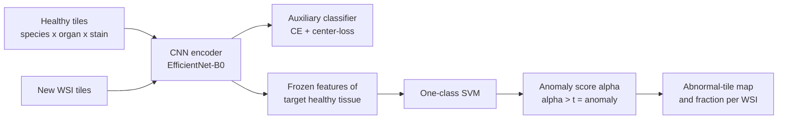
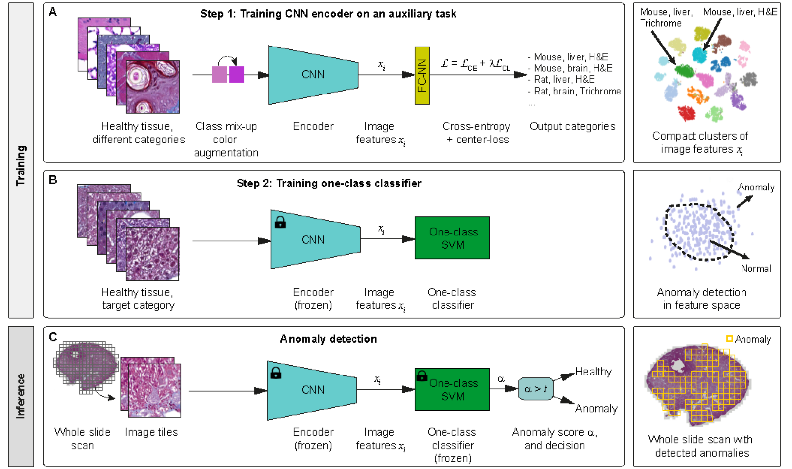
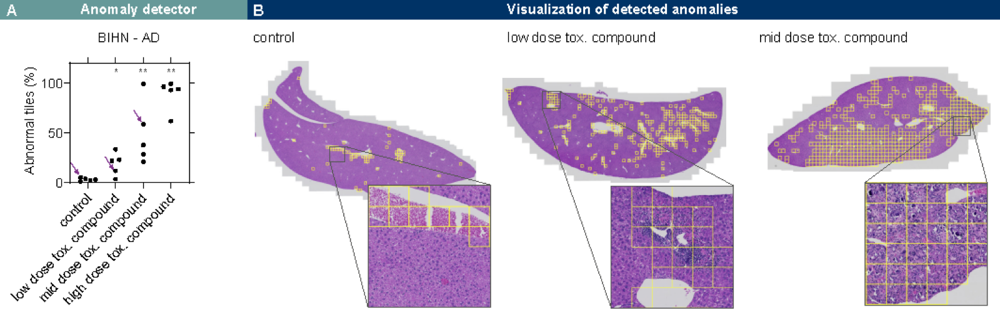

# Boehringer-Ingelheim/anomaly-detection-in-histology

> **Bibkey** `Zingman2024_anomaly_histology` · **Venue** GitHub (2022) · **Category** histopath · **Relevance** medium · **Access** open
> **Link** <https://github.com/Boehringer-Ingelheim/anomaly-detection-in-histology> · `status: complete`

---

## One-liner
A PyTorch repository from Boehringer Ingelheim: a CNN is trained on **healthy** tissue from several species, organs and two stains (auxiliary classification + center-loss), then a one-class SVM is fit on healthy features of the target tissue to find drug-induced histological alterations in whole-slide images; companion paper: Zingman et al., *Medical Image Analysis* 2024.

## Takeaways
- Two steps: (1) learn representations by classifying species-organ-stain categories with cross-entropy + center-loss; (2) freeze the encoder and fit a one-class SVM on healthy tiles of the target tissue only (README figure Scheme_extended).
- Evaluation: normal mouse liver vs mouse liver with non-alcoholic fatty liver disease (NAFLD); the README reports AU-ROC 97.33% (H&E) and 99.03% (Masson's Trichrome) (README table).
- Application example: after mice receive an experimental compound known to be toxic, the fraction of abnormal tiles rises with dose (README figure tox_pattern).
- Training data, evaluation data and pretrained models (CNN `.pt` + one-class SVM `.pkl`) are public on OSF (<https://osf.io/gqutd/>); code is MIT-licensed.
- Our reading: the training set already includes mouse kidney (H&E and Masson), so the pretrained CNN can be tried directly as a feature extractor for a one-class kidney baseline.

## Problem
In the README's words, the paper develops anomaly detection for whole-slide images (WSIs) of stained tissue in order to **routinely screen** histopathology data for abnormal alterations (README intro). The setting is toxicity assessment in drug development: after dosing, pathologists must find compound-induced tissue changes (README figure caption). Our reading: such changes are diverse and not known in advance, so labelling each kind is impractical, which is why learning only "normal" is attractive.

## Method
1. **Input**: healthy tissue tiles from mouse (brain, heart, kidney, liver, lung, pancreas, spleen) and rat (liver), each in H&E and Masson's Trichrome (a special stain; in the paper's Fig. 6B text, fibrosis appears blue in this stain) (README data folder tree).
2. **Step 1, representation learning**: a CNN encoder solves an auxiliary classification over species + organ + stain categories (e.g. Mouse, liver, H&E), with class mix-up colour augmentation and loss = cross-entropy + λ·center-loss (README figure Scheme_extended A). The README figure draws compact clusters for every class, but in the paper and code the center-loss acts only on the target class (e.g. mouse liver in one stain), making that class compact; applying it to all classes was tested and was worse (paper Sec. 4.5.4 / Table 6; `centerloss_classes` in `configs/cfg_training_cnn.py`). There is one model per target stain (`data_staining` = `HE` or `Masson`, README Training), but each CNN's auxiliary classifier is trained on all 16 categories, both stains included; `data_staining` only selects the center-loss target class and the one-class SVM's training tiles (`configs/cfg_training_cnn.py`; paper Sec. 4.3).
3. **Backbone**: EfficientNet-B0 (ImageNet-pretrained) with its last stage removed, giving a 320-dimensional feature vector; the 320 in the filename `EfficientNet_B0_320_...` is this feature dimension, not the input size (paper Sec. 3.1.3; `n_features = 320` in `models/pretrained_networks.py`). Input tiles are 256×256 px at 0.442 µm/px (paper Sec. 4.2; `patch_size = (256, 256)`).
4. **Step 2, one-class classifier**: with the encoder frozen, a one-class SVM is fit on features of healthy tiles of the target category (e.g. mouse liver), enclosing the "normal" region of feature space (README figure B; `anomaly_detector.py`).
5. **Inference**: WSI → tiles → frozen CNN features → frozen one-class SVM score α → anomaly if α > t, giving a map of abnormal tiles over the slide (README figure C).
6. **Evaluation**: balanced accuracy, AU-ROC and F1 on the NAFLD test set; the README also explains how to run Anomalib methods and DPA on the same data for comparison (README Evaluation).

## Method diagram


## Data
Everything is on OSF (<https://osf.io/gqutd/>). **Training** (`data/train/`): 16 folders = 7 mouse organs × 2 stains + rat liver × 2 stains, normal tissue only. **Evaluation** (`data/test/`): normal vs NAFLD mouse liver, one set each for H&E and Masson. A `trained models/` folder holds the pretrained CNNs and one-class SVMs (README "Setting up dataset"). The README gives no tile or slide counts; the paper gives about 7000 tiles per category (16 categories) for the auxiliary task, and healthy mouse-liver tiles for the one-class classifier from 204 (Masson) and 347 (H&E) WSIs (paper Sec. 4.2, 4.4).

## Key results
The README gives one results table ("Expected performance of anomaly detection with BIHN models") and one application figure. The paper's abstract says the system outperforms established AD methods on a published dataset of liver anomalies and gives results comparable to conventional methods tailored for quantifying liver anomalies (arXiv abstract); the baseline numbers were not checked here.
- **H&E**: balanced accuracy 94.20%, AU-ROC 97.33%, F1 94.09% (README table).
- **Masson's Trichrome**: balanced accuracy 97.51%, AU-ROC 99.03%, F1 97.51% (README table).
- **Toxicity example**: in mouse liver the fraction of abnormal tiles rises with compound dose (control / low / mid / high), stars mark significance vs the control mean; in controls, blood and a few other non-pathological structures cause some false positives; detections in treated groups were confirmed as pathological by a pathologist (README figure tox_pattern A–B).
- The pretrained CNN filenames contain `acc0.9762` (H&E) and `acc0.9755` (Masson). Our reading: this is likely auxiliary-classification accuracy, not an anomaly-detection metric; the README does not explain it.

## Contributions
- Uses readily available species-organ-stain categories as an auxiliary task to learn anomaly-friendly representations, instead of lesion labels (README figure A).
- Center-loss makes the target-class features compact, followed by a one-class SVM (README figures A–B); removing center-loss lowers performance by 3.4% (paper Sec. 4.5.4, Table 6).
- Releases an evaluation dataset with NAFLD pathology, the training data and pretrained models, plus instructions for comparing against Anomalib and DPA (README).
- Third-party view: Dippel et al. 2024 (this library's `histo-nejmai-2024`, App. A.3) notes that this work also uses other tissue types (liver, brain, kidney, heart, lung, pancreas, spleen), but to optimise representations followed by a one-class classifier, which differs from Outlier Exposure.

## Limitations
- The README reports one benchmark (mouse liver NAFLD) and one toxicity example (mouse liver); other organs and lesions are not shown.
- Rodents and two stains only; no human tissue.
- Our reading: the output is a tile-level abnormal / normal call, with no type, severity or molecular explanation.
- Our reading: blood and similar structures are flagged in controls (README caption), i.e. any normal structure missing from the healthy training set becomes a false positive.
- The companion paper was not read in full here; its baseline numbers and most ablations are unverified.

## Relation to our direction
A direct example of stage 1 (detect) under **drug perturbation**: learn healthy tissue only, find compound-induced change, and see a dose-response — exactly "detect regions changed by disease or drug". Our reading: three uses for Topic 1. (1) The training set contains mouse kidney (H&E and Masson), so the public CNN can serve as a feature extractor for a weak "frozen features + one-class SVM" kidney baseline. (2) "Auxiliary task over metadata categories (species / organ / stain)" maps onto omics: learn representations from available labels such as donor, tissue site or batch, then fit a one-class model on the healthy reference. (3) "Abnormal-tile fraction rises with dose" is a validation that needs no region labels, usable for kidney data with a dose or disease-stage gradient. Stages 2–3 (virtual tissue, revert) are not addressed.

## Reusable assets
- **Code (MIT)**: <https://github.com/Boehringer-Ingelheim/anomaly-detection-in-histology>; `train_cnn.py` (representation training), `anomaly_detector.py` (fit / evaluate the one-class SVM), `model_use_example.py` (feature extraction with pretrained models); configs `configs/cfg_training_cnn.py`, `configs/cfg_anomaly_detector.py`.
- **Pretrained models** (OSF `trained models/`): `EfficientNet_B0_320_HE_Liver_Mouse_acc0.9762.pt/.pkl`, `EfficientNet_B0_320_Masson_Liver_Mouse_acc0.9755.pt/.pkl`, plus training configs.
- **Data** (OSF): <https://osf.io/gqutd/> — multi-organ healthy training set + NAFLD evaluation set.
- **Baseline instructions**: the README explains how to run Anomalib (<https://github.com/openvinotoolkit/anomalib>) and DPA (<https://github.com/ninatu/anomaly_detection>) on the NAFLD data.

## Follow-ups
- Read the companion paper: Zingman I, Stierstorfer B, Lempp C, Heinemann F. *Medical Image Analysis* 92:103067 (2024), DOI 10.1016/j.media.2023.103067, arXiv:2210.07675 — check baseline numbers and ablations.
- Try the public BIHN CNN as a feature extractor on mouse or human kidney H&E and compare with a pathology foundation model such as CTransPath.

## Figures & tables


**Fig 1.** Method overview. **A (Training step 1):** a CNN encoder is trained on healthy tissue (many species/organ/stain categories) via an auxiliary classification task with class mix-up colour augmentation; the loss is cross-entropy + center-loss (𝓛=𝓛_CE+λ𝓛_CL); the figure shows compact clusters per category (the paper's final setting applies center-loss to the target class only; see Method). **B (Training step 2):** with the encoder frozen, a one-class SVM is fit on features of the target-category healthy tissue, drawing a "normal" boundary in feature space. **C (Inference):** a whole-slide scan is tiled → frozen CNN features → frozen one-class SVM emits anomaly score α → threshold decision (α>t ⇒ anomaly), yielding a WSI map of detected anomalies.
_Source: https://github.com/Boehringer-Ingelheim/anomaly-detection-in-histology/blob/master/docs/Scheme_extended.png  ·  License: MIT (repo) / arXiv:2210.07675_


**Fig 2.** Examples of detected anomalies. **A:** the BIHN anomaly detector's "abnormal tiles (%)" rises with toxic-compound dose (control / low / mid / high); each dot is one WSI; stars mark statistical significance vs the control-group mean. **B:** anomaly visualisation on WSIs — the control (left) shows a few false positives from blood and other non-pathological structures, while low- and mid-dose groups (middle, right) show detected anomalies (yellow tiles) that correspond to pathological alterations confirmed by a pathologist.
_Source: https://github.com/Boehringer-Ingelheim/anomaly-detection-in-histology/blob/master/docs/tox_pattern.png  ·  License: MIT (repo) / arXiv:2210.07675_

### Results

**Table 1.** Expected anomaly-detection performance of the BIHN models on the NAFLD liver dataset (normal mouse liver vs. NAFLD pathology), by staining.

| Staining | Balanced accuracy | AU-ROC | F1 score |
|---|:---:|:---:|:---:|
| H&E | 94.20% | 97.33% | 94.09% |
| Masson's Trichrome | 97.51% | 99.03% | 97.51% |

_Source: repo README (https://github.com/Boehringer-Ingelheim/anomaly-detection-in-histology)  ·  License: MIT_

## Cite
```bibtex
@article{Zingman2024_anomaly_histology,
  title = {Learning image representations for anomaly detection: application to discovery of histological alterations in drug development},
  author = {Zingman, Igor and Stierstorfer, Birgit and Lempp, Charlotte and Heinemann, Fabian},
  journal = {Medical Image Analysis},
  volume = {92},
  pages = {103067},
  year = {2024},
  doi = {10.1016/j.media.2023.103067},
  note = {Code: https://github.com/Boehringer-Ingelheim/anomaly-detection-in-histology; preprint arXiv:2210.07675},
  url = {https://github.com/Boehringer-Ingelheim/anomaly-detection-in-histology}
}
```


---

📄 **[AI-ready full-text extract →](ai-ready.md)**
