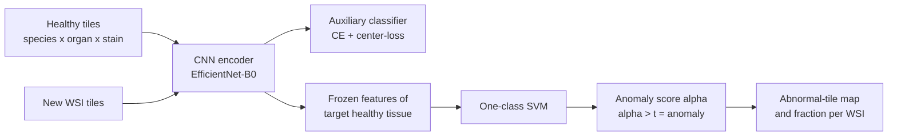

# Boehringer-Ingelheim/anomaly-detection-in-histology

> **文献键** `Zingman2024_anomaly_histology` · **来源** GitHub(2022) · **类别** histopath · **相关度** medium · **获取** open
> **链接** <https://github.com/Boehringer-Ingelheim/anomaly-detection-in-histology> · `status: complete`

---

## 一句话
Boehringer Ingelheim 的 PyTorch 代码库:先在多物种、多器官、两种染色的**健康**组织上训练 CNN(辅助分类任务 + center-loss),再在目标组织的健康特征上训练 one-class SVM,用来在全切片中找出药物引起的组织病理改变;配套论文为 Zingman et al., *Medical Image Analysis* 2024。

## 要点
- 两步法:第 1 步学表征(区分"物种-器官-染色"类别,交叉熵 + center-loss),第 2 步冻结编码器、只用目标组织的健康图块训练 one-class SVM(README 图 Scheme_extended)。
- 评测任务:正常小鼠肝 vs 非酒精性脂肪肝(NAFLD)小鼠肝;README 给出 H&E AU-ROC 97.33%、Masson 三色染色 AU-ROC 99.03%(README 表)。
- 应用示例:小鼠服用一种已知有毒的实验化合物后,"异常图块比例"随剂量升高(README 图 tox_pattern)。
- 训练数据、评测数据和预训练模型(CNN `.pt` + one-class SVM `.pkl`)都在 OSF 公开(<https://osf.io/gqutd/>),代码 MIT 许可。
- 我们的理解:训练集里就有小鼠肾脏(H&E 与 Masson 两种),所以这个预训练 CNN 可以直接拿来给肾脏切片提特征做 one-class 基线。

## 研究问题
README 的说法:论文提出一种在染色组织全切片(WSI)中做异常检测的方法,用来**常规筛查**组织病理数据中的异常改变(README 开头)。应用场景是药物开发中的毒性评估:动物服药后,病理学家要找出组织里由药物引起的改变(README 图注)。我们的理解:这类改变种类多、事先不知道会是什么,难以为每一种收集标注,所以只学"正常"是自然的选择。

## 方法
1. **输入**:健康组织图块,来自小鼠(脑、心、肾、肝、肺、胰、脾)和大鼠(肝),每种都有 H&E 和 Masson 三色(Masson's Trichrome,一种把胶原纤维染成蓝/绿色的染色)两个版本(README 数据目录结构)。
2. **第 1 步 表征学习**:CNN 编码器做辅助分类,类别是"物种 + 器官 + 染色"组合(如 Mouse, liver, H&E);训练时用 class mix-up 颜色增强;损失 = 交叉熵 + λ·center-loss,使每类特征聚成紧致的簇(README 图 Scheme_extended A)。按染色分别训练(`configs/cfg_training_cnn.py` 中 `data_staining` = `HE` 或 `Masson`)(README Training)。
3. **骨干**:预训练模型文件名为 `EfficientNet_B0_320_...`,即 EfficientNet-B0(我们的理解:320 应是输入尺寸,README 未明说)(README)。
4. **第 2 步 one-class 分类器**:冻结编码器,用目标类别(如小鼠肝)健康图块的特征训练 one-class SVM,在特征空间围出"正常"区域(README 图 B;`anomaly_detector.py`)。
5. **推理**:WSI 切成图块 → 冻结 CNN 提特征 → 冻结 one-class SVM 给出异常分 α → α > t 判为异常,在整张切片上标出异常图块(README 图 C)。
6. **评估**:在 NAFLD 测试集上报告平衡准确率、AU-ROC、F1;README 还说明了如何在同一数据上跑 Anomalib 中的方法和 DPA 作对比(README Evaluation)。

## 方法图


## 数据
全部在 OSF(<https://osf.io/gqutd/>)。**训练集**(`data/train/`):16 个文件夹 = 小鼠 7 个器官 × 2 种染色 + 大鼠肝 × 2 种染色,只含正常组织。**评测集**(`data/test/`):正常小鼠肝 vs NAFLD 小鼠肝,H&E 与 Masson 各一套。另有 `trained models/` 文件夹放预训练 CNN 和 one-class SVM(README "Setting up dataset")。README 没有给出图块数量或切片数量。

## 主要结果
README 只给出一个结果表("Expected performance of anomaly detection with BIHN models")和一个应用示例图;论文中的基线对比和消融未在此核对。
- **H&E**:平衡准确率 94.20%、AU-ROC 97.33%、F1 94.09%(README 表)。
- **Masson 三色**:平衡准确率 97.51%、AU-ROC 99.03%、F1 97.51%(README 表)。
- **毒性筛查示例**:小鼠肝中"异常图块比例"随实验化合物剂量(对照 / 低 / 中 / 高)升高,星号表示与对照组均值相比有统计显著差异;对照组中血液等非病理结构造成少量假阳性;处理组中的检出经病理学家确认为病理改变(README 图 tox_pattern A–B)。
- 预训练 CNN 文件名中带有 `acc0.9762`(H&E)和 `acc0.9755`(Masson)。我们的理解:这应是辅助分类任务的准确率,不是异常检测指标;README 未解释。

## 创新点
- 用"物种-器官-染色"这样的现成类别做辅助任务来学适合异常检测的表征,而不是用病变标注(README 图 A)。
- center-loss 让同类特征更紧致,再接 one-class SVM(README 图 A–B)。
- 公开了带 NAFLD 病变的评测数据集、训练数据和预训练模型,并给出与 Anomalib、DPA 对比的说明(README)。
- 第三方评价:Dippel et al. 2024(本库 `histo-nejmai-2024`,App. A.3)指出该工作同样用到其他组织类型(肝、脑、肾、心、肺、胰、脾),但用它们来优化表征后再接 one-class 分类器,与 Outlier Exposure 不同。

## 局限
- README 只报告了一个评测任务(小鼠肝 NAFLD)和一个毒性示例(小鼠肝);其他器官、其他病变未展示。
- 只有啮齿类动物、两种染色;没有人类组织。
- 我们的理解:输出是图块级的"是否异常",没有类型、严重程度或分子层面的解释。
- 我们的理解:对照组中血液等结构会被判为异常(README 图注),说明"正常"训练集如果没覆盖某些正常结构就会产生假阳性。
- 本页未读配套论文,论文中的基线对比、消融、数据规模均未核实。

## 与本研究方向的关系
这是 pipeline 第一环(detect)在**药物扰动**场景下的直接例子:只学健康组织,找出药物造成的改变,并能看到剂量-反应关系——正好是"检测因疾病或药物扰动而改变的区域"。我们的理解:对课题 1 有三点用处。(1) 训练集含小鼠肾(H&E 与 Masson),公开的 CNN 可直接作为肾脏切片的特征提取器,搭一个"冻结特征 + one-class SVM"的弱基线;(2) "用元数据类别(物种 / 器官 / 染色)做辅助任务"可以类比到组学:用供体、组织部位、测序批次等现成标签学表征,再在健康参考上做 one-class;(3) "异常图块比例随剂量上升"是一种不需要逐区域标注的验证方式,可用于有剂量或疾病分期梯度的肾脏数据。第二、三环(virtual tissue、revert)不涉及。

## 可复用资产
- **代码(MIT)**:<https://github.com/Boehringer-Ingelheim/anomaly-detection-in-histology>;`train_cnn.py`(训练表征)、`anomaly_detector.py`(训练 / 评估 one-class SVM)、`model_use_example.py`(用预训练模型提特征),配置 `configs/cfg_training_cnn.py`、`configs/cfg_anomaly_detector.py`。
- **预训练模型**(OSF `trained models/`):`EfficientNet_B0_320_HE_Liver_Mouse_acc0.9762.pt/.pkl`、`EfficientNet_B0_320_Masson_Liver_Mouse_acc0.9755.pt/.pkl` 及训练配置。
- **数据**(OSF):<https://osf.io/gqutd/> —— 多器官健康训练集 + NAFLD 评测集。
- **对比基线说明**:README 给出在 NAFLD 数据上运行 Anomalib(<https://github.com/openvinotoolkit/anomalib>)和 DPA(<https://github.com/ninatu/anomaly_detection>)的配置方法。

## 待读
- 精读配套论文:Zingman I, Stierstorfer B, Lempp C, Heinemann F. *Medical Image Analysis* 92:103067 (2024),DOI 10.1016/j.media.2023.103067,arXiv:2210.07675——核对基线、消融和数据规模。
- 在小鼠肾或人肾 H&E 上试用公开的 BIHN CNN 作为特征提取器,与病理基础模型(如 CTransPath)对比。

## 图表


**图1.** 方法总览。**A(训练第 1 步)**:在健康组织(多种物种 / 器官 / 染色类别)上用辅助分类任务训练 CNN 编码器,配合 class mix-up 颜色增强,损失为交叉熵 + center-loss(𝓛=𝓛_CE+λ𝓛_CL),使各类特征形成紧致簇。**B(训练第 2 步)**:冻结编码器,在目标类别健康组织的特征上训练 one-class SVM,在特征空间划出"正常"边界。**C(推理)**:全切片切成图块 → 冻结 CNN 提特征 → 冻结 one-class SVM 输出异常分 α → 阈值判定(α>t 为异常),在整张 WSI 上标出检出的异常区域。
_Source: https://github.com/Boehringer-Ingelheim/anomaly-detection-in-histology/blob/master/docs/Scheme_extended.png  ·  License: MIT (repo) / arXiv:2210.07675_


**图2.** 检出异常示例。**A:** BIHN 异常检测器输出的"异常图块占比(%)"随毒性化合物剂量(对照 / 低 / 中 / 高剂量)升高而增大,每个点是一张 WSI;顶部星号表示与对照组均值相比的统计显著性。**B:** 异常在 WSI 上的可视化——对照组(左)仅有血液等非病理结构造成的少量假阳性,低剂量与中剂量处理组(中、右)检出的异常(黄框图块)对应病理改变,并经病理学家确认。
_Source: https://github.com/Boehringer-Ingelheim/anomaly-detection-in-histology/blob/master/docs/tox_pattern.png  ·  License: MIT (repo) / arXiv:2210.07675_

### 结果表

**表1.** BIHN 模型在 NAFLD 肝脏异常检测数据集上的预期性能(正常小鼠肝 vs. NAFLD 病变),按染色划分。

| Staining | Balanced accuracy | AU-ROC | F1 score |
|---|:---:|:---:|:---:|
| H&E | 94.20% | 97.33% | 94.09% |
| Masson's Trichrome | 97.51% | 99.03% | 97.51% |

_Source: repo README (https://github.com/Boehringer-Ingelheim/anomaly-detection-in-histology)  ·  License: MIT_

## 引用
```bibtex
@article{Zingman2024_anomaly_histology,
  title = {Learning image representations for anomaly detection: application to discovery of histological alterations in drug development},
  author = {Zingman, Igor and Stierstorfer, Birgit and Lempp, Charlotte and Heinemann, Fabian},
  journal = {Medical Image Analysis},
  volume = {92},
  pages = {103067},
  year = {2024},
  doi = {10.1016/j.media.2023.103067}
}
```


---

📄 **[AI-ready 全文提取 →](ai-ready.md)**
