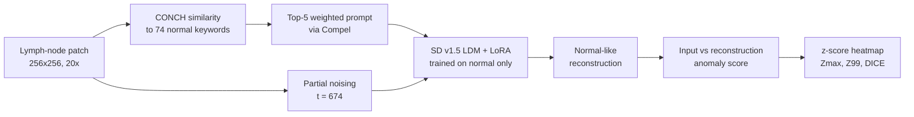

# Pathology-Informed Latent Diffusion Model for Anomaly Detection in Lymph Node Metastasis

> **Bibkey** `Wang2025_AnoPILaD` · **Venue** MICCAI 2025 (2025) · **Category** histopath · **Relevance** medium · **Access** open
> **Link** <https://papers.miccai.org/miccai-2025/0675-Paper2270.html> · `status: complete`

---

## One-liner
AnoPILaD fine-tunes a text-conditioned latent diffusion model (Stable Diffusion v1.5 + LoRA) on normal lymph-node patches only; at inference the pathology vision-language model CONCH picks the 5 best-matching of 74 "normal tissue" keywords as a prompt, the input is reconstructed toward normal, and the input–reconstruction difference is the anomaly score (the paper does not name the distance; the released code computes latent-space MSE and pixel LPIPS) — patch AUC 0.9587 on gastric lymph nodes and 0.8884 cross-organ on breast lymph nodes (Camelyon16).

## Takeaways
- Reconstruction-based anomaly detection: normal patches reconstruct well, metastases poorly; the novelty is steering the reconstruction with **text that describes normal tissue** (§2.1–2.2).
- On the in-house gastric lymph-node data (LH) patch AUC is 0.9587, a little above the best LH baseline MemAE (0.9290); on breast lymph nodes (C16) it is 0.8884, and the authors note the gap to the AE-type methods widens to ~0.22 AUC (AE 0.6584, MemAE 0.6611); the best C16 baseline, complexity (0.7752), is ~0.11 below (Table 2, §4).
- Slide-level classification still drops sharply across organs: best AUC 0.9943 on LH but only 0.6745 on C16 (Table 3).
- The authors stress evaluating **segmentation (localisation)**, not only classification: AE / MemAE classify reasonably but give near-uniform scores over a slide (Table 3, Fig. 3).
- Our reading: there is no ablation removing the text prompt or varying the keyword count, so the gain cannot be split between text guidance, the LDM itself, and SD pretraining.

## Problem
Lymph-node metastasis is a key prognostic factor. Supervised detection needs extensive expert annotation (Introduction). Unsupervised anomaly detection trains only on normal (in-distribution) samples and treats deviations as OOD. A DDPM reconstruction method has been used for breast lymph-node metastasis (called AnoDDPM in the paper, ref [17] Linmans et al. 2024) but produces many false positives, i.e. normal and OOD are not separated well (§2.1, Fig. 1). The paper adds pathology priors to widen the reconstruction gap between normal tissue and metastasis, and tests robustness across organs.

## Method
1. **Input**: WSIs tiled into 256×256-pixel patches at 20× (§3.1).
2. **Keyword pool**: 74 pathology keywords from the literature describing cells and microenvironments of normal lymph nodes, reviewed by an experienced pathologist (§2.2).
3. **Weighted prompt**: CONCH (a vision-language model pretrained on 1.17M pathology image–caption pairs) embeds the patch and every keyword; cosine similarity selects the top 5; each similarity divided by the median becomes its weight; a weighted text embedding c is built following the Compel library (§2.2, Fig. 2).
4. **Training**: a Stable Diffusion v1.5 latent diffusion model fine-tuned with LoRA (rank 4) on normal training patches only; Adam, lr 1e-5, batch 64; conditional denoising loss L = E‖ε − ε_θ(z_t, t, c)‖²; the 400k-step checkpoint with lowest FID is used (§2.1 Eq. 4, §3.2).
5. **Reconstruct and score**: following AnoDDPM, the input is noised to timestep t = 674 (chosen from 8 candidates by slide-classification performance on the LH test set) and denoised under the text condition to ẑ₀; input–reconstruction discrepancy = anomaly score (distance not named in the paper; the code outputs `mse_latent` and `lpips_pixel`); PLMS sampler, 100 steps (§2.1, §3.2).
6. **Evaluation**: anomaly scores are z-scored over all patches of a test set; patch level: AUC / AUPR; slide level: z-score heatmap with 2×2 morphological erosion, classification by max z (Zmax) or the paper's "average of 99th percentile z-scores" (Z99), segmentation by DICE / IoU on metastasis slides and true-negative rate (TNR) on normal slides, threshold 0 (§3.2).
7. **Baselines**: density-based VAE negative likelihood (NLL) and variants Regret, LLR, complexity; reconstruction-based f-AnoGAN, AE, MemAE, AnoDDPM (§3.2).

## Method diagram


## Data
**LH (gastric lymph nodes from two local hospital sites; no public download link in the paper, and the MICCAI page lists the dataset as N/A)**: 808 WSIs, 751 normal and 57 metastatic (partially annotated). Normal slides split 643 train / 50 val / 58 in-distribution test; the 57 metastatic slides are the OOD test set. Patches: train 1,373,475; val 102,240; in-dist test 174,703 (138,054 from the 58 normal test slides + 36,649 normal-annotated patches from the metastatic slides); OOD test 115,330 (fully metastasis-annotated). All LH tumour regions are >2 mm (§3.1, Table 1). **C16 (Camelyon16 breast lymph nodes, public)**: independent testing only — 32 normal val, 80 normal test, 49 metastatic, of which 22 contain tumour clusters >2 mm ("C16 Macro"); 55,659 OOD patches. Base prevalence: patch level LH 0.3976, C16 0.1882; slide level LH 0.4956, C16 0.3798, C16 Macro 0.2157 (§3.1).

## Key results
- **Patch level (Table 2)**: AnoPILaD AUC 0.9587 / AUPR 0.9499 on LH and 0.8884 / 0.6987 on C16, best in both. On LH: AE 0.9254, MemAE 0.9290, AnoDDPM 0.8555; on C16: AE 0.6584, MemAE 0.6611, AnoDDPM 0.6857.
- **Density methods are weak**: VAE NLL gives AUC 0.4982 on LH (near chance), the best variant (complexity) 0.7931; f-AnoGAN is worst (LH 0.2289) (Table 2, §4).
- **Slide classification (Table 3)**: AnoPILaD AUC 0.9837 (Zmax) and 0.9943 (Z99) on LH; 0.6745 / 0.6367 on C16; 0.8062 / 0.8023 on C16 Macro, where other methods reach 0.49–0.64.
- **Segmentation (Table 3)**: AnoPILaD has the highest TNR / DICE / IoU in every setting; C16 Macro DICE 0.5420 (AnoDDPM 0.3131, AE 0.3249); on LH DICE 0.4322, almost equal to AnoDDPM's 0.4319.
- **Qualitative**: for metastatic patches AnoDDPM partly reconstructs the tumour and fails to suppress pleomorphic nuclei and fibrosis; AnoPILaD reconstructs more uniform lymphocyte arrangements (Fig. 1, §4).

## Contributions
- Combines a pathology vision-language model (CONCH) with latent-diffusion reconstruction, using normal-tissue keywords as the reconstruction condition (§1, §2).
- Weighted prompt generation: 74 pathologist-reviewed keywords → top-5 by CONCH similarity → median-normalised weights → Compel weighted embedding (§2.2).
- Evaluates both classification and segmentation under a gastric → breast cross-organ shift, showing that classification alone overrates AE-type methods (§4).

## Limitations
- (Authors) cross-organ performance still needs work, left for future study (Conclusion); slide-level AUC on C16 is only 0.64–0.67 (Table 3).
- Our reading: the diffusion timestep t = 674 was chosen on the LH **test set** (§3.2), so LH results are somewhat optimistic.
- Our reading: no ablations (no prompt, random keywords, different keyword counts) and no standard deviations or repeated runs.
- Our reading: the keyword pool is lymph-node-specific and must be rebuilt for other organs; the paper gives no download for the LH data; 100-step diffusion sampling makes inference far costlier than an AE.

## Relation to our direction
Sits at stage 1 (detect) with a hint of "revert". Our reading: (1) "reconstruct the abnormal sample as normal; the difference is the anomaly" is an image-space counterfactual normal tissue, formally similar to our stage 3 "revert the anomaly", but without any gene-level explanation; (2) conditioning a generative normal model on prior knowledge (here text keywords) transfers to omics — e.g. condition on cell type or region labels so the model only has to judge "normal for this type"; (3) for the artifact-injection topic kidney benchmark, the evaluation design is worth copying: beyond slide/sample classification, include region-level segmentation metrics (DICE, TNR on normal slides) and cross-cohort / cross-organ tests. It also warns that AE-type baselines can look fine on classification yet localise poorly.

## Reusable assets
- **Code (MIT)**: <https://github.com/QuIIL/AnoPILaD> — `image_caption.py` (CONCH keyword selection → metadata.csv), `train_text_to_image_lora.py` (LoRA fine-tuning, adapted from the diffusers example), `rec_generate.py` (reconstruction), `ldm_solvers.py` (adapted from CFG++); python 3.11, CONCH installed separately (README). The README offers no pretrained weights.
- **Data**: Camelyon16 is public for the cross-organ test; no download link for LH (MICCAI page: dataset N/A).
- **Evaluation protocol**: within-test-set z-scores → patch AUC / AUPR; slide-level Zmax / Z99 with 2×2 erosion; segmentation DICE / IoU on metastatic slides + TNR on normal slides, threshold 0 (§3.2).

## Follow-ups
- Linmans et al. 2024, "Diffusion models for out-of-distribution detection in digital pathology", *Medical Image Analysis* 93:103088 — source of the AnoDDPM baseline here (ref [17]).
- Wyatt et al. 2022, AnoDDPM with simplex noise (ref [15]) — origin of the name.
- CONCH (Lu et al., arXiv:2307.12914, ref [20]).
- MemAE (Gong et al., ICCV 2019, ref [10]) — the strongest non-diffusion baseline on LH (on C16 the best baseline is complexity).

## Figures & tables


**Fig 2.** (Top) Weighted-prompt generation: CONCH text/image encoders score 74 normal keywords against the input by cosine similarity, take the top-5, median-normalise into weights, and Compel builds a weighted prompt (e.g. "small dormant lymphocytes: 1.06 … littoral cells: 0.83") fed to the LDM. (Bottom) Distribution of the top-10 frequent keywords in the LH training and test sets.
_Source: https://papers.miccai.org/miccai-2025/paper/2270_paper.pdf (Fig. 2)  ·  License: MICCAI 2025 Open Access_


**Fig 1.** Diffusion reconstructions. For in-distribution (row 1) and OOD (rows 2-3) inputs, AnoDDPM and AnoPILaD both reconstruct "normal-like" tissue; with text prompts AnoPILaD yields more uniform lymphocytic arrangements and suppresses pleomorphic/fibrotic structure. Right column lists the selected keyword prompts.
_Source: https://github.com/QuIIL/AnoPILaD (main.png; MIT) = paper Fig. 1_


**Fig 3.** Z-score anomaly heatmaps for four metastasis slides (two each from LH and C16). Black contours = metastasis annotation, green = normal annotation; parentheses give per-slide (Z99, DICE).
_Source: https://papers.miccai.org/miccai-2025/paper/2270_paper.pdf (Fig. 3)  ·  License: MICCAI 2025 Open Access_

### Results

**Table 2.** Patch-level anomaly detection, AUC / AUPR (LH = gastric nodes; C16 = Camelyon16 breast, cross-organ domain shift). Bold = best.

| Method | LH AUC | LH AUPR | C16 AUC | C16 AUPR |
|---|---|---|---|---|
| NLL | 0.4982 | 0.5552 | 0.3250 | 0.1600 |
| Regret | 0.6720 | 0.6718 | 0.6480 | 0.3441 |
| LLR | 0.6078 | 0.6260 | 0.7065 | 0.4765 |
| complexity | 0.7931 | 0.7139 | 0.7752 | 0.5140 |
| f-AnoGAN | 0.2289 | 0.3377 | 0.1735 | 0.1104 |
| AE | 0.9254 | 0.8906 | 0.6584 | 0.4759 |
| MemAE | 0.9290 | 0.8886 | 0.6611 | 0.4880 |
| AnoDDPM | 0.8555 | 0.7841 | 0.6857 | 0.5741 |
| **AnoPILaD** | **0.9587** | **0.9499** | **0.8884** | **0.6987** |

**Table 3.** WSI-level classification, each cell AUC / AUPR; two scores: Zmax (max z-score) and Z99 (paper: "average of 99th percentile z-scores"). C16 Macro = subset with tumour clusters >2mm. Bold = best.

| Method | LH Zmax | LH Z99 | C16 Zmax | C16 Z99 | C16-Macro Zmax | C16-Macro Z99 |
|---|---|---|---|---|---|---|
| AE | 0.9622 / 0.9612 | 0.9395 / 0.9381 | 0.6612 / 0.5961 | 0.5798 / 0.5217 | 0.6398 / 0.3677 | 0.5523 / 0.2918 |
| MemAE | 0.9504 / 0.9440 | 0.9365 / 0.9382 | 0.6505 / 0.5689 | 0.5686 / 0.5313 | 0.6381 / 0.3657 | 0.5597 / 0.3141 |
| AnoDDPM | 0.7840 / 0.6616 | 0.9383 / 0.8995 | 0.4992 / 0.3885 | 0.4551 / 0.3905 | 0.4926 / 0.2146 | 0.5119 / 0.2347 |
| **AnoPILaD** | **0.9837 / 0.9740** | **0.9943 / 0.9948** | **0.6745 / 0.6140** | **0.6367 / 0.5902** | **0.8062 / 0.5965** | **0.8023 / 0.5886** |

_Tables 2-3 source: https://papers.miccai.org/miccai-2025/paper/2270_paper.pdf (Tables 2-3)  ·  MICCAI 2025 Open Access_

## Cite
```bibtex
@inproceedings{Wang2025_AnoPILaD,
  title = {Pathology-Informed Latent Diffusion Model for Anomaly Detection in Lymph Node Metastasis},
  author = {Wang, Jiamu and Byeon, Keunho and Song, Jinsol and Nguyen, Anh and Ahn, Sangjeong and Lee, Sung Hak and Kwak, Jin Tae},
  booktitle = {Medical Image Computing and Computer Assisted Intervention (MICCAI)},
  series = {Lecture Notes in Computer Science},
  pages = {453--462},
  year = {2025},
  doi = {10.1007/978-3-032-04937-7_43},
  note = {Code: https://github.com/QuIIL/AnoPILaD},
  url = {https://papers.miccai.org/miccai-2025/0675-Paper2270.html}
}
```


---

📄 **[AI-ready full-text extract →](ai-ready.md)**
