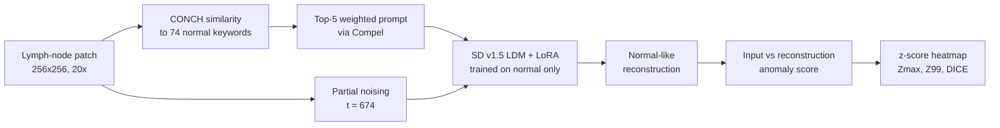
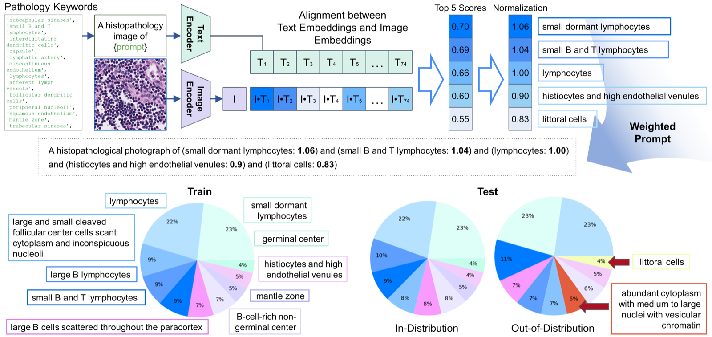
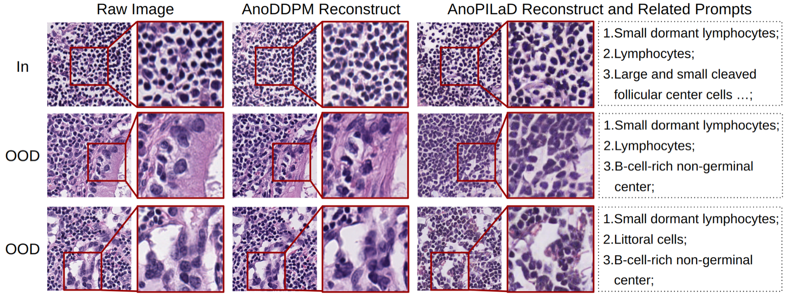
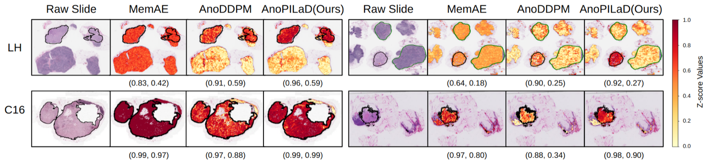

# Pathology-Informed Latent Diffusion Model for Anomaly Detection in Lymph Node Metastasis

> **文献键** `Wang2025_AnoPILaD` · **来源** MICCAI 2025(2025) · **类别** histopath · **相关度** medium · **获取** open
> **链接** <https://papers.miccai.org/miccai-2025/0675-Paper2270.html> · `status: complete`

---

## 一句话
AnoPILaD:只用正常淋巴结图块微调一个文本条件的潜空间扩散模型(Stable Diffusion v1.5 + LoRA),推理时用病理视觉-语言模型 CONCH 从 74 个"正常组织关键词"里挑出最贴切的 5 个作为提示,把输入"重建成正常样子",输入与重建的差异就是异常分(论文未说明用哪种距离;公开代码计算潜空间 MSE 和像素级 LPIPS 两种分数);在胃淋巴结上 patch-AUC 0.9587,跨器官到乳腺淋巴结(Camelyon16)仍有 0.8884。

## 要点
- 属于"重建式"异常检测:正常样本重建得好、转移灶重建得差;创新在于用**描述正常组织的文字**引导重建方向(§2.1–2.2)。
- 在本地胃淋巴结数据(LH)上 patch-AUC 0.9587,比 LH 上最好的基线 MemAE(0.9290)略高;在乳腺淋巴结(C16)上为 0.8884,作者称与 AE 类方法的差距拉大到约 0.22 AUC(AE 0.6584、MemAE 0.6611),与 C16 上最好的基线 complexity(0.7752)相差约 0.11(Table 2, §4)。
- 切片级分类在跨器官时仍大幅下降:LH 最高 AUC 0.9943,C16 只有 0.6745(Table 3)。
- 作者强调要评估**分割(定位)**而不仅是分类:AE / MemAE 分类不差,但热图几乎对全片打同样的分(Table 3, Fig. 3)。
- 我们的理解:论文没有"去掉文本提示"或"关键词数量"的消融,所以无法区分收益来自文本引导、LDM 本身还是 SD 预训练。

## 研究问题
淋巴结转移是重要的预后因素。有监督的转移检测需要大量专家标注,代价高(Introduction)。无监督异常检测只用正常(in-distribution)样本训练,把偏离正常的样本视作 OOD。基于 DDPM 的重建方法已被用于乳腺淋巴结转移检测(文中称 AnoDDPM,ref [17] Linmans et al. 2024),但会产生大量假阳性,说明正常与 OOD 分得不够开(§2.1, Fig. 1)。本文想通过加入病理先验来拉大正常与转移之间的重建差异,并检验跨器官的鲁棒性。

## 方法
1. **输入**:WSI 在 20× 下切成 256×256 像素图块(§3.1)。
2. **关键词池**:从文献中收集 74 个描述正常淋巴结细胞和微环境的病理关键词,由一位资深病理医生审核(§2.2)。
3. **加权提示**:用 CONCH(在 117 万对病理图像-说明文字上预训练的视觉-语言模型)分别编码图块和每个关键词,算余弦相似度,取前 5 个关键词;各自的相似度除以中位数作为权重,按 Compel 库的做法生成加权文本嵌入 c(§2.2, Fig. 2)。
4. **训练**:Stable Diffusion v1.5 潜空间扩散模型,只在正常训练图块上用 LoRA(秩 4)微调,Adam,学习率 1e-5,batch 64;目标是条件去噪损失 L = E‖ε − ε_θ(z_t, t, c)‖²;以 FID 最低的 400k 步 checkpoint 用于测试(§2.1 式 4, §3.2)。
5. **重建与打分**:沿用 AnoDDPM 流程:把输入加噪到时间步 t = 674(8 个候选中按 LH 测试集上的 WSI 分类效果选出),再在文本条件下反向去噪得到重建 ẑ₀;输入与重建的差异 = 异常分(论文未说明距离;代码输出 `mse_latent` 和 `lpips_pixel`)。推理用 PLMS 采样器、100 步(§2.1, §3.2)。
6. **评估**:对每个测试集内所有图块的异常分做 z-score;patch 级算 AUC / AUPR;WSI 级先生成 z-score 热图并做 2×2 形态学腐蚀,分类用最大 z(Zmax)或论文所说的 "average of 99th percentile z-scores"(Z99),分割在转移切片上算 DICE / IoU、在正常切片上算真阴性率 TNR,阈值为 0(§3.2)。
7. **基线**:基于密度的 VAE 负似然(NLL)及其变体 Regret、LLR、complexity;基于重建的 f-AnoGAN、AE、MemAE、AnoDDPM(§3.2)。

## 方法图


## 数据
**LH(两家本地医院的胃淋巴结;论文未给公开下载链接,MICCAI 页面数据集一栏为 N/A)**:808 张 WSI,751 张正常、57 张转移(部分标注)。正常切片分为训练 643 / 验证 50 / 正常测试 58;57 张转移切片作 OOD 测试。图块数:训练 1,373,475,验证 102,240,正常测试 174,703(其中 138,054 来自 58 张正常测试切片,36,649 来自转移切片中标注为正常的区域),OOD 测试 115,330(全部为转移标注区)。LH 中所有肿瘤区直径都 >2 mm(§3.1, Table 1)。**C16(Camelyon16 乳腺淋巴结,公开)**:只用于独立测试——32 张正常验证、80 张正常测试、49 张转移;其中 22 张含直径 >2 mm 的肿瘤簇,记为 C16 Macro;OOD 图块 55,659 个。异常比例(base prevalence):图块级 LH 0.3976、C16 0.1882;切片级 LH 0.4956、C16 0.3798、C16 Macro 0.2157(§3.1)。

## 主要结果
- **Patch 级(Table 2)**:AnoPILaD 在 LH 上 AUC 0.9587 / AUPR 0.9499,在 C16 上 0.8884 / 0.6987,均为最佳。LH 上 AE 0.9254、MemAE 0.9290、AnoDDPM 0.8555;C16 上 AE 0.6584、MemAE 0.6611、AnoDDPM 0.6857。
- **密度类方法较弱**:VAE 的 NLL 在 LH 上 AUC 0.4982(接近随机),最好的变体 complexity 为 0.7931;f-AnoGAN 最差(LH 0.2289)(Table 2, §4)。
- **WSI 分类(Table 3)**:AnoPILaD 在 LH 上 Zmax AUC 0.9837、Z99 AUC 0.9943;C16 上 0.6745 / 0.6367;C16 Macro 上 0.8062 / 0.8023,其他方法在 C16 Macro 上为 0.49–0.64。
- **分割(Table 3)**:AnoPILaD 在所有设置中 TNR / DICE / IoU 最高;C16 Macro DICE 0.5420(AnoDDPM 0.3131、AE 0.3249);LH 上 DICE 0.4322,与 AnoDDPM 0.4319 几乎相同。
- **定性**:对含转移的图块,AnoDDPM 会部分重建出转移结构,未能抑制多形性细胞核和纤维化;AnoPILaD 重建出更均匀的淋巴细胞排列(Fig. 1, §4)。

## 创新点
- 把病理视觉-语言模型(CONCH)与潜空间扩散重建结合,用描述正常组织的关键词作为重建条件(§1, §2)。
- 加权提示生成:74 个病理医生审核的关键词 → CONCH 相似度前 5 → 中位数归一化权重 → Compel 加权嵌入(§2.2)。
- 在胃 → 乳腺的跨器官设置下同时评估分类与分割,指出只看分类会高估 AE 类方法(§4)。

## 局限
- (作者)跨器官性能仍需提高,作为后续工作(Conclusion);C16 上 WSI 分类 AUC 只有 0.64–0.67(Table 3)。
- 我们的理解:扩散时间步 t = 674 是在 LH **测试集**上选的(§3.2),LH 上的结果因此略偏乐观。
- 我们的理解:没有消融(去掉提示、随机关键词、不同关键词数),也没有报告标准差或多次运行。
- 我们的理解:关键词池专门针对淋巴结,换器官需要重新整理词表;论文未提供 LH 数据下载;100 步扩散采样使推理成本远高于 AE。

## 与本研究方向的关系
位于 pipeline 第一环(detect),并带有"revert"的影子。我们的理解:(1) "把异常样本重建成正常样子,差异即异常"在图像域里做的正是"反事实的正常组织",和我们第三环"把异常 revert 回正常"在形式上相似,只是这里没有基因层面的解释;(2) 用先验知识(这里是文字关键词)给生成式正常模型加条件的做法,可以类比到组学——例如用细胞类型或区域标签作为条件,让模型只需要解释"在给定类型下是否正常";(3) 对课题 1 的肾脏基准,本文的评估设计值得照搬:除了切片 / 样本级分类,还要有区域级分割指标(DICE、正常切片上的 TNR),并做跨队列 / 跨器官测试。它也提醒我们:AE 类基线在分类上可能看起来不错,但定位很差。

## 可复用资产
- **代码(MIT)**:<https://github.com/QuIIL/AnoPILaD> —— `image_caption.py`(CONCH 选词生成 metadata.csv)、`train_text_to_image_lora.py`(LoRA 微调,改自 diffusers 示例)、`rec_generate.py`(重建)、`ldm_solvers.py`(改自 CFG++);环境 python 3.11,需单独安装 CONCH(README)。README 中没有预训练权重下载。
- **数据**:Camelyon16 公开,可复现跨器官测试;LH 论文未给下载链接(MICCAI 页面数据集为 N/A)。
- **评估协议**:测试集内 z-score → patch AUC / AUPR;WSI 级 Zmax / Z99 + 2×2 腐蚀;分割 DICE / IoU(转移切片)+ TNR(正常切片),阈值 0(§3.2)。

## 待读
- Linmans et al. 2024, "Diffusion models for out-of-distribution detection in digital pathology", *Medical Image Analysis* 93:103088 —— 本文 AnoDDPM 基线的来源(ref [17])。
- Wyatt et al. 2022, AnoDDPM(simplex noise,CVPR 2022 论文集,ref [15])—— 名称来源。
- CONCH(Lu et al., arXiv:2307.12914,ref [20])。
- MemAE(Gong et al., ICCV 2019,ref [10])—— LH 上最强的非扩散基线(C16 上最好的基线是 complexity)。

## 图表


**图2.**(上)加权文本提示生成流程:CONCH 的文本/图像编码器对 74 个正常关键词与输入图像算余弦相似度,取 top-5,除以中位数归一化为权重,经 Compel 组成加权提示(如 "small dormant lymphocytes: 1.06 … littoral cells: 0.83")送入 LDM;(下)LH 训练 / 测试集中 top-10 高频病理关键词分布。
_Source: https://papers.miccai.org/miccai-2025/paper/2270_paper.pdf (Fig. 2)  ·  License: MICCAI 2025 Open Access_


**图1.** 扩散重建对比。对 in-distribution(第一行)与 OOD(后两行)样本,AnoDDPM 与 AnoPILaD 均试图重建"正常样"结构;文本提示引导下,AnoPILaD 生成更均匀的淋巴细胞排列、抑制多形核与纤维化,右列为所选关键词提示。
_Source: https://github.com/QuIIL/AnoPILaD (main.png; MIT) = paper Fig. 1_


**图3.** 四张转移切片(LH 与 C16 各两例)的 z-score 异常热图。黑色轮廓为转移标注,绿色轮廓为正常标注;括号内为每片 (Z99, DICE)。
_Source: https://papers.miccai.org/miccai-2025/paper/2270_paper.pdf (Fig. 3)  ·  License: MICCAI 2025 Open Access_

### 结果表

**表2.** Patch 级异常检测,AUC / AUPR(LH = 胃淋巴结,C16 = Camelyon16 乳腺,跨器官域偏移)。加粗为最优。

| Method | LH AUC | LH AUPR | C16 AUC | C16 AUPR |
|---|---|---|---|---|
| NLL | 0.4982 | 0.5552 | 0.3250 | 0.1600 |
| Regret | 0.6720 | 0.6718 | 0.6480 | 0.3441 |
| LLR | 0.6078 | 0.6260 | 0.7065 | 0.4765 |
| complexity | 0.7931 | 0.7139 | 0.7752 | 0.5140 |
| f-AnoGAN | 0.2289 | 0.3377 | 0.1735 | 0.1104 |
| AE | 0.9254 | 0.8906 | 0.6584 | 0.4759 |
| MemAE | 0.9290 | 0.8886 | 0.6611 | 0.4880 |
| AnoDDPM | 0.8555 | 0.7841 | 0.6857 | 0.5741 |
| **AnoPILaD** | **0.9587** | **0.9499** | **0.8884** | **0.6987** |

**表3.** WSI 级分类,每格 AUC / AUPR;两种打分:Zmax(最大 z-score)与 Z99(论文原文:average of 99th percentile z-scores)。C16 Macro = 肿瘤簇 >2mm 子集。加粗为最优。

| Method | LH Zmax | LH Z99 | C16 Zmax | C16 Z99 | C16-Macro Zmax | C16-Macro Z99 |
|---|---|---|---|---|---|---|
| AE | 0.9622 / 0.9612 | 0.9395 / 0.9381 | 0.6612 / 0.5961 | 0.5798 / 0.5217 | 0.6398 / 0.3677 | 0.5523 / 0.2918 |
| MemAE | 0.9504 / 0.9440 | 0.9365 / 0.9382 | 0.6505 / 0.5689 | 0.5686 / 0.5313 | 0.6381 / 0.3657 | 0.5597 / 0.3141 |
| AnoDDPM | 0.7840 / 0.6616 | 0.9383 / 0.8995 | 0.4992 / 0.3885 | 0.4551 / 0.3905 | 0.4926 / 0.2146 | 0.5119 / 0.2347 |
| **AnoPILaD** | **0.9837 / 0.9740** | **0.9943 / 0.9948** | **0.6745 / 0.6140** | **0.6367 / 0.5902** | **0.8062 / 0.5965** | **0.8023 / 0.5886** |

_Tables 2-3 source: https://papers.miccai.org/miccai-2025/paper/2270_paper.pdf (Tables 2-3)  ·  MICCAI 2025 Open Access_

## 引用
```bibtex
@inproceedings{Wang2025_AnoPILaD,
  title = {Pathology-Informed Latent Diffusion Model for Anomaly Detection in Lymph Node Metastasis},
  author = {Wang, Jiamu and Byeon, Keunho and Song, Jinsol and Nguyen, Anh and Ahn, Sangjeong and Lee, Sung Hak and Kwak, Jin Tae},
  booktitle = {Medical Image Computing and Computer Assisted Intervention (MICCAI)},
  series = {Lecture Notes in Computer Science},
  pages = {453--462},
  year = {2025},
  doi = {10.1007/978-3-032-04937-7_43},
  note = {Code: https://github.com/QuIIL/AnoPILaD},
  url = {https://papers.miccai.org/miccai-2025/0675-Paper2270.html}
}
```


---

📄 **[AI-ready 全文提取 →](ai-ready.md)**
