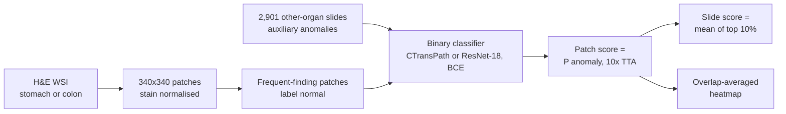
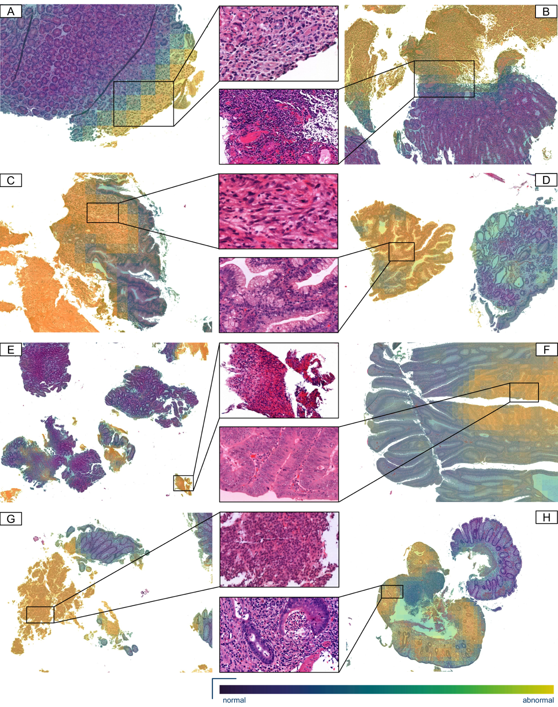
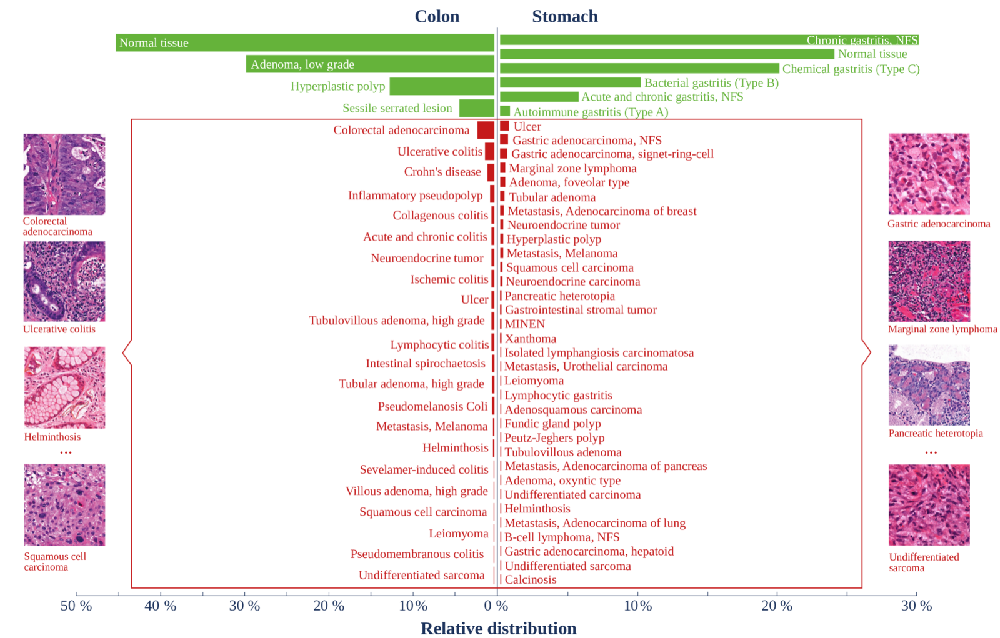

# AI-Based Anomaly Detection for Clinical-Grade Histopathological Diagnostics

> **Bibkey** `Dippel_2024` · **Venue** NEJM AI (2024) · **Category** histopath · **Relevance** high · **Access** paywall
> **Link** <https://doi.org/10.1056/aioa2400468> · `status: complete`

---

## One-liner
A deep anomaly-detection model trained only on "frequent findings" (normal tissue plus common diseases) of stomach and colon biopsies — best variant: Outlier Exposure — detects the long tail of 56 rarer entities it never saw, with slide-AUROC 95.0% (stomach) and 91.0% (colon), and transfers to a second hospital and scanner without retraining.

## Takeaways
- "Normal" here means **frequent findings** (including common diseases such as chronic gastritis), and "anomaly" means the rare long tail; the top-10 diagnoses cover ~90% (stomach) / 91% (colon) of cases (Fig. 1).
- The best method is Outlier Exposure: slides from other organs serve as "auxiliary anomalies" for a binary classifier; the anomaly score is the predicted anomaly-class probability (Methods §2.3).
- The choice of OE data matters more than architecture or loss: ImageNet as OE barely works (colon slide-AUROC 52.17%), while same-hospital multi-organ slides work best (91.49%) (App. Table 11).
- At a 100%-sensitivity threshold, 36.2% of stomach cases could be called "not abnormal"; for colon only 4.21% (§3.1).
- Failures are very subtle changes (pseudomelanosis coli, intestinal spirochaetosis; slide-AUROC ~20–24%); the authors point to multi-scale context or semi-supervised methods (App. Table 6, Discussion).

## Problem
Most pathology AI is supervised and only recognises common diagnoses with enough training examples. Real diagnoses follow a long tail: a few common findings make up ~90% of GI biopsies, and the remaining ~10% are spread over 56 rarer entities including many cancers (Abstract, Fig. 1). Supervised models miss or misclassify these, so every slide still needs pathologist confirmation (Introduction). The question: can we learn only what frequent findings look like and flag any deviation as an anomaly?

## Method
1. **Pre-processing**: tissue is detected on each H&E whole-slide image (WSI) and tiled into 340×340-pixel patches at 20× (~0.5 µm/pixel); patches with >80% background are dropped; Reinhard stain normalisation is applied (App. B.4).
2. **Training data**: separate models for stomach and colon; "normal" = frequent-finding patches of that organ. Low-grade adenomas are removed from training so that high-grade lesions stay detectable (§2.2, App. C.7). Anomalies are **never** used in training.
3. **Paradigm A — self-supervised features + kNN**: CTransPath (a Swin Transformer pretrained on 32,220 H&E slides from TCGA and PAIP) embeds patches and a modified kNN distance scores them; a variant fine-tunes CTransPath with a PANDA-style one-class (OCC) loss (§2.3, App. B.2).
4. **Paradigm B — Outlier Exposure (best)**: auxiliary anomalies = 2,901 slides of other organs (prostate 599, kidney 459, liver 402, lung 401, small intestine 283, breast 204, other 553) plus normal patches of the other GI organ. A binary cross-entropy classifier separates normal from auxiliary patches with class-balanced batches; OE patches are 50% "near" tissue (stomach, colon, small intestine) and 50% "far" tissue; OE patches with cosine similarity >0.9 to normal patches are removed to drop shared tissue such as connective tissue and muscle (§2.3, App. B.2, Table 2c). The main results use CTransPath fine-tuned on the OE task; a ResNet-18 trained from scratch performs about the same (App. D.4, Table 15).
5. **Scoring and aggregation**: patch score = anomaly-class probability, averaged over 10 test-time-augmented views; slide score = mean of the top-10% patch scores (§2.2, App. B.3).
6. **Heatmaps**: patches are extracted with 75-pixel overlap and overlapping scores are averaged into a smooth heatmap (App. B.3).
7. **Evaluation**: 5-fold cross-validation; slide-AUROC (from diagnosis labels) and patch-AUROC (from pathologist region annotations); the external LMU cohort gets slide-AUROC only, without retraining (§2.2, App. B.5).

## Method diagram


## Data
5,423 slides and ~17 million image patches from two hospitals (§3; the abstract says 5,423 cases). **Charité (Berlin) primary cohort**: routine 2020/2021 slides, 1,973 frequent-finding slides (stomach 961, colon 1,012) and 200 anomalous slides (126 from 2020/2021, 74 from 2000–2021 archives), 65 diagnoses, 3DHistech P1000 scanner; all anomalous slides have region annotations (diagnosis-defining regions, other anomalous regions such as tumour-adjacent inflammation, artifacts) (§2.1). Plus 2,901 other-organ slides as OE auxiliary data (App. Table 2c). **LMU (Munich) external cohort**: 192 gastric and 157 colon slides (frequent: 63 colon / 164 stomach; anomalous: 94 colon / 28 stomach), 2020–2023, Leica Aperio GT 450 scanner, >500k patches, no pixel annotations (§3.3, App. B.5). The data are not public.

## Key results
- **Charité main result (OE)**: slide-AUROC 95.04 ± 0.54% (stomach) and 91.01 ± 0.69% (colon); patch-AUROC 91.37 ± 0.34% and 90.47 ± 0.33%. Best self-supervised slide-AUROC: 94.95% stomach, 89.76% colon (kNN) (Table 1).
- **Malignancies are detected best**: OE slide-AUROC for the malignant group 97.72% (stomach), 96.97% (colon); colon inflammation 94.42% (Table 1, §3.1).
- **The colon "Other" group fails**: slide-AUROC 40.41%; per diagnosis, pseudomelanosis coli 20.28%, intestinal spirochaetosis 23.56%, lymphocytic colitis 79.39%; in stomach, oxyntic-type adenoma 64.42%, lymphocytic gastritis 72.93% (Table 1, App. Tables 5–6).
- **Cases that could skip review**: at 100% (99%, 95%) anomaly sensitivity, 36.2% (51.91%, 72.93%) of stomach and 4.21% (4.99%, 38.2%) of colon cases are called not abnormal; excluding pseudomelanosis and spirochaetosis, colon rises to 22.29% (49.46%, 85.22%) (§3.1).
- **External validation (LMU, no retraining)**: OE slide-AUROC 94.5 ± 0.93% (stomach), 85.88 ± 0.94% (colon); malignant group 94.77% / 95.02% (§3.3, App. Table 4).
- **Artifacts are not the main driver**: artifact regions get patch-AUROC 80.89% (colon) / 75.64% (stomach), below the 90.47% / 91.37% of true anomaly regions (App. C.3).
- **Baselines and ablations**: a plain autoencoder reaches only 65.58% (colon) / 63.73% (stomach) slide-AUROC (App. Table 10); with ImageNet as OE data colon slide-AUROC is 52.17%, with TCGA 82.73%, with the full OE set 91.49% (App. Table 11); performance saturates around 100 frequent-finding slides (App. D.1, Fig. 12); BCE, HSC and DeepSAD losses perform similarly (App. Table 16).

## Contributions
- Recasts long-tail diagnosis as anomaly detection trained on frequent findings only, evaluated on routine data with 65 diagnoses rather than a single anomaly type such as lymph-node metastasis (Discussion, App. A.3).
- The authors state this is the first use of Outlier Exposure in histopathology, with a systematic ablation of OE data choice (similarity vs diversity trade-off) (App. A.1, D.2).
- External validation across hospital and scanner, showing colour and test-time augmentations matter mainly on the external cohort (App. D.3, Tables 13–14).
- A clinical use pattern: slide anomaly score plus heatmap for triage and auto-clearing (Fig. 2).

## Limitations
- (Authors) very subtle colon changes are missed (pseudomelanosis coli, collagenous/lymphocytic colitis, spirochaetosis), some of which need special stains even for pathologists (Discussion).
- (Authors) single 340-pixel patches miss architectural changes such as colon mucosal architecture; multi-scale methods are needed (Discussion, App. C.7).
- (Authors) low-grade adenomas were deliberately removed from training, showing that the "normal" boundary is set by hand (§2.2, App. C.7).
- Our reading: colon external AUROC (85.88%) and colon auto-clear rate (4.21%) are much weaker than stomach; the LMU cohort also excluded slides with lab-specific tearing artifacts (App. B.5), so real deployment may be harder.
- Our reading: it outputs only "anomalous or not, and where", not a diagnosis or a biological explanation; the preprint gives no public data or code link.

## Relation to our direction
The closest to "clinical-grade" reference for stage 1 (detect) on H&E. Our reading: three direct lessons for Topic 1 (kidney single-cell / spatial anomaly benchmark). (1) **Defining normal**: here normal means "frequent findings", not "healthy"; a kidney benchmark must likewise fix its reference set (healthy donors? common CKD states?) and document the boundary, as this paper did by excluding low-grade adenomas. (2) **Transferring OE**: the paper's OE set already contains 459 kidney slides; conversely, kidney H&E or omics OE could use other organs / other datasets as auxiliary anomalies, sampled half near and half far, with too-similar samples removed. (3) **Evaluation design**: slide- and patch-level AUROC, per-diagnosis AUROC, "fraction cleared at 100% sensitivity" and an external cohort without retraining all carry over to biopsy- and region-level kidney evaluation. It does not address stages 2–3 (virtual tissue, revert), but its heatmaps can supply ROIs for them.

## Reusable assets
- **Method recipe**: OE binary classifier (BCE, class-balanced batches, half near / half far tissue, cosine >0.9 de-duplication), top-10% patch mean, 10-view TTA, 75-pixel-overlap heatmaps (App. B.2–B.3).
- **Evaluation protocol**: slide- and patch-AUROC, per-group and per-diagnosis AUROC, clearance rate at fixed sensitivity, external cohort without retraining (Tables 1, 4–6).
- **CTransPath** (third-party pathology foundation model; used here as feature extractor and OE backbone).
- Preprint: <https://arxiv.org/abs/2406.14866>. The preprint gives **no** code or data link (Charité / LMU clinical data).

## Follow-ups
- Check the NEJM AI version of record for changed numbers and any code / data availability statement.
- Hendrycks et al. 2019 (Outlier Exposure) and Liznerski et al. 2022 (Exposing Outlier Exposure, TMLR), the direct OE sources (refs 25–26).
- Zingman et al. 2024, Medical Image Analysis 92:103067 (this library's `histo-anomaly-bi-repo`), contrasted in App. A.3: also uses multi-organ data but with a one-class classifier.
- Ruff et al. 2021, "A unifying review of deep and shallow anomaly detection" (ref 21).

## Figures & tables

> _All figures/tables below come from the OPEN preprint arXiv:2406.14866 — nothing is taken from the paywalled NEJM AI page._


**Fig 1.** Method + clinical-workflow overview: training uses Outlier Exposure to separate frequent GI tissue from auxiliary tissue of other organs; at inference each patch gets an anomaly score, aggregated to a slide-level score and rendered as an anomaly heatmap; clinically this flags suspicious cases and may enable automated workflows in future.
_Source: https://arxiv.org/html/2406.14866 (Fig 2)  ·  License: arXiv preprint (arXiv:2406.14866)_


**Fig 2.** Anomaly-heatmap examples on stomach and colon tissue (adenocarcinoma, marginal-zone lymphoma, undifferentiated sarcoma, foveolar adenoma, ulcer, high-grade dysplasia, neuroendocrine tumour, inflammation): lesions are highlighted, and artifacts such as tissue folds barely affect the heatmap.
_Source: https://arxiv.org/html/2406.14866 (Fig 4)  ·  License: arXiv preprint (arXiv:2406.14866)_


**Fig 3.** Slide anomaly scores by diagnosis for the OE model on one Charité validation split: frequent findings separate clearly from most anomalous diagnoses.
_Source: https://arxiv.org/html/2406.14866 (Fig 3)  ·  License: arXiv preprint (arXiv:2406.14866)_


**Fig 4.** Long-tail distribution of GI-biopsy diagnoses: frequent findings (green) are 90% (stomach) / 91% (colon) of cases; the rest is a long tail of rarer diagnoses (red) — the problem setting the paper targets.
_Source: https://arxiv.org/html/2406.14866 (Fig 1)  ·  License: arXiv preprint (arXiv:2406.14866)_

### Results

**Table 1.** Slide-AUROC / patch-AUROC (%, 5-fold mean±SD) of three anomaly-detection approaches on the primary Charité cohort; Outlier Exposure is the best method.

| Method | Tissue | Slide-AUROC | Patch-AUROC |
|---|---|---|---|
| Self-supervision + kNN | Stomach | 94.95 ± 1.16 | 87.21 ± 0.36 |
| Self-supervision + kNN | Colon | 89.76 ± 0.77 | 85.09 ± 0.63 |
| Self-supervision + OCC | Stomach | 93.76 ± 1.39 | 89.73 ± 0.47 |
| Self-supervision + OCC | Colon | 88.51 ± 0.69 | 87.03 ± 0.49 |
| **Outlier Exposure** | **Stomach** | **95.04 ± 0.54** | **91.37 ± 0.34** |
| **Outlier Exposure** | **Colon** | **91.01 ± 0.69** | **90.47 ± 0.33** |
| Outlier Exposure (neoplastic malignant) | Stomach | 97.72 ± 0.44 | 95.02 ± 0.28 |
| Outlier Exposure (neoplastic malignant) | Colon | 96.97 ± 0.61 | 96.23 ± 0.27 |

**Table 2.** External validation on the LMU Munich cohort (different scanner, no retraining), slide-AUROC (%, mean±SD over the five cross-validation models).

| Method | Tissue | Slide-AUROC |
|---|---|---|
| Self-supervision + kNN | Stomach | 88.6 ± 0.1 |
| Self-supervision + kNN | Colon | 84.44 ± 0.61 |
| Self-supervision + OCC | Stomach | 89.92 ± 0.85 |
| Self-supervision + OCC | Colon | 87.43 ± 0.61 |
| **Outlier Exposure** | **Stomach** | **94.5 ± 0.93** |
| **Outlier Exposure** | **Colon** | **85.88 ± 0.94** |
| Outlier Exposure (malignancy) | Stomach | 94.77 ± 0.88 |
| Outlier Exposure (malignancy) | Colon | 95.02 ± 0.37 |

_Source: https://arxiv.org/html/2406.14866 (Tables 1 & 4)  ·  License: arXiv preprint (arXiv:2406.14866)_

## Cite
```bibtex
@article{Dippel_2024, title={AI-Based Anomaly Detection for Clinical-Grade Histopathological Diagnostics}, volume={1}, ISSN={2836-9386}, url={http://dx.doi.org/10.1056/AIoa2400468}, DOI={10.1056/aioa2400468}, number={11}, journal={NEJM AI}, publisher={Massachusetts Medical Society}, author={Dippel, Jonas and Prenißl, Niklas and Hense, Julius and Liznerski, Philipp and Winterhoff, Tobias and Schallenberg, Simon and Kloft, Marius and Buchstab, Oliver and Horst, David and Alber, Maximilian and Ruff, Lukas and Müller, Klaus-Robert and Klauschen, Frederick}, year={2024}, month=Oct }
```


---

📄 **[AI-ready full-text extract →](ai-ready.md)**
