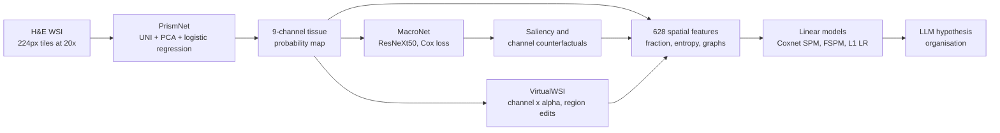

# Spatial biomarker discovery via interpretable semantic learning in histopathology

> **Bibkey** `Liang_2026` · **Venue** Cancer Cell (2026) · **Category** histopath · **Relevance** high · **Access** open
> **Link** <https://www.sciencedirect.com/science/article/pii/S153561082600259X> · `status: complete`

---

> **Note:** This paper is published **open access under CC BY 4.0** (Cancer Cell 44(8):1605–1622.e7; in-press date 2026-08-10; DOI 10.1016/j.ccell.2026.05.014); the full text was obtained via the open PDF (White Rose eprint 242066).

## One-liner
PathPrism segments colorectal-cancer H&E whole-slide images (WSIs) into 8-class tissue maps, turns each map into 628 mathematically defined spatial features (tissue fractions, spatial entropy, tissue-graph features), and fits linear models for prognosis, mutations and chemotherapy benefit; VirtualWSI then perturbs the tissue map ("grow / shrink one tissue class") and tracks how risk and features move.

## Takeaways
- The representation is the point: instead of black-box embeddings, "semantic map → 628 nameable spatial features"; linear Cox models (SPM, and FSPM with only 10 features) both exceed C-index 0.7 in DACHS 5-fold CV, on par with MacroNet and pathology foundation models (Fig. 4G).
- Macro tissue architecture carries molecular signal: an L1 logistic regression on spatial features predicts MSI with median AUC 0.85 (DACHS) and 0.78 (7 external cohorts); on TCGA, BMPR2/BRAF/TP53 AUCs are 0.78/0.75/0.66 (Fig. 5B–E).
- The headline clinical finding: in stage III CRC, patients with LYM–MUC–CC (fragmentation of lymphocyte connectivity around mucin) > 5 did worse with adjuvant chemotherapy (HR 9.08), those ≤ 5 benefited (HR 0.29), interaction HR 32.45 (Fig. 5J); the authors call this hypothesis-generating.
- VirtualWSI's perturbation is simple: multiply one tissue-class probability channel by α and re-take the argmax, so uncertain boundary pixels flip first; no retraining. The authors stress this is model interrogation, not biological causality (Methods, Limitations).
- The LLM (GPT-4o) only organizes discovered biomarkers into mechanistic hypotheses, with a second GPT-4o as reviewer; 5 experts rated them, which is not experimental validation (Fig. 6, Figs. S7–S9).

## Problem
Spatial biomarkers (multiscale arrangement patterns in the tumour microenvironment) matter for precision oncology, but WSIs are huge and heterogeneous, manual discovery is slow, and few spatial biomarkers are clinically validated (Introduction). Deep-learning and foundation models are accurate but black boxes; post-hoc pixel/latent explanations (heatmaps) are diffuse and hard to define, quantify and validate as pathologically interpretable biomarkers. This also blocks LLM-assisted hypothesis generation and the move from prediction to active perturbation (Introduction). The authors want an interpretable framework that does **not** sacrifice performance.

## Method
1. **PrismNet (tissue segmentation)**: WSIs are tiled at 20× (0.5 µm/pixel) into 224×224 tiles; a frozen UNI encoder gives 1024-d features → PCA to 32-d → logistic regression into 8 CRC tissue classes (ADI adipose, DEB debris, LYM lymphocytes, MUC mucus, MUS smooth muscle, NORM normal mucosa, STR cancer stroma, TUM adenocarcinoma epithelium) plus BACK. Trained on NCT-CRC-HE-100K-NONORM, tested on CRC-VAL-HE-7K; the authors compared CTransPath / PLIP / CONCH / MUSK / UNI with PCA / VAE; UNI+PCA was best overall, but CONCH, MUSK and UNI performed very similarly, so encoder choice had limited impact (Methods "PrismNet"; Figs. S1B–C). PrismNet vs KNN, SVM, MLP, LR, ViT-B/16, ResNet and VGG19 classifiers is in Fig. 2A. Tile probabilities are placed back at their coordinates to form a 9-channel probability map and segmentation map (via STAMP).
2. **MacroNet (prognosis from maps)**: a ResNeXt50 with 9 input channels → 2048-d → FC to 32-d → risk score, trained with the negative Cox partial log-likelihood for 100 epochs (Methods "MacroNet"). Baselines: attMIL-UNI, GigaPath, CHIEF, COBRA, PRISM (slide embeddings + elastic-net Cox).
3. **Interpreting MacroNet**: tissue fractions and Captum saliency by risk group; a structure-preserving counterfactual scales one tissue channel by α (<1 suppress, >1 enhance) and re-scores (Fig. 3D–G).
4. **628 spatial features**: fractions, sliding-window entropy, single-tissue graphs (eroded masks → connected components; regions > 2,000 px split into 30×30 blocks; edges for node distance < 20 px; degree, clustering, centrality, modularity…) and pairwise multi-tissue graphs (only cross-class edges; isolated-node ratio, mean cross-class neighbours…) (Methods; Tables S2–S3).
5. **Transparent models**: elastic-net Cox (l1_ratio 0.5) on all 628 features = SPM; top-10 |coef| features refit = FSPM; L1 logistic regression (C = 0.1) per mutation; Cox interaction models (ACT × biomarker, Wald test) for chemotherapy benefit.
6. **LLM hypotheses**: GPT-4o proposes mechanisms and follow-up experiments from biomarker definitions, morphology and clinical context; a second GPT-4o audits; no fine-tuning or retrieval; 5 experts rate the outputs.
7. **VirtualWSI**: (a) global channel perturbation (probability × α, re-argmax, recompute features and FSPM risk); (b) interactive region edits in a GUI (e.g. LYM→MUS). A UMAP of the spatial features forms a "spatial biomarker atlas" in which perturbation trajectories are plotted (Fig. 7).

## Method diagram


## Data
11 CRC cohorts, ~7,000 patients (Abstract; post-QC counts in Fig. 1G / Methods "Patient cohorts"). Prognosis: DACHS (n = 2,281; primary, 5-fold CV), MCO (1,395), CR07 (579; rectal only, frequent pre-op radiotherapy, low MSI), TCGA (232). Mutations: DACHS, MCO, TCGA plus five GECCO cohorts (EPIC 124, CORSA 50, IWHS 267, CRA 208, WHI 225). Adjuvant chemotherapy (ACT): MCO, IDEA (669; stage III, French GERCOR sub-cohort), HeCOG (970). Segmentation used public patches (NCT-CRC-HE-100K-NONORM, 100k patches from 86 slides; CRC-VAL-HE-7K, 7,180 patches from 50 patients) with no overlap with downstream cohorts. Breast transfer: TCGA-BRCA (642) and HeCOG-BRCA (38, ADC-treated); BRCA segmentation set TCGA-BRCA-6K (4,700 train patches / 100 WSIs, 1,149 test / 20 WSIs). Slides with < 1.25 cm² tissue (< 10,000 tissue patches) were excluded.

## Key results
- **Segmentation**: PrismNet on CRC-VAL-HE-7K reaches macro-F1 0.948 (95% CI 0.942–0.954), MCC 0.958, macro-AUROC 0.988 (Fig. 2A).
- **MacroNet prognosis** (endpoint: disease-specific survival, DSS): DACHS 5-fold C-index 0.716 ± 0.020, comparable to the five foundation-model baselines (Fig. 2B); top-two in MCO and CR07 (Fig. 2C); KM with DACHS thresholds gives HR 3.68 (MCO), 2.48 (CR07), 3.27 (TCGA) (Fig. 2D).
- **Interpretation**: high-risk slides have more TUM, DEB, STR; low-risk more ADI, LYM, MUS, NORM; amplifying LYM consistently lowers risk (Fig. 3B, 3F–G); high-risk slides have significantly higher spatial entropy (Fig. 3I).
- **Single biomarkers**: TUM graph entropy C-index 0.62, HR 1.97; MUS fraction C-index 0.60, HR 0.57 (Fig. 4D); ADI-TUM-E reaches 0.69 in CR07, STR-TUM-EN1 and MUS-TUM-EN2 0.73 each in TCGA (Fig. 4E).
- **Transparent prognosis**: SPM and FSPM both exceed C-index 0.7 (DACHS 5-fold; Fig. 4G) and generalize to MCO/CR07/TCGA (Fig. 4H); both beat fraction-only models (Figs. S4B–C); adding the 10 FSPM features to foundation-model embeddings improves performance, with spatial features ~25% of total coefficient weight (Fig. 4K).
- **Mutations**: MSI median AUC 0.85 (DACHS 5-fold) and 0.78 (7 external cohorts), key features MUC-TUM-IR2 and DEB-ENT (Fig. 5B–D); trained on GECCO cohorts, tested on TCGA: BMPR2 0.78, BRAF 0.75, TP53 0.66 (Fig. 5E).
- **Chemotherapy**: stage II ACT patients — LYM-TUM-AD2 HR 5.19 in MCO (p = 0.0005), HR 2.00 in HeCOG (p = 0.007) (Fig. S6B); MCO stage II, LYM-NORM-ED ≤ 0.038 shows no adverse ACT association (HR 0.79) vs HR 4.49 when > 0.038 (Fig. 5I); stage III LYM–MUC–CC > 5 HR 9.08 (p = 0.008), ≤ 5 HR 0.29 (p < 0.0001), interaction HR 32.45 (p = 0.001) (Fig. 5J).
- **VirtualWSI**: perturbing MUC/LYM channels moves LYM–MUC–CC continuously, with positive / flat / negative response archetypes; among patients without LYM–MUC structure, perturbation-induced state transitions identify a subgroup with significant ACT benefit (HR 0.27, p = 0.010) (Fig. 7G–M; the figure legend puts this KM result in panel M, while the body text cites Fig. 7L).
- **Breast transfer**: MacroNet/SPM/FSPM comparable to foundation models (Figs. S11D–F); in HeCOG-BRCA (n = 38), STR-ACL HR 6.11 (p = 0.018) under T-DXd and ADI-NEC-BT2 HR 0.06 (p = 0.002) under SG; correlations with ERBB2/TOP1/TACSTD2 are significant but modest (Figs. S11J–O).

## Contributions
- A full "semantic segmentation → quantified spatial-feature spectrum → transparent linear model" pipeline whose predictions trace back to named spatial biomarkers while matching foundation models.
- Closed-loop discovery: train and interpret MacroNet, turn the explanations into quantified candidate biomarkers, validate across cohorts (Fig. 4A).
- VirtualWSI: structure-preserving semantic perturbation on probability maps plus a spatial-biomarker UMAP atlas, with no retraining.
- Authors' conclusion: macro-scale organization captured by interpretable spatial biomarkers "encodes genetic information traditionally assumed to require cellular-level analysis" (MSI/BRAF/TP53/BMPR2; Results p.7); DEB entropy and MUC-TUM interactions are top contributors across several mutation tasks, with MSI features ranked by mean absolute SHAP value (Fig. 5D, 5F–H).
- Covers prognosis, MSI/BRAF/TP53/BMPR2 and stage II/III adjuvant-chemotherapy stratification on ~7,000 patients in 11 cohorts, plus transfer to breast cancer.

## Limitations
- (Authors) Depends on predefined tissue classes and only captures patterns they can express; a new tumour type needs new annotations, PrismNet training and validation (as for BRCA).
- (Authors) VirtualWSI is exploratory model interrogation, not evidence of biological causality or physically realizable tissue states.
- (Authors) Prognostic performance is moderate, so downstream interpretations (incl. ACT) are hypothesis-generating; the LLM only organizes hypotheses.
- Our reading: several chemotherapy and ADC findings rest on small subgroups (HeCOG-BRCA has 38 patients); extreme effect sizes such as HR 9.08 or interaction HR 32.45 are unstable in small samples and need prospective validation.
- Our reading: tiles are 224 px (~112 µm) and graphs use a 20-pixel edge threshold, so features describe tissue-patch-scale arrangement, not single cells.

## Relation to our direction
Our reading: this is an interpretable prototype of detect → model → revert on H&E; compare stage by stage:
- **Detect**: PathPrism outputs nameable, quantified spatial features (e.g. TUM graph entropy, STR–TUM interaction) rather than heatmaps. Our reading: treating the 628-feature spectrum as an interpretable feature space lets us run unsupervised anomaly detection on it (e.g. distance to a healthy reference distribution), which pathologists can check more easily than scores on black-box embeddings.
- **Model**: VirtualWSI makes controlled edits on semantic probability maps and tracks samples in the spatial-biomarker atlas — our reading: this can be seen as the simplest form of a manipulable virtual tissue. The authors state it is not causal and not guaranteed physically realizable.
- **Revert**: "reverting" stays at tissue level (e.g. amplifying LYM lowers risk) with no gene or drug-target mapping; the BRCA part only shows modest correlations with ERBB2/TOP1/TACSTD2 expression. Our reading: linking to genes needs spatial transcriptomics or single-cell data paired with the H&E.
- **Kidney the artifact-injection topic**: Our reading: PrismNet's "frozen foundation model + PCA + logistic regression" segmentation is cheap enough to build a kidney tissue ontology (glomeruli, tubules, interstitium, vessels, …) and reuse the single-/multi-tissue graph features to describe structural anomalies; kidney needs its own classes and annotations rather than the CRC 8.

## Reusable assets
- **Code**: PathPrism codebase and instructions (paper's Data and code availability). Note the README overview image `assets/figure1_new2.png` is a 1-byte git-lfs placeholder.
<https://github.com/KatherLab/PathPrism>
- **Related pipeline**: STAMP (WSI feature extraction, used to run PrismNet segmentation).
<https://github.com/KatherLab/STAMP>
- **Public data**: NCT-CRC-HE-100K / CRC-VAL-HE-7K (Zenodo 1214456); TCGA/CPTAC WSIs and molecular data (GDC, cBioPortal). DACHS, MCO, CR07, IDEA, HeCOG, GECCO are restricted (apply to each institution / consortium).
<https://zenodo.org/records/1214456> · <https://portal.gdc.cancer.gov/> · <https://www.cbioportal.org/>
- **Reusable components**: the UNI+PCA+LR segmentation recipe; single-/multi-tissue graph-feature definitions (Tables S2/S3); the Cox interaction framework; the probability-channel × α perturbation operator.

## Follow-ups
- Read Tables S2/S3 for exact definitions of the 628 features and judge which transfer to kidney tissue graphs.
- Run the PathPrism code on CRC100K segmentation and TCGA prognosis as an interpretable H&E baseline.
- Related work from the same group: MoPaDi (diffusion counterfactuals, Cancer Research 2026; `counterfactual-diffusion-cancerres-2026` in this library) — compare pixel-level counterfactuals with VirtualWSI's semantic-map perturbation.

## Figures & tables

**Note:** The GitHub README overview image (`assets/figure1_new2.png`) is a 1-byte git-lfs placeholder and is not downloadable; this section therefore **links** to the figures in the CC BY 4.0 open-access full text and reproduces the key result tables from numbers already in the paper.

**Fig 1 (overview, open access).** PathPrism three-stage "prism" pipeline (PrismNet semantic segmentation → MacroNet macro-architecture-to-survival → 628-dim spatial-biomarker spectrum + VirtualWSI): see the open-access full text, DOI <https://doi.org/10.1016/j.ccell.2026.05.014> (Cancer Cell 44, 2026, CC BY 4.0); repo overview at <https://github.com/KatherLab/PathPrism>.

_Source: https://doi.org/10.1016/j.ccell.2026.05.014 · https://github.com/KatherLab/PathPrism · License: CC BY 4.0_

### Results

**Table 1.** Headline performance (numbers taken from the Key-results section above; segmentation on CRC-VAL-HE-7K, prognosis/mutation on DACHS 5-fold).

| Task | Model | Cohort | Metric | Value |
|---|---|---|---|---|
| Tissue segmentation | PrismNet | CRC-VAL-HE-7K | macro-F1 | 0.948 |
| Tissue segmentation | PrismNet | CRC-VAL-HE-7K | MCC | 0.958 |
| Tissue segmentation | PrismNet | CRC-VAL-HE-7K | macro-AUROC | 0.988 |
| Prognosis (DSS) | MacroNet | DACHS (5-fold) | C-index | 0.716 ± 0.020 |
| MSI prediction | PathPrism | DACHS (5-fold) | median AUC | 0.85 |
| MSI prediction | PathPrism | 7 external cohorts | median AUC | 0.78 |

**Table 2.** Kaplan–Meier hazard ratios (HR) for MacroNet risk stratification.

| Cohort | HR |
|---|---|
| MCO | 3.68 |
| CR07 | 2.48 |
| TCGA | 3.27 |

## Cite
```bibtex
@article{Liang_2026, title={Spatial biomarker discovery via interpretable semantic learning in histopathology}, ISSN={1535-6108}, url={http://dx.doi.org/10.1016/j.ccell.2026.05.014}, DOI={10.1016/j.ccell.2026.05.014}, journal={Cancer Cell}, volume={44}, number={8}, pages={1605--1622.e7}, publisher={Elsevier BV}, author={Liang, Junhao and Jiang, Xiaofeng and Reitsam, Nic Gabriel and Lenz, Tim and Zhang, Li and Gustav, Marco and Carrero, Zunamys Itzell and Muti, Hannah Sophie and Neidlinger, Peter and Clusmann, Jan and Žigutytė, Laura and Sainath, Vidhya and Wolf, Fabian and Boardman, Lisa A. and French, Amy J. and Goode, Ellen L. and Gsur, Andrea and Brezina, Stefanie and Gunter, Marc J. and Steinfelder, Robert and Harrison, Tabitha and Peters, Ulrike and Phipps, Amanda I. and Quirke, Philip and West, Nicholas P. and Hoffmeister, Michael and Brenner, Hermann and Wankhede, Durgesh and Jonnagaddala, Jitendra and Hawkins, Nicholas and Ward, Robyn L. and Fountzilas, Elena and Papadopoulou, Kyriaki and Fountzilas, George and André, Thierry and Taieb, Julien and Emile, Jean-François and Svrcek, Magali and Kong, Lingjie and Kather, Jakob Nikolas}, year={2026}, month=jun }
```


---

📄 **[AI-ready full-text extract →](ai-ready.md)**
