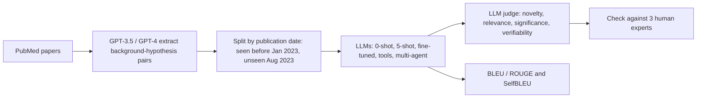

# Large Language Models as Biomedical Hypothesis Generators: A Comprehensive Evaluation

> **Bibkey** `Qi_2024` · **Venue** COLM 2024 (Conference on Language Modeling) (2024) · **Category** agents · **Relevance** high · **Access** open
> **Link** <https://arxiv.org/abs/2407.08940> · `status: complete`

---

## One-liner
The authors automatically extract "background → hypothesis" pairs from PubMed papers, **split them by publication date** (before Jan 2023 = train/seen, Aug 2023 = unseen) so test data cannot have been seen in training, and systematically evaluate 2023-era LLMs at proposing biomedical hypotheses zero-shot, few-shot, fine-tuned, with tools and as a multi-agent system, scoring Novelty / Relevance / Significance / Verifiability on 0–3 (LLM judge + human experts) (Abstract; §2–4).

## Takeaways
- **Temporal splitting is the most reusable design**: only models trained on pre-March-2023 corpora are evaluated, the unseen test set comes from Aug-2023 papers, and the retrieval tool also filters out post-Jan-2023 literature (§2.2, §3.1, §4.1).
- **Novelty and verifiability trade off**: zero-shot is more novel, few-shot (especially similarity-retrieved 5-shot*) more verifiable; e.g. gpt-3.5-turbo Novelty drops from 1.42 (0-shot) to 1.02 (5-shot*) while Verifiability rises from 1.97 to 2.36 (Fig. 4; Appendix Table 2).
- **"Verifiability" is a judge's rating of "could this be tested"**, not an actual experiment or literature check; "later confirmed" rests on the single example in Fig. 1 (§3.1; Fig. 1).
- **LLM judge agrees with humans**: across 10 model/prompt settings Pearson 0.73–0.97, Spearman 0.73–0.94, whereas BLEU/ROUGE-L correlate weakly or even negatively with human scores (Table 1; Appendix Table 5).
- **Tool use lowered scores**: single ChatGPT averages 1.92; with the PubMed tool, ReAct 1.56 and OpenAI function calling 1.49; multi-agent 2.09, multi-agent + tools 2.07 (Appendix Table 6). The text says tools "further enhance" the multi-agent system, but in the table only Novelty (1.35 → 1.52) and Significance (2.05 → 2.06) rise while Relevance and Verifiability fall, and the average slips from 2.09 to 2.07.

## Problem
Hypothesis-generation work relies on models like ChatGPT and GPT-4 whose training data cannot be traced, so test/train non-overlap cannot be guaranteed and "knowledge discovery" cannot be assessed zero-shot (Introduction). Hypotheses also have no single correct answer, so word-overlap metrics alone are insufficient (§3.1). The questions: can LLMs truly generate hypotheses zero-shot, and what do few-shot examples, domain adaptation, instruction tuning, tool use and multi-agent collaboration each contribute (§3–4)?

## Method
**Step 1 Task**: given instruction I and background X extracted from a paper, generate hypothesis Y — framed as text completion (§2.1).
**Step 2 Data** (Self-Instruct-style): compose paper sets by topic → summarize with ChatGPT and GPT-4 → generate background–hypothesis pairs → filter low quality → split by publication date (§2.2). The appendix reports two dataset versions, built by GPT-3.5 and by GPT-4 (Appendix Tables 2–3; Fig. 8b).
**Step 3 Models**: only models trained on corpora before March 2023 — API gpt-3.5-turbo; general instruction models from the Alpaca Eval leaderboard (pre-Sept-2023) Vicuna-33B-v1.3, Llama-2-70B-chat, WizardLM-13B-V1.2, WizardLM-70B-V1.0, Openchat-v3.2-super; medical models PMC-LLaMA-13B and MedAlpaca-13B (§3.1; Appendix Table 4).
**Step 4 Prompts and fine-tuning**: zero-shot; 5-shot random (5-shot); 5-shot similarity-retrieved (5-shot*), examples drawn from the pre-Jan-2023 training set. WizardLM-13B-V1.2 is also fine-tuned on the training pairs: 3 epochs, batch size 8, max length 2048, LR 3e-5, early-stopped on the seen test set (§3.1; Appendix F.4).
**Step 5 Evaluation**: BLEU / ROUGE against the reference; without a reference, an LLM judge scores Novelty (new information?), Relevance (on topic?), Significance (impact on the problem), Verifiability (testable with existing methods or data?) on 0–3 each, with step-by-step reasons. The text says GPT-4 is the judge; the appendix judge prompts, Table 1 and Table 5 say "ChatGPT", while the header of Appendix Table 6 (tools and multi-agent) says "GPT-4 Evaluation" (§3.1; Appendix F.3). Human evaluation: three biomedical experts score 100 unseen-test examples (§3.4).
**Step 6 Uncertainty**: SelfBLEU (BLEU among a set of generations; lower = more diverse) is a cheap proxy for generation "uncertainty", related to Novelty and Verifiability (§3.3; Fig. 5).
**Step 7 Multi-agent and tools**: Analyst (keywords/topics from the background) → Engineer (PubMed search and organisation, excluding post-Jan-2023 papers) → Scientist (hypothesis from findings + background) → Critic (evaluates, loops back), optional human in the loop; tool use compared via ReAct vs OpenAI function calling, evaluated on the unseen test set (§4.1; Fig. 6).

## Method diagram


## Data
**Seen**: 2,700 background–hypothesis pairs from literature before Jan 2023, split into 2,500 train and 200 validation (also the seen test set). **Unseen**: 200 pairs from papers published in Aug 2023 (§2.2). Source pool: about 10,000 PubMed medical papers (Fig. 2b). OpenAI embeddings + t-SNE show little difference between seen and unseen test sets (Appendix C.1; Fig. 8a). Human evaluation: three biomedical experts, 100 unseen-test examples (§3.4). Data and code released (Abstract).

## Key results
- **Zero-shot more novel, few-shot more verifiable**: nearly all models (notably the WizardLM series and Openchat-v3.2-super) score higher Novelty zero-shot and higher Verifiability with few-shot examples (§3.2.1; Fig. 4). E.g. WizardLM-70B-V1.0 Novelty 1.57 (0-shot) → 0.97 (5-shot*) (Appendix Table 2, GPT-3.5 dataset).
- **Higher BLEU on unseen**: the authors expected seen to win through memorization, but Fig. 3 shows models tend to do better on unseen; e.g. gpt-3.5-turbo 0-shot BLEU 13.93 seen vs 15.52 unseen (Appendix Table 2). They speculate the task's complexity hinders use of parametric "dark knowledge" (§3.2.1).
- **External knowledge is not always helpful**: domain adaptation (MedAlpaca, PMC-LLaMA) improves word overlap and few-shot use but weakens zero-shot ability; instruction tuning improves BLEU/ROUGE and verifiability but reduces novelty and significance (§3.2.2). Fine-tuned WizardLM-13B-V1.2 has human Novelty 0.85 and Significance 1.23 (Table 1).
- **Uncertainty**: zero-shot generations have lower SelfBLEU (more uncertain/diverse) and higher Novelty; few-shot has lower uncertainty and higher Verifiability (§3.3; Fig. 5).
- **Human evaluation**: LLM-judge vs human average correlations Pearson 0.73–0.97, Spearman 0.73–0.94 (all > 0.7); best human average Llama-2-70b-chat 5-shot 2.33, gpt-3.5-turbo 0-shot 2.02 (Table 1). BLEU–human correlations range from −0.58 to 0.32 (Pearson) and −0.65 to 0.39 (Spearman) (Appendix Table 5).
- **Tools and multi-agent (unseen test, LLM-judge average)**: ChatGPT 1.92; + ReAct tools 1.56; + OpenAI function calling 1.49; multi-agent 2.09; multi-agent + tools 2.07 (Appendix Table 6). The text concludes that tools help little and LLMs struggle to identify useful information, while multi-agent collaboration "significantly" improves generation by introducing uncertainty (§4.2).
- **Text vs appendix mismatches**: §4.2 says ReAct is slightly worse than OpenAI function calling, yet in Table 6 ReAct (2a) averages 1.56 vs 1.49 for function calling (2b); §4.2 says tools further enhance the multi-agent system, yet the Table 6 average goes 2.09 → 2.07.

## Contributions
- **Controls visibility directly by publication date**, instead of estimating contamination indirectly from question entropy vs accuracy as earlier work did (§2.2).
- A four-dimension hypothesis rubric, with LLM-judge agreement checked against human experts (§3.1, §3.4).
- "Uncertainty" (SelfBLEU) as a single lens for zero-shot / few-shot / external-knowledge effects (§3.3).
- An Analyst–Engineer–Scientist–Critic multi-agent prototype with time-filtered retrieval (§4.1).

## Limitations
- Authors: pairs are extracted automatically by ChatGPT/GPT-4; extraction accuracy and bias need evaluation, ideally by manually annotating a subset (§2.2).
- Authors: the effect of factual hallucination on hypotheses needs study; only web search and PubMed are used, with bioinformatics tools and knowledge graphs left for future work (§6).
- Authors: human evaluation was partial because of cost; they describe a 5% sampling rate (§3.4). Our reading: 100 examples are half of the 200 unseen pairs, so "5%" does not match the other numbers, and the paper does not explain it.
- Our reading: Verifiability is a rating, not a fact check; the judge (ChatGPT/GPT-4) is from the same family that extracted the data, so same-source bias is possible; SelfBLEU is a crude diversity proxy; all models are 2023-era; the scale is small (200 unseen pairs).
- Our reading: the text's description of tools and multi-agent results does not fully match Appendix Table 6 (see Key results); cite the table, not the prose.

## Relation to our direction
For **Topic 2 (verifying the claims of biomedical analysis agents)** this is an early reference for the hypothesis-scoring step. Our reading: (1) **temporal splitting against leakage** can be copied directly: to rule out that an agent analysing kidney data merely restates published conclusions when it "proposes a new mechanism", split seen/unseen by paper or data-release date and apply the same time filter to retrieval tools. (2) It hands "verifiability" to an LLM rating of 0–3, whereas Topic 2 wants to **trace each claim to actual evidence** (is it supported by the agent's own code, data or cited papers?) calibrated against expert labels — its human–LLM agreement check (Table 1) is a minimal calibration, done only on 100 examples and at the level of model-average scores. (3) The novelty–verifiability trade-off warns that a verifier rewarding only "supported" claims may penalise genuinely novel hypotheses; scoring should separate "unsupported" from "new but testable". (4) "Tool retrieval lowered scores and LLMs struggle to pick useful information from results" (§4.2; Table 6) is early evidence for an "evidence-selection failure" class.
On the detect → model → revert chain, our reading: it corresponds to the step after revert — writing candidate genes/perturbations as testable hypotheses and ranking them; but it uses literature background only and touches no experimental or omics data.

## Reusable assets
- **Code & data:** LLM4BioHypoGen (link given in the Abstract).
<https://github.com/TsinghuaC3I/LLM4BioHypoGen>
- **Eval protocol:** temporal split + time-filtered retrieval; four-dimension 0–3 judge prompts (Appendix Tables 14–17); SelfBLEU diversity; Pearson/Spearman agreement between LLM judge and humans.
- **Agent prototype:** Analyst / Engineer / Scientist / Critic role prompts (Appendix Tables 12–13).

## Follow-ups
- TruthHypo (`truthhypo-ijcai-2025` in this repo) — on hypothesis truthfulness and hallucination, the question §6 leaves open.
- Apply temporal splitting to kidney omics: use published kidney single-cell atlases as the boundary and test whether agent conclusions only restate known results.

## Cite
```bibtex
@inproceedings{Qi_2024,
  title = {Large Language Models as Biomedical Hypothesis Generators: A Comprehensive Evaluation},
  author = {Qi, Biqing and Zhang, Kaiyan and Tian, Kai and Li, Haoxiang and Chen, Zhang-Ren and Zeng, Sihang and Hua, Ermo and Hu, Jin-Fang and Zhou, Bowen},
  booktitle = {First Conference on Language Modeling (COLM)},
  year = {2024},
  eprint = {2407.08940},
  archivePrefix = {arXiv},
  url = {https://arxiv.org/abs/2407.08940}
}
```


---

📄 **[AI-ready full-text extract →](ai-ready.md)**
