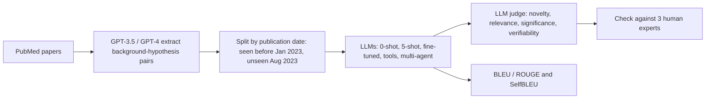

# Large Language Models as Biomedical Hypothesis Generators: A Comprehensive Evaluation

> **文献键** `Qi_2024` · **来源** COLM 2024 (Conference on Language Modeling)(2024) · **类别** agents · **相关度** high · **获取** open
> **链接** <https://arxiv.org/abs/2407.08940> · `status: complete`

---

## 一句话
作者从 PubMed 文献中自动抽取「背景知识 → 假设」配对,**按发表时间切分**(2023 年 1 月前 = 训练/seen,2023 年 8 月 = unseen)以避免测试数据被模型训练见过,系统评测 2023 年代 LLM 在 zero-shot、few-shot、微调、工具调用和多智能体设置下提出生物医学假设的能力,用 Novelty / Relevance / Significance / Verifiability 四个 0–3 分维度(LLM 评审 + 人类专家)打分(Abstract;§2–4)。

## 要点
- **时间切分是本文最可复用的设计**:只评测训练语料早于 2023 年 3 月的模型,unseen 测试集来自 2023 年 8 月的论文,检索工具也过滤掉 2023 年 1 月后的文献(§2.2、§3.1、§4.1)。
- **novelty 与 verifiability 此消彼长**:zero-shot 更新颖,few-shot(尤其相似度检索的 5-shot*)更可验证;例如 gpt-3.5-turbo 的 Novelty 从 0-shot 1.42 降到 5-shot* 1.02,Verifiability 从 1.97 升到 2.36(Fig. 4;附录 Table 2)。
- **"Verifiability" 只是评审打分的"能否被检验"**,不是真的去做实验或核对后续文献;"后来被证实"只有 Fig. 1 一个个例(§3.1;Fig. 1)。
- **LLM 评审与人类评审相关性高**:10 个模型/设置上 Pearson 0.73–0.97、Spearman 0.73–0.94;而 BLEU/ROUGE-L 与人评相关性很低甚至为负(Table 1;附录 Table 5)。
- **工具调用反而降分**:单个 ChatGPT 平均 1.92,加 PubMed 工具后 ReAct 1.56、OpenAI function calling 1.49;多智能体 2.09,多智能体 + 工具 2.07(附录 Table 6)。正文说"工具能进一步提升多智能体",但表中只有 Novelty(1.35 → 1.52)上升,平均分没有升。

## 研究问题
用 LLM 生成科学假设的工作依赖 ChatGPT、GPT-4 等模型,但它们的训练数据无法追溯,因此无法保证测试数据没被模型见过,也就无法在 zero-shot 条件下评估"知识发现"(Introduction)。此外,假设没有唯一正确答案,只用词重叠指标无法全面评价(§3.1)。作者要问:LLM 能否真正 zero-shot 地提出假设?few-shot 示例、领域适配、指令微调、工具调用和多智能体协作分别有什么影响(§3–4)?

## 方法
**第 1 步 任务定义**:给定指令 I 和从论文中抽取的背景知识 X,让模型生成假设 Y,形式化为文本补全(§2.1)。
**第 2 步 数据构建**(仿 Self-Instruct 流程):按主题和内容组成论文集 → 用 ChatGPT 和 GPT-4 总结文献 → 生成「背景–假设」对 → 过滤低质量数据 → 按发表时间切分(§2.2)。附录实际给出两套数据,分别由 GPT-3.5 和 GPT-4 构建(附录 Tables 2–3;Fig. 8b)。
**第 3 步 选模型**:只选训练语料早于 2023 年 3 月的模型 —— API 模型 gpt-3.5-turbo;Alpaca Eval 榜单(2023 年 9 月前)上的通用指令模型 Vicuna-33B-v1.3、Llama-2-70B-chat、WizardLM-13B-V1.2、WizardLM-70B-V1.0、Openchat-v3.2-super;医学模型 PMC-LLaMA-13B、MedAlpaca-13B(§3.1;附录 Table 4)。
**第 4 步 提示与微调**:zero-shot;5-shot 随机采样(5-shot);5-shot 相似度检索(5-shot*),示例都取自 2023 年 1 月前的训练集。另在训练对上微调 WizardLM-13B-V1.2:3 个 epoch、batch size 8、最大长度 2048、学习率 3e-5,按 seen 测试集早停(§3.1;附录 F.4)。
**第 5 步 评价**:有参考答案时用 BLEU / ROUGE;无参考答案时让 LLM 评审对 Novelty(是否有新信息)、Relevance(是否切题)、Significance(对理解问题的影响)、Verifiability(能否用现有方法或数据检验)各打 0–3 分并给出逐步理由。正文说用 GPT-4 评审,附录的评审 prompt 与 Table 1 表头写的是 "ChatGPT"(§3.1;附录 F.3)。人类评估:3 位生物医学专家对 unseen 测试集 100 个样本打分(§3.4)。
**第 6 步 不确定性**:用 SelfBLEU(一组生成之间的相互 BLEU,越低越多样)作为生成"不确定性"的廉价代理,分析它与 Novelty、Verifiability 的关系(§3.3;Fig. 5)。
**第 7 步 多智能体与工具**:Analyst(从背景中抽关键词/主题)→ Engineer(用 PubMed 检索并整理,排除 2023 年 1 月后的文献)→ Scientist(结合检索结果与背景提出假设)→ Critic(评估并反馈,可回到前面的角色),可选人类参与;工具调用对比 ReAct 与 OpenAI function calling,在 unseen 测试集上评估(§4.1;Fig. 6)。

## 方法图


## 数据
**Seen 数据集**:2,700 对背景–假设,来自 2023 年 1 月前的文献,分为训练 2,500 对和验证 200 对(同时作为 seen 测试集)。**Unseen 数据集**:200 对,来自 2023 年 8 月发表的论文(§2.2)。论文池为约 10,000 篇 PubMed 医学论文(Fig. 2b)。用 OpenAI embedding + t-SNE 可视化,seen 与 unseen 测试集分布差异很小(附录 C.1;Fig. 8a)。人类评估:3 位生物医学专家,unseen 测试集 100 例(§3.4)。数据与代码开源(Abstract)。

## 主要结果
- **zero-shot 更新颖、few-shot 更可验证**:几乎所有模型(尤其 WizardLM 系列和 Openchat-v3.2-super)zero-shot 时 Novelty 更高,给 few-shot 示例后 Verifiability 更高(§3.2.1;Fig. 4)。例:WizardLM-70B-V1.0 Novelty 0-shot 1.57 → 5-shot* 0.97(附录 Table 2,GPT-3.5 数据集)。
- **unseen 上 BLEU 反而更高**:作者原以为 seen 集会因记忆而更好,但 Fig. 3 显示模型在 unseen 集上往往更好;例如 gpt-3.5-turbo 0-shot BLEU seen 13.93、unseen 15.52(附录 Table 2)。作者推测是假设生成的复杂性妨碍模型利用参数化的 "dark knowledge"(§3.2.1)。
- **外部知识不总有益**:领域适配(MedAlpaca、PMC-LLaMA)提高词重叠指标,并提高利用 few-shot 的能力,但削弱 zero-shot 能力;指令微调提高 BLEU/ROUGE 和可验证性,但降低新颖性和重要性(§3.2.2)。微调后的 WizardLM-13B-V1.2 人评 Novelty 只有 0.85、Significance 1.23(Table 1)。
- **不确定性**:zero-shot 生成的 SelfBLEU 更低(更不确定/更多样)且 Novelty 更高;few-shot 不确定性更低而 Verifiability 更高(§3.3;Fig. 5)。
- **人类评估**:LLM 评审与人类平均分的相关系数 Pearson 0.73–0.97、Spearman 0.73–0.94(均 > 0.7);人评平均最高为 Llama-2-70b-chat 5-shot 2.33,gpt-3.5-turbo 0-shot 2.02(Table 1)。BLEU 与人评相关性在 −0.58 到 0.32 之间(附录 Table 5)。
- **工具与多智能体(unseen 测试集,LLM 评审平均分)**:ChatGPT 1.92;+ ReAct 工具 1.56;+ OpenAI function calling 1.49;多智能体 2.09;多智能体 + 工具 2.07(附录 Table 6)。正文结论是"工具帮助很小、LLM 难以从检索结果中识别有用信息;多智能体通过引入不确定性显著提升"(§4.2)。
- **正文与附录表不一致的地方**:§4.2 说 ReAct 略差于 OpenAI function calling,但 Table 6 中 ReAct(2a)平均 1.56 高于 function calling(2b)1.49;§4.2 说工具能进一步提升多智能体,但 Table 6 平均分 2.09 → 2.07 略降。

## 创新点
- **按发表日期直接控制可见性**,而不是像以往那样用题目熵与准确率的相关性间接估计污染(§2.2)。
- 四维假设评分量表,并检验 LLM 评审与人类专家的一致性(§3.1、§3.4)。
- 用"不确定性"(SelfBLEU)作为解释 zero-shot / few-shot / 外部知识效应的统一视角(§3.3)。
- Analyst–Engineer–Scientist–Critic 多智能体原型,检索端同样做时间过滤(§4.1)。

## 局限
- 作者自述:背景–假设对由 ChatGPT/GPT-4 自动抽取,其准确性和引入的偏差需要进一步评估,应人工标注一个子集(§2.2)。
- 作者自述:LLM 的事实性幻觉对假设生成的影响需要深入研究;目前只用 Web 搜索和 PubMed,未来想接入生物信息学分析工具和知识图谱(§6)。
- 作者自述:由于成本只做了部分人类评估,作者称采用 5% 抽样率(§3.4)。我们的理解:100 例占 unseen 测试集 200 对的一半,"5%"与文中其他数字对不上,原文未解释。
- 我们的理解:Verifiability 是评审打分,不是事实验证;评审用的是 ChatGPT/GPT-4,而数据也是 ChatGPT/GPT-4 抽取的,存在同源偏差;SelfBLEU 只是多样性的粗糙代理;所有模型都是 2023 年代模型;规模小(unseen 200 对)。
- 我们的理解:正文对工具与多智能体的描述和附录 Table 6 的数字不完全一致(见主要结果),引用这部分结论时应以表格为准。

## 与本研究方向的关系
对 **课题 2(生物医学分析 agent 的结论核查)**,这篇是"假设评分"一环的早期参照。我们的理解:(1) **时间切分防泄漏**可以直接照搬:若 agent 分析肾脏数据后"提出新机制",要排除它只是在复述已发表结论,就需要按论文或数据发布时间划 seen/unseen,并对检索工具做同样的时间过滤。(2) 它把"可验证性"交给 LLM 打 0–3 分,而课题 2 要做的是**把结论真正追溯到证据**(agent 自己的代码、数据或引用的文献是否支持),并用专家标注校准 —— 它的人类–LLM 一致性检验(Table 1)是一个最低限度的校准方案,但只在 100 例、模型平均分层面做了相关。(3) novelty–verifiability 权衡提醒我们:一个只奖励"有证据"的核查器可能会惩罚真正新颖的假设,评分要把"无证据"与"新但可检验"分开。(4) "工具检索反而降分、LLM 难以从检索结果中挑出有用信息"(§4.2;Table 6)是"证据选择失败"这一类失败的早期证据。
在 detect → model → revert 链条上,我们的理解:它对应 revert 之后"把候选基因/扰动写成可检验假设并排序"的环节;但它只用文献背景,不接触任何实验或组学数据。

## 可复用资产
- **代码与数据:** LLM4BioHypoGen(Abstract 给出的链接)。
<https://github.com/TsinghuaC3I/LLM4BioHypoGen>
- **评测协议:** 时间切分 + 检索端时间过滤;四维 0–3 评分 prompt(附录 Tables 14–17);SelfBLEU 多样性;LLM 评审与人类的 Pearson/Spearman 一致性。
- **Agent 原型:** Analyst / Engineer / Scientist / Critic 角色 prompt(附录 Tables 12–13)。

## 待读
- TruthHypo(本仓库 `truthhypo-ijcai-2025`)—— 关注假设的真实性与幻觉,正好补本文 §6 留下的问题。
- 把时间切分用到肾脏组学:以已发表的肾脏单细胞图谱为界,检验 agent 的结论是否只是复述已有结果。

## 引用
```bibtex
@inproceedings{Qi_2024,
  title = {Large Language Models as Biomedical Hypothesis Generators: A Comprehensive Evaluation},
  author = {Qi, Biqing and Zhang, Kaiyan and Tian, Kai and Li, Haoxiang and Chen, Zhang-Ren and Zeng, Sihang and Hua, Ermo and Hu, Jin-Fang and Zhou, Bowen},
  booktitle = {First Conference on Language Modeling (COLM)},
  year = {2024},
  eprint = {2407.08940},
  archivePrefix = {arXiv},
  url = {https://arxiv.org/abs/2407.08940}
}
```


---

📄 **[AI-ready 全文提取 →](ai-ready.md)**
