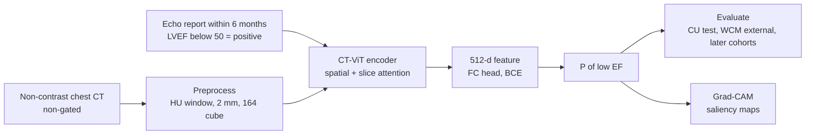

# An artificial intelligence model to detect abnormal ejection fraction from non-contrast chest computed tomography: the CT–LVEF study

> **Bibkey** `Raikhelkar_2026` · **Venue** European Heart Journal - Digital Health (2026) · **Category** imaging · **Relevance** medium · **Access** open
> **Link** <https://doi.org/10.1093/ehjdh/ztag088> · `status: complete`

---

## One-liner
A CT-ViT encoder (3D vision transformer from GenerateCT) classifies left-ventricular ejection fraction (LVEF) <50% vs ≥50% from routine non-gated, non-contrast chest CTs acquired for other reasons; AUROC 0.786 at the development site (Columbia) and 0.762 at an external site (Weill Cornell), as opportunistic heart-failure screening (Abstract).

## Takeaways
- Labels are the EF value from an echocardiogram report within 6 months of the CT, binarised at 50%; no extra test is needed (Methods §Data curation, §LVEF-based classification).
- An XGBoost baseline on demographics + 260 ICD-9 codes from the CT report reaches only AUROC 0.607 / 0.592, so the signal comes from the images (Table 6).
- Closer CT–echo timing gives higher AUROC: Columbia ≤1-day subset 0.800 vs 0.786 overall (Holm-adjusted P=0.004) (Table 5, Results).
- On 90 / 100 sampled CTs, the model's weighted F1 is 0.808 / 0.797 vs thoracic radiologists' 0.646 and 0.802 / 0.623 (Table 7).
- On temporally later "independent consecutive" test sets AUROC drops to 0.742 (Columbia) / 0.735 (Weill Cornell), with balanced accuracy only ~0.57 (Results).

## Problem
Heart failure affects over 64 million people worldwide; many with early systolic dysfunction (HFrEF / HFmrEF) are asymptomatic and undiagnosed and miss guideline-directed medical therapy (GDMT) that slows progression (Introduction). EF normally needs dedicated tests such as echocardiography or cardiac MRI (Discussion); more than 80 million CTs are performed yearly in the USA and chest CT is common (Introduction). AI on CT has already been used to predict cardiovascular risk (e.g. quantifying coronary calcium, left atrial volume and left ventricular mass index; Introduction, Discussion), but the authors say computing EF from non-gated, non-contrast chest CT has not been explored before (Discussion). The question: can reduced EF be screened directly from incidental non-gated (not synchronised to the heartbeat), non-contrast chest CTs?

## Method
1. **Paired data**: adults with a non-contrast chest CT at Columbia (CU) or Weill Cornell (WCM) between Jul 2005 and Aug 2023 and an echocardiogram within 6 months; after filtering and linkage, 34,058 CT–echo pairs from 19,410 patients (Methods §Data curation).
2. **Label**: LVEF from the echo report (2D echo, waterfall logic); <50% = positive (reduced EF), ≥50% = normal (Methods §LVEF-based classification).
3. **Splits**: CU for development, randomly split by patient into train/validation/hold-out test (test n=5,174, 20%); all of WCM for external validation; plus temporally later independent consecutive test sets at both sites (CU Aug–Dec 2023; WCM Aug 2023–Jul 2024) (Methods, Results).
4. **CT preprocessing**: DICOM to Hounsfield units, window [−1000, 1000] HU to drop air and bone, OTSU thresholding to focus on the body, spline resampling to 2×2×2 mm³, crop/zero-pad to 164×164×164 (Methods §3D preprocessing).
5. **Model**: the CT-ViT encoder from GenerateCT as backbone (4 self-attention blocks over the axial plane, then 4 over slices along z), giving a 512-d vector and a fully connected head that outputs P(low EF); random crops to 164×144×144 and horizontal flips in training, centre crop at test (Methods §AI model, §Grad-CAM).
6. **Training**: binary cross-entropy, AdamW, lr 1×10⁻⁵, weight decay 1×10⁻⁴, batch 8, 20 epochs, lr halved at epoch 15; five random seeds, reported as mean ± SD; one A100 (Methods §AI model).
7. **Evaluation**: AUROC, F1, balanced accuracy; Brier score and calibration curves; subgroups by sex, age, race and CT–echo interval; decision-curve analysis; comparison with two thoracic radiologists on sampled CTs with McNemar tests; Grad-CAM saliency for interpretability (Methods §Evaluation, §Comparison with radiologist).
8. **Opportunistic-screening demo**: the model is run on 633 routine chest CTs without paired echo, and charts of flagged patients are reviewed (Results §Opportunistic screening).

## Method diagram


## Data
34,058 CT–echo pairs from 19,410 patients: CU 14,083 patients / 25,948 pairs (21,787 normal, 4,161 reduced EF = 16.04%), WCM 5,327 patients / 8,110 pairs (6,695 normal, 1,415 reduced = 17.29%) (Methods, Table 1). Median CT–echo interval 12.7–24.2 days in retrospective cohorts; 11.8–20.7% within 1 day (Table 4). Independent consecutive test sets: CU 1,251 patients / 1,411 pairs, WCM 755 patients / 817 pairs (Results). Opportunistic screening: 633 CTs / 627 patients (Results). Data are not public under institutional policy and ethics approval; available from the corresponding author on reasonable request (Data availability).

## Key results

- **CU hold-out**: AUROC 0.786 ± 0.005 (95% CI 0.780–0.792), F1 0.822 ± 0.005 (n=5,174) (Results §AI model evaluation, Fig. 4).
- **WCM external**: AUROC 0.762 ± 0.007 (0.753–0.771), F1 0.812 ± 0.005 (Results §External validation).
- **Calibration**: Brier score CU 0.1120 ± 0.0025 (5 seeds), WCM 0.1199 ± 0.0022 (Results, Fig. 7).
- **Baselines**: demographics + 260 ICD-9 codes — random forest AUROC 0.538 / 0.550, XGBoost 0.607 / 0.592 (CU / WCM) (Table 6).
- **CT–echo interval**: CU ≤1 day 0.800 vs 0.786 overall (Holm P=0.004); WCM ≤1 month 0.788 vs 0.762 (Holm P=0.002) (Table 5, Results).
- **Subgroups**: ages 18–39 are worst (CU 0.696); differences across sex and age are significant (CU permutation ANOVA P=0.0018, 0.0008), across race not (P=0.4463) (Table 5, Results).
- **Versus radiologists**: weighted F1 on 90 CU CTs — model 0.808, RAD1 0.646, RAD2 0.802; on 100 WCM CTs — model 0.797, RAD2 0.623 (Table 7). Errors CU: model 13, RAD1 37, RAD2 18; WCM: model 15, RAD2 43 (Results). Speed: ~1 minute for the model on all 90 (or 100) scans vs ~2–2.2 minutes per scan for a radiologist (Results). The authors note this uses a single selected model and may be slightly optimistic (Results).
- **Later test sets**: CU AUROC 0.742 (0.729–0.755), balanced accuracy 0.571; WCM AUROC 0.735 (0.701–0.770), balanced accuracy 0.563 (Results).
- **Grad-CAM**: reviewed by a medical physicist on 51 reduced-EF patients; highlighted regions include an enlarged heart, the ascending aorta (especially when calcified), a dilated superior vena cava, pacemakers and leads, pulmonary oedema infiltrates, and also denser subcutaneous back tissue, sternal wires and neck scars from central lines (Results §Model interpretability).
- **Opportunistic screening**: of 633 CTs the model flagged 23 patients (3.7%); chart review confirmed 18/23 (78%) with reduced EF and a heart-failure diagnosis (Results §Opportunistic screening).

## Contributions
- The authors report it as the first study to identify reduced LVEF from routine non-gated, non-contrast chest CT (Discussion).
- A large two-centre paired dataset plus temporally later test sets, calibration and decision-curve analysis (Results).
- A blinded comparison with radiologists and error-overlap analysis (Table 7, Fig. 6).

## Limitations
- Authors: retrospective; a prospective study is planned (Discussion).
- Authors: 2D-echo EF has 8–21% intra- and 6–13% inter-observer variation; measurement methods (Simpson biplane, single plane, visual) were not consistently recorded; EF may change between CT and echo, so labels are noisy (Discussion).
- Authors: non-contrast CT only; Grad-CAM gives qualitative case-level explanations without population-level interpretability (no voxel-level registration across scans); the effect of artifacts or low-quality scans was not studied (Discussion).
- Our reading: pacemakers, sternal wires and central-line scars highlighted by Grad-CAM are traces of prior treatment, so the model may partly recognise already-diagnosed, treated patients, which weakens its value for screening the undiagnosed.
- Our reading: on the two later independent consecutive test sets balanced accuracy is only 0.571 / 0.563 (while F1 is 0.809 / 0.825), which points to low positive-class recall at the default threshold, with F1 probably carried mostly by the majority normal class (~83%) (the radiologist comparison explicitly uses weighted F1; the F1 type for the main results is not stated); the hold-out balanced accuracy is given only in Fig. 4C. In the Discussion the authors pick a specificity-first threshold instead: at 80% specificity, CU sensitivity is 64%.

## Relation to our direction
Our reading: this is supervised classification, not unsupervised anomaly detection, and relates only indirectly to **detect** in detect → model → revert. Three lessons for the artifact-injection topic. (1) **Opportunistic reuse of existing data**: mining images taken for other reasons for unlabelled disease signal resembles our aim of finding diseased regions in routine H&E / spatial omics. (2) **Shortcut features**: Grad-CAM shows the model uses pacemakers, surgical wires and line scars — traces of treatment; in kidney data the analogues could be biopsy-needle tracks, preparation artifacts or site-specific staining, exactly what the artifact-injection topic wants cross-modal agreement to rule out. (3) **Evaluation design to copy**: temporally later test sets, stratification by acquisition conditions (here the CT–echo interval), a naive clinical-feature baseline (ICD codes) and a blinded expert comparison all fit KidneyAnomalyBench's protocol. Nothing on virtual tissue or reversion.

## Reusable assets
- **Code and weights**: the paper says preprocessing, training and evaluation code plus trained weights will be released on GitHub on publication (Code and model weight availability); the repository exists; as of 2026-10-27 it holds code only (main.py, archs.py, transformer.py, preprocessing scripts and notebooks, README.txt) and no trained weight files.
<https://github.com/ZB-WCM/AI_CT_LVEF>
- **Backbone**: the CT-ViT encoder from GenerateCT (spatial + slice attention for 3D CT) (Methods).
- **Preprocessing recipe**: HU window [−1000, 1000], 2 mm isotropic, 164³ volume (Methods).
- **Data**: not public; on request from the corresponding author (Data availability).

## Follow-ups
- The GenerateCT / CT-ViT paper: how the encoder was pretrained and on what.
- Supplementary Tables S5–S6: 3-/4-class and 40% / 35% threshold results.
- Related work predicting EF from ECG or chest X-ray, to compare screening modalities.

## Figures & tables

The article is open access (CC BY); full text and figures are on PMC and the OUP article page. No images are downloaded here; figures are listed by their original numbers.
<https://pmc.ncbi.nlm.nih.gov/articles/PMC13322390/> · <https://academic.oup.com/ehjdh/article/7/6/ztag088/8705677>

**Fig 1**: Data curation and preprocessing flowchart — selection, exclusion and preprocessing of echo reports and chest CTs from Columbia and Weill Cornell. See <https://academic.oup.com/ehjdh/article/7/6/ztag088/8705677#F1>

**Fig 2** (method overview): the vision-transformer architecture that analyses 3D chest CT to predict left-ventricular systolic dysfunction. See <https://academic.oup.com/ehjdh/article/7/6/ztag088/8705677#F2>

**Fig 4** (main results): ROC curves and AUROC for both sites, metrics by demographic subgroup, and confusion matrices. See <https://academic.oup.com/ehjdh/article/7/6/ztag088/8705677#F4>

**Fig 5** (interpretability): Grad-CAM saliency maps on axial CT for four reduced-EF patients. See <https://academic.oup.com/ehjdh/article/7/6/ztag088/8705677#F5>

_Others: Fig 3 study design · Fig 6 error Venn diagrams (model vs radiologists) · Fig 7 calibration curves · Fig 8 decision curves; Table 1 population · Table 2 acquisition parameters · Table 3 diagnosis codes · Table 4 CT–echo intervals · Table 5 subgroup AUROC · Table 6 RF/XGBoost baselines · Table 7 F1 vs radiologists · Table 8 echo operator and source. (Note: the in-text figure numbers do not match the captions: the Grad-CAM examples are cited as "Figure 6A–D" (caption: Fig 5), the calibration curves as "Figure 5" (caption: Fig 7) and the Venn diagrams as "Figure 7" (caption: Fig 6); this note follows the caption numbering.)_

### Results

**Table 1.** Headline numbers (PMC full text; mean ± SD over 5 random seeds).

| Cohort | n pairs | AUROC | F1 | Source |
|---|---|---|---|---|
| CU hold-out test | 5,174 | 0.786 ± 0.005 | 0.822 ± 0.005 | AUROC Table 5; F1 Results |
| WCM external validation | 8,110 | 0.762 ± 0.007 | 0.812 ± 0.005 | AUROC Table 5; F1 Results |
| CU independent consecutive | 1,411 | 0.742 | 0.809 | Results |
| WCM independent consecutive | 817 | 0.735 | 0.825 | Results |
| XGBoost baseline (CU / WCM) | — | 0.607 / 0.592 | 0.309 / 0.312 | Table 6 |

## Cite
```bibtex
@article{Raikhelkar_2026, title={An artificial intelligence model to detect abnormal ejection fraction from non-contrast chest computed tomography: the CT–LVEF study}, volume={7}, ISSN={2634-3916}, url={http://dx.doi.org/10.1093/ehjdh/ztag088}, DOI={10.1093/ehjdh/ztag088}, number={6}, journal={European Heart Journal - Digital Health}, publisher={Oxford University Press (OUP)}, author={Raikhelkar, Jayant and Bai, Zilong and Beecy, Ashley N and Richter, Ilan and Liu, Fengbei and Nizam, Nusrat Binta and Kishore, Varsha and Kelsey, Chris and vanMaanen, David and Ruhl, Jeffrey and Tesfuzigta, Naomi and Lancet, Erica and Leb, Jay and Legasto, Alan and Elias, Pierre and Poterucha, Timothy and Kumaraiah, Deepa and Prince, Martin and Wang, Fei and Sayer, Gabriel and Estrin, Deborah and Sabuncu, Mert and Uriel, Nir}, year={2026}, month=jun }
```


---

📄 **[AI-ready full-text extract →](ai-ready.md)**
