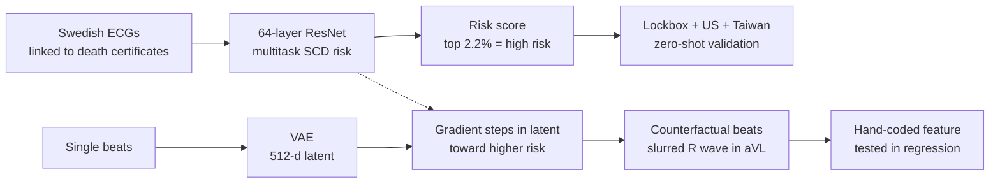

# An ECG biomarker for sudden cardiac death discovered with deep learning

> **Bibkey** `Obermeyer_2026` · **Venue** Nature (2026) · **Category** imaging · **Relevance** high · **Access** open
> **Link** <https://doi.org/10.1038/s41586-026-10674-6> · `status: complete`

---

## One-liner
A deep network trained on all ECGs of a Swedish region linked to death certificates predicts one-year sudden cardiac death (SCD); a generative model guided by the predictor then morphs low-risk beats into high-risk ones to reveal what the model learned — a slurred terminal R wave in lead aVL that the authors say has not been described before (Abstract, Figs. 4–5).

## Takeaways
- On a 40% "lockbox" held out before any analysis, AUC is 0.872; the model's high-risk group (2.2% of the sample) has a 7.0% annual SCD rate, above the reduced-LVEF group (1.9%, 4.6%) (Abstract, Results).
- Only 13.9% of the high-risk group had known reduced LVEF — 86.1% are new high-risk patients that the current standard misses (Fig. 3).
- Applied zero-shot to US and Taiwanese data: US AUC 0.822 for ventricular arrhythmias; Taiwan AUC 0.767 for arrhythmic arrests vs controls, but only 0.582 for non-arrhythmic arrests (a "placebo" test of specificity) (Results).
- Interpretability without saliency maps: a VAE is trained, a beat's latent is moved along the gradient of predicted risk and decoded, giving counterfactual higher-risk beats of the same patient; saliency maps only show where the model looks, not what it sees (Results §ECG biomarker, Methods §Generative model).
- High-risk patients with defibrillators died 54.4% less than expected (observational regression, not randomised); the authors sanity-check the regression by "rediscovering" the known trial effect in the LVEF group (67.5% vs 50–88% in trials) (Table 2, Results).

## Problem
Sudden cardiac death is preventable in principle with implanted defibrillators (ICDs), but only if risk is predicted. The only widely used predictor is ultrasound-measured LVEF: most people who die suddenly never had LVEF measured, and of those who did only a minority had it reduced (many false negatives); two-thirds of defibrillators implanted for low LVEF never fire (many false positives) (Abstract, Introduction). ECGs are cheap and standardised, but no ECG marker has rivalled LVEF, and large ECG datasets linked to reliable causes of death were lacking (Introduction).

## Method
1. **Data and splits**: all 441,614 ECGs from Region Halland, Sweden, 2010–2016 (500 Hz, Philips), linked to death certificates and health records. Before any analysis, 40% of patients were sealed as a lockbox, opened only after provisional acceptance; the other 60% were split in half for training/validation, and after provisional acceptance the model was retrained on the full 60% (262,554 ECGs from 75,157 patients) and run once on the lockbox (Methods §Sweden, Results).
2. **Label**: SCD within one year of the ECG from death certificates: cardiac or ill-defined cause, death outside hospital or within 24 h of admission (Methods). Main analyses are restricted to under-80s, as defibrillator benefit falls with age (Methods).
3. **Predictor**: after trying CNNs, ResNets, transformers and LSTMs, a 64-layer ResNet (32 residual blocks, each 2 conv layers with 128 filters and kernel size 16) on 10-s 12-lead ECGs (Methods §Predictive model).
4. **Multitask training**: (i) SCD over several horizons and other outcomes in the whole cohort; (ii) SCD vs other causes among those who died within a year; (iii) LVEF ≤35% where LVEF was measured; then logit calibration on under-80 training patients for one-year SCD (Methods). No fine-tuning on external data ("zero-shot") (Methods).
5. **High-risk threshold**: the largest group whose lower 95% CI exceeds the median control-arm SCD rate in defibrillator trials (4.9%/yr) — the riskiest 2.2% (Results, Fig. 1).
6. **External validation**: US — Sharp HealthCare via Dandelion Health, 251,858 ECGs from 139,613 patients in 2021–2022, outcome = VF/VT (ventricular fibrillation/tachycardia) diagnosis within a year; Taiwan — National Taiwan University Hospital arrest registry, 257 arrests (96 arrhythmic) + 4,011 controls, using the most recent prior ECG (Results, Methods).
7. **Defibrillator analysis**: OLS regression in Sweden of SCD on age, sex, high-risk indicator, defibrillator indicator and their interaction; the interaction coefficient measures how much less than expected high-risk patients with defibrillators die (Results, Table 2).
8. **Generative morphing**: 10-s ECGs are segmented into single beats; a VAE with a 512-d latent space is trained and the predictor is retrained on beats; 56 beats are encoded, the latent is moved along the gradient of predicted risk and decoded, repeated up to 2,000 times or until risk reaches the 90th percentile, giving counterfactual higher-risk beats of the same patient (Methods §Generative model). This part uses the initial 30%/30% data, not the lockbox (Methods).
9. **Quantify the feature**: in lead aVL, from R peak to QRS end, the mean absolute first and second voltage differences become new features in regressions that control for rate, intervals, axes, QRS duration and other standard ECG measures (Results, Fig. 5).

## Method diagram


## Data
**Sweden**: 441,614 ECGs from 187,677 patients, Region Halland, 2010–2016 (Reporting Summary). The lockbox holds 179,060 ECGs / 51,481 patients; main analyses (under 80 with one-year follow-up) use 119,541 ECGs / 35,885 patients, of which 113,072 / 35,417 without defibrillators (Results, Methods, Table 1). One-year SCD rate in the lockbox 0.6%; 43.9% of SCDs had LVEF measured premortem and 36.4% of those were ≤35%; 41.2% of SCDs had no obvious risk factor at the time of the ECG (Methods). **USA**: Sharp HealthCare via Dandelion Health, 251,858 ECGs from 139,613 patients under 80, 500 Hz (83.3%) or 250 Hz (16.7%, interpolated to 500 Hz), GE MUSE — a different manufacturer from Sweden's Philips (Methods). **Taiwan**: NTUH emergency-department arrest registry (Nightingale Open Science), 2011–2019, 257 arrests + 4,011 controls (Methods).

## Key results

- **Discrimination**: lockbox AUC 0.872 (95% CI 0.843–0.899) vs 0.697 for the AHA/ACC 10-year risk score and 0.655 for SEER, a published ECG deep-learning heart-disease model (Results). The originally submitted model (30% training data) had AUC 0.837; retraining on 60% raised it to 0.872 (Methods).
- **Positive predictive value**: riskiest 0.2% annual SCD 11.0% (4.4–17.0%); riskiest 1.0% 7.9%; chosen 2.2% group 7.0% (4.9–9.5%); reduced LVEF 4.6% (Results, Fig. 1).
- **Arrhythmias**: on top of the 7.0% SCD in the 2.2% group, a further 3.8% per year have VF/VT (Results, Fig. 2a).
- **USA**: zero-shot VF/VT AUC 0.822 (0.812–0.831) vs 0.717 in Sweden; VF/VT incidence in the riskiest 2.2% is 29.1% vs a 3.8% base rate (Results, Fig. 2b).
- **Taiwan**: arrhythmic arrests vs controls AUC 0.767 (0.706–0.823); non-arrhythmic arrests vs controls 0.582 (0.529–0.636), significantly lower (P<0.001) (Results).
- **Overlap with LVEF**: only 13.9% of the high-risk ECG group had known reduced LVEF; at equal group size (1.9%) SCD rates are 7.3% vs 4.6% (P=0.03); 10.7% when both flag a patient; 6.4% for high-risk ECG with normal or unknown LVEF (Fig. 3, Results).
- **Defibrillators (observational)**: high-risk-ECG patients with defibrillators died 3.62 percentage points less than the predicted 6.65 points, a 54.4% reduction (P<0.001); the LVEF ≤35% group shows 67.5%, within the 50–88% trial range; all-cause mortality falls 39.0% in the ECG high-risk group and a non-significant 4.6% in the LVEF group (Table 2, Results).
- **New waveform feature**: high-risk morphs show left axis deviation (consistent with left anterior fascicular block) and poor R-wave progression — known ischaemic correlates — plus a slurred terminal R wave in lead aVL replacing the sharp negative S wave of the low-risk beat, which the authors say is undescribed (Fig. 4, Results). Quantified by first/second differences, its regression coefficients are large, negative and significant in Sweden and the USA, same direction but not significant in Taiwan, and add independent signal of similar size to left axis deviation (Results, Fig. 5).
- **Single leads**: models trained on any single lead reach AUCs close to the 12-lead model (with lower PPV), which the authors read as a diffuse process throughout the myocardium (Results).
- **Mechanistic hypothesis**: randomly distributed conduction obstacles could make the depolarisation wavefront split repeatedly; among the few patients with cardiac MRI, blinded review found subtle diffuse late gadolinium enhancement (LGE, usually a sign of fibrosis) more often in the riskiest 10% (Results).

## Contributions
- Discovery via a predictor-guided generative model: morph a patient's beat along the risk gradient in latent space to isolate what the model sees, then turn it into a human-measurable feature and test it independently (Results, Methods).
- A strict lockbox: the test set was sealed before any analysis and opened only after provisional acceptance (Methods).
- Specificity for arrhythmic death checked with three different labels (death certificates, VF/VT diagnoses, case-reviewed arrest causes) and a "placebo" AUC (Results).

## Limitations
- Authors: the defibrillator analysis is observational and may be biased by unmeasured confounding; it concerns patients selected for devices under current practice and may not generalise; a randomised trial is needed (Results, Clinical implications).
- Authors: death certificates may mislabel non-arrhythmic deaths; the three datasets differ in design and outcome definitions, which affects interpretation; Taiwan is case–control, so PPV cannot be computed (Results).
- Authors: the generative and morphing results use the initial 30%/30% data, not the lockbox, and serve hypothesis generation rather than performance claims; the fibrosis mechanism is speculative (Methods, Results).
- Authors' interests: Z.O. and S.M. co-founded and hold equity in Dandelion Health, the US data source (data provided free; the company had no role in analysis) (Competing interests).
- Our reading: morphing starts from only 56 beats, so generality of the "new feature" rests on the follow-up regressions, which are not significant in Taiwan.

## Relation to our direction
Our reading: strictly this is **supervised risk prediction plus generative explanation**, not unsupervised anomaly detection, but it demonstrates the hardest step after detection — **turning "the model finds this abnormal" into a new feature humans can state and test independently**. Three lessons for Topic 1. (1) **Counterfactual morphing instead of saliency**: move along the score gradient in a VAE latent and decode to see what changes as the same sample becomes more abnormal. In kidney, replace the risk predictor with an anomaly score and do this in the latent space of a generative model of H&E patches or single-cell expression, yielding "what this tubule/cell looks like when more abnormal" for pathologists to judge as lesion or artifact. (2) **Quantify the finding and test it externally**: the aVL slurring is coded as first/second-difference features and regressed in independent data with known measures controlled — the analogue of "expert confirmation, then independent validation" in KidneyAnomalyBench. (3) **Lockbox and placebo outcomes**: a sealed test set and an outcome the model should not predict (non-arrhythmic arrest) test specificity; both carry over to our evaluation, e.g. checking whether anomaly scores are also raised by known technical artifacts. For model / revert: the fibrosis hypothesis is a step from discovery to mechanism, but there is no molecular or perturbation content.

## Reusable assets
- **Code**: the morphing pipeline and other code are public; deep models trained on Swedish data are available only via a collaboration agreement with Region Halland under GDPR (Code availability).
<https://github.com/alexmschubert/ECG-SCD>
- **Data**: the Taiwanese arrest ECG dataset is freely available on Nightingale Open Science; Sweden needs a collaboration agreement; US data via Dandelion Health (Data availability).
<https://docs.ngsci.org/datasets/arrest-ntuh-ecg/>
- **Designs to copy**: sealed lockbox, threshold set from trial control-arm risk, placebo AUC, validating an observational regression by rediscovering a known effect (Results, Methods).

## Follow-ups
- Supplementary Information V.A–B: VAE and morphing details (loss, step size, whether moves stay on the data manifold).
- The group's earlier work (Nightingale Open Science; Mullainathan & Obermeyer on machine learning for hypothesis generation).
- Existing score-guided latent counterfactual methods for H&E or single-cell data (e.g. diffusion counterfactuals), compared with this approach.

## Figures & tables

_Open access (CC BY 4.0). The entries below link to the figures on nature.com; no images are downloaded here; numbers come from the main text._

**Fig 1**: Positive predictive value for SCD — annual SCD rate in the high-risk group vs the percentile threshold; the dark-red point is the chosen 2.2% group. See <https://www.nature.com/articles/s41586-026-10674-6/figures/1>

**Fig 2**: Ventricular-arrhythmia incidence in the high-risk group vs threshold: a Sweden, b USA. See <https://www.nature.com/articles/s41586-026-10674-6/figures/2>

**Fig 3**: Overlap of the high-risk ECG group and the reduced-LVEF group in Sweden, with SCD rates. See <https://www.nature.com/articles/s41586-026-10674-6/figures/3>

**Fig 4**: One patient's low-risk beat (dark purple) vs its high-risk morph (light orange) on 12 leads; the orange arrowhead marks the new aVL feature. See <https://www.nature.com/articles/s41586-026-10674-6/figures/4>

**Fig 5**: Quantifying the aVL feature — cumulative first and second differences from R peak to QRS end. See <https://www.nature.com/articles/s41586-026-10674-6/figures/5>

### Results

**Table 1.** Share of sample and annual SCD rate by group in the Swedish lockbox (Results, Fig. 3; n = 113,072 ECGs without defibrillators).

| Group | Share of sample | Annual SCD rate |
|---|---|---|
| Model high-risk ECG | 2.2% | 7.0% |
| Reduced LVEF ≤35% | 1.9% | 4.6% |
| Both | 0.3% | 10.7% |
| High-risk ECG, normal LVEF | 0.7% | 6.4% |
| High-risk ECG, LVEF missing | 1.2% | 6.4% |
| Reduced LVEF, not ECG high-risk | 1.6% | 3.4% |

External validation (zero-shot): US VF/VT AUC 0.822; Taiwan arrhythmic arrest AUC 0.767, non-arrhythmic 0.582 (Results).

_Source: https://www.nature.com/articles/s41586-026-10674-6  ·  Nature 655 (2026) 210–218 · CC BY 4.0_

## Cite
```bibtex
@article{Obermeyer_2026, title={An ECG biomarker for sudden cardiac death discovered with deep learning}, volume={655}, ISSN={1476-4687}, url={http://dx.doi.org/10.1038/s41586-026-10674-6}, DOI={10.1038/s41586-026-10674-6}, number={8121}, journal={Nature}, publisher={Springer Science and Business Media LLC}, author={Obermeyer, Ziad and Schubert, Alexander and Ross, James and Mullainathan, Sendhil and Lingman, Markus}, year={2026}, month=June, pages={210–218} }
```


---

📄 **[AI-ready full-text extract →](ai-ready.md)**
