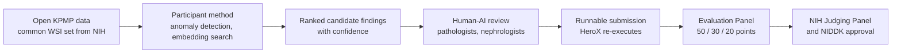

# Kidney Artificial Intelligence Discovery Challenge: From Nebulae to Nephrons

> **Bibkey** `nih-kidney-ai-challenge-2026` · **Venue** NIDDK / NIH (prize challenge, hosted on HeroX) (2026) · **Category** competition · **Relevance** high · **Access** open
> **Link** <https://www.herox.com/KidneyAI> · `status: complete`

---

## One-liner
A US$100,000 NIDDK prize challenge hosted on HeroX: inspired by astronomy, where AI found rare gravitational lenses and other anomalies in archival telescope images, it asks participants to use **only open KPMP Kidney Tissue Atlas data** to **discover previously unrecognized patterns, objects or anomalies** in kidney-biopsy whole-slide images (WSIs), backed by human–AI review with pathologists and nephrologists — the goal is discovery, not classification of known disease states.

## Takeaways
- The goal is **discovery, not classification**: find previously unrecognised patterns, objects or anomalies in KPMP kidney-biopsy whole-slide images and support them with evidence; inspired by AI finding rare gravitational lenses in archival astronomy images (HeroX Overview, Guidelines).
- Only open KPMP Kidney Tissue Atlas data; no controlled data under a data-use agreement; NIH supplies a common image set (HeroX, Statutory Authority).
- Judging, 100 points: discovery and novelty 50, technical approach and performance 30, interpretability and expert usability 20; explicitly asks to separate true findings from staining, preparation and scanner artifacts and to report confidence and failure modes (HeroX, Judging Criteria).
- Timing: submissions 5 Nov 2026 – 29 Apr 2027, winners 1 Sep 2027; US$100,000 total ($50k / $30k / $20k) (HeroX, Dates, Prizes).
- Cash goes only to US citizens/permanent residents (or US entities); non-US people may join an eligible team but cannot receive prize money; no federal funds may be used to develop submissions (HeroX, Eligibility).

## Problem
Kidney disease affects about 35.5 million people in the US, yet major gaps remain in heterogeneity, progression mechanisms, treatment response and early-intervention windows. KPMP has amassed high-quality multi-scale data (WSIs, spatial and molecular data, clinical information) from CKD and AKI patients. The organizers argue that hypothesis-driven analyses and classification-based ML may miss **rare, subtle, spatially complex or out-of-category** patterns, and ask whether "fresh computational eyes" — anomaly detection, semi-supervised learning, similarity search in learned embedding spaces, human–AI collaborative review — can repeat astronomy's success in kidney pathology.

## Method
**Desired solutions** are conceptual, methodological and collaborative, centred on **image-based feature discovery**: detect anomalies, show how computational methods reveal previously unrecognized structures or signals, and provide supporting evidence; optionally explore **patient stratification/reclassification** using image-derived anomalies combined with clinical parameters or other KPMP data. Assigning molecular mechanisms to new features is a longer-term goal, possibly for a future challenge. **Rigorous human–AI collaboration** is emphasized: pathologists, nephrologists and other experts validate and interpret flagged anomalies. **Submissions** (requirements still being finalized): describe each discovery, its supporting evidence and scientific rationale (why rare/novel/meaningful), technical methods and assumptions, validation procedures and reliability measures, and limitations; solutions **must be provided in runnable form** so HeroX can independently execute and verify the findings. **Review**: administrative triage (eligibility, completeness, scope) → scoring by an Evaluation Panel of scientific, technical, clinical and commercialization experts → selection by an NIH Judging Panel (federal employees) → final approval by the Award Approving Official, NIDDK Director Dr. Griffin Rodgers; no individual feedback is provided.

## Method diagram


## Data
**Exclusive use of KPMP data, limited to the publicly available ("open") data in the Kidney Tissue Atlas** — no "controlled" data requiring a data-use agreement. NIH provides all participants with **a common set of eligible KPMP images** rather than participant-supplied images; all public data is de-identified with no PII. The Overview scopes the challenge more broadly ("kidney tissue images, multi-omics data, spatial data, and associated clinical information"), but judging criteria 1 and 2 explicitly score findings **in whole-slide kidney biopsy images** only; criterion 3 scores interpretability and expert usability and explicitly allows image-derived anomalies to be combined with clinical parameters or other KPMP data for patient stratification — which is where spatial, multi-omics and clinical data come in.
<https://www.kpmp.org/available-data>

## Key results
No results yet (launched 15 Sep 2026; currently pre-registration; the HeroX page showed 60 teams on 2026-10-27). **Timeline**: launch 2026-09-15; **submission window 2026-11-05 to 2027-04-29**; judging 2027-04-30 to 2027-06-30; **winners announced 2027-09-01**. **Prizes**: US$100,000 total cash — 1st $50,000, 2nd $30,000, 3rd $20,000; NIDDK may award fewer or none; no non-monetary prize, but winners may be invited as co-authors/contributors to an anticipated publication (and a strategic white paper/roadmap). **Expected outputs**: near-term a cross-disciplinary network, a catalogue of priority anomaly-detection targets in KPMP data, conceptual pipelines and a white paper; medium/long-term technical specifications, data governance, validation studies, and ultimately new disease subtypes, progression markers and treatment-response signatures.

## Contributions
- **Judging criteria (100 points)** — the part of this card to remember:
- **1. Discovery and Novelty (50 pts)**: are identified WSI features rare, unexpected, scientifically meaningful or potentially novel; how strong is the visual/analytical evidence; **does the submission distinguish meaningful discoveries from common background variation, technical artifacts or expected histology**; can findings support new hypotheses. Possible metrics: precision among top-ranked features, expert-confirmed discovery rate, novelty score, rarity frequency, enrichment over baselines, rank of seeded or expert-validated findings.
- **2. Technical Approach and Performance (30 pts)**: ability to detect, rank, retrieve, cluster or localize rare/expert-validated findings rather than classify routine slide-level categories; full workflow documentation; **reducing false positives from staining variation, preparation artifacts, scanner effects and common background**; generalization beyond development data; **confidence/uncertainty/reliability estimates for flagged findings**; identification of ambiguous, borderline, likely-false-positive cases and expected failure modes. Possible metrics: top-k precision, MRR, AP, AUPRC, localization overlap, clustering purity, retrieval accuracy, false-positive rate, reduction of expert review burden, held-out performance, degradation under pre-analytical variability.
- **3. Scientific Interpretability and Expert Usability (20 pts)**: how detected features support patient stratification (with clinical parameters or other KPMP data); why specific slides/regions/patches/clusters/objects were flagged; usefulness of interpretability outputs (heatmaps, localization maps, representative patches, cluster summaries, similarity search, feature descriptions, rationales) for expert review; whether explanations separate true discoveries from artifacts and uncertain cases; whether the team includes/consults kidney-biopsy experts. Possible metrics: expert usability ratings, review time, inter-rater agreement on flagged findings, % outputs with interpretable localization, agreement between model explanations and expert annotations.

## Limitations
- **Eligibility (key)**: individuals must be US citizens or permanent residents to receive a cash prize; a team's Captain must be a US citizen/PR; entities must be incorporated and primarily based in the US. **Non-US citizens/non-PRs may participate as members of an otherwise eligible team but cannot receive any monetary prize (in whole or in part)**; their participation may be recognized when results are announced.
- Other rules: age 18+; federal entities/employees acting in scope, HHS employees (personal capacity), judges and challenge parties and immediate family are ineligible; **no federal grant/cooperative-agreement/contract funds may be used to develop submissions**, and those using federal grant funds must register as an Entity on behalf of the awardee institution; participants grant NIH a nonexclusive, royalty-free worldwide licence to publish and practise the solution while retaining other IP; winners must return verification/payment documents within 10–20 business days of notification.
- Open KPMP data only — non-public data cannot underpin a submission, and controlled data (much of the individual-level omics/clinical detail) is excluded.
- Submission requirements not yet final; mechanism assignment not required (deferred to a future challenge); judged by expert panels, no public leaderboard or fixed ground truth.

## Relation to our direction
Our reading: this is **the artifact-injection topic's external exam**, practically tailored to the **detect** stage: the organizers' language — anomaly detection, embedding similarity search, human–AI review, "distinguish true discoveries from staining/preparation/scanner artifacts", "confidence and failure modes for flagged findings" — maps one-to-one onto the artifact-injection topic's core hypothesis that cross-modal agreement separates artifacts from disease, and onto the expert-validated KidneyAnomalyBench. Concretely: (1) **criteria 1–2 demand suppressing artifact false positives** → rules learned on multi-modal data (H&E paired with single-cell / spatial omics) about "only cross-modally consistent signals count as disease anomalies" can act as a filter/prior on open KPMP WSIs (the submission itself must rely on open KPMP data, but the method can be developed and calibrated on other data — verify how the rules treat development data once requirements are published); (2) the suggested metrics — **rank of seeded or expert-validated findings, top-k precision, reduction in expert review burden** — can become KidneyAnomalyBench's evaluation protocol directly; (3) **criterion 3's patient stratification** corresponds to linking image anomalies to the molecular cell states of Lake 2023 / KPMP (e.g. altered/injured states) — the bridge from detect to **model**. For **the agent-trustworthiness topic**, the requirement that solutions be runnable and independently re-executed by HeroX, plus confidence/reliability estimates, is a concrete venue for claim-to-evidence verification and rerun stability: an agent-assisted discovery pipeline would have to show every finding reproduces on re-run with traceable evidence. **Practical constraint**: cash prizes go only to US citizens/PRs (or US entities); non-US members may join an otherwise eligible team but receive no prize money — participation would require teaming with a US collaborator as Team Captain and confirming no federal funds are used. For the thesis, producing a reproducible anomaly catalogue and evaluation protocol is itself external validation for the artifact-injection topic, independent of winning.

## Reusable assets
- **Challenge page (rules, timeline, FAQ, forum, teams):**
<https://www.herox.com/KidneyAI>
- **Data:** KPMP Kidney Tissue Atlas open data (NIH will provide a common image set).
<https://www.kpmp.org/available-data> · <https://atlas.kpmp.org/>
- **Official announcement:** nih.gov/challenges (returned 403 on access).
<https://www.nih.gov/challenges/kidney-artificial-intelligence-discovery-challenge-nebulae-nephrons>
- **Eval template:** the three judging criteria and suggested metrics, reusable as KidneyAnomalyBench's metric list.

## Follow-ups
- Re-check this card when final submission requirements are published (before the window opens), especially rules on development data, external data and team composition.
- The astronomy precedents (finding gravitational lenses in archival images, embedding similarity search) for transferable methods.
- Inventory the WSIs and paired spatial/single-cell data in KPMP open data, and design stratification against Lake 2023 cell-state annotations.

## Cite
```bibtex
@misc{nih-kidney-ai-challenge-2026,
  title = {Kidney Artificial Intelligence Discovery Challenge: From Nebulae to Nephrons},
  author = {{National Institute of Diabetes and Digestive and Kidney Diseases}},
  howpublished = {NIH prize challenge hosted on HeroX, \url{https://www.herox.com/KidneyAI}},
  year = {2026},
  note = {Launched 15 September 2026; submissions 5 November 2026 -- 29 April 2027; accessed 2026-10-27}
}
```


---

📄 **[AI-ready full-text extract →](ai-ready.md)**
