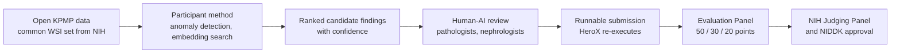

# Kidney Artificial Intelligence Discovery Challenge: From Nebulae to Nephrons

> **文献键** `nih-kidney-ai-challenge-2026` · **来源** NIDDK / NIH (prize challenge, hosted on HeroX)(2026) · **类别** competition · **相关度** high · **获取** open
> **链接** <https://www.herox.com/KidneyAI> · `status: complete`

---

## 一句话
NIDDK 发起、HeroX 承办的 10 万美元奖金挑战赛:借鉴天文学用 AI 在存档望远镜图像中找引力透镜等稀有异常的经验,要求参赛者**只用 KPMP Kidney Tissue Atlas 的公开(open)数据**,在肾活检全切片图像(WSI)中**发现以往未识别的形态模式/对象/异常**,并以病理与肾内科专家的人机协同复核来支撑这些发现 —— 目标是"发现",而不是对已知疾病做分类。

## 要点
- 目标是**发现**而不是分类:在 KPMP 肾活检全切片图像里找出以往未识别的形态模式、对象或异常,并给出证据;灵感来自天文学用 AI 在存档图像中找到稀有引力透镜(HeroX Overview, Guidelines)。
- 只能用 KPMP Kidney Tissue Atlas 的公开(open)数据,不得用需数据使用协议的 controlled 数据;NIH 提供统一的图像集(HeroX, Statutory Authority)。
- 评审 100 分:发现与新颖性 50、技术方法与表现 30、可解释性与专家可用性 20;明确要求区分真发现与染色、制片、扫描仪伪影,并给出置信度与失败模式(HeroX, Judging Criteria)。
- 时间:提交窗口 2026-11-05 至 2027-04-29,2027-09-01 公布获奖;奖金共 10 万美元(5 万 / 3 万 / 2 万)(HeroX, Dates, Prizes)。
- 现金奖只发给美国公民/永久居民(或美国实体);非美国人可作为合格团队的成员参加,但不能分得奖金;不得用联邦资助开发提交物(HeroX, Eligibility)。

## 研究问题
美国约 3,550 万人患肾病,但疾病异质性、进展机制、治疗反应与早期干预窗口仍有大量空白。KPMP 已积累 CKD 与 AKI 患者的高质量多尺度数据(WSI、空间与分子数据、临床信息)。主办方认为,传统的假设驱动分析和基于分类的机器学习,可能漏掉**稀有、细微、空间复杂或落在现有疾病类别之外**的模式,因此想看"新鲜的计算之眼"(异常检测、半监督学习、学习到的 embedding 空间里的相似性检索、人机协同审阅)能否在肾脏病理中复制天文学的成功。

## 方法
**期望的解决方案**是概念性、方法学与协作性的:以**基于图像的特征发现**为核心 —— 检测异常、展示计算方法如何揭示此前未识别的结构或信号,并提供支持证据;可选地探索如何用图像衍生的异常结合临床参数或其他 KPMP 数据对患者**分层/重新分类**。为新特征指派分子机制是更长期目标,可能留给后续挑战。强调**严谨的人机协同**:由病理、肾内科等领域专家验证与解读计算发现的异常。**提交物**(要求仍在定稿):逐条描述发现、给出支持证据与科学理由(为何稀有/新颖/有意义)、技术方法与假设、验证程序与可靠性度量、局限性;并且**必须以可运行形式提供**,以便 HeroX 独立执行并复现所报告的发现。**评审流程**:行政初筛(资格、完整性、范围)→ 由科学、技术、临床与商业化专家组成的 Evaluation Panel 打分 → NIH Judging Panel(联邦雇员)选出获奖者 → NIDDK 主任 Griffin Rodgers 博士最终批准;不向参赛者提供个别评审意见。

## 方法图


## 数据
**只允许使用 KPMP 数据,且仅限 Kidney Tissue Atlas 中的公开(open)数据** —— 不得使用需签数据使用协议的 controlled 数据。NIH 会向所有参赛者提供**一套统一的合格 KPMP 图像**,而不是让参赛者自带图像;所有公开数据已去标识化,不含 PII。评审标准明确针对**肾活检 WSI**;KPMP 数据还包括空间、多组学与临床信息,可用于分层分析。
<https://www.kpmp.org/available-data>

## 主要结果
尚无结果(挑战于 2026 年 9 月 15 日发布,当前为预注册阶段;2026-10-27 HeroX 页面显示 60 个 team)。**时间线**:发布 2026-09-15;**提交窗口 2026-11-05 至 2027-04-29**;评审 2027-04-30 至 2027-06-30;**公布获奖者 2027-09-01**。**奖金**:总额 10 万美元现金 —— 第一名 5 万、第二名 3 万、第三名 2 万;NIDDK 可少发或不发;无非现金奖品,但获奖者可能被邀请作为预期出版物(以及战略白皮书/路线图)的共同作者或贡献者。**预期产出**:短期形成跨学科研究者网络、KPMP 数据中优先异常检测目标的目录、概念性分析流程和战略白皮书;中长期用于技术规范、数据治理、验证研究,最终发现新的疾病亚型、进展标志物与治疗反应特征。

## 创新点
- **评审标准(满分 100)** —— 这是本卡最该记住的部分:
- **1. Discovery and Novelty(50 分)**:WSI 中识别出的特征是否稀有、意外、有科学意义或可能新颖;视觉/分析证据有多强;**能否把有意义的发现与常见背景变异、技术伪影或预期的组织学所见区分开**;能否支撑新的生物学/病理/临床/影像假设。可能的量化指标:top-ranked 特征的 precision、专家确认的发现率、novelty score、稀有频率、相对基线方法的富集、植入(seeded)或专家验证发现的排名位置。
- **2. Technical Approach and Performance(30 分)**:检测、排序、检索、聚类或定位稀有/专家验证发现的能力,而非对常规 slide 级类别分类;完整记录流程;**降低由染色变异、制片伪影、扫描仪效应和常见组织背景造成的假阳性**;泛化到开发数据之外;**为标记的发现给出置信度/不确定性/可靠性估计**;识别模糊病例、边界发现、可能假阳性与预期失败模式。可能指标:top-k precision、MRR、AP、AUPRC、定位重叠、聚类纯度、检索准确率、假阳性率、专家审阅负担的降低、held-out 测试表现、预分析变异下的性能退化。
- **3. Scientific Interpretability and Expert Usability(20 分)**:如何用检测到的特征支持患者分层(结合临床参数或其他 KPMP 数据);为何标记某些 slide/区域/patch/簇/对象;解释输出(热图、定位图、代表性 patch、簇摘要、相似性检索、特征描述、简明理由)对专家复核的用处;解释是否足以区分真发现、伪影与不确定病例;团队是否包含或咨询能评估肾活检的专家。可能指标:专家可用性评分、审阅耗时、标记发现的评分者间一致性、可解释定位比例、模型解释与专家标注的一致性。

## 局限
- **资格限制(关键)**:个人须为美国公民或永久居民才有资格获得现金奖;团队的 Team Captain 须为美国公民/永久居民;实体须在美国注册并以美国为主要营业地。**非美国公民/非永久居民可以作为符合条件团队的成员参赛,但不能获得任何(全部或部分)现金奖金**,其贡献可在公布结果时被认可。
- 其他规则:须年满 18 岁;联邦实体/在职履职的联邦雇员、HHS 雇员(以个人身份)、评委及挑战相关方及其直系亲属不可获奖;**不得使用联邦资助(grant / cooperative agreement / contract)开发提交物**,使用联邦 grant 资金者须以 Entity 身份代表受资助机构参赛;参赛即授予 NIH 非独占、免版税的全球许可(发布与实施方案),但保留其他知识产权;获奖者须在通知后 10–20 个工作日内提交核验与付款文件。
- 只允许 open KPMP 数据 —— 不能使用自有数据(例如我们的 95 例活检)作为提交依据;controlled 数据(含大部分个体层面组学/临床细节)不可用。
- 提交要求尚未最终公布;对机制解释不做要求(留给未来挑战);评审为专家打分,无公开排行榜或固定 ground truth。

## 与本研究方向的关系
我们的理解:这是**课题 1 的"外部考场"**,几乎是为本方向的 **detect** 一环量身定做:主办方用的语言 —— 异常检测、embedding 相似性检索、人机协同审阅、"区分真发现与染色/制片/扫描伪影"、"为标记的发现给置信度与失败模式" —— 与课题 1 的核心假设"跨模态一致性区分伪影与疾病"和"专家验证的 KidneyAnomalyBench"一一对应。具体映射:(1) **评审第 1、2 项要求压低伪影假阳性** → 我们在 95 例自有活检(H&E + snRNA/snATAC/Xenium)上学到的"跨模态一致才算疾病异常"的规则,可以作为在 open KPMP WSI 上的过滤器/先验(提交本身只能用 open KPMP 数据,但方法可在自有数据上开发与校准 —— 需注意规则对"开发数据"的界定,应在提交要求公布后核实);(2) **"seeded 或专家验证发现的排名位置""top-k precision""专家审阅负担降低"** 这几个建议指标,可以直接成为 KidneyAnomalyBench 的评测协议;(3) **评审第 3 项的患者分层**,对应把图像异常与 Lake 2023 / KPMP 的分子细胞状态(如 altered/injured states)关联 —— 这一步也是从 detect 走向 **model** 的桥。对**课题 2(分析 agent 的结论核查)**,评审要求"可运行、可被 HeroX 独立复现"与"置信度/可靠性估计",恰是 claim-to-evidence 校验与 rerun stability 的落地场景:一个 agent 辅助的发现流程若要提交,必须能证明每条发现都能被重跑复现、证据可追溯。**实际约束**:奖金只发给美国公民/永久居民(或美国注册实体),非美国成员只能作为符合条件团队的成员参与而不得奖金 —— 若要参赛需与美国合作者(由其担任 Team Captain)组队,并确认不使用联邦资金;对学位论文而言,"参赛并产出可复现的异常目录与评测协议"本身即可作为课题 1 的外部验证,不以获奖为前提。

## 可复用资产
- **挑战页(规则、时间线、FAQ、论坛、组队):**
<https://www.herox.com/KidneyAI>
- **数据:** KPMP Kidney Tissue Atlas 公开数据(NIH 将提供统一图像集)。
<https://www.kpmp.org/available-data> · <https://atlas.kpmp.org/>
- **官方公告:** nih.gov/challenges(本次访问 403)。
<https://www.nih.gov/challenges/kidney-artificial-intelligence-discovery-challenge-nebulae-nephrons>
- **评测协议模板:** 三项评审标准及其建议指标,可直接借作 KidneyAnomalyBench 的指标清单。

## 待读
- 提交要求正式发布后(开放提交前)重新核对本卡,尤其是对开发数据、外部数据和团队构成的规定。
- 天文学异常检测先例(存档图像中找引力透镜、embedding 相似性检索),看能迁移哪些方法。
- 盘点 KPMP open 数据里有哪些 WSI 与配套空间/单细胞数据,对照 Lake 2023 的细胞状态注释设计分层分析。

## 引用
```bibtex
@misc{nih-kidney-ai-challenge-2026,
  title = {Kidney Artificial Intelligence Discovery Challenge: From Nebulae to Nephrons},
  author = {{National Institute of Diabetes and Digestive and Kidney Diseases}},
  howpublished = {NIH prize challenge hosted on HeroX, \url{https://www.herox.com/KidneyAI}},
  year = {2026},
  note = {Launched 15 September 2026; submissions 5 November 2026 -- 29 April 2027; accessed 2026-10-19}
}
```


---

📄 **[AI-ready 全文提取 →](ai-ready.md)**
