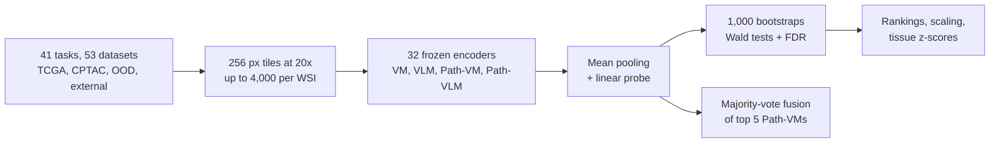

# A benchmark study of vision and pathology foundation models for computational pathology

> **Bibkey** `Bareja_2026` · **Venue** Nature Communications (2026) · **Category** foundation · **Relevance** high · **Access** open
> **Link** <https://doi.org/10.1038/s41467-026-76004-6> · `status: complete`

---

## One-liner
This Stanford (Gevaert lab) benchmark evaluates 32 foundation models in four categories — general vision (VM), general vision-language (VLM), pathology vision (Path-VM) and pathology vision-language (Path-VLM) — all frozen with only a linear probe trained, on 41 tasks, 53 datasets and >17,500 WSIs. Path-VMs lead but differences among the top models are mostly non-significant, Path-VMs beat Path-VLMs, neither model size nor pretraining data size consistently predicts downstream performance, and majority-vote ensembling improves aggregate performance (Abstract).

## Takeaways
- Top five Path-VMs: mean TCGA AUROC Virchow2 0.830, Prov-GigaPath 0.829, H-optimus-0 0.824, UNI 0.824, UNI2 0.824; non-TCGA Virchow2 0.836, UNI 0.835 (Fig. 1b–c). The five show no significant differences on TCGA in AUROC/AUPRC/sensitivity/specificity (Wald tests; Supplementary Fig. 4).
- Differences appear at patch level: on 8 external patch tasks Virchow2 has mean AUROC 0.962, significantly above UNI, UNI2, Prov-GigaPath and H-optimus-0 (FDR p < 0.001) (Fig. 2b,d).
- Path-VMs significantly beat Path-VLMs (TCGA, CPTAC, external; not fully OOD slide tasks), but are **not significantly different** from general VMs — the authors read the Path-VM edge as consistency and frequent top-10 placement, not uniform superiority (Fig. 3a; Results).
- Scale: bigger models (ViT-S→ViT-L) and more pretraining data help mainly on TCGA (especially multi-class tasks); effects on external and OOD data are small and non-significant (Fig. 4; Results §"Scaling").
- Ensembling: majority-vote fusion of the top 5 ranks 1st on TCGA cumulative balanced accuracy (0.702 vs Virchow2 0.696) and 2nd on non-TCGA (Virchow2 first at 0.712); per-task tests show no significant difference from single models (Fig. 5a–c).
- Our reading: the key lesson for us is "top pathology encoders differ little and rankings shift out of domain" — the backbone choice matters less than validating on our own out-of-domain data (e.g. Aachen kidney biopsies).

## Problem
Pathology foundation models are often pretrained on TCGA or a single institution's proprietary data and may overfit to those datasets instead of generalising across institutions, stains and scanners (Introduction). Earlier benchmarks (refs. 50, 51) mainly compared pathology-specific encoders over a limited set of cancers or task types (mostly weakly supervised classification). Questions: under one protocol, which of the four categories is strongest; how much does pathology-specific pretraining buy; do conclusions hold outside TCGA (which may be in the pretraining data); and what do scale and ensembling contribute?

## Method
1) **Preprocessing**: H&E WSIs are tiled at 20× (0.5 µm/px) into non-overlapping 256×256 tiles, background removed by Otsu thresholding, up to 4,000 tiles per WSI, stored in HDF5; external patch benchmarks use their own png images (Methods §"Whole slide image preprocessing").
2) **Feature extraction**: tiles are resized to each model's native input (224×224 for most); all 32 models are frozen and features are extracted once per task (Methods §"Model evaluation").
3) **Slide aggregation + linear probe**: a bag of tile features is mean-pooled and passed to one linear layer; lr 0.001, batch 16 per GPU, 30 epochs, no augmentation; 4× A100 40GB. TCGA / CPTAC / OOD use a 70/30 patient-level train/hold-out split; external patch benchmarks use their predefined splits and are classified per patch without aggregation (Methods).
4) **Metrics and uncertainty**: AUROC, AUPRC, sensitivity, specificity; 1,000 test-set bootstraps for 95% CIs (Methods §"Statistical analysis").
5) **Pairwise comparison**: per bootstrap, the AUROC difference between two models; its empirical variance gives a Wald test; p-values are FDR-corrected (threshold 0.05); results form win/loss matrices with performance score = (wins − losses)/(wins + losses) (figure legends; Methods writes the denominator as wins + losses + 1). Category and scale-group comparisons use Welch t-tests + FDR; scaling effects are summarised with Cohen's d and Spearman correlation (Methods).
6) **Scale groups**: architecture ViT-S (21M) / ViT-B (85M) / ViT-L (>300M); pretraining data small (<0.1M WSIs) / medium (0.1–1M) / large (≥1M) (Fig. 4).
7) **Ensemble**: predictions of the top five non-TCGA models (Virchow2, H-optimus-0, Prov-GigaPath, UNI, UNI2) combined by untrained majority vote, compared with single models by balanced accuracy (Results §"Model ensembling").

## Method diagram


## Data
41 tasks / 53 datasets / >17,500 WSIs covering diagnosis (subtyping, grading, staging), biomarker status, transcriptomic subtypes and pathway activity (Introduction; Methods). **TCGA (19 tasks, treated as in-domain)**: e.g. LGG/GBM IDH mutation (884 train / 368 test), transcriptomic subtypes, BRCA ER/PR/PAM50, BLCA subtyping, PRAD ERG fusion, pan-cancer grading, pathway and immune groups; **kidney**: 4-class RCC subtyping ccRCC / ChRCC / PRCC1 / PRCC2 (194 train / 80 test). **CPTAC (7 pan-cancer tasks)**: grade, SWI/SNF, p53, chromatin modification, mTOR, MYC pathways, 7-class tumour type (includes CCRCC; 441 train / 175 test). **OOD (slide level)**: Stanford in-house lung and brain cohorts (e.g. lung squamous vs adenocarcinoma, GBM MGMT methylation), NLST, DHMC. **External patch benchmarks (8)**: BRACS, BACH, UniToPatho, SICAPv2, BreakHis, LC25000, MHIST, NCT-CRC-HE.

## Key results
- **Path-VM ranking**: top five mean TCGA AUROC Virchow2 0.830 (95% CI 0.784–0.875), Prov-GigaPath 0.829, H-optimus-0 0.824, UNI 0.824, UNI2 0.824; non-TCGA Virchow2 0.836, UNI 0.835, H-optimus-0 0.832, Prov-GigaPath 0.827, UNI2 0.824 (Fig. 1b–c). Per-task wins: Virchow2 5 and UNI2 3 of 19 TCGA tasks; Virchow2 6 and H-optimus-0 5 of 22 non-TCGA tasks (Fig. 1d–e).
- **Statistically hard to separate**: the five top models do not differ significantly on TCGA in any metric; on non-TCGA the only significant difference is Virchow2 vs UNI2 sensitivity; none after grouping by tumour type (Results; Supplementary Figs. 3–4).
- **Slide vs patch**: on 14 non-TCGA slide tasks UNI is first at 0.761 ± 0.083 with no significant differences among top models; on 8 patch tasks Virchow2 0.962 ± 0.033, UNI2 0.953, Prov-GigaPath 0.949, with some significant pairwise differences (Fig. 2a–d). The authors attribute this to patch tasks probing fine-grained representations without MIL aggregation (Discussion).
- **Categories**: Path-VM significantly beats Path-VLM (except OOD slide tasks); Path-VM vs VM is not significant; Path-VM share of top-10 slots is 0.55 (168/304) on TCGA, 0.53 (106/224) on CPTAC+OOD, 0.52 (66/128) on external (Fig. 3; Results).
- **Scale**: for TCGA multi-class tasks, small→medium and small→large data gave significant gains (effect sizes ≈0.25–0.30) but medium→large did not; external and OOD tasks showed small, non-significant effects throughout (Fig. 4b; Results).
- **Ensemble**: fusion is first on TCGA cumulative balanced accuracy at 0.702 ± 0.111 (Virchow2 0.696); on non-TCGA Virchow2 is first at 0.712 and fusion second at 0.699; per-task differences vs single models are not significant. Rank shifts: UNI 5th→3rd, UNI2 6th→9th, Virchow 7th→10th from TCGA to non-TCGA (Fig. 5a–b; Results).
- **Tissue preferences** (z-scores): CONCH strongest on lung tasks, Virchow2 on colon and prostate, H-optimus-0 on pan-cancer, UNI on brain and bladder, Prov-GigaPath robust on breast, bladder and lung (Fig. 5f); significant differences appear only in colon (Supplementary Fig. 24).

## Contributions
- Breadth: 32 models × 4 categories × 41 tasks × 53 datasets under one frozen-feature + linear-probe protocol (Abstract).
- Explicit separation of TCGA (in-domain) from non-TCGA evaluation, and a slide- vs patch-level comparison (Introduction; Discussion).
- Tasks beyond weakly supervised classification, including pathway activity and transcriptomic subtypes (Introduction).
- Every comparison has bootstrap Wald tests + FDR, with all inferential statistics released (Supplementary Data 1–15).
- An online leaderboard (PathBench) and MIT-licensed code.

## Limitations
- Authors: frozen features + linear probe only — representation quality, not the fine-tuned ceiling (Discussion).
- Authors: overlap of public data (TCGA, CPTAC) with pretraining corpora cannot be excluded and may inflate in-domain results; NLST and DHMC are not reported as pretraining data, but this cannot be verified (Discussion; Methods).
- Authors: scaling uses coarse proxies (parameters, slide counts) ignoring data composition and quality; analyses are correlational (Discussion).
- Authors: slide-level mean pooling may dilute localised signals (Discussion).
- Our reading: tasks are almost all tumour-related (subtype, grade, mutation, pathway); kidney appears only as TCGA RCC subtyping and the CCRCC class in CPTAC tumour type; no non-tumour disease and no anomaly-detection task. Many slide-level test sets have tens to a few hundred cases, so CIs are wide.
- Our reading: naming clash — ref. 60 (Ma et al., arXiv 2505.20202) is a different benchmark also called "PathBench"; this paper's site is pathbench.stanford.edu.

## Relation to our direction
Our reading: this paper is not one of the detect → model → revert stages but the **evaluation layer**, with three direct uses for Topic 1. **First, backbone choice**: Virchow2, UNI2, UNI, Prov-GigaPath and H-optimus-0 form one tier with mostly non-significant gaps, and rankings change outside TCGA — for kidney H&E it is better to extract 2–3 feature sets and compare them on Aachen data, or ensemble, than to pick a "best" encoder in advance. **Second, a protocol template**: frozen features + a simple head as an honest baseline, explicit in-domain vs out-of-domain splits, bootstrap + pairwise tests + FDR rather than bare means — directly transferable to a kidney anomaly-detection benchmark (replace the linear probe with kNN / density anomaly scorers). **Third, the gap**: none of the 41 tasks is non-tumour disease or anomaly detection, and kidney appears only as RCC — exactly what Topic 1 fills. Caveat: PathBench compares supervised classification only and does not show which encoder is best for unsupervised anomaly detection.

## Reusable assets
- **Code** (MIT; parts adapted from facebookresearch/dino, Apache-2.0; includes processed results and figure source data; archived on Zenodo, doi 10.5281/zenodo.20618270):
<https://github.com/gevaertlab/benchmarking-path-models>
- **Live benchmark:** the PathBench leaderboard.
<https://pathbench.stanford.edu/>
- **Data:** TCGA (GDC portal), CPTAC (CPTAC Data Portal), NLST (TCIA), DHMC and 8 public patch benchmarks; Stanford in-house cohorts are not public (Data availability).
- **Model inventory:** Tables 2–5 list SSL method, architecture, parameters, WSI and patch counts and data source for all 32 models — a handy lookup table.
- **Eval protocol:** 256 px tiles at 20×, mean pooling + linear probe (lr 0.001, 30 epochs), patient-level 70/30 split, 1,000 bootstraps, Wald + FDR win/loss matrices, majority-vote fusion.

## Follow-ups
- The prior benchmarks it compares with (refs. 50, 51) and Ma et al.'s other "PathBench" (ref. 60; lung, breast, gastric, colorectal, brain cancers).
- Original papers for Virchow2 (predecessor `virchow-2024` is in the library), Prov-GigaPath and H-optimus-0.
- Supplementary Tables 3–8: tissue composition of each model's pretraining data — which models have seen kidney tissue.
- Run the repo with the linear probe replaced by anomaly scorers, on non-tumour kidney tasks.

## Cite
```bibtex
@article{Bareja_2026, title={A benchmark study of vision and pathology foundation models for computational pathology}, volume={17}, ISSN={2041-1723}, url={http://dx.doi.org/10.1038/s41467-026-76004-6}, DOI={10.1038/s41467-026-76004-6}, number={1}, journal={Nature Communications}, publisher={Springer Science and Business Media LLC}, author={Bareja, Rohan and Carrillo-Perez, Francisco and Zheng, Yuanning and Pizurica, Marija and Nandi, Tarak Nath and Tian, Lu and Shen, Jeanne and Madduri, Ravi and Gevaert, Olivier}, year={2026}, month=July }
```


---

📄 **[AI-ready full-text extract →](ai-ready.md)**
