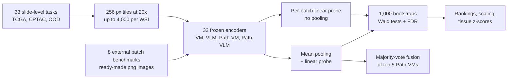

# A benchmark study of vision and pathology foundation models for computational pathology

> **文献键** `Bareja_2026` · **来源** Nature Communications(2026) · **类别** foundation · **相关度** high · **获取** open
> **链接** <https://doi.org/10.1038/s41467-026-76004-6> · `status: complete`

---

## 一句话
这篇 Stanford(Gevaert 组)的 benchmark 把 32 个基础模型分成四类——通用视觉 VM、通用视觉-语言 VLM、病理专用视觉 Path-VM、病理专用视觉-语言 Path-VLM——全部冻结、只训 linear probe,在 41 个任务、53 个数据集、17,500+ 张 WSI 上统一评测:Path-VM 稳居前列但头部模型之间差异多不显著,Path-VM 优于 Path-VLM,模型规模和预训练数据量都不能稳定预测下游表现,多数投票集成在总体上进一步提升(Abstract)。

## 要点
- 头部五个 Path-VM:TCGA 平均 AUROC Virchow2 0.830、Prov-GigaPath 0.829、H-optimus-0 0.824、UNI 0.824、UNI2 0.824;非 TCGA 上 Virchow2 0.836、UNI 0.835(Fig. 1b–c)。五者在 TCGA 上 AUROC/AUPRC/灵敏度/特异度均无显著差异(Wald 检验;Supplementary Fig. 4)。
- 差异在 patch 级任务上才显现:8 个外部 patch 任务中 Virchow2 平均 AUROC 0.962,与 UNI、UNI2、Prov-GigaPath、H-optimus-0 的差异显著(FDR p < 0.001)(Fig. 2b,d)。
- Path-VM 显著优于 Path-VLM(TCGA、CPTAC、外部基准;完全 OOD 的 slide 任务除外),但与通用 VM 相比**没有统计显著差异**——作者把 Path-VM 的优势解释为"稳定、常进前十",而非一致的统计优势(Fig. 3a;Results)。
- 规模:模型变大(ViT-S→ViT-L)和预训练数据变多主要在 TCGA(尤其多分类任务)上有收益;在 CPTAC 二分类任务上有小幅显著收益;在外部和 OOD 数据上效应小且不显著(Fig. 4;Results §"Scaling")。
- 集成:5 个头部模型多数投票的 fusion 在 TCGA 累计 balanced accuracy 第 1(0.702 vs Virchow2 0.696)、非 TCGA 第 2(Virchow2 0.712 第 1);逐任务检验与单模型无显著差异(Fig. 5a–c)。
- 我们的理解:对我们最重要的是"头部病理编码器差异小、域外排名会变"——选 backbone 不必纠结,但必须在目标域外数据(如独立的肾活检队列)上验证。

## 研究问题
病理基础模型常用 TCGA 或单一机构的专有数据预训练,可能对特定数据集过拟合,而不是真正跨机构、染色、扫描仪泛化(Introduction)。已有 benchmark(refs. 50, 51)主要只比病理专用编码器,覆盖的癌种或任务类型有限(多为弱监督分类)。作者要回答:在统一协议下,四类模型谁更强?病理专用预训练带来多少收益?这些结论离开 TCGA(可能已进入预训练数据)后是否成立?规模和集成各起什么作用?

## 方法
1) **预处理**:H&E WSI 在 20×(0.5 µm/px)切成不重叠的 256×256 tile,Otsu 阈值去背景,每张 WSI 最多取 4,000 个 tile,存 HDF5;外部 patch 基准直接用其 png(Methods §"Whole slide image preprocessing")。
2) **特征提取**:tile resize 到各模型原生输入(多数为 224×224),32 个模型全部冻结,每个任务只提一次特征(Methods §"Model evaluation")。
3) **slide 级聚合 + linear probe**:一袋 tile 特征取平均(mean pooling),接一个线性层;lr 0.001、每 GPU batch 16、30 epoch、无数据增强;4 张 A100 40GB。TCGA / CPTAC / OOD 按患者 70/30 划分训练与留出测试;外部 patch 基准用其预定义划分,逐 patch 分类不聚合(Methods)。
4) **指标与不确定性**:AUROC、AUPRC、灵敏度、特异度;测试集 bootstrap 1,000 次得 95% CI(Methods §"Statistical analysis")。
5) **两两比较**:每次 bootstrap 算两模型 AUROC 差,用其经验方差做 Wald 检验,p 值做 FDR 校正(阈值 0.05);汇总成胜负矩阵,performance score =(wins − losses)/(wins + losses)(图注;Methods 中分母写作 wins + losses + 1)。类别间与规模分组间比较用 Welch t 检验 + FDR,规模效应用 Cohen's d 和 Spearman 相关(Methods)。
6) **规模分组**:架构 ViT-S(21M)/ ViT-B(85M)/ ViT-L(>300M);预训练数据 small(<0.1M WSI)/ medium(0.1–1M)/ large(≥1M)(Fig. 4)。
7) **集成**:取非 TCGA 排名前五(Virchow2、H-optimus-0、Prov-GigaPath、UNI、UNI2)的预测,不可训练的多数投票,用 balanced accuracy 与单模型比较(Results §"Model ensembling")。

## 方法图


## 数据
41 个任务 / 53 个数据集 / >17,500 张 WSI,任务类型包括诊断(分型、分级、分期)、生物标志物状态、转录组亚型、通路活性(Introduction;Methods)。**TCGA(19 个任务,视为 in-domain)**:如 LGG/GBM IDH 突变(训练 884 / 测试 368)、转录组亚型、BRCA ER/PR/PAM50、BLCA 分型、PRAD ERG 融合、泛癌分级、通路与免疫分组;**肾脏**:RCC 四分类 ccRCC / ChRCC / PRCC1 / PRCC2(训练 194 / 测试 80)。**CPTAC(7 个泛癌任务)**:分级、SWI/SNF、p53、染色质修饰、mTOR、MYC 通路、7 类肿瘤类型(含 CCRCC,训练 441 / 测试 175)。**OOD(slide 级)**:Stanford 院内肺与脑肿瘤队列(如肺鳞癌 vs 腺癌、GBM MGMT 甲基化)、NLST、DHMC。**外部 patch 基准(8 个)**:BRACS、BACH、UniToPatho、SICAPv2、BreakHis、LC25000、MHIST、NCT-CRC-HE。

## 主要结果
- **Path-VM 排名**:TCGA 平均 AUROC 前五为 Virchow2 0.830(95% CI 0.784–0.875)、Prov-GigaPath 0.829、H-optimus-0 0.824、UNI 0.824、UNI2 0.824;非 TCGA 为 Virchow2 0.836、UNI 0.835、H-optimus-0 0.832、Prov-GigaPath 0.827、UNI2 0.824(Fig. 1b–c)。逐任务第一:TCGA 19 个任务中 Virchow2 5 个、UNI2 3 个;非 TCGA 22 个中 Virchow2 6 个、H-optimus-0 5 个(Fig. 1d–e)。
- **统计上难分高下**:五个头部模型在 TCGA 上各项指标无显著差异;非 TCGA 上唯一显著差异是 Virchow2 vs UNI2 的灵敏度;按肿瘤类型分组后也无显著差异(Results;Supplementary Figs. 3–4)。
- **slide 级 vs patch 级**:14 个非 TCGA slide 任务上 UNI 0.761 ± 0.083 第一,头部模型间无显著差异;8 个 patch 任务上 Virchow2 0.962 ± 0.033、UNI2 0.953、Prov-GigaPath 0.949,部分两两差异显著(Fig. 2a–d)。作者解释:patch 任务没有 MIL 聚合,更直接反映细粒度表征(Discussion)。
- **类别比较**:Path-VM 显著优于 Path-VLM(OOD slide 任务除外);Path-VM 与 VM 无显著差异;Path-VM 占前十名位置的比例 TCGA 0.55(168/304)、CPTAC+OOD 0.47(106/224;Fig. 3b 图注与 Methods 为 0.47;Results 正文写作 0.53,但 106/224 = 0.47)、外部 0.52(66/128)(Fig. 3;Results)。
- **规模**:TCGA 多分类任务上数据从小到中、从小到大有显著收益(效应量约 0.25–0.30),中到大不显著;CPTAC 二分类任务从小到中在 AUROC 和灵敏度上有小幅显著收益(效应量约 0.25–0.40),CPTAC 多分类无显著收益;外部与 OOD 任务所有比较效应小且不显著(Fig. 4b;Results)。
- **集成**:fusion 在 TCGA 累计 balanced accuracy 0.702 ± 0.111 第一(Virchow2 0.696);非 TCGA Virchow2 0.712 第一、fusion 0.699 第二;逐任务与单模型均无显著差异。排名漂移:UNI 从 TCGA 第 5 升到非 TCGA 第 3,UNI2 第 6→第 9,Virchow 第 7→第 10(Fig. 5a–b;Results)。
- **组织偏好**(z-score):CONCH 在肺相关任务最强,Virchow2 强在结肠和前列腺,H-optimus-0 强在泛癌,UNI 强在脑和膀胱,Prov-GigaPath 在乳腺、膀胱、肺稳健(Fig. 5f);仅结肠组织中存在显著差异(Supplementary Fig. 24)。Discussion 给的列表略有不同:Virchow2 强在结肠、肺、前列腺,Prov-GigaPath 强在乳腺和膀胱,H-optimus-0 强在泛癌,UNI 强在脑、膀胱和乳腺。

## 创新点
- 覆盖面:32 个模型 × 4 个类别 × 41 个任务 × 53 个数据集,统一冻结特征 + linear probe 协议(Abstract)。
- 显式区分 TCGA(in-domain)与非 TCGA 评测,并比较 slide 级与 patch 级设置(Introduction;Discussion)。
- 任务超出弱监督分类,包括通路活性和转录组亚型预测(Introduction)。
- 每个比较都有 bootstrap Wald 检验 + FDR,并公开全部推断统计(Supplementary Data 1–15)。
- 在线排行榜 PathBench 与 MIT 许可代码。

## 局限
- 作者:只做冻结特征 + linear probe,反映表征质量而非微调后的上限(Discussion)。
- 作者:公开数据(TCGA、CPTAC)与预训练数据的重叠无法完全排除,可能抬高 in-domain 成绩;NLST、DHMC 未被报告用于预训练,但无法独立核实(Discussion;Methods)。
- 作者:规模分析用参数量、切片数等粗代理,未考虑数据组成和质量;分析是相关性的(Discussion)。
- 作者:slide 级用简单 mean pooling,可能稀释局部判别信号(Discussion)。
- 我们的理解:任务几乎全是肿瘤相关(分型、分级、突变、通路);肾脏出现在 TCGA RCC 四分类任务中,另外 CPTAC 的 6 个泛癌任务(SWI/SNF、p53、染色质修饰、mTOR、MYC、肿瘤类型)覆盖包括 CCRCC 在内的 7 种癌;CPTAC 分级任务正文未列出癌种;没有肾脏专门的非肿瘤任务;没有非肿瘤疾病,也没有异常检测类任务。很多 slide 级任务测试集只有几十到几百例,置信区间宽。
- 我们的理解:名称易混——参考文献 60(Ma et al., arXiv 2505.20202)是另一个也叫 "PathBench" 的 benchmark;本文的在线站点是 pathbench.stanford.edu。

## 与本研究方向的关系
我们的理解:这篇不属于 detect → model → revert 的某一环,而是**评测层**,对课题 1 有三点直接用处。**其一,选 backbone**:Virchow2、UNI2、UNI、Prov-GigaPath、H-optimus-0 是同一梯队,差异多不显著,而且离开 TCGA 排名会变——对肾脏 H&E,与其事先挑"最好"的编码器,不如同时提 2–3 套特征,在目标肾脏数据上比较,或做集成。**其二,协议模板**:冻结特征 + 简单头作为诚实基线、in-domain 与域外显式切分、bootstrap + 两两检验 + FDR 而非只报均值——这些可以直接搬到肾脏异常检测 benchmark(把 linear probe 换成 kNN / 密度等异常打分器)。**其三,空白**:41 个任务里没有非肿瘤疾病和异常检测任务,肾脏只以 RCC 出现——这正是课题 1 要补的位置。注意:PathBench 只比较监督分类,不能直接说明哪个编码器做无监督异常检测最好。

## 可复用资产
- **代码**(MIT 许可;部分改编自 facebookresearch/dino,Apache-2.0;含处理后的结果和图源数据;Zenodo 存档 doi 10.5281/zenodo.20618270):
<https://github.com/gevaertlab/benchmarking-path-models>
- **在线 benchmark:** PathBench 排行榜。
<https://pathbench.stanford.edu/>
- **数据:** TCGA(GDC portal)、CPTAC(CPTAC Data Portal)、NLST(TCIA)、DHMC 以及 8 个公开 patch 基准;Stanford 院内队列不公开(Data availability)。
- **模型清单:** Table 2–5 列出 32 个模型的 SSL 方法、架构、参数量和数据来源;WSI 数、patch 数只在 Table 2(16 个 Path-VM)中给出。可作选型速查表。
- **评测协议:** 256 px @20× tile、mean pooling + linear probe(lr 0.001、30 epoch)、患者级 70/30 划分、1,000 次 bootstrap、Wald + FDR 胜负矩阵、多数投票 fusion。

## 待读
- 对比的既有 benchmark(refs. 50、51)和 Ma et al. 的另一个 "PathBench"(ref. 60,肺、乳腺、胃、结直肠、脑五种癌)。
- Virchow2(本库已有 `virchow-2024` 的前代)、Prov-GigaPath、H-optimus-0 的原文。
- Supplementary Tables 3–8:各模型预训练数据的组织组成——看哪些模型见过肾组织。
- 试跑 repo,把 linear probe 换成异常打分器,接入非肿瘤肾脏任务。

## 引用
```bibtex
@article{Bareja_2026, title={A benchmark study of vision and pathology foundation models for computational pathology}, volume={17}, ISSN={2041-1723}, url={http://dx.doi.org/10.1038/s41467-026-76004-6}, DOI={10.1038/s41467-026-76004-6}, number={1}, journal={Nature Communications}, publisher={Springer Science and Business Media LLC}, author={Bareja, Rohan and Carrillo-Perez, Francisco and Zheng, Yuanning and Pizurica, Marija and Nandi, Tarak Nath and Tian, Lu and Shen, Jeanne and Madduri, Ravi and Gevaert, Olivier}, year={2026}, month=jul }
```


---

📄 **[AI-ready 全文提取 →](ai-ready.md)**
